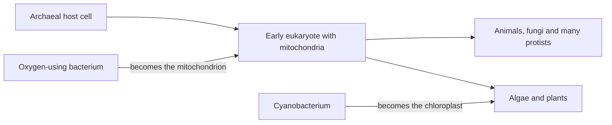

The last lesson showed how species split and how trees record those splits. This lesson zooms out to the whole tree over the whole of Earth's history: when life began, how its major groups appeared, and how mass extinctions repeatedly reset the board. The challenge is the scale of time. Human history is a few thousand years; the history of life is billions.

## Deep time and the geologic time scale

Earth formed about 4.54 billion years ago, a date measured by radiometric dating (lesson 26) of meteorites and the oldest Earth and Moon rocks. Geologists divide that span into the **geologic time scale**, a set of named intervals. The largest are eons, divided into eras, which are divided into periods. Many boundaries were drawn in the 1800s, before anyone could date rocks, at places where the fossils change sharply, often because of a mass extinction. Radiometric dating later put numbers on them.

| Eon or era | Time (million years ago) | Highlights |
|---|---|---|
| Hadean eon | 4,540–4,000 | Earth forms; no rock record of life |
| Archean eon | 4,000–2,500 | First prokaryotes; stromatolites |
| Proterozoic eon | 2,500–539 | Oxygen builds up; first eukaryotes; first multicellular life |
| Paleozoic era | 539–252 | Cambrian explosion; fish; plants and animals move onto land |
| Mesozoic era | 252–66 | Age of reptiles: dinosaurs; first mammals, birds and flowering plants |
| Cenozoic era | 66–now | Age of mammals; humans |

The Paleozoic, Mesozoic and Cenozoic together form the Phanerozoic eon ("visible life"), the time of abundant animal fossils. Everything before it is informally called the Precambrian, nearly 90% of Earth's history. The timeline below draws the eons to scale, then zooms in on the Phanerozoic.

### Example 1

Squeeze Earth's 4.54 billion years into one 24-hour day, with Earth forming at midnight. At what time does the Cambrian explosion (539 million years ago) happen? When do modern humans (about 300,000 years ago) appear?

Each hour stands for $4{,}540 \div 24 \approx 189$ million years. The time elapsed before the Cambrian is $4{,}540 - 539 = 4{,}001$ million years, so

$$\text{clock time} = 24 \times \frac{4{,}001}{4{,}540} \approx 21.15 \text{ hours},$$

about 9:09 p.m. Animals with hard parts fill only the last three hours of the day.

Modern humans: $\dfrac{0.3}{4{,}540} \times 24$ hours $\approx 0.0016$ hours $\approx 6$ seconds before midnight.

## How life began

The origin of life is an active research question, and scientists are open about what is still unknown. What is well established:

- Early Earth had almost no free oxygen. In 1953 Stanley Miller and Harold Urey ran electric sparks through a mixture of gases thought to resemble the early atmosphere, with water, and within a week found amino acids. Later experiments under a range of conditions have made sugars, nucleotide bases and other building blocks, showing that the molecules of life can form without life.
- RNA can both store information (like DNA) and act as a catalyst (like an enzyme); the rRNA that links amino acids in your ribosomes (lesson 23) is an example. This supports the RNA world hypothesis: early life may have used RNA for both jobs before DNA and proteins took over.
- Fatty molecules spontaneously form hollow bubbles with membrane-like walls, a possible first step toward cells.

## The first three billion years

The earliest widely accepted fossils are about 3.5 billion years old: microscopic cells and stromatolites, layered mounds built by mats of bacteria. For more than a billion years after that, all life was prokaryotic.

Cyanobacteria evolved oxygen-releasing photosynthesis. Their oxygen at first reacted with dissolved iron, forming rust-red banded rock layers, but by about 2.4 billion years ago it began to build up in the air, the Great Oxidation Event. Oxygen was poisonous to many microbes, but it made aerobic respiration possible, with its much larger ATP yield (module 3).

Eukaryotes appear around 2 billion years ago (estimates range from about 1.6 to 2.1). They arose from a partnership between the two older branches of the tree (lesson 29). The host was most likely an archaeon related to today's Asgard archaea, and it took in an oxygen-using bacterium that became the mitochondrion. Later, one eukaryote lineage that already had mitochondria took in a cyanobacterium, which became the chloroplast of algae and plants. This is the endosymbiotic theory from module 2: mitochondria and chloroplasts have their own circular DNA and bacterial-type ribosomes, and divide by splitting like bacteria. Multicellular algae appear over a billion years ago, and soft-bodied animals by about 575 million years ago.

Then, starting about 539 million years ago, the Cambrian explosion: within roughly 20 to 25 million years, most of the major animal groups alive today appear in the fossil record, many with shells, skeletons and eyes. Predators and prey drove one another's evolution, and hard parts fossilize well, so the record suddenly becomes rich.

## Life moves onto land

Plants reached land around 470 million years ago, followed by arthropods. Four-limbed vertebrates evolved from lobe-finned fish roughly 390 to 360 million years ago; *Tiktaalik* (lesson 26), about 375 million years old, shows the transition under way. The amniotic egg, which doesn't dry out, freed reptiles from water around 320 million years ago. Dinosaurs appear about 230 million years ago, mammals not long after, birds evolve from small feathered dinosaurs around 150 million years ago, and flowering plants spread from about 130 million years ago.

## Mass extinctions

Species go extinct all the time, at a low background rate. A **mass extinction** is a geologically brief event in which a large fraction of species dies out worldwide. The fossil record shows five:

| Extinction | About when (million years ago) | Leading explanation |
|---|---|---|
| End-Ordovician | 445 | Glaciation and falling sea level |
| Late Devonian | 372 | Ocean oxygen loss; several pulses |
| End-Permian | 252 | Huge volcanic eruptions in Siberia; warming, acidic, low-oxygen oceans |
| End-Triassic | 201 | Volcanic eruptions as the supercontinent Pangaea split |
| End-Cretaceous | 66 | Asteroid impact at Chicxulub, Mexico, plus volcanic eruptions in India |

The end-Permian was the worst: by most estimates 80 to 90 percent or more of marine species vanished. The end-Cretaceous is the best known. In 1980 Luis and Walter Alvarez reported a thin clay layer at the boundary, worldwide, rich in iridium, a metal rare in Earth's crust but common in asteroids. A buried crater of the right age, about 180 km across, was later found at Chicxulub. Non-bird dinosaurs, along with many other groups, disappeared.

### Example 2

A cliff shows these layers, from bottom to top: (1) sandstone with trilobite fossils; (2) a volcanic ash layer dated at 260 million years; (3) shale with early dinosaur fossils; (4) an iridium-rich clay layer; (5) rock with fossils of early primates. Put the events in order and estimate their ages.

- By superposition, lower layers are older: trilobites, then the ash, then dinosaurs, then the iridium layer, then primates.
- The trilobites are older than 260 million years (they lie below the dated ash). That fits the fossil record, since trilobites died out in the end-Permian extinction, 252 million years ago.
- The dinosaurs are younger than 260 million years; the iridium layer matches the end-Cretaceous boundary, 66 million years ago, and the primates come after it.

Two separate tools, rock order and radiometric dates, have to agree, and they do.

Extinctions also open opportunities. After the end-Cretaceous, mammals, which had been mostly small for over 100 million years, diversified rapidly into the empty roles, an adaptive radiation that produced whales, bats, primates and grazers. Many biologists warn that human activity is now driving extinction rates far above the background rate (module 10).

## The tempo of evolution

How fast does change happen? Darwin pictured gradualism: slow, steady change, with species changing little by little. In 1972 Niles Eldredge and Stephen Jay Gould pointed out that many fossil species stay nearly unchanged for millions of years, then are replaced fairly quickly (geologically speaking: tens of thousands of years) by related species. They called this pattern **punctuated equilibrium**. Today both patterns are recognized: some lineages change gradually, others show long stability broken by rapid change, often tied to speciation in small populations or to environmental upheaval.

## Common mistakes

- Thinking humans and dinosaurs lived at the same time. Non-bird dinosaurs died out 66 million years ago; modern humans appeared about 300,000 years ago.
- Assuming life was complex from the start. For more than a billion years after the first fossils, all organisms were single-celled prokaryotes.
- Thinking oxygen was always in the air. It accumulated only after about 2.4 billion years ago, produced by photosynthesis.
- Treating punctuated equilibrium as sudden appearance overnight. "Rapid" here means tens of thousands of years, quick only compared to millions.
- Forgetting that a fossil's age often comes from the volcanic layers around it, so it is a range (older than the layer above, younger than the layer below).

## Key points

- Earth is about 4.54 billion years old; the geologic time scale divides that time into eons, eras and periods, with boundaries often at mass extinctions.
- Experiments show life's building blocks can form without life; the RNA world hypothesis suggests RNA came before DNA and proteins.
- Prokaryotes by 3.5 billion years ago; oxygen buildup about 2.4 billion; eukaryotes about 2 billion (an archaeal host plus a bacterium that became the mitochondrion); the Cambrian explosion about 539 million years ago.
- Five mass extinctions, the worst at the end of the Permian; the end-Cretaceous impact ended the non-bird dinosaurs and opened the way for mammals.
- Evolution can be gradual or follow punctuated equilibrium: long stability broken by relatively rapid change.
