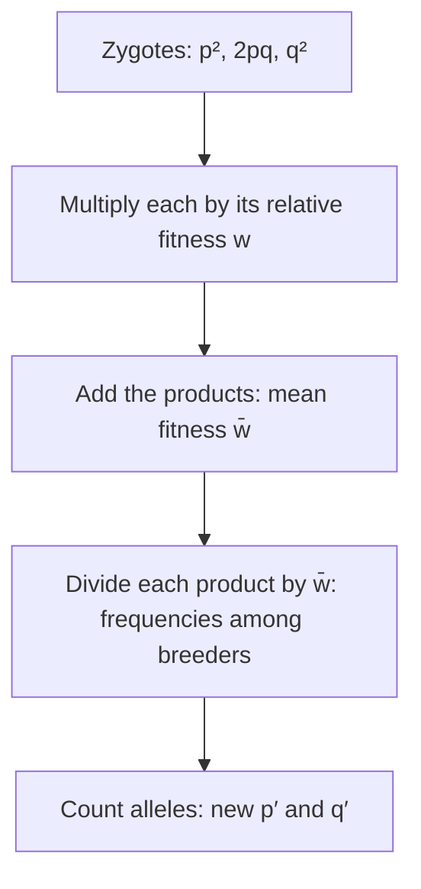

Lesson 28 set up Hardy-Weinberg equilibrium as a null model and named the forces that push a population away from it. It described those forces in words. This lesson turns two of them, natural selection and genetic drift, into numbers you can calculate with, and then shows how to test real genotype counts against Hardy-Weinberg using the chi-square test from lesson 21. These are the same tools R. A. Fisher, J. B. S. Haldane and Sewall Wright built in the 1920s and 1930s when they joined Mendel's genetics to Darwin's selection, the core of what is called the modern synthesis. You will need the Hardy-Weinberg equations and allele counting from lesson 28.

## Measuring fitness with numbers

Lesson 27 defined fitness as reproductive success. To calculate with it, start from **absolute fitness**: the average number of offspring that an individual of a given genotype leaves in the next generation (counting only offspring that survive to breed). Absolute numbers depend on how good a year it was, so population geneticists compare genotypes instead. The **relative fitness** $w$ of a genotype is its absolute fitness divided by the absolute fitness of the best genotype:

$$w = \frac{\text{absolute fitness of the genotype}}{\text{absolute fitness of the fittest genotype}}$$

The fittest genotype has $w = 1$, and every other genotype has $w$ between 0 and 1. The **selection coefficient** $s = 1 - w$ measures how much worse a genotype does. A genotype with $w = 0.8$ has $s = 0.2$: it leaves 20% fewer offspring than the best genotype.

For example, if $AA$ and $Aa$ plants each leave 50 seeds that grow into adults on average and $aa$ plants leave 30, then $w_{AA} = w_{Aa} = 1$, $w_{aa} = 30/50 = 0.6$, and $s = 0.4$ against $aa$. Because $Aa$ has the same fitness as $AA$, selection here acts only on the recessive phenotype.

## One generation of selection

Selection changes allele frequencies because genotypes contribute unequally to the next generation. The calculation always follows the same steps:



The sum in the third step is the **mean fitness** of the population, $\bar w = p^2 w_{AA} + 2pq\,w_{Aa} + q^2 w_{aa}$. Dividing by it rescales the survivors' frequencies so they add up to 1 again. The new frequency of $a$ is the frequency of $aa$ breeders plus half the frequency of $Aa$ breeders:

$$q' = \frac{q^2 w_{aa} + pq\,w_{Aa}}{\bar w}$$

### Example 1

A population starts at $p = q = 0.5$, in Hardy-Weinberg proportions. Fitnesses are $w_{AA} = w_{Aa} = 1$ and $w_{aa} = 0.6$. Find $q$ after one generation of selection.

| | $AA$ | $Aa$ | $aa$ | Total |
|---|---|---|---|---|
| Zygotes | 0.25 | 0.50 | 0.25 | 1 |
| Times $w$ | $0.25 \times 1 = 0.25$ | $0.50 \times 1 = 0.50$ | $0.25 \times 0.6 = 0.15$ | $\bar w = 0.90$ |
| Breeders (divide by 0.90) | 0.278 | 0.556 | 0.167 | 1 |

New $q' = 0.167 + \tfrac12(0.556) = 0.444$. One generation of fairly strong selection ($s = 0.4$) lowered $q$ from 0.500 to 0.444.

Now repeat with the same fitnesses but starting from $q = 0.1$. Then $q^2 = 0.01$, so very few individuals are $aa$, and $\bar w = 1 - 0.4(0.01) = 0.996$. The new $q' = \dfrac{0.01(0.6) + 0.09}{0.996} = 0.0964$, a drop of only 0.0036. Most copies of a rare recessive allele sit in heterozygotes, where selection cannot see them. The graph shows the change in $q$ per generation for every starting $q$:

```plot
{"x": [0, 1], "y": [-0.08, 0.005], "xLabel": "q (frequency of allele a)", "yLabel": "change in q per generation", "functions": [{"f": "-0.4*x^2*(1-x)/(1-0.4*x^2)"}], "caption": "Selection against aa with s = 0.4. The change is largest near q = 0.7 and nearly zero when q is small."}
```

This is why harmful recessive alleles linger in populations for a very long time, and why selection can almost never remove them completely. New mutations add copies at a low rate, and the two processes can balance.

## Heterozygote advantage

Sometimes the heterozygote is the fittest genotype. This **heterozygote advantage** keeps both alleles in the population, an example of **balancing selection**. The best-studied case in humans is sickle-cell hemoglobin. People with two copies of the sickle allele ($SS$) have sickle-cell disease. Carriers ($AS$) have no disease in most conditions and are partly protected against severe malaria, caused by the parasite *Plasmodium falciparum*. People with $AA$ are not protected.

### Example 2

Take illustrative relative fitnesses for a region where malaria is common: $w_{AA} = 0.88$, $w_{AS} = 1$, $w_{SS} = 0.20$. (They are of the size estimated in classic studies; real values vary from place to place and have changed with medical care.) Start with $q = 0.05$ for $S$.

- Zygotes: $AA$ $0.9025$, $AS$ $0.0950$, $SS$ $0.0025$.
- Times $w$: $0.7942$, $0.0950$, $0.0005$; mean fitness $\bar w = 0.8897$.
- New $q' = \dfrac{0.0005 + \tfrac12(0.0950)}{0.8897} = 0.054$.

The $S$ allele rose even though $SS$ has very low fitness, because at this frequency almost every $S$ copy is in a protected carrier. It won't rise forever: as $q$ grows, more $S$ copies end up in $SS$ individuals. Writing $s = 1 - w_{AA} = 0.12$ and $t = 1 - w_{SS} = 0.80$, the frequency stops changing at

$$\hat q = \frac{s}{s + t} = \frac{0.12}{0.92} \approx 0.13.$$

At that point an $S$ allele and an $A$ allele leave, on average, the same number of copies. Frequencies of the sickle allele of roughly 0.1 or more are found in parts of sub-Saharan Africa where malaria has long been common, and the allele is rare where malaria never was. Where malaria disappears, $w_{AA}$ rises to 1, the advantage vanishes, and selection slowly lowers $q$.

## Genetic drift in numbers

Each generation, the $2N$ gene copies passed on by $N$ breeding adults are a random sample of the parents' gene pool. On average the sample keeps the same allele frequency, but it rarely matches exactly. The typical size of the change in one generation is about $\sqrt{pq/2N}$: with $p = 0.5$, that is 0.11 for $N = 10$ but only 0.025 for $N = 200$.


The figure shows eight simulated populations of each size, all starting at $p = 0.5$ with no selection. In the small populations every line soon hits 0 (the allele is lost) or 1 (it is fixed). **Fixation** means an allele has reached a frequency of 1, so it is the only allele left at that gene; only a new mutation or gene flow can bring variation back. For a neutral allele, the chance that drift eventually fixes it equals its current frequency: an allele at 0.2 is fixed in about 20% of populations and lost in the other 80%. A brand-new mutation, one copy among $2N$, has only a $\tfrac{1}{2N}$ chance.

Drift also steadily removes genetic variation. In an idealized population of $N$ breeders, the expected heterozygosity $H$ (the fraction of individuals that are heterozygous at a gene) shrinks each generation by a factor of $\left(1 - \tfrac{1}{2N}\right)$:

$$H_t = H_0\left(1 - \frac{1}{2N}\right)^t$$

### Example 3

Two populations start with heterozygosity $H_0 = 0.5$ at a gene. One has 25 breeders, the other 500. Ignoring mutation, gene flow and selection, what is the expected heterozygosity after 50 generations?

- $N = 25$: $\left(1 - \tfrac{1}{50}\right)^{50} = 0.98^{50} = 0.364$, so $H_{50} = 0.5 \times 0.364 = 0.18$.
- $N = 500$: $\left(1 - \tfrac{1}{1000}\right)^{50} = 0.951$, so $H_{50} = 0.48$.

The small population lost almost two-thirds of its variation in 50 generations; the large one lost about 5%. This is why conservation biologists worry about small, isolated populations even when nothing is selecting against them.

## Effective population size

The formulas above assume an idealized population: constant size, equal numbers of males and females, and every adult equally likely to be a parent. Real populations break all three assumptions, so biologists use the **effective population size** $N_e$: the size of an idealized population that would lose variation by drift at the same rate. $N_e$ is almost always smaller than the census count.

- *Unequal sex ratio.* With $N_m$ breeding males and $N_f$ breeding females, $N_e = \dfrac{4N_m N_f}{N_m + N_f}$. In northern elephant seals a few dominant males father most pups: 10 breeding males and 90 females give $N_e = \dfrac{4(10)(90)}{100} = 36$, not 100.
- *Unequal family sizes.* When some adults leave many offspring and most leave few, fewer lineages are passed on, and $N_e$ drops.
- *Changing size.* Over several generations, $N_e$ is the harmonic mean of the sizes, which is pulled strongly toward the smallest.

### Example 4

A population of 1,000 crashes to 10 in one bad generation and then recovers: sizes over five generations are 1,000, 1,000, 10, 1,000, 1,000. The ordinary average is 802. The effective size is

$$N_e = \frac{5}{\tfrac{1}{1000} + \tfrac{1}{1000} + \tfrac{1}{10} + \tfrac{1}{1000} + \tfrac{1}{1000}} = \frac{5}{0.104} \approx 48.$$

One generation at 10 made the whole stretch behave like a population of about 48. That is the bottleneck effect from lesson 28 in numbers. The founder effect works the same way: 5 founders carry only 10 gene copies, so an allele at 1% in the source population has only a $1 - 0.99^{10} \approx 10\%$ chance of being carried at all, and if it is carried, its frequency jumps to at least $\tfrac{1}{10}$.

Drift and selection act together. A rough rule (a simplification of Kimura's theory) is that selection controls an allele's fate when $s$ is much larger than $\tfrac{1}{2N_e}$, while an allele with a smaller $s$ behaves almost as if it were neutral. In a small population, even a mildly harmful allele can drift to fixation.

## Testing Hardy-Weinberg with chi-square

To test whether a population fits Hardy-Weinberg proportions at a gene, you need to count every genotype, so the trait must be codominant or typed from DNA. The steps:

1. Estimate $p$ and $q$ from the observed counts.
2. Expected counts: $p^2 N$, $2pqN$, $q^2 N$.
3. $\chi^2 = \sum \dfrac{(O - E)^2}{E}$ over the three genotypes.
4. Degrees of freedom: 3 categories $- 1$, minus 1 more because $p$ was estimated from the same data. So df $= 1$, and the critical value at $p = 0.05$ is 3.84.

### Example 5

In a sample of 1,000 people typed for the MN blood group (codominant alleles $M$ and $N$): 298 $MM$, 489 $MN$, 213 $NN$. Is this consistent with Hardy-Weinberg?

- $p_M = \dfrac{2(298) + 489}{2{,}000} = \dfrac{1{,}085}{2{,}000} = 0.5425$, $q_N = 0.4575$.
- Expected: $MM$ $0.2943 \times 1{,}000 = 294.3$; $MN$ $2(0.5425)(0.4575)(1{,}000) = 496.4$; $NN$ $0.2093 \times 1{,}000 = 209.3$.
- $\chi^2 = \dfrac{3.7^2}{294.3} + \dfrac{(-7.4)^2}{496.4} + \dfrac{3.7^2}{209.3} \approx 0.05 + 0.11 + 0.07 = 0.22$.

$0.22 < 3.84$: fail to reject. The data are consistent with Hardy-Weinberg proportions. Compare a sample of 200 with 70 $AA$, 60 $Aa$, 70 $aa$: $p = 0.5$, expected 50, 100, 50, and $\chi^2 = 8 + 16 + 8 = 32$, far above 3.84. That heterozygote shortage points to inbreeding, or to a sample that mixes two populations with different allele frequencies.

Failing to reject does not prove that no evolution is happening. Weak selection or a few generations of drift can leave genotype proportions close to Hardy-Weinberg, and small samples can miss real departures.

## Common mistakes

- Using absolute offspring numbers as $w$. Divide by the fittest genotype's number first, so the best genotype has $w = 1$.
- Forgetting to divide by $\bar w$. Without it, the breeders' genotype frequencies don't add up to 1 and $q'$ comes out wrong.
- Using df $= 2$ for a Hardy-Weinberg test. One more degree of freedom is lost because $p$ was estimated from the same counts.
- Running chi-square on frequencies or percentages instead of counts.
- Thinking an allele fixed by drift must have been helpful. In small populations neutral and even mildly harmful alleles are often fixed by chance.
- Taking the census count as $N$ in drift formulas. Unequal sex ratios, unequal family sizes and past crashes make $N_e$ much smaller.
- Expecting selection to wipe out a harmful recessive allele quickly. Once it is rare, it hides in heterozygotes and declines very slowly.

## Key points

- Relative fitness $w$ = a genotype's offspring number divided by the best genotype's; selection coefficient $s = 1 - w$.
- One generation of selection: multiply $p^2$, $2pq$, $q^2$ by their $w$, divide by $\bar w$, then count alleles: $q' = (q^2 w_{aa} + pq\,w_{Aa})/\bar w$.
- Selection against a recessive phenotype slows down as the allele becomes rare; heterozygote advantage holds both alleles at $\hat q = s/(s + t)$, as with sickle-cell hemoglobin and malaria.
- Drift: a neutral allele is fixed with probability equal to its frequency; heterozygosity falls as $H_t = H_0(1 - \tfrac{1}{2N})^t$.
- Effective population size $N_e$ is usually below the census size; over time it is the harmonic mean of the sizes, dominated by bottlenecks.
- Chi-square test of Hardy-Weinberg: expected counts from the estimated $p$, df $= 1$, critical value 3.84.
