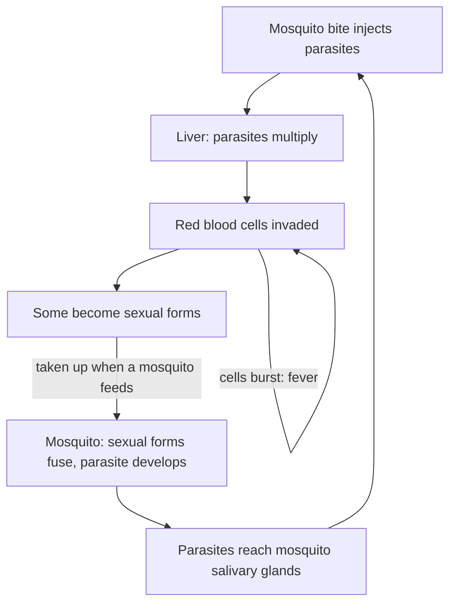

## Into the eukaryotes

The last lesson covered the two domains of cells without a nucleus. Everything else alive, from yeast to redwoods to you, belongs to the third domain, Eukarya. Plants and animals get the next two lessons. This one covers the eukaryotes that are neither: the enormously varied protists, and the fungi, which turn out to be closer relatives of animals than of plants.

## Protists: a group defined by what it isn't

A **protist** is any eukaryote that isn't a plant, an animal or a fungus. Most are single-celled, some form colonies, and a few, such as giant kelp, are large and multicellular. That definition is a leftover from older classification. DNA studies show that protists don't form one branch of the tree: some are closer to plants, some to animals and fungi, and many sit on deep branches of their own. Biologists still use "protist" as a convenient word, but it isn't a natural group, and modern classifications split protists among several supergroups.

Because the label covers so much, it helps to sort protists by how they live, while remembering that these are lifestyles, not family trees:

| Lifestyle | How they get food | Examples |
|---|---|---|
| Plant-like (algae) | Photosynthesis with chloroplasts | Diatoms, green algae, kelp (a brown alga) |
| Animal-like (often called protozoa) | Eat other cells or absorb nutrients | *Amoeba*, *Paramecium*, *Plasmodium* |
| Fungus-like | Absorb nutrients from decaying or living matter | Slime molds, water molds |

Some protists blur even these lines. *Euglena* photosynthesizes in light but can absorb food in the dark.

### How protists move

Single-celled protists move in three classic ways, each tied to a structure you met in the cell module:

- Pseudopods ("false feet"): an amoeba pushes out extensions of cytoplasm and flows into them. The same extensions surround and engulf food.
- Cilia: a *Paramecium* is covered in thousands of short, hair-like cilia that beat in coordinated waves.
- Flagella: a few long whip-like flagella pull or push the cell, as in *Euglena* and many algae.

### Why protists matter

Photosynthetic protists and cyanobacteria in the oceans, the phytoplankton, carry out roughly half of all photosynthesis on Earth. Every other breath you take uses oxygen they released, and they form the base of most ocean food chains. Diatoms build glassy silica shells; their fossil remains are mined as diatomaceous earth.

Some protists are serious pathogens. Malaria is caused by *Plasmodium*, a single-celled parasite carried by *Anopheles* mosquitoes. The parasite has a complex life cycle: it multiplies in the liver, then repeatedly invades red blood cells and bursts them, which causes the cycles of fever. Some parasites in the blood become sexual forms, which a mosquito swallows when it bites; they fuse in the mosquito, and the cycle continues, as the diagram traces. Malaria still kills hundreds of thousands of people a year, mostly young children in sub-Saharan Africa.

Other protist diseases include African sleeping sickness (*Trypanosoma*, spread by tsetse flies) and the intestinal infection giardiasis (*Giardia*, from contaminated water).

A water mold, *Phytophthora infestans*, destroyed Ireland's potato crops in the 1840s and contributed to a famine that killed about a million people. It was long called a fungus because it grows in threads like one, but its cell walls are made of cellulose rather than chitin and its DNA places it among the protists, near diatoms and brown algae. Looks can mislead; ancestry decides.

### Example 1: designing a protist experiment

A student thinks *Euglena* swim toward light. Design a test and predict the result if she is right.

- Independent variable: light. Cover one half of a dish of *Euglena* culture with foil and leave the other half lit.
- Control everything else: same culture, same temperature, same volume, same time.
- Dependent variable: number of cells in each half after 30 minutes, counted in samples under a microscope.
- Replicate: set up several dishes, and swap which side is covered in half of them so a hidden difference between the sides can't explain the result.

If *Euglena* move toward light, the lit half should have clearly more cells than the dark half in every dish. This makes sense for an organism that photosynthesizes: it has a light-sensing eyespot, and swimming toward light keeps its chloroplasts supplied.

## Fungi: the great absorbers

Fungi include yeasts, molds and mushrooms. For centuries they were lumped with plants because they don't move and often grow from soil. They differ from plants in basic ways:

- Fungi are heterotrophs; they never photosynthesize.
- Their cell walls are made of chitin, the same tough polysaccharide found in insect exoskeletons, not cellulose.
- They store food as glycogen, as animals do, not as starch.

DNA comparisons confirm what these clues suggest: fungi and animals share a more recent common ancestor than either does with plants.

### The body of a fungus

Except for single-celled yeasts, a fungus is built from **hyphae**: thread-like filaments, often only one cell wide. A mass of branching hyphae is a **mycelium**, which spreads through soil, wood or food, mostly unseen. A mushroom is only the fruiting body, a short-lived structure the mycelium pushes up to release spores. Mycelia can be huge: a single honey fungus (*Armillaria*) in an Oregon forest spreads through roughly 9 square kilometers of soil and is among the largest known organisms.

The drawing shows the proportions that matter: the cap, gills and stalk are only the visible tip of a fungus whose mycelium threads through the soil.

Fungi feed by absorption. Hyphae release digestive enzymes into their surroundings, break down food outside the body, and absorb the small molecules. The long, thin hyphae give a huge surface area for that absorption, the same surface-area-to-volume logic you saw for cells.

### Reproduction by spores

Fungi reproduce with spores, tiny cells that can grow into a new individual. Spores can be made asexually (a single mold colony releases millions) or sexually, when hyphae of two compatible mating types fuse. Spores are light and drift on air currents, which is why mold appears on bread that was never touched by moldy food. Yeasts also reproduce asexually by budding.

### What fungi do

- Decomposers. Fungi are among the few organisms that can break down lignin, the tough material in wood. Without them, dead trees and leaves would pile up and their nutrients would stay locked away.
- Partners. Most land plants form **mycorrhizae**, partnerships in which fungal hyphae wrap around or enter roots. The fungus extends the root system and delivers water and minerals such as phosphate; the plant pays in sugars. Fossils suggest such partnerships helped the first plants colonize land. A **lichen** is a partnership between a fungus and a photosynthetic alga or cyanobacterium; it can grow on bare rock and helps begin soil formation.
- Food and medicine. Yeast ferments sugar to make bread rise and to brew. In 1928 Alexander Fleming noticed that a *Penicillium* mold contaminating a bacterial plate had cleared a ring around itself; the substance it made became penicillin, the first widely used antibiotic.
- Pathogens. Fungi cause athlete's foot, ringworm (a fungus, not a worm), and serious infections in people with weakened immune systems. They devastate crops (rusts, smuts) and, in the case of the chytrid fungus *Batrachochytrium*, have caused declines of hundreds of amphibian species worldwide.

### Example 2: reading Fleming's result

Fleming's plate showed bacteria growing everywhere except in a clear zone a few centimeters wide around the mold. Which conclusion does that support, and what further test would strengthen it?

The clear zone surrounds the mold rather than touching it, so something spreading out from the mold, not direct contact, stopped the bacteria. The supported conclusion is that the mold releases a substance that kills or inhibits these bacteria. A stronger test: grow the mold in liquid broth, filter out all the mold, and add the filtered liquid to fresh bacteria, alongside a control of plain broth. If the bacteria fail to grow only with the mold-treated broth, the active agent is a dissolved chemical. Fleming did essentially this, and later Howard Florey and Ernst Chain purified the compound.

### Example 3: which kingdom?

An organism is multicellular, has cell walls made of chitin, cannot photosynthesize, and secretes enzymes into rotting fruit. Classify it.

Chitin walls plus absorptive feeding and no photosynthesis point to a fungus. Cell walls alone don't make something a plant: what matters is the wall material and how the organism gets food.

## Common mistakes

- Calling protists a single evolutionary group. "Protist" is a catch-all for eukaryotes that aren't plants, animals or fungi.
- Saying fungi are plants. Fungi are heterotrophs with chitin walls and are closer relatives of animals.
- Thinking the mushroom is the whole fungus. It's a fruiting body; the mycelium is most of the organism.
- Assuming all algae are plants. Kelp and diatoms are protists; even "blue-green algae" are really cyanobacteria.

## Key points

- Protists are eukaryotes that aren't plants, animals or fungi; they are diverse and not one natural group.
- Protists move by pseudopods, cilia or flagella. Ocean phytoplankton (algae plus cyanobacteria) do about half of Earth's photosynthesis; *Plasmodium* causes malaria.
- Fungi are absorptive heterotrophs with chitin walls, built of hyphae forming a mycelium, and reproduce by spores.
- Fungi decompose wood and litter, form mycorrhizae with most plants and lichens with algae, and include both medicines and pathogens.
