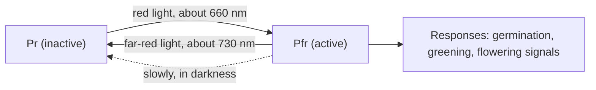
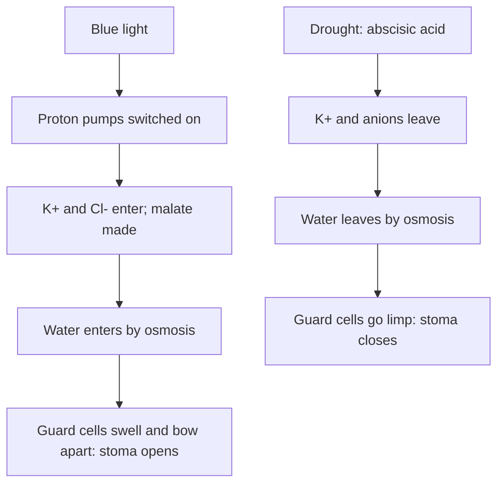

## Coordinating a body without nerves

The plants lesson introduced tropisms, the Darwins' seedlings, Went's agar blocks and the cohesion-tension mechanism, and listed a few other hormones. This lesson goes deeper on each: the experiments that built the hormone story, how plants sense light and measure the night, and the numbers behind pulling water up a 100-meter tree.

Without nerves, a plant responds mostly by changing how and where it grows, coordinated by hormones that work at tiny concentrations, often far from where they are made. The same hormone can have opposite effects in different tissues or at different doses, and many responses depend on the balance between hormones.

| Hormone | Made mainly in | Main effects |
|---|---|---|
| Auxin | Shoot tips, young leaves | Cell elongation, tropisms, apical dominance, root formation |
| Gibberellins | Young tissues, seeds | Stem elongation, seed germination |
| Cytokinins | Roots, dividing tissues | Cell division, shoot formation, delaying leaf aging |
| Abscisic acid | Leaves, roots, seeds | Stomatal closing in drought, seed dormancy |
| Ethylene | Ripening fruit, aging or stressed tissue | Fruit ripening, leaf and fruit drop |

## Auxin: from an "influence" to a molecule

The Darwins showed in 1880 that the tip of a grass coleoptile (the sheath around a seedling's first leaf) senses light and sends an influence down to the region that bends (top row of the figure). In 1913 Peter Boysen-Jensen put a thin layer of gelatin between a cut tip and its stump: the seedling still bent toward light, so the signal could cross a wet, nonliving gap, which suggested a chemical. A sheet of mica pushed into the shaded side stopped bending; on the lit side it didn't. The signal travels down the shaded side.

Frits Went (1926) removed light altogether. An agar block that had held tips, set off-center on a decapitated coleoptile in the dark, made it bend away from the block's side; plain agar did nothing. The bending angle rose with the number of tips used, so curvature could measure the substance, and in the 1930s the main natural **auxin** was identified as indole-3-acetic acid (IAA).

Does one-sided light move auxin to the shaded side (the Cholodny-Went hypothesis) or destroy it on the lit side? Example 1 shows how this was tested. The light is detected by blue-light receptors called phototropins, which is why blue light causes phototropism and red light barely does.

### Example 1: moved or destroyed?

This follows the design of experiments by Winslow Briggs and colleagues on corn coleoptiles from the late 1950s (numbers simplified). Auxin collected in agar blocks under the tips was measured by the curvature it caused in test coleoptiles.

| Setup | Auxin collected (degrees of curvature) |
|---|---|
| A: tip in darkness | 24 |
| B: tip lit from one side | 24 |
| C: lit from one side, tip and block split completely by a barrier | lit half 12, shaded half 12 |
| D: lit from one side, barrier only in the lower part of the tip | lit half 8, shaded half 16 |

- A and B have the same total, so light is not destroying auxin.
- In C, with the tip fully split, the halves are equal: auxin can't cross the barrier.
- In D the top of the tip is connected, and twice as much auxin reaches the shaded side, with the same total ($8 + 16 = 24$). Auxin moved sideways in the upper tip.

The data support lateral redistribution. In some stems of broad-leaved plants the evidence is less clear-cut, so treat the grass coleoptile as the best-studied case rather than the whole story.

### Moving auxin and loosening walls

Auxin moves cell by cell from the shoot tip toward the base. This **polar auxin transport** continues even in an upside-down stem segment, so it isn't gravity. It happens because the carrier proteins that pump auxin out of a cell (PIN proteins) sit mainly in the cell's lower membrane, so each cell hands auxin to the one below.

How does auxin lengthen a cell? By the **acid growth hypothesis**, auxin activates proton pumps that acidify the cell wall; the low pH activates wall-loosening proteins (expansins), and turgor pressure stretches the loosened wall. This is well supported for the fast response. Over hours, auxin also switches genes on by triggering the destruction of repressor proteins.

Auxin's effects depend on tissue and dose. In **gravitropism**, starch-filled organelles settle to the bottom of cells in the root cap and shoot, and auxin is redirected to the lower side. Shoot cells elongate faster with extra auxin, so a sideways shoot curves up. Root cells are far more sensitive, and the same increase slows them, so a sideways root curves down. In **apical dominance**, a growing shoot tip keeps the buds below it dormant. In 1933 Kenneth Thimann and Folke Skoog showed that removing the tip released the side buds and that auxin applied to the cut stump kept them dormant (gardeners pinch tips to get bushier plants). The full mechanism also involves cytokinins, strigolactone hormones and the sugar supply.

## Four more hormones

**Gibberellins** were found through "foolish seedling" disease, in which infected rice grows absurdly tall and topples; in 1926 Eiichi Kurosawa showed that a substance from the fungus caused it. Plants make their own gibberellins, which lengthen stems. Mendel's short peas carry an allele that slows the last step in making active gibberellin, and the semi-dwarf wheat and rice of the 1960s Green Revolution have altered gibberellin production or response: their short, sturdy stems hold heavy grain heads without falling over. In a germinating cereal grain, gibberellin from the embryo signals the cells around the stored starch to make amylase, freeing sugar for the seedling.

**Cytokinins** came from tissue culture. In the 1950s Skoog and Carlos Miller found that cultured tobacco tissue divided only with an added substance, kinetin, first purified from heated DNA. Cytokinins promote cell division, and the auxin-to-cytokinin ratio decides what cultured tissue becomes: high gives roots, low gives shoots, intermediate gives a mass of dividing cells. They also delay the yellowing of aging leaves.

**Abscisic acid** (ABA) is the stress hormone. When soil dries, ABA closes stomata within minutes. It also keeps seeds dormant: corn mutants that can't make ABA sprout while still on the cob. Whether a seed germinates depends largely on the balance of ABA and gibberellin. (The name is a historical mistake; ABA was thought to cause leaf drop, but ethylene is the main trigger.)

**Ethylene** ($\text{C}_2\text{H}_4$) is a gas, first identified as a plant regulator in 1901 when Dimitry Neljubow traced stunted pea seedlings to ethylene leaking from illuminating gas. It triggers ripening in fruits such as bananas and apples, and ripening fruit makes more ethylene, a positive feedback that lets one ripe apple speed up a whole bag. In autumn, falling auxin from aging leaves makes the base of each leaf stalk sensitive to ethylene, and the leaf drops.

## Sensing light and measuring the night

In 1952 Harry Borthwick, Sterling Hendricks and colleagues found that red light (about 660 nm) made certain lettuce seeds germinate and far-red light (about 730 nm) reversed the effect; after alternating flashes, the seeds obeyed the last one. The pigment responsible, **phytochrome**, switches between two forms.

Leaves absorb red but pass far-red, so a small seed under a canopy keeps its phytochrome mostly as Pr and waits for a gap, and shaded seedlings sense the low red to far-red ratio and race upward.

**Photoperiodism** is a response to the relative lengths of day and night. In 1920 Wightman Garner and Harry Allard found that Maryland Mammoth tobacco flowered only when days were short. Plants are grouped as short-day (chrysanthemums, poinsettias, soybeans), long-day (spinach, wheat) and day-neutral (tomatoes). The names mislead: in 1938 Karl Hamner and James Bonner interrupted the long night of cocklebur, a short-day plant, with a brief flash of light, and it didn't flower, while interrupting the day with darkness had no effect. Plants measure uninterrupted darkness. A short-day plant flowers when the night is longer than a **critical night length**; a long-day plant flowers when the night is shorter than its critical night length. Red light is the most effective night break, and far-red right after it cancels the break: phytochrome again.

Leaves sense night length, but flowers form at the shoot tip. In the 1930s grafting showed that a flowering signal crosses graft unions, and Mikhail Chailakhyan named it **florigen**. In 2007 it was identified as a protein (FT) made in leaves that travels in the phloem to the shoot tip.

### Example 2: predicting flowering

Plant S is a short-day plant with a critical night length of 9 hours; plant L is a long-day plant with a critical night length of 11 hours.

| 24-hour schedule | Longest unbroken dark | S (needs > 9 h) | L (needs < 11 h) |
|---|---|---|---|
| 16 h light, 8 h dark | 8 h | No | Yes |
| 8 h light, 16 h dark | 16 h | Yes | No |
| 8 h light, 16 h dark, red flash mid-night | 8 h | No | Yes |
| Same, but red flash then far-red flash | 16 h | Yes | No |
| 14 h light, 10 h dark | 10 h | Yes | Yes |

In row four, far-red converts Pfr back to Pr, so the night counts as unbroken. In the last row both flower: "short-day" and "long-day" describe which side of its own critical value a plant needs, not whether days are under or over 12 hours.

## Water transport by the numbers

Henry Dixon and John Joly proposed the cohesion-tension mechanism in 1894. Why must water be pulled? A suction pump can raise water only about 10.3 m, because suction just lowers the pressure above the water and atmospheric pressure (0.101 MPa) can push a column no higher. Trees reach about 116 m, so their xylem water must be under negative pressure (tension), held together by cohesion.

Cut a transpiring twig and the sap snaps back from the cut; in a pressure chamber, the pressure needed to push it back to the cut surface measures the tension, often 1–2 MPa at midday.

High tension is risky. A gas bubble can form and expand in a conduit, breaking its water column; this **cavitation** (embolism) takes the conduit out of service. Pit membranes between conduits keep bubbles from spreading, but severe drought can kill a tree by embolizing too many conduits.

Roots can also push. At night root cells pump ions into the xylem, water follows by osmosis, and **root pressure** builds, forcing droplets from leaf edges by morning (guttation). It is small (a few tenths of a megapascal at most) and absent in many transpiring trees, so it can't supply a treetop.

At the top, **guard cells** set the rate of water loss. Hoops of cellulose in their walls let them lengthen but not widen, so when they swell they bow apart.

A typical plant loses several hundred water molecules through its stomata for each carbon dioxide molecule it fixes, which is why the C4 and CAM adaptations of module 3 pay off in hot, dry places.

### Example 3: how hard must a redwood pull?

Holding up a water column of height $h$ takes a pressure difference $\rho g h$, with $\rho = 1000$ kg/m³ and $g = 9.81$ m/s². For a 110 m tree:

$$\rho g h = 1000 \times 9.81 \times 110 = 1.08 \times 10^{6} \text{ Pa} = 1.08 \text{ MPa}$$

That's about 0.01 MPa (0.1 bar) per meter. Friction in the conduits adds more; suppose 0.9 MPa along this path. If the soil water is at $\Psi = -0.3$ MPa, the water at the treetop must be at about

$$-0.3 - 1.08 - 0.9 \approx -2.3 \text{ MPa}.$$

Can water survive that? In 1950 the physicist Lyman Briggs found water in a spinning glass tube held together under nearly 28 MPa (about 280 atmospheres), so cohesion is strong enough; in real xylem, cavitation sets in much sooner. A 2004 study of the tallest redwoods found that the growing water stress near the top (which brings the xylem close to cavitation and limits leaf growth and photosynthesis) would cap tree height at roughly 120–130 m. Meanwhile air at 20 °C and 50% humidity has a water potential near $-93$ MPa (lesson 9), a steep slope that the sun keeps pulling water down.

## Common mistakes

- Thinking auxin always promotes growth. The level that speeds shoot elongation slows root elongation.
- Saying light destroys auxin on the lit side. In coleoptiles, auxin moves to the shaded side.
- Believing short-day plants measure day length. They measure unbroken night; a flash of light resets them.
- Thinking root pressure lifts water to treetops. It's far too weak; transpiration pull does the work.
- Crediting abscisic acid with leaf drop. Ethylene triggers it; ABA closes stomata and keeps seeds dormant.

## Key points

- Auxin was found through coleoptile experiments (Darwins, Boysen-Jensen, Went); it moves by polar transport, loosens walls by acid growth, and drives phototropism, gravitropism and apical dominance, with tissue- and dose-dependent effects.
- Gibberellins lengthen stems and trigger cereal germination; cytokinins promote division and, with auxin, shoot or root formation; ABA closes stomata and holds seeds dormant; ethylene ripens fruit and causes leaf drop.
- Phytochrome switches between Pr and active Pfr with red and far-red light, controlling germination, shade responses and photoperiodism.
- Photoperiodic plants compare night length with a critical value; florigen (FT protein) carries the signal from leaves to the shoot tip.
- Xylem water is under tension of about 0.01 MPa per meter of height plus friction; cavitation limits the pull, and root pressure is too weak to matter in tall trees.
