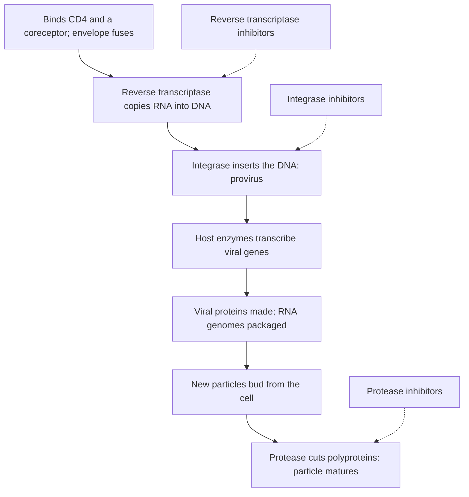

## Small genomes, big consequences

The classification lesson introduced lytic and lysogenic cycles, retroviruses, binary fission and the sideways transfer of genes between bacteria, and lesson 27 showed with replica plating that resistance mutations exist before an antibiotic arrives. This lesson looks inside those processes: how virologists count viruses and measure an infection, how HIV copies itself and why that makes it hard to treat, how viruses evolve, how antibiotics kill bacteria, and how resistance arises and spreads. It ends with the microbes that live on and in us.

## Counting phages and timing an infection

Spread a thin layer of bacteria and a few phages on a nutrient plate. Bacteria grow into a cloudy lawn, but each phage infects a cell, bursts it, and its offspring infect the neighbors, leaving a clear spot called a **plaque**. Each plaque starts from one phage, so plaques are counted as plaque-forming units (PFU), the same logic as counting bacterial colonies.

In 1939 Emory Ellis and Max Delbrück used plaque counts to follow a single round of infection: they let phages attach to bacteria for a few minutes, then diluted the culture so that newly released phages could not quickly find new hosts. The phage count stayed flat during a latent period of about half an hour while the infected cells built new phages, then jumped and leveled off as the cells burst. The size of the jump, the average number of phages released per infected cell, is the **burst size**, often around 100.

### Example 1: a burst size

A culture holds $5.0 \times 10^{5}$ infected cells per mL just after infection. After every cell has burst, a sample is diluted to $10^{-5}$ and 0.1 mL is plated with bacteria, giving 62 plaques. Find the burst size.

- Phages per mL $= \dfrac{62}{10^{-5} \times 0.1} = 6.2 \times 10^{7}$ PFU/mL.
- Burst size $= \dfrac{6.2 \times 10^{7}}{5.0 \times 10^{5}} = 124$ phages per infected cell.

### Lysis or lysogeny?

A temperate phage such as lambda chooses between the two cycles you met earlier. In the lysogenic path, its DNA joins the bacterial chromosome as a **prophage**, and a phage repressor protein keeps the lytic genes switched off. The choice depends on conditions: when several phages infect the same cell, or the host is starving, lysogeny becomes more likely. That makes sense, because those are signs that healthy new hosts are scarce, so riding along inside the current one pays better. When the host's DNA is damaged (by UV light, for example), its emergency repair system destroys the repressor, and the prophage switches to the lytic cycle and escapes a cell that may be dying.

Prophages can change their hosts. In **lysogenic conversion**, genes carried by a prophage give the bacterium new traits. The genes for cholera toxin, diphtheria toxin and the Shiga toxin of dangerous *E. coli* strains all arrive on phages: *Vibrio cholerae* strains that lack the phage don't cause cholera's deadly diarrhea.

## Retroviruses: copying RNA into DNA

HIV infects helper T cells, the coordinators of the immune response. Its cycle runs as follows.



**Reverse transcriptase** is the enzyme that copies the viral RNA into DNA. It has no proofreading, and measured error rates are about 3 mistakes per 100,000 bases copied. HIV's genome is about 9,700 bases, so each new copy carries on average about 0.3 new mutations (roughly one new mutation for every three genomes copied). An untreated patient produces billions of new virus particles a day, so every possible single mutation arises over and over, including ones that resist any single drug.

Once integrated, the viral DNA is a **provirus**, a permanent part of that cell's chromosome. Some infected cells go quiet with the provirus inside, out of reach of drugs that act only on replicating virus. This hidden reservoir is why antiretroviral drugs control HIV but don't cure it. Since 1996, combinations of drugs from different classes have kept the virus suppressed for decades; people whose virus is suppressed to undetectable levels don't transmit it sexually. Example 3 shows the arithmetic behind combination therapy.

Retroviruses have also shaped our own genome. About 8% of human DNA consists of remnants of ancient retroviruses that infected the germ line of our ancestors. Most are broken, but a few have been put to work: a protein our placenta uses to fuse cells comes from an old retroviral envelope gene.

## How viruses evolve

Viruses evolve fast because they have huge populations, generations measured in hours, and, for most RNA viruses, no proofreading. (Coronaviruses are an exception: they have a proofreading enzyme, one reason they mutate more slowly than flu.) Influenza shows two modes of change:

- **Antigenic drift**: point mutations gradually change the surface proteins hemagglutinin (H) and neuraminidase (N), so antibodies from past infections or vaccines fit less well. This is why the flu vaccine is updated every year.
- **Antigenic shift**: the influenza genome comes in eight separate RNA segments. When two strains, such as a bird strain and a human strain, infect the same cell, segments can be mixed into a new combination with a surface protein few people have met. Shifts produced the 1957 and 1968 pandemics, and the 2009 H1N1 pandemic virus was a reassortant of swine, bird and human lineages.

Many new human viruses come from animals. HIV-1, for example, descends from a chimpanzee virus that crossed into people in central Africa in the early twentieth century.

## How antibiotics work

An antibiotic works by hitting something bacteria have and our cells lack, or have in a different form.

| Target | Examples | Why our cells are spared |
|---|---|---|
| Peptidoglycan wall synthesis | Penicillins, cephalosporins, vancomycin | Human cells have no peptidoglycan |
| Bacterial (70S) ribosomes | Tetracyclines, macrolides, streptomycin | Our cytoplasmic ribosomes (80S) differ |
| DNA gyrase (relieves the twisting of DNA during copying) | Ciprofloxacin and other fluoroquinolones | Our version of the enzyme differs |
| Folate synthesis | Sulfonamides | We get folate from food |

Some antibiotics kill bacteria (bactericidal); others stop growth and leave the immune system to clear the infection (bacteriostatic). The lowest concentration that stops visible growth in a lab test is the **minimum inhibitory concentration** (MIC), and doctors compare a strain's MIC with the levels a drug reaches in the body to decide whether the strain counts as resistant. Because our mitochondria descend from bacteria, their ribosomes resemble bacterial ones, which explains some side effects of ribosome-targeting drugs.

## How resistance arises

### By mutation

Do bacteria mutate in response to a threat, or do mutations arise at random? In 1943 Salvador Luria and Max Delbrück answered with the fluctuation test, before the Lederbergs' replica plating.

### Example 2: reading a fluctuation test

Ten small cultures were each grown from a few cells, and each whole culture was spread on a plate covered with a phage that kills normal *E. coli*. Separately, ten equal samples were taken from one large culture and plated the same way. Counts of resistant colonies:

| Ten separate cultures | 0, 1, 0, 0, 107, 3, 0, 0, 12, 1 |
|---|---|
| Ten samples of one culture | 14, 15, 9, 13, 17, 11, 12, 16, 10, 13 |

The means are similar (12.4 and 13), but the variances are not: about 1,118 for the separate cultures and about 7 for the samples. If resistance appeared only on contact with the phage, every culture would behave like a sample of the same thing, and counts would scatter narrowly around the mean. Instead most cultures had almost none, and one had 107: a "jackpot" culture in which a mutation happened early, and the mutant then multiplied for many generations before plating. Mutations arise at random during growth; the phage only selects them.

### By gene transfer

Bacteria can also gain resistance genes ready-made, by horizontal gene transfer:

- **Conjugation**: a cell passes a plasmid through a pilus to a neighbor, even of a different species. Plasmids often carry several resistance genes at once; in the 1950s Japanese doctors found *Shigella* that had picked up resistance to four drugs in one step.
- **Transformation**: a cell takes up naked DNA released from dead bacteria (as in Griffith's experiment, lesson 22).
- **Transduction**: a phage accidentally packages bacterial DNA and delivers it to the next host.

Whatever the source, resistance genes work in a few ways: an enzyme destroys the drug (a **beta-lactamase** breaks the ring in penicillins), the target changes (MRSA has an altered wall-building enzyme that penicillins can't grip), pumps push the drug out, or the outer membrane lets less in.

```plot
{"x": [0, 36], "y": [0, 10], "xLabel": "hours after antibiotic starts", "yLabel": "log₁₀ of cell number", "functions": [{"f": "9 - 0.5*x", "from": 0, "to": 18, "label": "susceptible cells"}, {"f": "min(1 + 0.301*x, 9)", "from": 0, "to": 36, "label": "resistant cells", "dashed": true}], "caption": "Selection in a culture with 10 resistant cells among a billion (illustrative). The drug kills susceptible cells, and the resistant ones, doubling every hour, take over."}
```

### Example 3: why combinations beat single drugs

A tuberculosis lung cavity can hold about $10^{9}$ bacteria. Resistance mutations arise at roughly 1 in $10^{8}$ cells for rifampin and 1 in $10^{6}$ for isoniazid (round numbers).

- Expected rifampin-resistant cells: $10^{9} \times 10^{-8} = 10$. Treat with rifampin alone, and these 10 survive and regrow: the treatment fails.
- Expected isoniazid-resistant cells: $10^{9} \times 10^{-6} = 1000$.
- Resistance to both needs two independent mutations in one cell: $10^{-8} \times 10^{-6} = 10^{-14}$, so the expected number is $10^{9} \times 10^{-14} = 10^{-5}$. Almost certainly none exists, so the drugs together kill every cell.

That's why tuberculosis is treated with several drugs at once, and why HIV is treated with a combination.

## How resistance spreads

Every use of an antibiotic selects for resistance, in the patient's own gut flora as well as in the infection. Unneeded prescriptions (for colds, which are viral), heavy use in livestock, crowded hospitals and international travel all add to the spread. A 2022 global study estimated that bacterial antimicrobial resistance directly caused about 1.27 million deaths in 2019. Resistance often costs bacteria some growth rate, but compensating mutations reduce that cost, so resistance doesn't reliably disappear when a drug is used less. The responses that work are using antibiotics only for bacterial infections, choosing narrow-spectrum drugs, vaccinating to prevent infections, controlling infection in hospitals, and developing new drugs. (The old advice to always finish a course is being revisited: for many infections shorter courses work as well. Follow the prescriber's instructions.)

## The microbiome

Your **microbiome** is the community of microbes living on and in you, mostly in the large intestine. A 2016 estimate put the bacteria in an adult at about 38 trillion, roughly equal to the body's 30 trillion human cells, and the gut community carries around 150 times as many genes as the human genome. Gut bacteria ferment dietary fiber we can't digest into short-chain fatty acids that feed the cells lining the colon, make vitamin K, train the immune system (germ-free mice have poorly developed immune tissues), and crowd out invaders.

Antibiotics disrupt this community, and the clearest example is *Clostridioides difficile*, which can overgrow after antibiotic treatment and cause severe diarrhea. For repeated *C. difficile* infections, a 2013 trial found that transplanting stool from a healthy donor cured 81% of patients after one treatment, against 31% with the antibiotic vancomycin. Many other reported links, between microbiome makeup and obesity, mood or allergies, are correlations; transfer experiments in mice show the microbiome can cause some of these effects in mice, but in people cause and effect is mostly still unsettled.

## Common mistakes

- Thinking antibiotics cause the mutations that make bacteria resistant. Mutations arise at random; the drug selects them.
- Assuming resistance spreads only from parent to offspring. Plasmids and phages move resistance genes between species.
- Treating a provirus as an active infection that drugs can clear. Integrated, silent provirus is untouched by drugs that block replication.
- Mixing up antigenic drift (gradual point mutations) and antigenic shift (sudden reshuffling of genome segments).
- Reading every microbiome correlation as cause and effect.

## Key points

- Plaque counts measure phages; a one-step growth curve gives the latent period and burst size.
- Temperate phages choose lysogeny when hosts are scarce and leave when the host's DNA is damaged; prophage genes can make bacteria dangerous (lysogenic conversion).
- HIV's error-prone reverse transcriptase and huge population make resistance to single drugs inevitable; combination therapy suppresses it, but the provirus reservoir prevents a cure.
- Flu evolves by antigenic drift and shift.
- Antibiotics target walls, ribosomes, DNA gyrase or folate synthesis. Resistance arises by random mutation (Luria-Delbrück) and spreads by conjugation, transformation and transduction; multi-drug therapy works because double mutants are vanishingly rare.
- The gut microbiome digests fiber, makes vitamins and trains immunity; antibiotics can disrupt it, as *C. difficile* shows.
