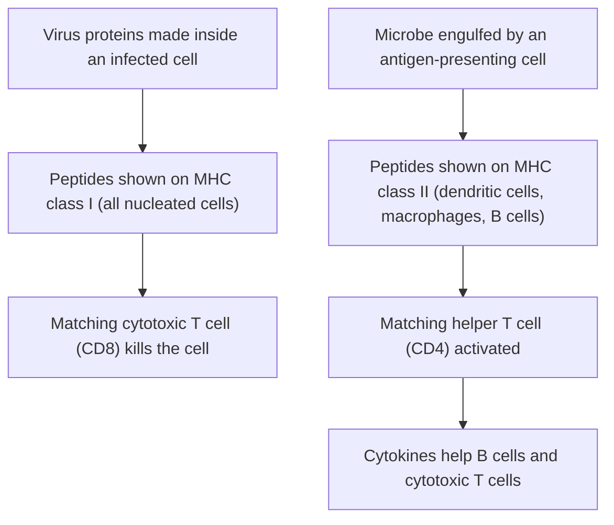

## How does the immune system know?

The core lesson on digestion and immunity introduced B cells, T cells, antibodies and memory, and the idea that only the lymphocytes matching an antigen multiply. That raises hard questions. How can the body make a matching lymphocyte for a virus it has never met, perhaps one that didn't exist when you were born? How does a T cell "see" a virus hiding inside a cell? Why does a booster shot work better than the first dose? This lesson answers them, with the experiments behind the answers, and ends with the arithmetic of herd immunity. It's biology, not medical advice.

## Clonal selection

In 1957 Frank Macfarlane Burnet proposed the **clonal selection** theory, now the foundation of immunology. Its claims:

1. Each lymphocyte carries receptors of a single specificity: every receptor on one B cell binds the same antigen.
2. The specificities are generated randomly, before any antigen is encountered. The body doesn't design receptors to fit a pathogen; it makes a huge random library and waits.
3. When an antigen binds a lymphocyte's receptor (with the right extra signals), that cell is selected: it divides repeatedly, forming a clone of identical cells, most of which become effector cells (antibody-secreting plasma cells, or killer T cells), while some become memory cells.
4. Lymphocytes whose receptors bind the body's own molecules are eliminated or silenced while they develop. This tolerance usually prevents autoimmunity; when it fails, diseases such as type 1 diabetes can result.

### Where the diversity comes from

Humans have only about 20,000 protein-coding genes, yet make millions or more different antibodies. In 1976 Susumu Tonegawa showed why: antibody genes are not inherited in working form. In each developing B cell, DNA is cut and rejoined to pick one segment from each of several sets, a process called **V(D)J recombination**. The heavy-chain gene is assembled from one V (variable), one D (diversity) and one J (joining) segment; the light-chain gene from one V and one J. T-cell receptor genes are assembled the same way. The joints are also imprecise, with nucleotides added or removed, which multiplies the possibilities further.

### Example 1: counting antibodies

Use approximate counts of functional human gene segments: heavy chain 40 V, 23 D and 6 J; kappa light chain 40 V and 5 J; lambda light chain 30 V and 4 J. How many antibodies can be made from segment choices alone?

- Heavy chains: $40 \times 23 \times 6 = 5{,}520$.
- Light chains: kappa $40 \times 5 = 200$, lambda $30 \times 4 = 120$, so $200 + 120 = 320$ (each B cell uses one or the other, so add).
- Pairs: $5{,}520 \times 320 \approx 1.8$ million.

Imprecise joining raises the potential repertoire by many more orders of magnitude (estimates run from about $10^{12}$ to as many as $10^{18}$ possible antibodies), far more than the number of B cells in a body at any one time, so each person carries only a sample of what is possible. Random generation is how a finite genome meets an unlimited variety of antigens.

## Antibody structure and classes

An antibody is four polypeptides: two identical **heavy chains** and two identical **light chains**, held together by disulfide bonds into a Y. Each chain has a **variable region** at the tip of the arm, where its amino acid sequence differs from one antibody to the next, and a **constant region**, which is the same for all antibodies of a class. The variable regions of one heavy and one light chain fold together into an antigen-binding site, so each Y has two identical binding sites. Rodney Porter and Gerald Edelman worked out this structure in the late 1950s and 1960s by cutting antibodies with enzymes and separating the chains.


The stem doesn't bind antigen. It's the "handle" other parts of the immune system grab: phagocytes have receptors for it, and it can trigger complement, blood proteins that punch holes in bacteria. That's how antibodies, which can't kill anything themselves, get pathogens destroyed. They neutralize (block a virus or toxin from attaching), clump pathogens together, coat them so phagocytes engulf them more readily (opsonization), and activate complement.

The heavy-chain constant region defines the **antibody class**:

| Class | Form | Main features |
|---|---|---|
| IgM | Five Y units joined (10 binding sites) | First class made in a primary response; good at clumping and activating complement |
| IgG | Single Y | Most abundant in blood; dominates secondary responses; crosses the placenta to protect a fetus |
| IgA | In secretions, two Y units joined | In mucus, saliva, tears and breast milk; guards the gut and airways |
| IgE | Single Y | Binds mast cells; defends against parasitic worms; triggers allergic reactions |
| IgD | Single Y | Found mainly on the surface of naive B cells; its role is less well understood |

A B cell starts by making IgM. Signals from helper T cells can make it switch to IgG, IgA or IgE, swapping the constant region while keeping the same variable region, so the new antibody binds the same antigen but does a different job. This is **class switching**. During the same response, the variable-region genes mutate rapidly and B cells whose antibodies bind more tightly are preferentially selected, so the antibodies improve over weeks (affinity maturation).

### Example 2: reading an antibody test

Because IgM comes first and IgG later, tests for each class show how recent an infection is. Interpret three people's results for antibodies to the same virus.

| Person | IgM | IgG |
|---|---|---|
| A | positive | negative |
| B | positive | positive |
| C | negative | positive |

- A: IgM only. A very recent primary infection; there hasn't been time to switch to IgG.
- B: both. Infection within the past several weeks; class switching under way.
- C: IgG only. A past infection (or vaccination); IgM has faded but IgG and memory remain.

Real tests need clinical interpretation, but this is why labs measure the classes separately.

## How T cells see antigen: MHC

B-cell receptors and antibodies bind intact antigens floating free. T cells can't. A T-cell receptor recognizes only a short peptide (a fragment of a protein) held in a groove of a cell-surface protein encoded by the **major histocompatibility complex (MHC)**. In humans they're called HLA, the proteins matched in organ transplants.



- MHC class I is on almost every nucleated cell. It displays peptides from proteins made inside that cell. Normally they're self peptides and are ignored, but in a virus-infected or cancerous cell some are foreign or abnormal, and a **cytotoxic T cell** (marked by the CD8 protein) with a matching receptor kills the cell. It releases perforin, which makes pores in the target's membrane, and enzymes called granzymes that enter and trigger apoptosis, the cell's own self-destruct program.
- MHC class II is on **antigen-presenting cells**: dendritic cells (the most important for starting a response), macrophages and B cells. They display peptides from material they've engulfed. A **helper T cell** (marked by CD4) with a matching receptor is activated and releases **cytokines**, signaling proteins that switch on B cells, cytotoxic T cells and macrophages.

Dendritic cells carry antigen from tissues to lymph nodes, where the rare matching T cells wait. A B cell is fully activated only when a helper T cell recognizes a peptide from the same antigen on that B cell's class II MHC, a double check that guards against attacking the body's own molecules.

### Example 3: the MHC restriction experiment

In 1974 Rolf Zinkernagel and Peter Doherty infected mice of strain A with a virus and collected their cytotoxic T cells. They mixed the T cells with infected or uninfected target cells from different mouse strains and measured how many targets were killed. Results in the pattern they found (illustrative numbers):

| Target cells | Target killed |
|---|---|
| Strain A, infected | 60% |
| Strain A, uninfected | 3% |
| Strain B (different MHC), infected with the same virus | 4% |
| Strain B, uninfected | 3% |

What do the results show?

- Infected strain A cells were killed but uninfected ones weren't: the T cells are specific for the virus.
- Infected strain B cells weren't killed, even though they carried the same virus: the T cells recognize the viral antigen only together with their own strain's MHC.
- Conclusion: T-cell recognition is "MHC restricted": the receptor sees peptide plus self-MHC as one shape. They shared the 1996 Nobel Prize for this.

## Memory and vaccines

After an infection clears, most effector cells die, but memory B and T cells persist for years or decades. They outnumber the naive cells of the same specificity that started the response, respond to less antigen, and (for B cells) have usually already switched class and improved their affinity. That's why a secondary response is faster, larger and mostly IgG. A booster dose works the same way: it triggers a secondary response that expands memory and raises antibody levels.

Vaccine design follows the biology:

- Live attenuated vaccines (measles, mumps and rubella) replicate a little inside cells, so their proteins are shown on class I MHC as well as class II. They tend to produce strong cytotoxic T-cell and antibody responses, often lasting, from one or two doses. They're generally not given to people with weakened immunity.
- Inactivated, subunit and toxoid vaccines (most flu shots, hepatitis B, tetanus) can't replicate. They mainly drive class II presentation and antibodies, and usually need several doses or boosters; subunit and toxoid vaccines usually also contain adjuvants (ingredients that alert innate immunity), though most flu shots do not.
- mRNA and viral-vector vaccines have cells make one viral protein for a short time, so it's presented on both class I and class II.

**Passive immunity** is protection from antibodies made by someone else: IgG crossing the placenta, IgA in breast milk, or manufactured antibodies given as treatment. It works immediately but fades over weeks to months, because no memory cells are made.

## Herd immunity: the arithmetic

The basic reproduction number $R_0$ is the average number of people one case infects in a population with no immunity. If a fraction $s$ of the population is still susceptible, each case infects on average

$$R_{\text{eff}} = R_0 \times s$$

others, the effective reproduction number. An outbreak grows while $R_{\text{eff}} > 1$ and shrinks when $R_{\text{eff}} < 1$. Setting $R_0 \times s = 1$ gives $s = 1/R_0$, so the immune fraction must exceed $1 - 1/R_0$, the herd immunity threshold from the core lesson. If a vaccine protects a fraction $E$ of those who get it, coverage $V$ gives an immune fraction of $V \times E$, so the needed coverage is $(1 - 1/R_0)/E$.

```plot
{"x": [0, 20], "y": [0, 100], "xLabel": "basic reproduction number R0", "yLabel": "immune share needed (%)", "functions": [{"f": "100*(1 - 1/x)", "from": 1, "to": 20, "label": "threshold 1 − 1/R0"}], "points": [{"at": [2, 50], "label": "R0 = 2: 50%"}, {"at": [4, 75], "label": "R0 = 4: 75%"}, {"at": [15, 93.3], "label": "R0 = 15: 93%"}], "caption": "Herd immunity threshold rises steeply at first, then levels off near 100%"}
```

### Example 4: will an outbreak spread?

A disease has $R_0 = 4$. In one town 70% of people are vaccinated with a vaccine that protects 90% of recipients, and no one else is immune. Ten cases arrive. Will the outbreak grow, and what coverage would stop it?

- Immune fraction: $0.70 \times 0.90 = 0.63$, so $s = 0.37$.
- $R_{\text{eff}} = 4 \times 0.37 = 1.48 > 1$: the outbreak grows. Ten cases become about $10 \times 1.48^3 \approx 32$ after three generations of spread (ignoring chance).
- Needed: $1 - 1/4 = 0.75$ immune, so coverage $= 0.75 / 0.90 \approx 83.3\%$.
- With a vaccine only 70% effective, the needed coverage would be $0.75 / 0.70 \approx 107\%$, impossible: vaccination alone couldn't stop spread, and other measures or a better vaccine would be needed.

These formulas assume everyone mixes evenly and that immunity fully blocks infection and doesn't wane. In real populations, clusters of unvaccinated people can have a local $R_{\text{eff}}$ above 1 even when national coverage looks high, and $R_0$ depends on how people live and gather. The threshold is a guide, not a guarantee. The epidemiology lesson in the honors modules develops these models further.

## Common mistakes

- Thinking antigen "instructs" a lymphocyte to build a matching receptor. Receptors are made randomly first; antigen selects among them.
- Calling the whole antibody "variable." Only the tips of the arms vary; the stem's class decides what the antibody does.
- Saying T cells recognize whole viruses. They recognize peptides presented on MHC.
- Mixing up the classes: class I (all nucleated cells, to CD8 killers) vs class II (antigen-presenting cells, to CD4 helpers).
- Treating passive immunity as long lasting. Without memory cells it fades.
- Forgetting vaccine effectiveness: coverage needed is the threshold divided by effectiveness.

## Key points

- Clonal selection: a random, pre-made library of lymphocytes; antigen selects and expands matching clones; self-reactive cells are removed.
- V(D)J recombination of gene segments, plus imprecise joining, generates enormous receptor diversity.
- Antibodies: two heavy and two light chains; variable regions bind antigen, the constant region sets the class (IgM first, IgG most abundant, IgA in secretions, IgE in allergy and parasites).
- MHC I shows inside proteins to cytotoxic (CD8) T cells; MHC II on antigen-presenting cells shows engulfed material to helper (CD4) T cells, which release cytokines.
- Memory cells make secondary responses fast and large; vaccines and boosters exploit this.
- $R_{\text{eff}} = R_0 s$; herd immunity threshold $1 - 1/R_0$; needed coverage $(1 - 1/R_0)/E$.
