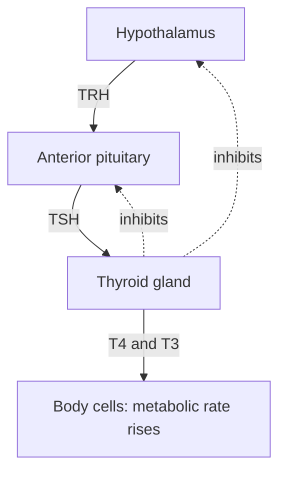

## From "a hormone travels in the blood" to how it works

The homeostasis lesson defined a hormone as a chemical messenger carried in the blood to target cells with matching receptors, and used insulin and glucagon as the classic negative feedback pair. This honors lesson asks what happens at the target cell, how the brain runs a chain of glands, how the pancreas senses glucose, how ADH sets the concentration of urine, and how to read hormone data the way a clinician or researcher does. It's biology, not medical advice.

## Two ways to deliver a message

Hormones fall into two broad groups by how they dissolve.

- A **peptide hormone** (insulin, glucagon, ADH, growth hormone) is water-soluble. It travels freely in plasma but can't cross the lipid bilayer, so it binds a receptor on the target cell's surface. The receptor relays the signal inward, often by making a second messenger such as cyclic AMP (cAMP), which activates enzymes that activate more enzymes. Each step multiplies the signal, so a few hormone molecules can change thousands of enzyme molecules within seconds to minutes. Amine hormones such as adrenaline (epinephrine) work the same way.
- A **steroid hormone** (cortisol, aldosterone, estrogen, testosterone) is made from cholesterol and is lipid-soluble. It rides in the blood bound to carrier proteins, slips through the membrane, and binds a receptor inside the cell (in the cytoplasm or the nucleus). The hormone-receptor complex acts as a transcription factor, switching particular genes on or off. Effects take hours, because new mRNA and protein must be made, and they can last days. Thyroid hormones, though not steroids, also act through receptors inside the cell.

How long a hormone acts also depends on how fast it is removed. Insulin has a half-life in the blood of only about 5 minutes; cortisol, about an hour or more; the main thyroid hormone T4, about a week. A short half-life lets a level change quickly when secretion changes.

### Example 1: a short half-life

After a meal, a person's insulin level is 80 µU/mL (microunits per milliliter), and then secretion suddenly stops. With a half-life of 5 minutes, what is the level 15 minutes later?

- 15 minutes is $15/5 = 3$ half-lives.
- Level $= 80 \times (1/2)^3 = 80/8 = 10$ µU/mL.

Within a quarter of an hour, almost 90% is gone. Glucose control needs exactly this: the pancreas can raise or drop the signal within minutes.

## The hypothalamus and pituitary

Many glands answer to a two-part control center at the base of the brain. The **hypothalamus** is brain tissue that senses the blood (temperature, osmolality, hormone levels) and receives input from the rest of the brain. Below it hangs the pituitary, which has two parts with very different origins:

- The **posterior pituitary** is really an extension of the brain. Hypothalamic neurons make ADH and oxytocin, send them down their axons and release them into the blood there. These are hormones released by neurons.
- The **anterior pituitary** is a true gland. The hypothalamus controls it with releasing hormones carried a short distance through a private set of portal blood vessels. Each releasing hormone tells the anterior pituitary to secrete a **tropic hormone**, a hormone whose target is another endocrine gland.

The chains are called axes. The hypothalamus-pituitary-thyroid axis is typical:

Other axes follow the same pattern: CRH → ACTH → adrenal cortex → cortisol (the stress axis), and GnRH → LH and FSH → ovaries or testes → sex hormones. The final hormone feeds back to inhibit the earlier steps, so the whole chain holds the final hormone near a set point. A chain also amplifies: a tiny amount of releasing hormone leads to much larger amounts of the final hormone.

### Example 2: where is the fault?

Doctors read the axis backward from blood tests. TSH (thyroid-stimulating hormone) comes from the pituitary; T4 from the thyroid. Using the feedback loop, find the likely site of the problem.

| Patient | TSH | T4 | Reasoning | Likely problem |
|---|---|---|---|---|
| A | High | Low | Little T4, so little feedback; the pituitary shouts louder | Thyroid underactive (primary hypothyroidism) |
| B | Low | High | Plenty of T4 is suppressing the pituitary, yet T4 stays high | Thyroid overactive on its own (primary hyperthyroidism) |
| C | Low | Low | T4 is low but the pituitary isn't responding | Pituitary or hypothalamus failing (secondary) |

Real cases make this concrete. In iodine deficiency, the thyroid can't make enough T4 (each molecule contains four iodine atoms), TSH stays high, and the constant stimulation enlarges the gland into a goiter. In Graves' disease, antibodies bind and switch on the TSH receptor, mimicking TSH, so the thyroid overproduces while real TSH falls to almost nothing: patient B's pattern.

## Glucose regulation in depth

### How a beta cell senses glucose

Beta cells don't have a glucose receptor in the usual sense. They measure glucose by burning it:

1. Glucose enters the beta cell through transporters, in proportion to its blood level.
2. Glycolysis and respiration raise the cell's ATP.
3. ATP closes ATP-sensitive K⁺ channels, so less K⁺ leaks out.
4. The membrane depolarizes, opening voltage-gated Ca²⁺ channels.
5. Ca²⁺ flows in and triggers exocytosis of insulin granules.

This is the same logic as a neuron (lesson on neurons): a change in K⁺ permeability shifts the voltage, and Ca²⁺ entry triggers release. Sulfonylurea drugs for type 2 diabetes act by closing the same K⁺ channels.

In muscle and fat cells, insulin binds a receptor that is itself an enzyme (a tyrosine kinase), and the signal moves **GLUT4** glucose transporters from internal vesicles into the plasma membrane, so glucose uptake rises severalfold. In the liver, insulin switches on glycogen and fat synthesis and switches off glucose release. Glucagon, through a surface receptor and cAMP, does the opposite in the liver: it promotes glycogen breakdown and the making of new glucose. Muscle has no glucagon receptors, so muscle glycogen fuels only the muscle itself.

### Diabetes types

- Type 1 (about 5–10% of diagnosed cases): autoimmune destruction of beta cells, so insulin is low or absent.
- Type 2 (about 90–95%): insulin resistance (for example, fewer GLUT4 transporters reach the membrane in response to insulin), at first compensated by extra insulin, until beta cells can no longer keep up.
- Gestational diabetes: high glucose first appearing in pregnancy, as placental hormones increase insulin resistance; it usually resolves after birth but raises later type 2 risk.

When blood glucose exceeds about 180 mg/dL, the kidney's glucose carriers are saturated and glucose spills into urine, pulling water with it: that's why untreated diabetes causes frequent urination and thirst.

### Example 3: reading a glucose tolerance test

Clinical criteria (American Diabetes Association) for an oral glucose tolerance test: fasting glucose under 100 mg/dL is normal, 100–125 is prediabetes, 126 or more suggests diabetes; two hours after a 75 g glucose drink, under 140 is normal, 140–199 is prediabetes, 200 or more suggests diabetes. A diagnosis needs confirmation, usually by a repeat test. Classify these results.

| Person | Fasting glucose | 2-hour glucose | Fasting insulin |
|---|---|---|---|
| P | 92 | 118 | normal |
| Q | 112 | 168 | high |
| R | 138 | 245 | very low |
| S | 131 | 226 | high |

- P: both normal.
- Q: prediabetes on both measures; high insulin suggests the body is compensating for insulin resistance.
- R: diabetes range on both, with almost no insulin: the pattern of type 1.
- S: diabetes range, but with plenty of insulin that isn't working: the pattern of type 2.

## ADH and the kidney

**Antidiuretic hormone (ADH)**, also called vasopressin, is the main control on water. Osmoreceptors in the hypothalamus track plasma osmolality, the concentration of dissolved particles (normally about 285–295 mOsm/kg). A rise of just 1–2% increases ADH release from the posterior pituitary. ADH binds receptors on collecting-duct cells and, through cAMP, inserts **aquaporins**, water channel proteins, into their membranes. Water then flows out of the duct into the very salty tissue deep in the kidney, and urine can become as concentrated as about 1,200 mOsm/kg. With no ADH the ducts stay nearly watertight and urine can be as dilute as about 50 mOsm/kg. Alcohol suppresses ADH release, which is why it increases urine output.

In **diabetes insipidus** ("tasteless" diabetes, unrelated to insulin), the ADH signal fails and large volumes of dilute urine are made. In central diabetes insipidus the pituitary makes too little ADH; in nephrogenic diabetes insipidus the kidney doesn't respond to it. Giving a synthetic ADH (desmopressin) tells them apart: urine concentrates in the central form but barely changes in the nephrogenic form. Since 2022, endocrine societies have recommended new names for these two conditions, arginine vasopressin deficiency (central) and arginine vasopressin resistance (nephrogenic), partly to avoid confusion with diabetes mellitus; you will see both sets of names.

### Example 4: the smallest possible urine volume

A person must excrete about 600 mOsm of solutes (urea, salts) a day. If the kidneys can concentrate urine to at most 1,200 mOsm/kg (about 1,200 mOsm per liter), what is the least urine they can make? How much in diabetes insipidus with urine stuck at 150 mOsm/kg?

- Minimum volume $= \dfrac{600 \text{ mOsm}}{1200 \text{ mOsm/L}} = 0.5$ L per day.
- At 150 mOsm/kg: $600/150 = 4$ L per day, eight times as much, and the person must drink to match it.

## Negative and positive feedback in the data

Most axes are negative feedback, but some switch. Estrogen normally inhibits GnRH and LH. Yet when estrogen stays high for a day or two late in the ovarian cycle, it flips to positive feedback and triggers a surge of LH that causes ovulation. Typical values (illustrative):

| Cycle day | 6 | 9 | 11 | 12 | 13 | 14 | 16 |
|---|---|---|---|---|---|---|---|
| Estradiol (pg/mL) | 50 | 100 | 180 | 250 | 300 | 200 | 120 |
| LH (IU/L) | 6 | 6 | 7 | 10 | 45 | 25 | 8 |

Read it the way an endocrinologist would. From day 6 to 11, estradiol more than triples while LH barely moves: negative feedback is holding LH down. Once estradiol has been high (above about 200) for a day or more, LH jumps roughly fourfold in a day: positive feedback. The surge is brief because LH itself changes the follicle, which switches from making mostly estradiol to making progesterone; the stimulus falls away, and ovulation follows about a day and a half after the surge begins. As with oxytocin in childbirth, the event the loop drives is what ends it.

## Common mistakes

- Thinking steroid hormones act through cAMP. Most act on receptors inside the cell and change gene expression.
- Assuming high TSH means an overactive thyroid. High TSH usually means the thyroid is underactive and the pituitary is pushing harder.
- Mixing up diabetes mellitus (glucose, insulin) and diabetes insipidus (water, ADH).
- Saying insulin lets glucose into every cell. It mainly increases uptake in muscle and fat (GLUT4); brain cells take up glucose without it.
- Treating positive feedback as rare or harmful. It's normal for events that must finish: ovulation, birth, clotting.

## Key points

- Peptide hormones bind surface receptors, use second messengers and act fast; steroid hormones bind internal receptors and change gene expression slowly.
- The hypothalamus controls the posterior pituitary through neurons and the anterior pituitary through releasing hormones; axes end in negative feedback.
- Read axis lab tests backward: high TSH with low T4 points to the thyroid; low TSH with low T4 to the pituitary.
- Beta cells sense glucose through ATP closing K⁺ channels; insulin moves GLUT4 to the membrane; type 1 lacks insulin, type 2 resists it.
- ADH inserts aquaporins in collecting ducts; minimum urine volume = solute load ÷ maximum urine concentration.
- Estrogen switches from negative to positive feedback to trigger the LH surge.
