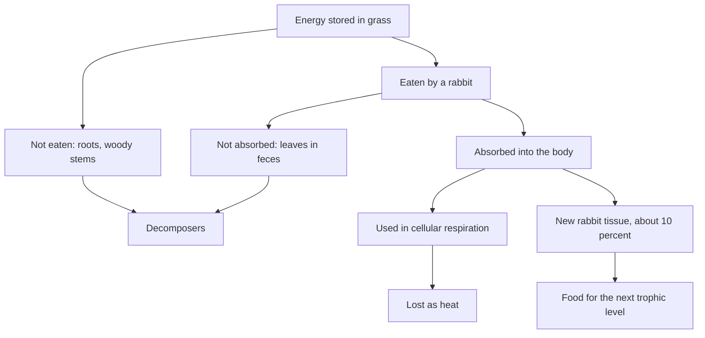

## From one body to a whole ecosystem

The last lesson followed food through a single body: digestion breaks it down, and the energy in it ends up powering cells. Ecology asks the same question at a larger scale. Where did that food's energy come from, where does it go after you use it, and why can a meadow feed thousands of grasshoppers but only a few hawks? This module studies organisms together with their surroundings. This first lesson follows energy through an ecosystem and turns the answers into numbers you can calculate with.

## What an ecosystem is made of

An ecosystem has two kinds of parts. **Biotic factors** are the living parts and their products: plants, animals, fungi, bacteria, fallen leaves, dung. **Abiotic factors** are the nonliving conditions: sunlight, temperature, water, soil minerals, pH, salinity, wind. The two shape each other. Rainfall decides which plants can grow; the plants then shade the soil, hold water and change the local temperature.

Ecologists group organisms by how they get energy:

- **Producers** make their own organic molecules, almost always by photosynthesis (plants, algae, cyanobacteria). In deep-sea vents and caves, some bacteria and archaea are producers by chemosynthesis, using energy from chemicals such as hydrogen sulfide.
- Consumers get energy by eating other organisms. Herbivores (primary consumers) eat producers, carnivores eat animals, and omnivores eat both.
- **Decomposers**, mainly bacteria and fungi, break down dead material and wastes, releasing simple nutrients back to the soil and water. Animals such as earthworms and millipedes that eat dead material help by shredding it.

Each feeding step is a **trophic level** (from the Greek *trophē*, "nourishment"). Producers are level 1, primary consumers level 2, secondary consumers (carnivores that eat herbivores) level 3, and tertiary consumers level 4. A single path such as grass → grasshopper → shrew → owl is a food chain. Real organisms eat many things and are eaten by many things, so ecologists draw a **food web**: all the feeding links in a community. An omnivore such as a bear can sit at several trophic levels at once, eating berries (level 2) and salmon (level 4 or higher, since salmon themselves eat other animals).

Arrows in food chains and webs point in the direction energy moves: from the food to the eater. "Grass → rabbit" means the rabbit eats the grass.

The food web below is a simplified meadow. Trace any path from a producer to the owl and you have a food chain; the owl sits at level 3 when it eats a mouse but at level 4 when it eats a snake that ate a mouse. Dead remains and wastes from every organism, not just the two shown with dashed arrows, end up with the decomposers.


## Where the energy comes from: primary productivity

Almost all energy in ecosystems starts as sunlight captured by producers. Only a small fraction of the sunlight reaching a field, typically around 1%, ends up stored in plant molecules; the rest is reflected, passes through, or evaporates water.

The total rate at which producers capture energy is the gross primary productivity (GPP). Producers burn part of that sugar in their own cellular respiration to stay alive and grow. What remains, stored as new tissue that consumers can eat, is the **net primary productivity** (NPP):

$$\text{NPP} = \text{GPP} - R_{\text{producers}}$$

NPP is usually reported as energy (kJ per m² per year) or as dry mass (g per m² per year). It is highest in tropical rainforests, coral reefs, estuaries and wetlands, where light, warmth, water and nutrients are all plentiful, and lowest in deserts, tundra and the open ocean. The open ocean still contributes a large share of Earth's total because it is so vast.

### Example 1

A pond's algae capture 25,000 kJ per m² per year (GPP) and use 14,000 kJ per m² per year in respiration. What is the NPP, and what fraction of the captured energy is available to consumers?

1. NPP = GPP − respiration = 25,000 − 14,000 = 11,000 kJ per m² per year.
2. Fraction available: $\tfrac{11{,}000}{25{,}000} = 0.44$, or 44%.

So less than half of what the algae captured is ever on the menu for the pond's animals.

## Why only about 10% passes up each level

When a rabbit eats grass, most of the energy in that grass never becomes rabbit. Three things happen to it:

1. *Not all of it is eaten.* Roots, woody stems and leaves the rabbit never reaches stay behind (and eventually feed decomposers).
2. *Not all that is eaten is absorbed.* Cellulose and other hard-to-digest material leaves as feces.
3. *Most of what is absorbed is used, not stored.* The rabbit spends it on cellular respiration to run its muscles, keep warm and repair cells, and that energy ends as heat that radiates away. Only the remainder builds new rabbit tissue that a fox could eat.

The flowchart follows those three branches.



The result is the **ten percent rule**: on average, about 10% of the energy at one trophic level becomes available at the next. Real values range from under 1% to around 20%. Endotherms such as birds and mammals usually pass on less than ectotherms such as insects and fish, because keeping a body warm costs so much energy.

Two big consequences follow. First, energy flows *one way* through an ecosystem: sunlight in, heat out. It is not recycled, so ecosystems need a constant input of sunlight. Matter is different: carbon, nitrogen and other atoms are recycled again and again, which is the subject of the next lesson. Second, food chains are short. After four or five levels so little energy remains that another level of predators could not find enough to eat.

The classic evidence came from studies that measured every level of a real ecosystem. Raymond Lindeman's study of Cedar Bog Lake in Minnesota (published 1942) first described ecosystems as trophic levels passing energy along with losses at each step. Howard Odum's study of Silver Springs, Florida (1957) measured the energy flow in detail. Rounded, his figures for gross production were:

| Trophic level | Energy (kcal per m² per year) |
|---|---|
| Producers | 20,810 |
| Herbivores | 3,368 |
| Carnivores | 383 |
| Top carnivores | 21 |

From producers to herbivores, $\tfrac{3368}{20{,}810} \approx 16\%$; from herbivores to carnivores, about 11%; from carnivores to top carnivores, about 5.5%. The exact percentage varies, but the steep drop at every step is always there.

## Ecological pyramids

Drawing each trophic level as a bar whose width shows its size gives an ecological pyramid. There are three kinds.

- *Pyramid of energy*: energy flowing through each level per unit area per year. Because energy is lost at every step, this pyramid is *always* upright.
- *Pyramid of biomass*: the **biomass**, the total dry mass of living organisms, present in each level at one moment (for example, g per m²). Usually upright, but it can be inverted. In the open ocean, the phytoplankton present at any moment can weigh less than the zooplankton eating them, because the phytoplankton reproduce so fast that they are eaten and replaced many times a year.
- *Pyramid of numbers*: how many individuals are in each level. It can be inverted too: a single oak tree supports thousands of caterpillars.

```shape
{"polygons": [{"points": [[-5, 0], [5, 0], [5, 1], [-5, 1]]}, {"points": [[-3.75, 1.2], [3.75, 1.2], [3.75, 2.2], [-3.75, 2.2]]}, {"points": [[-2.5, 2.4], [2.5, 2.4], [2.5, 3.4], [-2.5, 3.4]]}, {"points": [[-1.25, 3.6], [1.25, 3.6], [1.25, 4.6], [-1.25, 4.6]]}], "labels": [{"at": [0, 0.5], "text": "Producers: 10,000 kJ"}, {"at": [0, 1.7], "text": "Primary: 1,000 kJ"}, {"at": [0, 2.9], "text": "Secondary: 100 kJ"}, {"at": [0, 4.1], "text": "Tertiary: 10"}], "caption": "Pyramid of energy with 10% transfer (widths not to scale; true widths would shrink tenfold per level)"}
```

### Example 2

The producers in a grassland store 50,000 kJ per m² per year. Using the ten percent rule, how much energy reaches the tertiary consumers?

Each step up keeps 10%, that is, multiply by 0.1:

1. Primary consumers: $50{,}000 \times 0.1 = 5{,}000$ kJ.
2. Secondary consumers: $5{,}000 \times 0.1 = 500$ kJ.
3. Tertiary consumers: $500 \times 0.1 = 50$ kJ per m² per year.

In one line: $50{,}000 \times 0.1^3 = 50$. Tertiary consumers are three steps above producers, so the exponent is 3, not 4. Counting levels instead of steps is the most common slip.

### Example 3

A farm field produces crops containing 9.0 million kJ of food energy per year. A person needs about 3.0 million kJ per year (roughly 8,200 kJ, or 2,000 Calories, per day). Compare how many people the field can feed if people eat the crops directly versus feeding them to livestock and eating the meat (assume 10% transfer).

1. Eating crops: $\tfrac{9.0 \text{ million}}{3.0 \text{ million}} = 3$ people.
2. Through livestock: the animals keep $9.0 \times 0.1 = 0.90$ million kJ, which feeds $\tfrac{0.90}{3.0} = 0.3$ of a person.

Eating one trophic level lower feeds ten times as many people from the same land. (Real figures differ by animal: chickens convert feed more efficiently than cattle. The direction of the result does not change.)

### Example 4

To estimate the biomass of grass in a 2.0-hectare meadow (1 hectare = 10,000 m²), a student clips all the plants in five 0.25 m² quadrats, dries them in an oven, and weighs them: 60, 75, 70, 55 and 65 g.

1. Mean dry mass per quadrat: $\tfrac{60 + 75 + 70 + 55 + 65}{5} = 65$ g.
2. Biomass per square meter: $\tfrac{65 \text{ g}}{0.25 \text{ m}^2} = 260$ g per m².
3. Meadow area: $2.0 \times 10{,}000 = 20{,}000$ m².
4. Total: $260 \times 20{,}000 = 5{,}200{,}000$ g $=$ 5,200 kg of dry grass.

Biomass is measured as *dry* mass because water content varies so much with weather and time of day.

## Common mistakes

- Drawing food-chain arrows from the eater to the food. The arrow shows energy moving, so it points to the eater.
- Saying energy is recycled. Matter cycles; energy flows through once and leaves as heat.
- Thinking the "lost" 90% is destroyed. It is not destroyed (energy is conserved); most becomes heat from respiration, and the rest goes to decomposers in uneaten parts and feces.
- Using the wrong exponent with the ten percent rule. From level 1 to level 4 is three transfers: multiply by $0.1^3$.
- Assuming every pyramid must be upright. Only the energy pyramid always is.
- Confusing GPP and NPP. Consumers can only eat what is left after the producers' own respiration.

## Key points

- Ecosystems contain biotic and abiotic factors that affect each other.
- Producers capture energy; consumers eat other organisms; decomposers return nutrients from dead material.
- NPP = GPP − producer respiration; it is the energy available to consumers.
- About 10% (roughly 1–20%) of the energy in one trophic level reaches the next; the rest is mostly lost as heat from respiration.
- Energy flows one way through ecosystems; matter cycles.
- Energy pyramids are always upright; biomass and numbers pyramids can be inverted.
