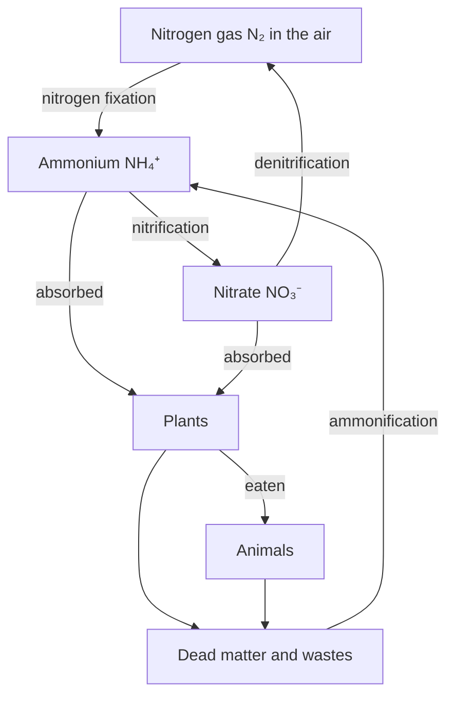

## Energy flows, matter cycles

The last lesson ended with a contrast: energy passes through an ecosystem once and leaves as heat, but matter is reused. The carbon atoms in your body have been part of air, plants, dinosaurs and ocean rock. This lesson follows two of those atoms, carbon and nitrogen, around their cycles, then turns to the question of how many organisms an ecosystem can hold: how populations grow, what stops them, and how ecologists count them.

## Biogeochemical cycles

A **biogeochemical cycle** is the path an element or compound takes as it moves between living things (*bio*), rocks, soil, water and air (*geo*), changing chemical form (*chemical*) along the way. Each cycle has reservoirs, places where the substance is stored, and fluxes, the processes that move it between reservoirs. Some reservoirs turn over quickly (carbon in the air is exchanged with plants within years); others hold material for millions of years (carbon locked in limestone).

The water cycle is the simplest: evaporation and transpiration from plants carry water up, condensation and precipitation bring it down, and runoff and groundwater return it to the oceans. Water also carries dissolved nutrients, linking the other cycles. The sun powers the whole cycle by evaporating water; gravity brings it back down and downhill.


## The carbon cycle

Carbon is the backbone of every organic molecule. Its main fluxes are two processes you studied in the energy module:

- Photosynthesis takes CO₂ out of the air (or water) and builds it into sugars, the entry point of carbon into food webs.
- Cellular respiration, by producers, consumers and especially decomposers, releases CO₂ back.

Other parts of the cycle:

- The ocean dissolves CO₂ at its surface. Marine organisms build shells of calcium carbonate, and over geologic time these settle and form limestone, a huge slow reservoir.
- Under some conditions dead organisms are buried before they decompose. Over millions of years heat and pressure turn them into coal, oil and natural gas: fossil fuels.
- Combustion of fossil fuels and wood, and volcanic eruptions, return carbon to the air.

The diagram puts these reservoirs and fluxes together. The fast cycle (top) runs through living things in years to centuries; the slow cycle (bottom) runs through fossil fuels and rock over millions of years.

![The carbon cycle. Atmospheric carbon dioxide is at the top. On land, photosynthesis moves carbon into plants; plants are eaten by animals; plants and animals return CO₂ by respiration; their dead matter and wastes go to soil and decomposers, which return CO₂ by decomposition; some dead matter is buried and becomes fossil fuels, which return CO₂ by combustion. In the ocean, CO₂ dissolves into and is released from seawater; marine life takes it up by photosynthesis and returns it by respiration; shells and remains settle into limestone and sediments, which return CO₂ through volcanoes.](images/m10-carbon-cycle.svg)

Before industrialization, the fluxes in and out of the atmosphere were nearly balanced. Burning fossil fuels moves carbon from a slow reservoir into the fast cycle. Fossil fuel use released roughly 37 billion tonnes of CO₂ in 2024. About half of the CO₂ humans emit stays in the air; the oceans and land plants absorb the rest. As a result, atmospheric CO₂ has risen from about 280 parts per million (ppm) before 1750 to about 424 ppm (global average) in 2024. The dissolved CO₂ also makes seawater more acidic, which makes building carbonate shells harder.

The best evidence for the cycle's living side comes from the Keeling curve, the CO₂ record kept at Mauna Loa, Hawaii, since 1958. Besides its steady rise, the curve wiggles every year: CO₂ falls during the Northern Hemisphere's spring and summer, when its vast forests photosynthesize, and rises in fall and winter, when respiration and decay dominate. The planet's land plants visibly "breathe."

## The nitrogen cycle

Nitrogen is needed for proteins and nucleic acids. The air is 78% nitrogen gas (N₂), but its triple bond is so strong that plants and animals cannot use it. Nitrogen enters food webs only after it is converted to other forms, almost entirely by bacteria.

1. **Nitrogen fixation** converts N₂ into ammonia (NH₃) or ammonium (NH₄⁺). Some bacteria do this in soil and water (including cyanobacteria); others, such as *Rhizobium*, live in root nodules of legumes (beans, peas, clover) and trade fixed nitrogen for sugar. Lightning fixes a little. Since the early 1900s, the industrial Haber–Bosch process has fixed nitrogen for fertilizer; it now fixes roughly as much nitrogen as all natural processes on land, or more by some recent estimates.
2. Decomposers release ammonium from dead organisms and wastes (ammonification).
3. Nitrifying bacteria oxidize ammonium to nitrite (NO₂⁻) and then nitrate (NO₃⁻), a process called nitrification.
4. Plants absorb ammonium and nitrate and build them into amino acids and nucleotides; animals get nitrogen by eating plants or other animals.
5. **Denitrification**: in waterlogged, low-oxygen soils, denitrifying bacteria convert nitrate back to N₂, closing the cycle.



Follow the diagram around once: every nitrogen atom in your proteins was fixed from the air by a microbe or a factory, passed through plants, and will eventually return to the air by denitrification.

Excess fertilizer washes into rivers and coasts. The extra nitrate feeds algal blooms; when the algae die, decomposers use up the dissolved oxygen, creating low-oxygen "dead zones" such as the one that forms most summers in the Gulf of Mexico. This process is eutrophication. The phosphorus cycle, by contrast, has no gas stage: phosphorus moves from weathering rock to soil, organisms and sediments, which is why it is often the nutrient in shortest supply in lakes.

## How populations grow

A population changes through four processes: births ($B$), deaths ($D$), immigration ($I$, arrivals) and emigration ($E$, departures):

$$\Delta N = B - D + I - E$$

With plenty of resources and no crowding, each individual adds offspring at the same average rate no matter how many others there are. Growth is then proportional to size, which is **exponential growth**:

$$\frac{dN}{dt} = rN$$

where $r$ is the per capita growth rate (births minus deaths per individual per unit time). For species that breed once a year it is easier to use the discrete form, where $\lambda$ is the factor the population is multiplied by each year:

$$N_t = N_0\,\lambda^t$$

A population with $\lambda = 1.5$ grows 50% per year. Graphed, exponential growth gives a J-shaped curve: slow at first, then explosive.

### Example 1

Ten rabbits are released on an island with no predators, and the population grows by a factor of $\lambda = 2$ per year. How many rabbits are there after 6 years?

$N_6 = 10 \times 2^6 = 10 \times 64 = 640$ rabbits. After 12 years the same rule would give 40,960, which is why exponential growth never lasts long in nature.

## Carrying capacity and logistic growth

No environment has unlimited food, space, water or nesting sites. The largest population an environment can support over the long term is its **carrying capacity**, $K$. As a population approaches $K$, birth rates fall and death rates rise. The **logistic growth** model captures this by multiplying exponential growth by the fraction of $K$ still unused:

$$\frac{dN}{dt} = rN\,\frac{K - N}{K}$$

When $N$ is small, $\frac{K-N}{K}$ is close to 1 and growth is nearly exponential. As $N$ approaches $K$, the fraction approaches 0 and growth stops. The graph is S-shaped, and the population grows fastest when $N = K/2$.

```plot
{"x": [0, 20], "y": [0, 1100], "xLabel": "time (generations)", "yLabel": "population size N", "functions": [{"f": "20*exp(0.4*x)", "label": "exponential", "dashed": true}, {"f": "1000/(1 + 49*exp(-0.4*x))", "label": "logistic"}, {"f": "1000", "label": "K = 1000", "dashed": true}], "caption": "Exponential (J-shaped) and logistic (S-shaped) growth from N₀ = 20 with r = 0.4; the logistic curve levels off at K"}
```

The Russian ecologist G. F. Gause tested this in the 1930s by growing *Paramecium* in tubes with a fixed daily food supply. The cultures grew quickly, slowed, and leveled off at a steady size, tracing an S-curve closely matching the logistic model.

### Example 2

A deer population has $r = 0.4$ per year and $K = 800$. Find the growth rate when $N = 200$ and when $N = 600$.

1. $N = 200$: $\frac{dN}{dt} = 0.4 \times 200 \times \frac{800 - 200}{800} = 80 \times 0.75 = 60$ deer per year.
2. $N = 600$: $\frac{dN}{dt} = 0.4 \times 600 \times \frac{200}{800} = 240 \times 0.25 = 60$ deer per year.

Both give 60: the logistic curve is symmetric about $K/2 = 400$, where growth peaks at $0.4 \times 400 \times 0.5 = 80$ deer per year.

## What limits populations

A limiting factor, the same idea you met with photosynthesis rates, is here any resource or condition that keeps a population from growing further. Ecologists sort them by whether their effect depends on crowding.

- **Density-dependent factors** hit harder as the population becomes denser: competition for food and space, predation, disease and parasites (which spread faster in crowds), and buildup of wastes. They push populations back toward $K$.
- **Density-independent factors** affect a population the same way whatever its density: a hard freeze, drought, flood, wildfire, or a volcanic eruption.

Populations can overshoot. In 1944, 29 reindeer were released on St. Matthew Island in the Bering Sea, which had abundant lichen and no predators. By 1963 there were about 6,000. They had eaten the slow-growing lichen faster than it could regrow, and after a severe winter the herd crashed to 42 animals in 1966. Food shortage (density-dependent) set up the crash; the harsh winter (density-independent) triggered it.

The human population, about 8.2 billion in 2025, is still growing but more slowly than in the 1960s. United Nations projections (2024) have it peaking at around 10.3 billion in the 2080s.

## Counting a population: mark–recapture

Animals that move cannot simply be counted. The **mark–recapture** method (the Lincoln–Petersen estimate) works like this: capture $M$ animals, mark them harmlessly, and release them. Later, capture a second sample of $C$ animals and count how many of them, $R$, carry marks. If the marked animals have mixed evenly, the fraction marked in the sample matches the fraction marked in the whole population:

$$\frac{R}{C} = \frac{M}{N} \quad\Rightarrow\quad N = \frac{M \times C}{R}$$

The estimate assumes no births, deaths or migration between samples, that marks are not lost, and that marked animals are no easier or harder to catch than the others.

### Example 3

Ecologists net 40 trout in a pond, tag them, and release them. A week later they net 50 trout, of which 8 are tagged. Estimate the population.

$N = \frac{40 \times 50}{8} = \frac{2000}{8} = 250$ trout. Check: 8 of 50 is 16% marked, and 40 of 250 is also 16%.

## Common mistakes

- Writing the mark–recapture formula upside down. Sanity check: $N$ must be larger than both $M$ and $C$.
- Confusing $r$ and $\lambda$. A population that does not change has $r = 0$ but $\lambda = 1$.
- Thinking logistic growth is fastest near $K$. It is fastest at $K/2$ and nearly zero at $K$.
- Calling nitrogen fixation something plants do. Bacteria (and lightning and factories) fix nitrogen; legumes only host the bacteria.
- Classifying a drought as density-dependent. It kills a fixed fraction whatever the density.

## Key points

- Matter cycles between living things and the environment; energy does not.
- Photosynthesis removes CO₂; respiration and combustion add it. Fossil fuel burning has raised CO₂ from about 280 to about 424 ppm (2024).
- Bacteria drive the nitrogen cycle: fixation, nitrification, denitrification.
- Exponential growth: $dN/dt = rN$ or $N_t = N_0\lambda^t$ (J-curve).
- Logistic growth: $dN/dt = rN(K-N)/K$ (S-curve), fastest at $K/2$, leveling off at carrying capacity.
- Mark–recapture: $N = MC/R$.
