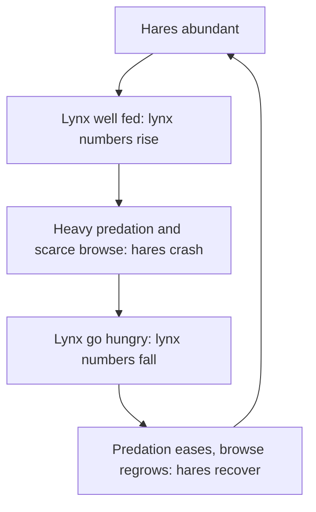

## Beyond a single growth rate

Lesson 39 described a population with one growth rate and capped it with a carrying capacity $K$. That model treats every individual alike, but a newly hatched fish and a ten-year-old fish differ in their chance of dying and in how many offspring they have. This lesson builds age-based life tables, uses them to predict growth, looks at how life histories evolve, and then follows two species at once with the Lotka–Volterra models.

## Life tables

A **life table** summarizes, age by age, how many individuals survive and how many die. The cleanest kind follows a **cohort**: a group of individuals born at the same time, tracked until the last one dies. (Otherwise ecologists build a "static" table from the ages at death in a sample, assuming conditions stayed constant.)

The standard columns, for age class $x$:

| Symbol | Meaning | How to compute |
|---|---|---|
| $n_x$ | number alive at the start of age $x$ | counted |
| $l_x$ | survivorship: fraction of the cohort still alive at age $x$ | $n_x / n_0$ |
| $d_x$ | number dying during age $x$ | $n_x - n_{x+1}$ |
| $q_x$ | age-specific mortality rate: fraction of those alive at $x$ that die before $x+1$ | $d_x / n_x$ |
| $e_x$ | **life expectancy**: average further years an individual of age $x$ will live | see Example 2 |

The two "rates" answer different questions. $l_x$ is about the whole cohort since birth; $q_x$ is about the individuals still alive at the start of that year.

### Example 1

A biologist marks 1,000 newly hatched lizards and counts the survivors each year:

| Age $x$ (years) | $n_x$ | $l_x$ | $d_x$ | $q_x$ |
|---|---|---|---|---|
| 0 | 1,000 | 1.000 | 600 | 0.60 |
| 1 | 400 | 0.400 | 100 | 0.25 |
| 2 | 300 | 0.300 | 120 | 0.40 |
| 3 | 180 | 0.180 | 126 | 0.70 |
| 4 | 54 | 0.054 | 54 | 1.00 |
| 5 | 0 | 0 | — | — |

1. $l_x$: divide each $n_x$ by 1,000. For age 2, $300/1000 = 0.300$.
2. $d_x$: subtract the next row. For age 2, $300 - 180 = 120$.
3. $q_x$: divide deaths by the number alive at the start of that age. For age 2, $120/300 = 0.40$.

Mortality is very high in the first year (60%), lowest for one-year-olds (25%), then climbs with age. Note that $d_3 = 126$ is only a little larger than $d_1 = 100$, yet $q_3 = 0.70$ is almost three times $q_1$, because far fewer lizards are left at age 3. Compare rates, not raw death counts.

### Example 2

Find the life expectancy at birth ($e_0$) and at age 1 ($e_1$) for the same lizards.

1. Estimate the lizard-years lived during each age as the average of the start and end counts, $L_x = (n_x + n_{x+1})/2$: $L_0 = 700$, $L_1 = 350$, $L_2 = 240$, $L_3 = 117$, $L_4 = 27$.
2. Add up all the years still to be lived from age $x$ onward, $T_x = L_x + L_{x+1} + \dots$: $T_0 = 1434$ and $T_1 = 734$.
3. Divide by the number alive: $e_0 = 1434/1000 \approx 1.43$ years and $e_1 = 734/400 \approx 1.84$ years.

A one-year-old lizard can expect to live *longer* (1.84 more years) than a newborn (1.43 years). The newborn still has to survive the deadly first year; the one-year-old already has.

## Survivorship curves

Plotting $n_x$ (survivors out of 1,000) against age gives a **survivorship curve**. Ecologists plot the vertical axis on a log scale, because then a straight line means a *constant mortality rate*: losing the same fraction each year shows up as equal-sized steps down.

- *Type I*: low mortality until old age, then a steep drop. Humans in countries with good health care, many large mammals.
- *Type II*: roughly constant mortality at every age, a straight line on the log scale. Some songbirds after they leave the nest, many lizards, some rodents.
- *Type III*: enormous mortality among the very young, then a much lower rate for the few survivors. Oysters, most marine fish, many plants that shed thousands of seeds.

These are idealized shapes. Real species mix them: many birds are Type III as eggs and nestlings but Type II as adults. Treat the types as reference points, not boxes.

## Will the population grow? The net reproductive rate

Add a column $m_x$, the **fecundity**: the average number of female offspring produced by a female of age $x$ (counting only daughters keeps the bookkeeping to one sex). The **net reproductive rate** is the average number of daughters a newborn female will produce over her whole life:

$$R_0 = \sum l_x m_x$$

Each term is "chance of surviving to age $x$" times "daughters produced at age $x$". If $R_0 > 1$, each generation more than replaces itself and the population grows; if $R_0 = 1$, it holds steady; if $R_0 < 1$, it shrinks.

### Example 3

The lizards above have $m_x = 0, 1.0, 1.5, 1.5, 0.5$ daughters at ages 0 to 4. Is the population growing?

1. Multiply: $l_x m_x = 0,\ 0.400,\ 0.450,\ 0.270,\ 0.027$.
2. Add: $R_0 = 0.400 + 0.450 + 0.270 + 0.027 = 1.147$.

Each female replaces herself with about 1.15 daughters, so the population grows by roughly 15% per generation. (Dividing by the generation time, here about 1.93 years, gives an approximate yearly rate: $r \approx \ln R_0 / T \approx 0.071$.) The table also shows where the leverage is: because so few lizards survive their first year, a small improvement in first-year survival raises every later $l_x$ and has a big effect on $R_0$.

## Life histories: r- and K-selection, with caveats

A species' **life history** is its schedule of growth, reproduction and survival: when it starts breeding, how many and how large its offspring are, and how long it lives. Energy spent on one part is unavailable for another, so life histories involve trade-offs.

In the 1960s Robert MacArthur and E. O. Wilson named two extremes after the terms of the logistic equation. **r-selected species** are favored in unstable or newly opened habitats where populations are usually far below $K$ and the winners are those that multiply fastest: early maturity, many small offspring, little parental care, short lives (dandelions, mosquitoes, mice). **K-selected species** are favored where populations stay near $K$ and competition is intense: later maturity, fewer and larger offspring, much parental care, long lives (elephants, albatrosses, oaks).

The labels are still useful shorthand, but ecologists have largely moved past the theory behind them, for three reasons:

1. Most species are mixtures (a sea turtle lives a century but lays hundreds of unprotected eggs), so r and K are ends of a continuum at best.
2. The theory says density drives the trade-offs, but experiments show *which ages die* matters more. David Reznick and colleagues studied Trinidad guppies. In streams with fish predators that eat mainly adult guppies, guppies mature earlier and smaller and produce more, smaller young. In 1976 John Endler moved guppies from a high-predation site to an upstream pool whose only predator, a small killifish, eats mainly juveniles. When Reznick's team checked about 11 years later, the transplanted population had evolved later maturity and fewer, larger young. Age-specific mortality, not crowding as such, drove the change.
3. Modern life-history theory works directly from life tables, asking which schedule of $l_x$ and $m_x$ gives the highest fitness.

## Density dependence in the data

The logistic model assumes per capita growth falls in a straight line as $N$ rises: $\dfrac{1}{N}\dfrac{dN}{dt} = r\left(1 - \dfrac{N}{K}\right)$. Field biologists test this by plotting per capita growth (or births per female, or survival) against density. If the points slope downward, the population is regulated by density-dependent factors, and where the line crosses zero is an estimate of $K$.

### Example 4

A bird population's per capita growth rate was 0.30 per year in a year when it numbered 100, and 0.10 per year when it numbered 300. Assuming a straight-line decline, estimate $r$ and $K$.

1. Slope: $\dfrac{0.10 - 0.30}{300 - 100} = -0.001$ per bird.
2. Intercept at $N = 0$: $0.30 + 0.001 \times 100 = 0.40$, so $r \approx 0.40$ per year.
3. The rate reaches zero when $0.40 - 0.001N = 0$, so $K \approx 400$.

Real plots are noisy and often curved, but long-term studies such as those of song sparrows on Mandarte Island, British Columbia, show breeding success falling as density rises.

## Two species at once: the Lotka–Volterra models

In the 1920s Alfred Lotka and Vito Volterra independently wrote down the simplest equations for two interacting species. Volterra was prompted by an observation of the biologist Umberto D'Ancona (who married Volterra's daughter): when fishing in the Adriatic was reduced during World War I, predatory fish made up a larger share of the catch.

### Predator and prey

Let $H$ be the number of prey (hares) and $P$ the number of predators (lynx). The **Lotka–Volterra model** of predation is

$$\frac{dH}{dt} = rH - aHP \qquad \frac{dP}{dt} = b\,aHP - mP$$

- $rH$: prey grow exponentially when there are no predators.
- $aHP$: prey are killed at a rate proportional to how often predators and prey meet; $a$ is the attack rate.
- $b\,aHP$: predators convert prey eaten into new predators with efficiency $b$.
- $mP$: predators die at rate $m$ without food.

Setting each equation to zero shows when each population stops changing. Prey hold steady when $P = r/a$; predators hold steady when $H = m/(ab)$. Away from that balance point the two populations chase each other in cycles, and predator peaks always lag behind prey peaks.

### Example 5

For the model in the graph, $r = 0.8$, $a = 0.02$, $b = 0.3$ and $m = 0.6$ (time in years). Find the balance point and predict what happens to it if predators start dying faster.

1. Prey are steady when $P = r/a = 0.8/0.02 = 40$ predators.
2. Predators are steady when $H = m/(ab) = 0.6/(0.02 \times 0.3) = 100$ prey.
3. The cycles in the graph swing around $H = 100$ and $P = 40$.
4. If the predator death rate $m$ rises, $H = m/(ab)$ rises: the model predicts *more* prey on average, while the average number of predators ($r/a$) is unchanged. Each population's average is set by the other species' parameters.

The model is a caricature. Its cycles are "neutral": a small disturbance shifts the system to a different cycle. Real predators get full, and real prey are limited by their own food; adding these gives more realistic models. Laboratory tests showed how fragile simple predator–prey systems are: in Gause's tubes the protist *Didinium* ate every *Paramecium* and then starved, and in Carl Huffaker's 1958 experiments predatory mites wiped out plant-feeding mites on a tray of oranges unless barriers and patchy food let the prey escape and recolonize.

### The hare–lynx story

The best-known data are the Hudson's Bay Company fur records from Canada: about a century of lynx pelts showing peaks every 9 to 11 years, with hare numbers (pieced together from several sources) cycling just ahead. The loop below is the usual reading of those data.

Read the records with care. Pelt counts measure trappers' catch, which also tracked fur prices and trapping effort, and the hare series mixes regions and methods. Hares also have many other predators (coyotes, owls, goshawks). The decisive test came from experiments at Kluane Lake in the Yukon from 1986 to 1996. On plots about a square kilometer each, where food was added, mammal predators were fenced out, or both, and averaged over the peak and decline years, adding food tripled hare density, excluding mammal predators roughly doubled it, and doing both increased it about elevenfold. Food and predation together (plus the stress of predator threat on breeding hares) drive the cycle: more complicated than the two-species equations, but the same feedback.

### Competition

The Lotka–Volterra competition model adds a second species to the logistic equation:

$$\frac{dN_1}{dt} = r_1 N_1\,\frac{K_1 - N_1 - \alpha_{12}N_2}{K_1}$$

and a matching equation for species 2. The **competition coefficient** $\alpha_{12}$ measures how much one individual of species 2 uses up species 1's resources, counted in species 1 individuals. If $\alpha_{12} = 0.5$, two individuals of species 2 crowd species 1 as much as one of its own.

The model's main lesson is qualitative. The two species can coexist only if each limits its own growth more than it limits the other's: **intraspecific competition** (within a species) must be stronger than interspecific competition (between species). In symbols, coexistence needs $\alpha_{12} < K_1/K_2$ and $\alpha_{21} < K_2/K_1$. If the species use resources too similarly, one excludes the other, which is the competitive exclusion seen in Gause's two *Paramecium* species. Resource partitioning, like MacArthur's warblers, lowers the $\alpha$ values and makes coexistence possible.

## Common mistakes

- Confusing $l_x$ with $q_x$. $l_x$ is survival from birth to age $x$; $q_x$ is the death rate *during* age $x$ among those who reached it.
- Comparing ages by $d_x$ instead of $q_x$. More deaths can mean more individuals, not a higher risk.
- Reading a survivorship curve on a linear axis. Only on a log axis does a straight line mean constant mortality.
- Adding $m_x$ without weighting by $l_x$. Daughters a female would have at age 4 count only for the fraction that survive to 4.
- Treating r- and K-selection as a law. They are endpoints of a continuum, and age-specific mortality explains life histories better.

## Key points

- A cohort life table gives $l_x = n_x/n_0$, $d_x = n_x - n_{x+1}$, $q_x = d_x/n_x$ and life expectancy $e_x = T_x/n_x$.
- Survivorship curves are drawn on a log scale; Types I, II and III are idealized patterns.
- $R_0 = \sum l_x m_x$; the population grows if $R_0 > 1$.
- r- and K-selection describe a continuum of life histories; experiments such as Reznick's guppies show age-specific mortality shaping them.
- Lotka–Volterra predation: prey steady at $P = r/a$, predators steady at $H = m/(ab)$; cycles with predator peaks lagging.
- Competition: coexistence requires intraspecific competition to be stronger than interspecific competition.
