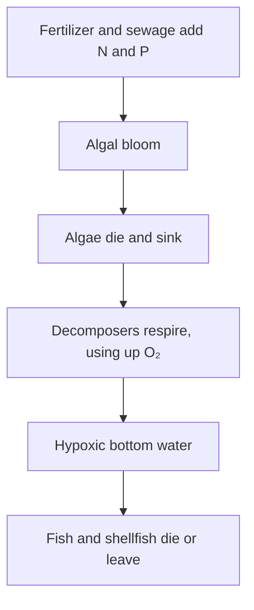
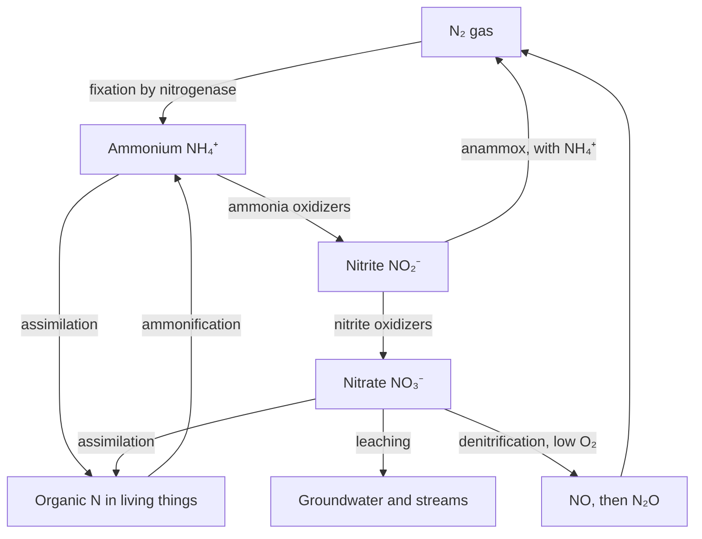

## Measuring a whole ecosystem

Lesson 38 introduced net primary productivity with a simple subtraction, and lesson 39 traced carbon and nitrogen around their cycles. This lesson asks how ecologists actually measure those quantities in a lake or a forest, what limits them, and how the same bookkeeping, scaled up to the whole planet, gives the evidence for human-caused climate change.

## GPP, NPP and the ecosystem's balance

**Gross primary productivity** (GPP) is the rate at which producers fix carbon (or capture energy) by photosynthesis. Producers immediately respire part of it, a loss called autotrophic respiration ($R_a$). What remains is net primary productivity, $\text{NPP} = \text{GPP} - R_a$, the new plant and algal tissue available to everything else. Across many ecosystems $R_a$ is roughly half of GPP, so NPP is about half of GPP.

Consumers and decomposers respire too (heterotrophic respiration, $R_h$). Subtracting that gives **net ecosystem production**:

$$\text{NEP} = \text{GPP} - R_a - R_h = \text{NPP} - R_h$$

If NEP is positive, the ecosystem is storing carbon (in wood, soil or sediment); if negative, it is losing carbon to the air. Today ecologists measure NEP of forests continuously with instruments on towers that record CO₂ moving up and down in the air above the canopy.

Earth's total NPP is roughly 105 billion tonnes of carbon per year, split about evenly between land and ocean. That is striking, because ocean producers make up well under 1% of the planet's producer biomass. Phytoplankton divide every few days and are eaten almost as fast, so a tiny standing stock carries a huge flow, the same reason open-ocean biomass pyramids can be inverted.

## The light and dark bottle method

How do you measure photosynthesis by algae you cannot see? In the 1920s the Norwegian oceanographers Torbjørn Gaarder and Haaken Gran introduced the **light and dark bottle method**. Fill three identical bottles with water from the same depth. Measure the dissolved oxygen in one right away. Seal the other two, one clear and one wrapped to block all light, and hang them back at that depth for a few hours.

- Dark bottle: only respiration happens, so $\text{initial} - \text{dark} = R$.
- Light bottle: photosynthesis and respiration both happen, so $\text{light} - \text{initial}$ = net production.
- Together: $\text{GPP} = \text{light} - \text{dark}$, because the dark bottle's loss is added back.

### Example 1

Lake water starts with 8.0 mg of O₂ per liter. After 6 hours the light bottle reads 9.2 mg/L and the dark bottle 7.4 mg/L. Find respiration, net production and GPP, and convert GPP to carbon.

1. $R = 8.0 - 7.4 = 0.6$ mg O₂/L in 6 h.
2. Net production $= 9.2 - 8.0 = 1.2$ mg O₂/L.
3. $\text{GPP} = 9.2 - 7.4 = 1.8$ mg O₂/L, which is $1.2 + 0.6$, as it should be. Per hour: $1.8/6 = 0.30$ mg O₂/L.
4. Photosynthesis releases one O₂ for each CO₂ fixed ($6\text{CO}_2 + 6\text{H}_2\text{O} \rightarrow \text{C}_6\text{H}_{12}\text{O}_6 + 6\text{O}_2$), so multiply by the mass ratio of C to O₂, $12/32$: $1.8 \times 0.375 = 0.675$ mg of carbon fixed per liter.

Honest caveats: the method assumes respiration is the same in light and dark, which is not quite true. The bottles also hold bacteria and tiny animals, so "net" production here is really net production of the whole bottle community. Real cells also release a little more than one O₂ per CO₂. Modern studies often add carbon-14 instead, tracking the label into algae.

## What limits productivity: nutrients

Where light, water and warmth are adequate, productivity is usually held back by a **limiting nutrient**: the one in shortest supply relative to need, whose addition increases growth. (This is Liebig's "law of the minimum", named for the 19th-century chemist Justus von Liebig.) Algae need nutrients in roughly fixed proportions. Starting in 1934, Alfred Redfield showed that ocean plankton, and the deep water they decompose into, share a ratio of about 106 C : 16 N : 1 P atoms, now called the **Redfield ratio**. Water with an N:P ratio well below 16 tends to be nitrogen-limited; well above 16, phosphorus-limited.

Experiments test this directly by adding nutrients and watching what grows.

- *Lakes*: In 1973 David Schindler's team split Lake 226 in northwestern Ontario with a plastic curtain. One basin got carbon, nitrogen and phosphorus; the other got the same carbon and nitrogen without phosphorus. Within weeks the phosphorus side turned bright green with algae; the other stayed clear. Phosphorus was limiting, and the photo of the two-colored lake helped persuade governments to cut phosphate from detergents.
- *Coastal seas*: John Ryther and William Dunstan (1971) showed that coastal algae off New York were limited mainly by nitrogen, which is why farm and sewage nitrogen drives coastal dead zones.
- *The open ocean*: Parts of the Southern Ocean and Pacific have plenty of nitrate and phosphate but few algae. John Martin proposed that iron, needed in tiny amounts for enzymes, was limiting. In the 1995 IronEx II experiment, adding iron to a patch of the equatorial Pacific set off a large phytoplankton bloom.
- *Co-limitation*: A 2007 meta-analysis by James Elser and colleagues found that adding nitrogen and phosphorus together usually boosted growth far more than either alone, on land, in fresh water and in the sea. "The" limiting nutrient is often a simplification.

### Example 2

Flasks of pond water are incubated for a week with nutrients added. Algal chlorophyll (µg/L) at the end: control 4, +N 5, +P 18, +N and P 40. What limits the algae?

1. Adding N alone barely changes growth (4 to 5), so N is not the first limit.
2. Adding P alone raises chlorophyll more than fourfold: P is the primary limiting nutrient.
3. With P added, adding N as well doubles growth again (18 to 40). Once P is supplied, N becomes limiting: the algae are co-limited, with P first.

When excess nutrients reach water, the result is **eutrophication**: nutrient enrichment that produces algal overgrowth and, often, oxygen loss.

## The nitrogen cycle in detail

Lesson 39 gave the outline. The chemistry explains why each step happens where it does.

- *Fixation.* The enzyme **nitrogenase** breaks N₂'s triple bond: $\text{N}_2 + 8\text{H}^+ + 8e^- + 16\,\text{ATP} \rightarrow 2\text{NH}_3 + \text{H}_2$. That is expensive, which is why legumes pay their *Rhizobium* partners in sugar. Nitrogenase is destroyed by oxygen, so fixers protect it: cyanobacteria fix in thick-walled cells called heterocysts, and legume nodules contain leghemoglobin, which binds oxygen.
- **Ammonification**: decomposers release ammonium from proteins and nucleic acids in dead tissue and wastes.
- **Nitrification**: two groups of microbes oxidize ammonium to nitrite and nitrite to nitrate, gaining energy from it. They need oxygen. Ammonia-oxidizing archaea, first grown in the lab in 2005, are now known to do much of the first step in oceans and soils, and in 2015 "comammox" bacteria were found that do both steps. Nitrate's negative charge is not held by soil particles, so it washes out easily.
- *Denitrification*: in low-oxygen soils and sediments, bacteria use nitrate in place of O₂, reducing it through nitrite, NO and nitrous oxide (N₂O) to N₂. Incomplete denitrification releases N₂O, a greenhouse gas about 270 times as strong as CO₂ per kilogram over a century and the largest remaining human-caused threat to the ozone layer.
- **Anammox** (anaerobic ammonium oxidation): bacteria discovered in the 1990s in a Dutch wastewater plant combine ammonium and nitrite directly into N₂. They are now estimated to produce a large share, perhaps a third to a half, of the N₂ lost from the oceans.

## The global carbon budget

The **airborne fraction** is the share of human CO₂ emissions that stays in the atmosphere; the rest is taken up by **carbon sinks**, reservoirs that absorb more carbon than they release (the ocean and land vegetation).

### Example 3

Using the 2023 budget above, find the airborne fraction and the rise in atmospheric CO₂, given that 1 ppm of CO₂ in the atmosphere contains about 2.12 billion tonnes of carbon.

1. Total emissions: $10.1 + 1.0 = 11.1$ GtC. Airborne fraction: $5.9/11.1 \approx 0.53$, so about 53%.
2. Rise in concentration: $5.9/2.12 \approx 2.8$ ppm.
3. Check: observations showed CO₂ rising 2.79 ppm in 2023. The land sink was unusually weak that year (heat, drought and fires during El Niño), so the airborne fraction was above its recent average of about 45–50%.

Sinks are a service, not a guarantee. The ocean's uptake is acidifying it, and warming, drought and fire can weaken the land sink.

## The evidence for human-caused climate change

The **greenhouse effect** is the warming of a planet's surface because gases such as CO₂, methane, N₂O and water vapor let sunlight through but absorb and re-emit the infrared radiation the surface gives off. Eunice Foote (1856) and John Tyndall (1859) showed in the lab that CO₂ absorbs heat. The evidence that rising CO₂ is from human activity and is warming Earth comes from independent lines that agree:

1. *The rise itself*: the Keeling curve, from about 315 ppm in 1958 to about 424 ppm in 2024.
2. *Ice cores*: air bubbles in Antarctic ice show CO₂ between roughly 180 and 300 ppm for the past 800,000 years. Today's level is far outside that range.
3. *Isotopes*: fossil fuels come from ancient plants, which are low in carbon-13 and so old they have no carbon-14 left. Atmospheric CO₂ has been getting steadily poorer in both, the fingerprint of fossil carbon rather than volcanic or ocean carbon.
4. *Oxygen*: atmospheric O₂ is falling slightly, as expected from burning fuel, not from volcanoes.
5. *The response*: global temperature in 2024 was about 1.5 °C above the late-1800s average; the ocean has absorbed over 90% of the extra heat; sea level rose about 20 cm from 1901 to 2018; Arctic sea ice is shrinking.
6. **Ocean acidification**: CO₂ dissolving in seawater forms carbonic acid. Surface pH has dropped about 0.1 units since preindustrial times, roughly 25–30% more hydrogen ions, which makes carbonate shells harder to build.

Biological signals agree: earlier springs, species moving poleward and uphill, and repeated mass coral bleaching. Uncertainties remain about feedbacks, such as how much carbon thawing permafrost will release, but not about the basic cause.

## Common mistakes

- Using light − initial as GPP. That is net production; GPP is light − dark.
- Forgetting that NPP and NEP differ: NEP also subtracts consumer and decomposer respiration.
- Assuming one nutrient limits everywhere. Lakes are often P-limited, coasts N-limited, some open oceans Fe-limited, and co-limitation is common.
- Calling denitrification and nitrification the same thing. Nitrification needs oxygen and makes nitrate; denitrification happens without oxygen and removes nitrate.
- Thinking all emitted CO₂ stays in the air. About half is taken up by sinks.

## Key points

- $\text{NPP} = \text{GPP} - R_a$ and $\text{NEP} = \text{NPP} - R_h$; positive NEP means the ecosystem stores carbon.
- Light and dark bottles: $R$ = initial − dark, net = light − initial, GPP = light − dark.
- Nutrient-addition experiments (Lake 226, coastal bioassays, IronEx) identify limiting nutrients; Redfield ratio 106:16:1.
- Nitrogenase fixes N₂ at high ATP cost; nitrification needs O₂; denitrification and anammox return N₂ in low-O₂ places.
- In 2023, 11.1 GtC was emitted and 5.9 GtC stayed in the air (about 53%); 2.12 GtC ≈ 1 ppm.
- Ice cores, isotopes, falling O₂ and the temperature record together show human-caused warming.
