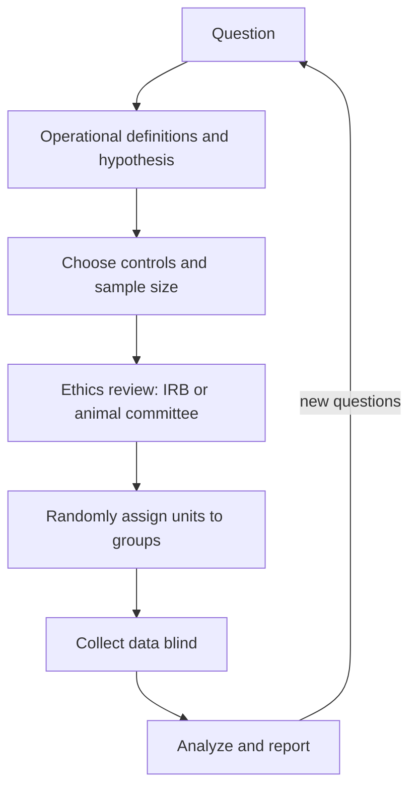

Lesson 2 of the core course set out the parts of a controlled experiment: a hypothesis, an independent and a dependent variable, controlled variables and a control group. Real research asks more of a design. How do you turn a vague question into something you can measure? How many individuals do you need? Who decides which individual gets the treatment, and does the person measuring know? When is a study on people or animals allowed at all? This lesson is about planning; the next three describe data, test it, and report it.

## From a question to a measurable hypothesis

Research starts with a question such as "Does caffeine speed up the heart?" Before it can be tested, every word has to become something you can measure. An **operational definition** says exactly how a variable will be measured or manipulated. "Caffeine" might become "a 2 mg/mL caffeine solution in pond water, applied for 5 minutes." "Heart rate" might become "beats counted under a microscope for 15 seconds, multiplied by 4." The water flea *Daphnia* is transparent, so you can watch its heart beat.

Operational definitions make a study repeatable and expose hidden choices: is "growth" height or dry mass? A plant in dim light stretches taller while its dry mass falls, so the definition can change the answer.

The hypothesis then becomes a specific prediction: *if* caffeine stimulates the *Daphnia* heart, *then* animals in the caffeine solution will have a higher mean heart rate than animals in plain pond water. Lesson 43 shows how statisticians restate this as a "null hypothesis" of no difference and test it.

## Controls and confounding variables

A **confounding variable** is a factor that differs between groups along with the treatment and also affects the outcome, so its effect gets mixed up with the treatment's. In lesson 2 the student who kept her music plants on a sunny windowsill and the silent ones in a closet had light as a confounder. If all the caffeine *Daphnia* are tested in the afternoon, after the room has warmed up, temperature is a confounder: *Daphnia* heart rate rises with temperature.

Good experiments often use two kinds of control group.

- A **negative control** is a group expected to show *no* effect, treated in every way like the experimental group except for the factor being tested. If caffeine is dissolved in a solvent, the negative control gets the solvent alone.
- A **positive control** is a group given a treatment *known* to produce the effect. It shows that the method can detect an effect when one exists.

Suppose you test whether garlic extract kills bacteria by placing soaked paper disks on a lawn of bacteria growing on agar. A disk soaked in the solvent alone is the negative control: if a clear ring appears around it, the solvent kills bacteria and the garlic results mean nothing. A disk with a known antibiotic is the positive control: if no clear ring appears around *it*, something is wrong with the bacteria or the plates, and a "no effect" result for garlic cannot be trusted.

## Replication, sample size, and the experimental unit

Replication has to happen at the right level. The **experimental unit** is the smallest unit that independently receives a treatment. If one fertilized pot and one unfertilized pot each hold five plants, the pots got the treatments, so there is one experimental unit per group. Measuring five plants (or fifty leaves) in each pot doesn't change that: any difference between the pots, such as a draft or a different batch of soil, affects all of a pot's plants together. Treating repeated measurements of the same unit as if they were independent replicates is **pseudoreplication**, and it makes results look far more certain than they are.

The **sample size** ($n$) is the number of independent experimental units in each group. Bigger samples help because the uncertainty in a group's mean shrinks as $n$ grows: lesson 42 shows that it is proportional to $1/\sqrt{n}$. To halve the uncertainty you need four times as many units.

Sample size also controls **statistical power**: the probability that a study detects a real effect of a given size. A study that is too small can miss a real effect entirely, and "we found no difference" from a study with 3 animals per group says very little. Researchers estimate the sample size they need *before* collecting data, from a pilot study or past work, often aiming for 80% power. Too large a sample wastes resources and, in animal or human research, exposes more individuals than necessary.

### Example 1: How many *Daphnia*?

A pilot study finds that *Daphnia* heart rates at 20 °C vary with a standard deviation of about 11 beats per minute (bpm). You want the uncertainty in each group's mean (the standard error, $\text{SD}/\sqrt{n}$, from lesson 42) to be no more than 2.5 bpm. How many animals per group?

*Step 1.* Set up the requirement: $\dfrac{11}{\sqrt{n}} \le 2.5$.

*Step 2.* Solve: $\sqrt{n} \ge \dfrac{11}{2.5} = 4.4$, so $n \ge 4.4^2 = 19.36$.

*Step 3.* Round up, because you can't use part of an animal: 20 per group.

*Check:* $11/\sqrt{20} = 2.46$ bpm, just under 2.5. To get the standard error down to 1.25 bpm (half as much) you would need $(11/1.25)^2 = 77.4$, so 78 animals: about four times as many.

## Randomization and blinding

Even with a good sample size, *who* goes into which group matters. If a student picks the "healthiest-looking" *Daphnia* for the caffeine group, any difference might come from that choice. **Random assignment** means using a chance process (a random number generator, drawing lots) to decide which unit gets which treatment. It does not make the groups identical, but it makes them differ only by chance, including in factors nobody thought to control. That is why randomized experiments can support claims about cause and effect when observational data cannot. Randomization applies to position and order too: shuffle the pots on the bench and the order in which animals are tested, so that a warm corner or a tired observer doesn't line up with one treatment.

**Blinding** means keeping people from knowing which treatment each unit received. In a single-blind study, the subjects don't know; in a double-blind study, neither the subjects nor the people giving the treatment and measuring the outcome know. People who know can't help influencing the result: a researcher counting heartbeats who expects the caffeine group to be faster may count borderline beats differently. In human studies the control group often receives a **placebo**, an inactive treatment that looks identical to the real one, because simply believing you are treated can change symptoms.

### Example 2: The 1954 polio vaccine trial

In 1954 the United States tested Jonas Salk's polio vaccine on schoolchildren in two ways at once. In some areas, children were randomly assigned (with parental consent) to the vaccine or a salt-water placebo, double-blind. In other areas, the National Foundation for Infantile Paralysis (NFIP) offered the vaccine to all consenting second graders and used first and third graders as controls. The rounded results (polio cases per 100,000 children) were:

| Design | Group | Size | Rate per 100,000 |
|---|---|---|---|
| Randomized, double-blind | Vaccine | 200,000 | 28 |
| | Placebo | 200,000 | 71 |
| | No consent | 350,000 | 46 |
| NFIP | Grade 2, vaccine | 225,000 | 25 |
| | Grades 1 and 3, control | 725,000 | 54 |
| | Grade 2, no consent | 125,000 | 44 |

*Step 1: cases.* Rate × size: vaccine $28 \times 2 = 56$ cases; placebo $71 \times 2 = 142$ cases.

*Step 2: the effect in the randomized trial.* The vaccine cut the rate from 71 to 28 per 100,000, a drop of $\dfrac{71 - 28}{71} \times 100\% \approx 61\%$.

*Step 3: why the NFIP design gives a smaller number.* Its controls (54) included children whose parents would *not* have consented. Polio struck children from cleaner, better-off homes more often, because they were less likely to have caught the virus as infants while still protected by their mothers' antibodies, and those families were also more likely to consent. Notice that in the randomized design the unvaccinated "no consent" children had a *lower* rate (46) than the unvaccinated placebo children (71). Consenting families were more at risk, so comparing volunteers with everyone else biased the comparison. The NFIP design suggests a drop of only $\frac{54 - 25}{54} \approx 54\%$, and grade itself was a second confounder. Only the randomized comparison of consenting children with consenting children is fair.

## Bias

**Bias** is a systematic error: one that pushes results in one direction, so it doesn't average out with more data. Some common sources:

- **Sampling bias**: the individuals studied don't represent the population the conclusion is about. Trapping mice only near the trail, or studying only patients who come back for follow-up, can give a distorted picture.
- **Observer bias**: an observer's expectations affect what is recorded. Blinding is the cure.
- Measurement bias: an instrument reads consistently too high or low (a scale that isn't zeroed). Calibration against a known standard catches it.

Bias is a bigger danger in an **observational study**, where researchers measure what already happens rather than assigning treatments. Observational studies are often the only ethical option (no one may assign people to smoke), and they did establish that smoking causes lung cancer, because many independent studies with different weaknesses agreed and a mechanism explained the link. But a single observational study can't rule out confounding.

## The ethics of research on people and animals

Rules for research grew out of real abuses. In the Tuskegee study (1932–1972), the U.S. Public Health Service followed hundreds of Black men with syphilis without telling them their diagnosis and withheld treatment, even after penicillin became the standard cure in the 1940s. Its exposure led to the Belmont Report (1979), whose three principles guide U.S. research on people today: respect for persons, beneficence (maximize benefits, minimize harms) and justice (share the burdens and benefits of research fairly).

In practice:

- **Informed consent**: participants (or the parents of children, along with the child's own agreement) are told the purpose, procedures, risks and benefits in plain language, agree voluntarily, and may quit at any time without penalty.
- An **institutional review board** (IRB), an independent committee, must approve a study on people before it starts, weighing risks against benefits.

Research on animals is guided by the **3Rs**, proposed by William Russell and Rex Burch in 1959: *replace* animals with other methods where possible (cell cultures, computer models, or invertebrates such as *Daphnia*), *reduce* the number used to the fewest that give a clear answer (a sample-size calculation is an ethical tool), and *refine* procedures to minimize pain and distress. In the United States, research on vertebrate animals is reviewed by an animal care committee (IACUC). Rules differ by country and by organism; the European Union, for example, also protects cephalopods such as octopuses.

### Example 3: Redesign a study

A student's plan: "I'll put 3 *Daphnia* in caffeine and 3 in pond water, count their heartbeats, and see which is faster. I'll test the caffeine ones first since I already made that solution." List the problems and fix them.

1. *Sample size.* Three per group has little power; from Example 1, aim for about 20.
2. *Order is a confounder.* Time of day, temperature and observer fatigue line up with treatment. Fix: randomize the testing order and hold the temperature constant.
3. *No blinding.* Fix: a classmate codes the dishes A and B so the counter doesn't know which is which.
4. *Selection.* Fix: assign animals to groups at random.
5. *Operational definitions.* Fix: state the caffeine concentration, the exposure time, and how beats are counted.
6. *Ethics.* *Daphnia* need no committee approval in most places, but the 3Rs still apply: use no more than needed and handle them gently.

## Common mistakes

- *Pseudoreplication.* Measuring many leaves on one plant, or many cells from one culture, is not the same as having many independent units.
- *Thinking randomization makes groups identical.* It makes differences between groups due to chance alone, which statistics can then account for.
- *Confusing a negative and a positive control.* Negative: expected to show no effect. Positive: known to show the effect, proving the method works.
- *Reading "no significant difference" from a tiny study as "no effect."* A study with low power can easily miss a real effect.
- *Thinking more data fix bias.* Bias is systematic; a bigger biased sample just gives a more precise wrong answer.

## Key points

- An **operational definition** states exactly how each variable is measured or applied.
- A **confounding variable** changes along with the treatment and affects the outcome. **Negative controls** should show no effect; **positive controls** show that the method can detect one.
- Replicate the **experimental unit**, the thing that independently gets the treatment; repeated measures of one unit are **pseudoreplication**.
- Uncertainty in a mean falls as $1/\sqrt{n}$: four times the **sample size** halves it. Plan $n$ in advance for adequate **statistical power**.
- **Random assignment** and **blinding** (with a **placebo** where needed) protect against hidden confounders and **observer bias**.
- Human research needs **informed consent** and **IRB** approval (Belmont principles); animal research follows the **3Rs**.
