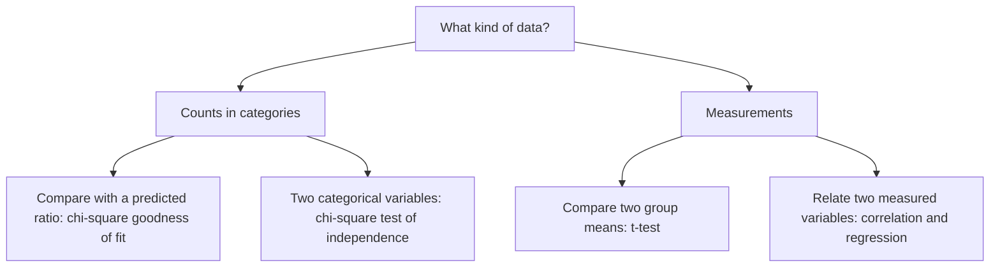

Lesson 42 judged differences by eye, from error bars and confidence intervals. A statistical test makes the same judgment with a number attached. You have already used one: lesson 21 of the core course used the chi-square test to ask whether offspring counts fit a Mendelian ratio. This lesson explains the logic shared by all such tests, extends chi-square to a second use, introduces the $t$-test for comparing means, and ends with correlation and regression, the tools for relationships between two measured variables.

## The logic: null hypotheses and p-values

A test starts from a **null hypothesis** ($H_0$): a specific statement of "no effect" or "no difference" that predicts exact numbers. "Caffeine has no effect on mean heart rate." "Offspring follow 3 : 1." The **alternative hypothesis** ($H_1$ or $H_A$) is what you'd conclude if $H_0$ fails: "caffeine changes mean heart rate."

The test then asks: *if the null hypothesis were true, how surprising would data like mine be?* The answer is the **p-value**: the probability, assuming $H_0$ is true, of getting a result at least as extreme as the one observed. A small p-value means the data would be unusual under $H_0$, which counts as evidence against it.

Researchers choose a **significance level** ($\alpha$) in advance, usually 0.05. If $p \le \alpha$, they reject $H_0$ and call the result statistically significant. If $p > \alpha$, they fail to reject $H_0$. This is like a trial: the defendant ($H_0$) is presumed innocent, and the verdict is "guilty" or "not proven," never "proven innocent."

Two kinds of error are possible:

| | $H_0$ actually true | $H_0$ actually false |
|---|---|---|
| Reject $H_0$ | **Type I error** (false positive) | Correct |
| Fail to reject $H_0$ | Correct | **Type II error** (false negative) |

When $H_0$ is true, testing at $\alpha = 0.05$ produces a Type I error 5% of the time. The power from lesson 41 is the probability of *avoiding* a Type II error when a real effect exists.

## What a p-value does not mean

p-values are among the most misread numbers in science; in 2016 the American Statistical Association issued a formal statement about the misreadings.

- $p = 0.03$ does *not* mean "a 3% chance that $H_0$ is true." It is calculated by *assuming* $H_0$ is true.
- A small p-value does not mean a large or important effect. With a huge sample, a trivial difference can be "significant." Always report the size of the effect (a difference in means, a percent change) and its confidence interval.
- $p > 0.05$ does not show that there is no effect, especially in a small study with low power.
- 0.05 is a convention, not a law of nature: $p = 0.049$ and $p = 0.051$ are nearly the same evidence.
- Run 20 tests where every null hypothesis is true and you expect about one "significant" result by chance. Testing many things and reporting only the hits produces false discoveries.

## Chi-square, two ways

The **goodness-of-fit** use (lesson 21) compares observed counts with counts predicted by a model. Mendel's flower-color F2 had 705 purple and 224 white plants. Expected under 3 : 1: $0.75 \times 929 = 696.75$ and $232.25$, giving $\chi^2 = 0.098 + 0.293 = 0.39$ with 1 degree of freedom. The critical value is 3.84 and $p \approx 0.53$: data at least this far from 3 : 1 would occur about half the time by chance, so they fit well.

The **test of independence** asks whether two categorical variables are associated. Data go in a **contingency table**, with one variable in the rows and the other in the columns. $H_0$ says the variables are independent, so each cell's expected count is

$$E = \frac{\text{row total} \times \text{column total}}{\text{grand total}}$$

and the **degrees of freedom** are $(\text{rows} - 1)(\text{columns} - 1)$. (Degrees of freedom count how many values are free to vary once the totals are fixed: in a 2 × 2 table, once one cell is known, the totals determine the other three.) Then $\chi^2 = \sum (O - E)^2/E$ as before.

### Example 1: Peppered moths in a polluted wood

In 1953 Bernard Kettlewell released marked peppered moths in a soot-darkened wood near Birmingham, England, and trapped them again over the following nights. If birds eat the conspicuous form more often, fewer of that form should be recaptured. His counts for the dark (*carbonaria*) and pale (*typica*) forms:

| | Recaptured | Not recaptured | Total |
|---|---|---|---|
| Dark | 123 | 324 | 447 |
| Pale | 18 | 119 | 137 |
| Total | 141 | 443 | 584 |

*Step 1: hypotheses.* $H_0$: recapture is independent of form. $H_1$: recapture depends on form.

*Step 2: expected counts.* Dark recaptured: $447 \times 141/584 = 107.92$. Then dark not recaptured $= 447 - 107.92 = 339.08$, pale recaptured $= 141 - 107.92 = 33.08$, pale not recaptured $= 103.92$.

*Step 3: chi-square.*
$$\chi^2 = \frac{15.08^2}{107.92} + \frac{15.08^2}{339.08} + \frac{15.08^2}{33.08} + \frac{15.08^2}{103.92} = 2.11 + 0.67 + 6.87 + 2.19 = 11.84$$
(Every $|O - E|$ is the same in a 2 × 2 table.)

*Step 4: decide.* df $= (2 - 1)(2 - 1) = 1$, critical value 3.84. Since $11.84 > 3.84$ ($p \approx 0.0006$), reject $H_0$. Dark moths were recaptured at 27.5% and pale ones at 13.1%: in the sooty wood, the dark form survived (or at least stayed) better. Some textbooks apply a "continuity correction" to 2 × 2 tables, which gives 11.06 here; the conclusion is the same.

*Step 5: limits.* The test shows an association, not its cause. Critics later pointed out that Kettlewell released moths at unnaturally high densities and in daylight. A large, carefully designed repeat by Michael Majerus (2001–2007) answered those criticisms and again found that birds ate more of the conspicuous form.

## The idea of the t-test

To compare the means of two groups, the **t-test** measures the difference between means in units of its own uncertainty:

$$t = \frac{\bar{x}_1 - \bar{x}_2}{\text{SE}_{\text{diff}}}, \qquad \text{SE}_{\text{diff}} = \sqrt{\text{SE}_1^2 + \text{SE}_2^2}$$

A large $|t|$ means the gap between means is big compared with the noise. With two independent groups of sizes $n_1$ and $n_2$, the degrees of freedom are $n_1 + n_2 - 2$, and $H_0$ (equal means) is rejected at the 0.05 level when $|t|$ reaches the critical value:

| df | 5 | 10 | 14 | 20 | 30 | very large |
|---|---|---|---|---|---|---|
| Critical $t$ ($\alpha = 0.05$, two-sided) | 2.57 | 2.23 | 2.14 | 2.09 | 2.04 | 1.96 |

So for moderate samples, $|t|$ greater than about 2 is significant, which is why the "±2 SE" rule of lesson 42 works. The test assumes independent observations and roughly normal data. When the two groups' SDs are quite different, statisticians use Welch's version, which adjusts the degrees of freedom; and when the same individuals are measured twice (before and after), a paired $t$-test is used on the individual differences.

### Example 2: Caffeine and the *Daphnia* heart

From lesson 42: pond water mean 213.0 bpm (SE 3.87), caffeine mean 245.0 bpm (SE 3.66), 8 animals each.

*Step 1.* $\text{SE}_{\text{diff}} = \sqrt{3.87^2 + 3.66^2} = \sqrt{14.98 + 13.40} = 5.33$ bpm.

*Step 2.* $t = (245.0 - 213.0)/5.33 = 6.0$.

*Step 3.* df $= 8 + 8 - 2 = 14$; critical value 2.14. Since $6.0 > 2.14$, reject $H_0$ (software gives $p \approx 0.00003$).

*Step 4: report.* "Caffeine raised mean heart rate by 32 bpm (15%; $t = 6.0$, df = 14, $p < 0.001$)." Compare lesson 42's fertilizer example: a 1.9 g difference with $\text{SE}_{\text{diff}} = \sqrt{1.1^2 + 1.0^2} = 1.49$ g gives $t = 1.28$ with 22 df, below 2.07, so not significant, as the overlapping SE bars suggested.

## Correlation is not causation

When both variables are measured rather than assigned, look for **correlation**: a tendency for them to rise and fall together. The **correlation coefficient** $r$ runs from −1 (perfect negative straight-line relationship) through 0 (no straight-line relationship) to +1 (perfect positive). It measures only *linear* association: a strong curved pattern can have $r$ near 0.

A correlation, even a strong one, can arise without one variable causing the other:

- a confounding variable drives both (towns with more storks had more births because both go with rural areas);
- causation runs the other way;
- chance, especially when many pairs of variables are searched.

A 2012 note in a medical journal found a correlation of $r = 0.79$ between countries' chocolate consumption per person and their Nobel prizes per person. National wealth, which raises both, is the obvious suspect. To show causation, biologists turn to randomized experiments, or, when those are impossible, to many observational studies with different weaknesses that agree, a dose-response pattern, and a plausible mechanism.

## Linear regression

**Linear regression** fits the straight line $\hat{y} = a + bx$ that best predicts $y$ from $x$. "Best" means least squares: the line that makes the sum of squared vertical distances from the points to the line as small as possible. The slope and intercept are

$$b = \frac{\sum (x - \bar{x})(y - \bar{y})}{\sum (x - \bar{x})^2}, \qquad a = \bar{y} - b\bar{x}$$

The **coefficient of determination**, $r^2$, is the fraction of the variation in $y$ explained by the line.

### Example 3: Crickets as thermometers

Snowy tree crickets chirp faster when it's warm, a pattern described by A. E. Dolbear in 1897. A student records these realistic data:

| Temperature $x$ (°C) | 16 | 19 | 22 | 25 | 28 |
|---|---|---|---|---|---|
| Chirps per minute $y$ | 80 | 106 | 121 | 148 | 163 |

*Step 1: means.* $\bar{x} = 22$, $\bar{y} = 618/5 = 123.6$.

*Step 2: slope.* Deviations of $x$: −6, −3, 0, 3, 6. Of $y$: −43.6, −17.6, −2.6, 24.4, 39.4. Products: 261.6, 52.8, 0, 73.2, 236.4, sum 624. Squared $x$ deviations sum to $36 + 9 + 0 + 9 + 36 = 90$. So $b = 624/90 = 6.93$ chirps per minute per °C.

*Step 3: intercept.* $a = 123.6 - 6.93 \times 22 = -28.9$. The line: $\hat{y} = -28.9 + 6.93x$.

*Step 4: predict and judge.* At 20 °C: $-28.9 + 6.93 \times 20 = 109.7$ chirps per minute. Software gives $r = 0.996$ and $r^2 = 0.99$: temperature explains about 99% of the variation in chirp rate here. Don't extrapolate: at 0 °C the line predicts −29 chirps, which is impossible (crickets go silent in the cold). A line fitted between 16 and 28 °C describes only that range.

```plot
{"x": [14, 30], "y": [60, 180], "xLabel": "temperature (°C)", "yLabel": "chirps per minute", "functions": [{"f": "-28.933 + 6.9333*x", "label": "y = -28.9 + 6.93x", "from": 15, "to": 29}], "points": [[16, 80], [19, 106], [22, 121], [25, 148], [28, 163]], "caption": "Cricket chirp rate rises with temperature; the least-squares line has slope 6.93 chirps per minute per °C"}
```

Choosing among the tests depends on the type of data:



## Common mistakes

- *Reading p as the probability that $H_0$ is true,* or as the size of the effect.
- *Treating "not significant" as "no effect."*
- *Using percentages in a chi-square test.* It needs raw counts.
- *Using categories − 1 for a contingency table.* For independence, df $= (r - 1)(c - 1)$.
- *Concluding causation from a correlation or a regression line.* Regression predicts; it doesn't explain.
- *Extrapolating* a regression line beyond the range of the data.

## Key points

- A test assumes the **null hypothesis** and asks how surprising the data would be; the **p-value** is that probability. Reject $H_0$ when $p \le$ the **significance level** (usually 0.05).
- **Type I error**: rejecting a true $H_0$. **Type II error**: missing a real effect.
- Chi-square tests counts: goodness of fit (df = categories − 1) or independence in a **contingency table** ($E$ = row × column / total; df $= (r - 1)(c - 1)$).
- The **t-test**: $t = (\bar{x}_1 - \bar{x}_2)/\sqrt{\text{SE}_1^2 + \text{SE}_2^2}$, df $= n_1 + n_2 - 2$; $|t|$ above about 2 is significant for moderate samples.
- The **correlation coefficient** $r$ measures linear association, from −1 to 1; correlation alone doesn't show causation.
- **Linear regression**: $b = \sum (x - \bar{x})(y - \bar{y}) / \sum (x - \bar{x})^2$, $a = \bar{y} - b\bar{x}$; $r^2$ is the fraction of variation explained.
