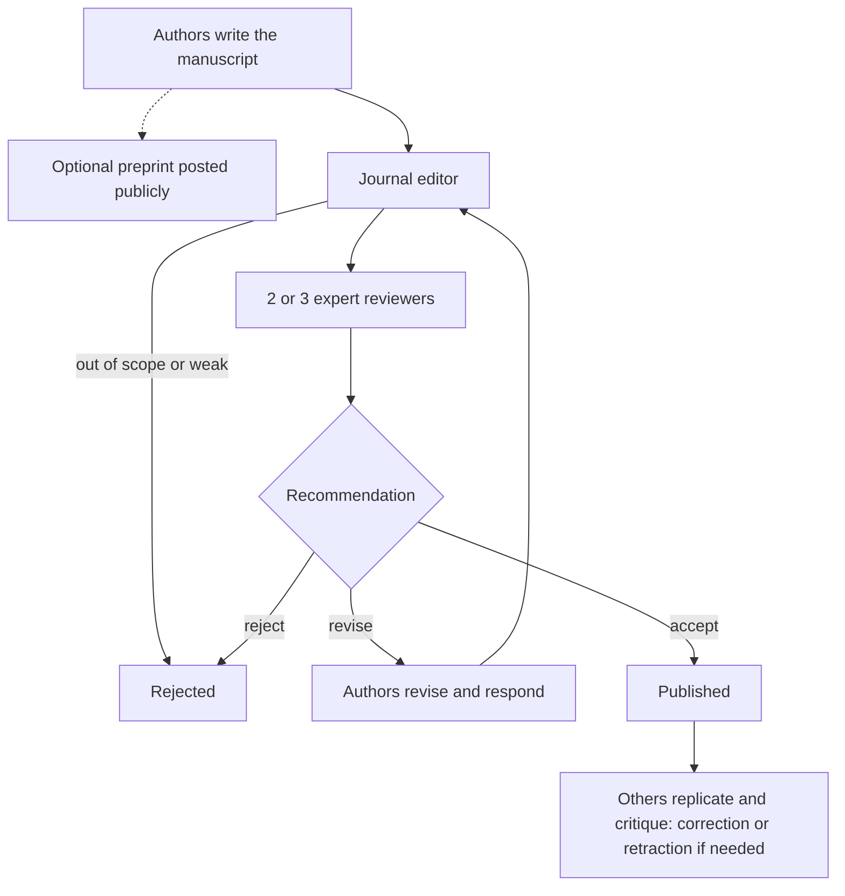

The last three lessons followed one study from plan to data to test. A study isn't finished, though, until other people can read it, check it and build on it. Core lesson 2 mentioned that scientists publish their methods and data and that journals use peer review. This lesson looks closely at that system: how a research paper is built, how to read its figures, what peer review and preprints are (and aren't), how to judge whether a source deserves your trust, and how to write up your own investigation as a lab report.

## The structure of a research paper

A **primary source** in science is a report of original research written by the people who did it: their methods, their data, their conclusions. A **review article** is a secondary source that summarizes many primary studies on a topic; textbooks and news stories are further removed still. Reviews are a good way into a field, but claims should be traceable to primary data.

Most research papers in biology follow the **IMRaD** structure:

| Section | Question it answers | What you'll find |
|---|---|---|
| Title and **abstract** | What was found, in brief? | A one-paragraph summary of the question, methods, main results and conclusion |
| Introduction | Why does this matter? | Background, the gap in knowledge, the hypothesis |
| Methods | What exactly was done? | Organisms, sample sizes, procedures, statistical tests, ethics approval |
| Results | What was found? | Data in text, tables and figures, with test results, but no interpretation |
| Discussion | What does it mean? | Interpretation, comparison with other studies, limitations, next steps |

References and often supplementary files (extra data, code) follow. Experienced readers rarely read front to back. A good order: the abstract; then the figures and their legends, to see the actual evidence; then the discussion; then the methods, to judge whether the evidence can be trusted. Checking the figures against the abstract is the single best habit: abstracts sometimes claim more than the data show.

## Reading figures

Figures carry most of a paper's evidence, and they come with a **figure legend**: the text below the figure that says what is plotted, the sample size, what the error bars show, and which test was used. Read the legend before the picture.

Parts to check, using the figure above:

- *Panel letters* (A, B) split one figure into related parts that the legend describes one by one.
- *Axis titles with units.* Check the scale, too: a y-axis that doesn't start at zero can make a small difference look huge (fine for a dot plot, misleading for bars, whose length implies the amount).
- *Individual points*, if shown, let you see the sample size and spot outliers.
- *Error bars*: the legend says whether they are SD, SE or 95% CI (lesson 42).
- *Significance markers*: an asterisk usually means $p < 0.05$, two asterisks $p < 0.01$, and so on; the legend defines them.

### Example 1: Extract the numbers

Panel A's legend reads: "Dry mass of *Arabidopsis* plants 28 days after sowing. Dots, individual plants; lines, mean ± SE; $n = 10$ per group. \* $p < 0.05$, $t$-test." Reading the graph: control mean 1.20 g (SE 0.07), nitrogen mean 1.86 g (SE 0.10).

*Step 1: effect size.* Difference $= 1.86 - 1.20 = 0.66$ g. Percent change $= 0.66/1.20 \times 100\% = 55\%$. Fold change $= 1.86/1.20 = 1.55$, so nitrogen-fed plants were about 1.5 times as heavy.

*Step 2: check the asterisk.* Approximate 95% CIs ($\pm 2$ SE): 1.06 to 1.34 g and 1.66 to 2.06 g. They don't overlap, consistent with $p < 0.05$. In fact $t = 0.66/\sqrt{0.07^2 + 0.10^2} = 0.66/0.122 = 5.4$ with 18 df, far beyond the critical 2.10.

*Step 3: limits.* One species, one growth stage, 10 plants per group, grown under lab conditions. The result says nothing yet about field crops.

## Peer review

Before publication in a reputable journal, a paper goes through **peer review**:

Reviewers check whether the question is worthwhile, the design sound, the statistics appropriate and the conclusions justified by the data. Peer review catches many problems, but it is a filter, not a guarantee. Reviewers usually see only what the authors report, not the raw data or the lab notebooks, so they rarely detect fraud, and they are busy volunteers who can miss errors. The real test comes after publication, when other labs try to repeat the work.

When a published paper turns out to be seriously wrong, through honest error or misconduct, the journal may issue a **retraction**, withdrawing it from the scientific record. A notorious case: a 1998 paper in *The Lancet* that suggested a link between the measles-mumps-rubella (MMR) vaccine and autism was retracted in 2010 after investigators found its data misrepresented and its ethics violated. Many large studies since, following hundreds of thousands of children, have found no link. The damage to vaccination rates lasted far longer than the paper's credibility, which is why the next section matters.

## Preprints

A **preprint** is a complete manuscript posted publicly, on a server such as bioRxiv (founded 2013) or medRxiv (2019), before or while it undergoes peer review. Preprints spread results fast and free; during the COVID-19 pandemic they let researchers share findings in days instead of months. But a preprint has not been checked by reviewers. Many are later published with few changes; some change substantially or never appear in a journal. Treat a preprint as a researcher's claim, not an established finding, and notice when news stories don't mention that a study is a preprint.

## Evaluating sources

Ask these questions of any scientific claim, whether in a journal, a news story or a social-media post:

1. *Where does it come from?* A peer-reviewed primary study, a review, an expert agency (such as the NIH or WHO), a news report of a study, or someone's opinion?
2. *Who did it, and who paid?* Funding and a **conflict of interest** (a financial or personal stake in the outcome) don't make a result wrong, but they are a reason to look harder. Reputable journals require authors to declare them.
3. *What kind of evidence?* A randomized experiment or an observational study? Cells, mice, or people? How many?
4. *Does the claim match the data?* Headlines often turn "associated with" into "causes," and "in mice" into "in people."
5. *Do other studies agree?* One study is a starting point. Scientific consensus rests on many independent studies.

### Example 2: Evaluate a headline

A website announces: "Blueberries reverse memory loss, scientists find!" The source is a preprint: 16 aged mice fed blueberry extract found the platform in a water maze faster than 16 mice on normal food (means 21 s and 28 s, $p = 0.04$). The study was funded by a blueberry growers' association.

- *Type of source:* a preprint, not yet peer reviewed.
- *Organism:* mice, not people; "memory loss" in the headline implies human patients.
- *Claim versus data:* the study shows faster maze performance, not "reversal" of anything; there was no measurement before and after memory decline.
- *Strength:* a single small study with $p = 0.04$, just under the threshold.
- *Conflict of interest:* the funder benefits from a positive result. That doesn't make it false, but it calls for independent replication.

A fair summary: "A small, not-yet-reviewed mouse study found that blueberry extract was associated with slightly faster maze learning in aged mice."

## Writing a lab report

A lab report follows the same IMRaD plan, scaled down. Its job is to let a reader judge, and repeat, what you did.

- *Title:* specific: "Caffeine raises heart rate in *Daphnia magna*," not "Lab 3."
- *Abstract:* four or five sentences: question, method, main result with numbers, conclusion.
- *Introduction:* background, the question, and the hypothesis with its prediction.
- *Methods:* past tense, with enough detail to repeat: organisms, sample sizes, concentrations, randomization and blinding, and the statistical test used.
- *Results:* what you found, with numbers, units, $n$, measures of variation and test results, pointing to numbered figures and tables. No interpretation yet.
- *Discussion:* whether the results support the hypothesis, how they compare with other work, limitations (sample size, possible confounders), and what to test next.
- *References* for every source you used.

### Example 3: Fix a results sentence

Draft: "The caffeine worked and proved our hypothesis that caffeine makes *Daphnia* hearts beat faster."

Problems: "worked" and "proved" are interpretation (and data never prove a hypothesis); there are no numbers, no $n$, no test.

Revised results: "Mean heart rate was 245.0 bpm (SE 3.66, $n = 8$) in caffeine solution and 213.0 bpm (SE 3.87, $n = 8$) in pond water, a 15% increase ($t = 6.0$, df $= 14$, $p < 0.001$; Figure 1)."

Then, in the discussion: "These results support the hypothesis that caffeine stimulates the *Daphnia* heart, at least at 2 mg/mL and 20 °C."

## Common mistakes

- *Trusting the abstract or headline without checking the figures.*
- *Treating peer review as proof,* or a preprint as an established finding.
- *Ignoring what the error bars are,* or a y-axis that doesn't start at zero on a bar graph.
- *Mixing results and interpretation* in a lab report, or writing methods too vague to repeat.
- *Dismissing a study only because of its funding,* or ignoring funding altogether.
- *Relying on one study* when a body of evidence exists.

## Key points

- A **primary source** reports original research; a **review article** summarizes many. Papers follow **IMRaD**, with an **abstract** first.
- Read figures with their **figure legend**: what's plotted, $n$, which error bars, which test.
- **Peer review** filters papers before publication but can't guarantee them; post-publication replication and **retraction** correct the record.
- A **preprint** is public but not yet peer reviewed.
- Judge sources by origin, **conflict of interest**, kind of evidence, match between claim and data, and agreement with other studies.
- A lab report: title, abstract, introduction with hypothesis, repeatable methods, results with numbers, discussion with limitations, references.
