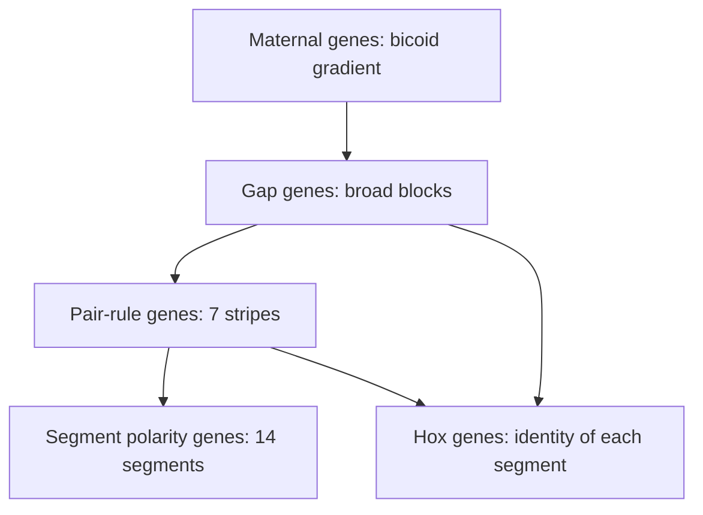

Lesson 45 followed the cell movements that turn a zygote into a layered embryo. But a skin cell, a neuron and a muscle cell have the same genome (lesson 10, Gurdon's frogs), and in lesson 24 you learned that they differ because they express different genes. That raises the deeper question this lesson answers: how does a cell in an embryo find out *which* genes to express? The answers are some of the great experiments of biology: grafts between newt embryos, the discovery of a gradient in the fly egg, and mutant flies with legs growing out of their heads.

## Same genes, different expression

Two kinds of evidence show that differentiation is about expression, not about losing genes. Nuclear transfer (Gurdon, and lesson 47) shows that a differentiated nucleus still holds a complete genome. And when biologists stain embryos for particular mRNAs, each mRNA shows up only in certain cells, even though every cell carries the gene.

Some genes act as switches for a whole cell type. In 1987 Harold Weintraub's lab found that forcing a single gene, *MyoD*, to be expressed in cultured fibroblasts turned them into muscle-forming cells that make muscle proteins and fuse into long fibers. *MyoD* codes for a transcription factor that switches on the muscle genes, and also its own gene, so once on it stays on. A cell type is often defined by a small set of such master transcription factors.

## Determination comes before differentiation

A cell can be committed to a fate long before it looks any different. Biologists separate two stages:

- **Determination**: the cell's fate becomes fixed, so it will follow that fate even if moved to a new place. Nothing visible has changed yet.
- Differentiation: the cell actually becomes specialized, making the proteins and structures of its cell type.

The test for determination is a transplant. Hans Spemann did it with newt embryos around 1918.

### Example 1: When is the fate fixed?

Spemann cut out a patch of tissue that would normally become brain ("presumptive neural" tissue) and swapped it with a patch that would normally become belly skin ("presumptive epidermis"). He did this at two stages. Predict what he saw, and explain.

| Stage of donor and host | Presumptive neural tissue placed in the belly region became… | Presumptive epidermis placed in the brain region became… |
|---|---|---|
| Early gastrula | ? | ? |
| Late gastrula | ? | ? |

Step 1: If a tissue is not yet determined, it should follow its *new* position. In the early gastrula, the transplanted brain tissue became belly skin, and the transplanted skin tissue became brain. The fates were not fixed.

Step 2: If a tissue is determined, it follows its *old* fate. In the late gastrula, the transplanted presumptive neural tissue formed neural tissue in the belly, in the wrong place.

Step 3: Conclusion: between early and late gastrulation, signals from the surroundings fixed the fate of the future neural tissue. The next question was: what sends those signals?

## Two ways to become different

Embryos use two broad strategies.

1. **Cytoplasmic determinants**: molecules (often mRNAs or proteins) placed unevenly in the egg. When cleavage divides the egg, cells that inherit the determinant take one fate and cells that don't take another. In sea squirt eggs a yellow-pigmented region of cytoplasm ends up in the cells that become tail muscle, and those cells make muscle even when isolated.
2. **Induction**: one group of cells changes the fate of a neighboring group by sending a signal, a secreted protein or a signal at the cell surface. The notochord inducing the neural plate (lesson 45) is an example. Only cells that can respond to the signal are affected; this ability to respond, called **competence**, depends on which receptors and transcription factors the responding cells have.

Most embryos use both, and induction happens over and over: each newly specified tissue becomes the source of signals for the next.

## The organizer

In 1924 Hilde Mangold, a graduate student in Spemann's lab, did the most famous graft in embryology. She used two newt species with differently colored cells, so donor and host cells could be told apart. She took the dorsal lip of the blastopore (the region where cells first roll inward) from a light-colored early gastrula and grafted it onto the opposite (belly) side of a darker early gastrula.


The host developed a second body axis, with a second neural tube, notochord and somites, sometimes almost a whole conjoined twin. The key result was in the colors: the graft itself formed mostly notochord, while the second neural tube and most of the second set of somites were built from *host* cells that would normally have become belly tissue. The graft had organized its neighbors into a new body. Spemann named this region the **organizer** (now called the **Spemann–Mangold organizer**), and he received the 1935 Nobel Prize. Mangold died in an accident in 1924, before the paper appeared.

Seventy years later the organizer's signals were identified. Surprisingly, they work by blocking. Cells across the ectoderm and the ventral side produce a signal protein called BMP4 that tells ectoderm to become epidermis. The organizer secretes proteins such as chordin and noggin that bind BMP4 and stop it from reaching its receptors. Ectoderm near the organizer, shielded from BMP, becomes neural tissue. This is a simplified picture (other signals also matter), but it captures why the dorsal side of a vertebrate makes the nervous system.

## Morphogens: position from concentration

How can one signal tell different cells different things? Lewis Wolpert proposed that cells read their position from the concentration of a **morphogen**, a substance that spreads from a source and forms a concentration gradient. Cells exposed to more than a high threshold take one fate, cells between two thresholds another, and so on. This information about a cell's location is called **positional information**.

The clearest real morphogen is **Bicoid** in the fruit fly *Drosophila*. Its mRNA is placed at the front (anterior) end of the egg by the mother and held there. After fertilization it is translated, and the protein spreads back through the embryo's shared cytoplasm (early fly embryos are one big cell with many nuclei), forming a gradient that falls off roughly exponentially:

$$C(x) = C_0 \, e^{-x/\lambda}$$

where $x$ is distance from the front, $C_0$ the concentration at the front, and $\lambda$ the decay length, about 100 µm in an egg about 500 µm long. Bicoid is a transcription factor; nuclei where it is above a threshold switch on target genes such as *hunchback*, which help specify head and thorax.

```plot
{"x": [0, 500], "y": [0, 2.1], "xLabel": "distance from anterior end (µm)", "yLabel": "Bicoid (relative to normal C0)", "functions": [{"f": "exp(-x/100)", "label": "normal (2 copies)"}, {"f": "2*exp(-x/100)", "label": "4 copies", "dashed": true}, {"f": "0.1", "label": "threshold", "dashed": true}], "points": [{"at": [230, 0.1], "label": "230"}, {"at": [300, 0.1], "label": "300"}], "caption": "An exponential Bicoid gradient with decay length 100 µm; doubling the dose moves the threshold point back by about 69 µm"}
```

Bicoid is the product of a **maternal effect gene**: the embryo's pattern depends on the *mother's* genotype, because she loaded the mRNA into the egg. Three classic experiments by Christiane Nüsslein-Volhard's group showed Bicoid works as a morphogen:

- Embryos from mothers with no working *bicoid* develop with no head or thorax; posterior structures form at both ends.
- Injecting *bicoid* mRNA into the middle or rear of an egg makes head structures form wherever it was injected.
- Giving mothers extra copies of the gene makes the head region larger and shifts the boundaries of the body toward the rear.

### Example 2: Moving a boundary by changing the dose

Use $\lambda = 100$ µm. A target gene switches on where Bicoid is at least $0.1\,C_0$ of the normal gradient. (a) Where is its boundary in a normal embryo? (b) A mother with four copies of *bicoid* instead of two makes eggs with $2C_0$ at the front. Where is the boundary now? (c) A mother with only one copy?

Step 1: Solve $C_0 e^{-x/\lambda} = T$ for $x$: take logs to get $x = \lambda \ln(C_0/T)$.

Step 2: Normal: $x = 100 \ln(1/0.1) = 100 \ln 10 = 230$ µm, a little before the middle of the egg.

Step 3: Four copies: $x = 100 \ln(2/0.1) = 100 \ln 20 = 300$ µm, a shift of $100 \ln 2 \approx 69$ µm toward the rear.

Step 4: One copy: $x = 100 \ln(0.5/0.1) = 100 \ln 5 = 161$ µm, 69 µm toward the front.

Notice that every doubling of dose moves the boundary by the same distance, $\lambda \ln 2$. Real fly embryos shift in the predicted direction, but measured shifts are somewhat smaller than this simple model predicts, evidence that other genes help keep the pattern stable.

## A cascade that builds segments

Bicoid is the first step in a cascade of transcription factors that divides the fly embryo into segments, worked out by Nüsslein-Volhard and Eric Wieschaus in large screens for mutants with broken body patterns.



Each level reads the one above it, and the pattern gets finer at every step, from a smooth gradient to sharp stripes.

## Hox genes and homeotic mutants

A segment's *number* and *identity* are separate problems. Whether a segment of the thorax carries a leg, a wing, or a small balancing organ called a haltere is decided by the **Hox genes**. Mutations in them cause **homeotic** transformations: one body part develops as if it were another.

- In *Antennapedia* mutants, a Hox gene normally active in the middle thorax is switched on in the head, and legs grow where the antennae should be.
- Combinations of mutations in the *Ultrabithorax* region turn the third thoracic segment into a copy of the second, giving a fly with four wings instead of two wings and two halteres. Edward Lewis studied these for decades; he shared the 1995 Nobel Prize with Nüsslein-Volhard and Wieschaus.

When the Hox genes were cloned in the 1980s, each turned out to contain the same 180-base-pair sequence, the **homeobox**, which codes for a 60-amino-acid DNA-binding region (the homeodomain). Hox proteins are transcription factors that switch on the genes for building a particular kind of segment.


Two features are striking. First, **colinearity**: the order of the Hox genes on the chromosome matches the order of the body regions where they act, front to back. Second, conservation: the same genes, in the same order, are found in almost all animals. Mammals have 39 Hox genes in four clusters (HOXA to HOXD), which arose by duplication (lesson 48). Mouse and human Hox genes pattern the vertebrae and limbs: mice lacking both *Hoxa11* and *Hoxd11* have severely reduced forearm bones, and people with certain *HOXD13* mutations are born with fused, extra fingers. Some human and mouse Hox genes can even do much of the job of their fly counterparts when expressed in flies.

### Example 3: A maternal effect cross

A female fly heterozygous for a loss-of-function *bicoid* allele ($bcd/+$) mates with a $bcd/+$ male. (a) What fraction of their embryos develop normally? (b) Their $bcd/bcd$ daughters grow up and mate with normal males. What happens to those daughters' embryos?

Step 1: The mother's genotype decides the egg's Bicoid supply. A $bcd/+$ mother has one working copy, which is enough. All of her embryos get Bicoid mRNA and develop normally, including the one-quarter that are $bcd/bcd$. So the answer to (a) is all of them.

Step 2: The $bcd/bcd$ daughters themselves are normal adults (their mother supplied Bicoid). But they make no Bicoid mRNA, so every egg they lay lacks it. Every one of their embryos develops without a head and thorax, whatever the father's genotype.

Step 3: This one-generation delay is the signature of a maternal effect gene, and it is how such genes were found: screens looked for normal-looking females whose embryos all failed.

## Common mistakes

- Thinking determined cells look different. Determination is a hidden commitment; differentiation is the visible specialization that follows.
- Saying the organizer graft formed the whole second embryo. It formed mainly notochord and *induced* host cells to form the rest.
- Thinking a morphogen tells each cell exactly what to make. It gives a concentration; cells' own thresholds and transcription factors interpret it.
- Confusing homeotic mutations (a part replaced by another part) with segmentation mutations (segments missing or fused).
- Thinking Hox genes are unique to insects. They are shared by nearly all animals, in the same order.

## Key points

- Differentiation is differential gene expression; master transcription factors such as MyoD can set a cell's type.
- Determination (fate fixed, tested by transplant) precedes differentiation.
- Cells become different through cytoplasmic determinants and through induction by neighbors; responding cells must be competent.
- The Spemann–Mangold organizer induces a second body axis; it works partly by blocking BMP signaling.
- A morphogen gradient such as Bicoid, $C(x) = C_0 e^{-x/\lambda}$, gives positional information; boundaries sit at $x = \lambda \ln(C_0/T)$.
- Hox genes, with a shared homeobox, give segments their identity; they are colinear and conserved across animals.
