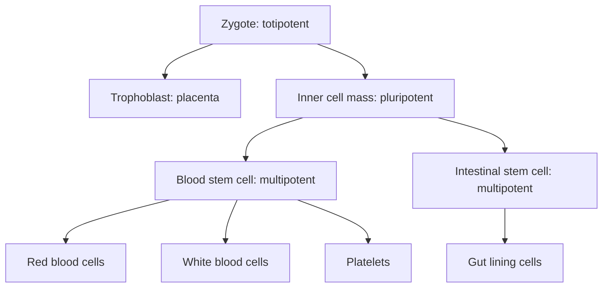

Lesson 15 introduced stem cells: unspecialized cells that renew themselves and also produce specialized cells, ranked by how many cell types they can make. Lesson 46 showed how cells in an embryo become committed to a fate. This lesson asks the reverse questions. How does a body keep a reserve of uncommitted cells for life? Can a committed cell be turned back? The experiments that answered them also raise some of the hardest ethical questions in biology.

## What makes a stem cell

Two properties define a stem cell: **self-renewal** (when it divides, at least one product is still a stem cell) and the ability to give rise to differentiated cells. A stem cell can manage both at once by **asymmetric division**, in which one daughter stays a stem cell and the other heads toward differentiation. Often the outcome depends on location: stem cells live in a special microenvironment, the **stem cell niche**, whose neighboring cells send signals that keep them in the stem state. A daughter that is pushed out of the niche loses those signals and begins to differentiate.

Potency describes how many cell types a cell can produce:

- **Totipotent**: every cell type, including the placenta and other supporting tissues. Only the zygote and the blastomeres of the first few divisions.
- Pluripotent: every cell type of the body itself, but not the placenta. The inner cell mass (lesson 45).
- **Multipotent**: several cell types of one family, such as all the blood cells.
- **Unipotent**: a single cell type, such as muscle satellite cells, which make only skeletal muscle.



## Proving a stem cell exists

In 1961 James Till and Ernest McCulloch, in Toronto, gave mice a dose of radiation that destroys the bone marrow, then injected bone marrow cells from a donor. About ten days later the spleens had visible lumps, and each lump contained red cells, white cells and platelet-forming cells together. The number of lumps rose in direct proportion to the number of cells injected, which is what you expect if each lump grows from a *single* cell. Two years later, using donor cells marked by unique radiation-induced chromosome changes, they showed that all the cells in a lump carried the same marker: each colony was a clone. One cell had made several kinds of blood cell and, when lumps were transplanted again, more colony-forming cells. That is self-renewal plus multipotency: the first direct evidence for the **hematopoietic stem cell**, the blood stem cell that bone marrow transplants rely on.

### Example 1: How rare are colony-forming cells?

Data of the kind Till and McCulloch collected:

| Marrow cells injected | 20,000 | 50,000 | 100,000 | 200,000 |
|---|---|---|---|---|
| Spleen colonies (mean) | 2 | 5 | 11 | 21 |

```plot
{"x": [0, 22], "y": [0, 25], "xLabel": "cells injected (ten thousands)", "yLabel": "spleen colonies", "functions": [{"f": "1.057*x", "label": "best line through origin", "dashed": true}], "points": [[2, 2], [5, 5], [10, 11], [20, 21]], "caption": "Colonies rise in proportion to cells injected, as expected if each colony comes from one cell"}
```

(a) Estimate the frequency of colony-forming cells. (b) Suppose only about 10% of injected colony-forming cells actually lodge in the spleen (the rest go elsewhere). Estimate the true frequency.

Step 1: The points lie on a straight line through the origin, with slope about 1.06 colonies per 10,000 cells. So about 1 colony-forming cell is detected per 10,000 marrow cells, or about 10 per 100,000.

Step 2: If only one in ten reaches the spleen, each detected colony stands for about ten colony-forming cells injected. The true frequency is about $10 \times 10 = 100$ per 100,000, or 1 in 1,000.

Step 3: Interpretation: stem cells are rare, which is why finding and purifying them took decades. The correction in (b) also shows why an assay's efficiency must be measured before a count can be converted into a frequency.

Other adult tissues have their own stem cells. Stem cells at the base of pits in the intestinal lining (crypts) replace the whole absorptive surface every few days; stem cells in the skin and hair follicles renew the epidermis; satellite cells repair muscle. These **adult stem cells** (also called somatic or tissue stem cells) are mostly multipotent or unipotent. Many tissues, such as heart muscle, have very little stem cell activity, which is why a heart attack leaves a scar.

## Embryonic stem cells

**Embryonic stem cells** are pluripotent cells taken from the inner cell mass of a blastocyst and grown in culture, where they can divide indefinitely without losing pluripotency. Mouse embryonic stem cells were first grown in 1981, human ones in 1998 by James Thomson's lab, using early embryos donated from in vitro fertilization clinics. Removing the inner cell mass destroys the embryo, which is the source of the ethical debate below.

Pluripotency is tested by what the cells can make. Injected under the skin of an immune-deficient mouse, they form a **teratoma**, a disorganized tumor containing tissues from all three germ layers. The teratoma test is strong evidence of pluripotency, but it also shows the main safety risk: any undifferentiated cells left in a therapy could form tumors.

## Turning back the clock: cloning by nuclear transfer

In 1952 Robert Briggs and Thomas King transplanted nuclei from frog blastula cells into eggs whose own nuclei had been removed, and got normal tadpoles. Nuclei from later, more specialized stages worked less and less often. John Gurdon then showed in 1962 that even nuclei from tadpole intestine cells could occasionally support development to adulthood (lesson 10). The genome is not lost during differentiation, but the egg's cytoplasm has trouble resetting it.

The mammalian version is **somatic cell nuclear transfer** (SCNT): the nucleus of a body cell is fused with an egg whose own chromosomes have been removed, and the reconstructed egg is grown into an embryo. In 1996 Ian Wilmut, Keith Campbell and colleagues at the Roslin Institute in Scotland used udder (mammary) cells from a six-year-old ewe and produced Dolly, the first mammal cloned from an adult cell.

### Example 2: How efficient was Dolly?

In the Dolly experiment, 277 eggs were fused with mammary cells. 29 of them developed into early embryos good enough to transfer into surrogate ewes. One lamb was born. (a) What fraction of fused eggs gave a lamb? (b) What fraction of transferred embryos? (c) What do the numbers suggest?

Step 1: Per fused egg: $\dfrac{1}{277} \approx 0.0036$, about 0.36%.

Step 2: Per transferred embryo: $\dfrac{1}{29} \approx 0.034$, about 3.4%. Only $\dfrac{29}{277} \approx 10\%$ of fused eggs got that far.

Step 3: Failures happen at every stage, before transfer and after it. The best explanation is incomplete **reprogramming**: the donor nucleus still carries epigenetic marks (lesson 24) from its life as an udder cell, and the egg resets them only partly. Many cloned animals since then have shown developmental problems for the same reason. Dolly was euthanized at age six in 2003 because of a virus-caused lung tumor common in housed sheep; later clones made from the same cell line aged largely normally.

Making a cloned animal is **reproductive cloning**. Using SCNT only to make an early embryo as a source of embryonic stem cells genetically matched to a patient is called **therapeutic cloning**. Human SCNT embryonic stem cells were first reported in 2013, but the method is difficult, needs donated eggs, and has been largely overtaken by the approach in the next section. Human reproductive cloning is banned in many countries and opposed by essentially all scientific organizations.

## Reprogramming with four genes

If an egg's cytoplasm can reset a nucleus, perhaps a few of its molecules are doing the work. In 2006 Kazutoshi Takahashi and Shinya Yamanaka chose 24 genes that are active in embryonic stem cells and put all of them into mouse fibroblasts using viruses. Some cells turned into colonies resembling embryonic stem cells. They then left out one gene at a time to see which were essential, and narrowed the list to four transcription factors, Oct4, Sox2, Klf4 and c-Myc, now called the **Yamanaka factors**. The resulting induced pluripotent stem cells (iPSCs) made teratomas and, in later work, could contribute to every tissue of a mouse. Human iPSCs followed in 2007 from Yamanaka's lab and, with a slightly different set of factors, from Thomson's.

Reprogramming is slow and inefficient: in the early experiments well under 1 percent of treated cells became iPSCs. Concerns include c-Myc (a known oncogene, lesson 15), viruses inserting into the genome, and incomplete reprogramming; newer methods avoid permanent DNA changes. iPSCs are now used to grow a patient's own cell types to study disease ("disease in a dish") and to test drugs, and clinical trials have begun, starting in 2014 with a sheet of retinal cells made from a patient's own iPSCs to treat a form of macular degeneration. Gurdon and Yamanaka shared the 2012 Nobel Prize.

## Regeneration

Some animals regenerate far better than we do.


- *Planarians.* These flatworms can regrow a whole animal from a small fragment; a classic 1898 report by Thomas Hunt Morgan found regeneration from a piece about 1/279 of the worm. The secret is a large population of dividing cells called **neoblasts** spread through the body. In 2011 Peter Reddien's lab irradiated planarians to kill all their dividing cells, then transplanted a *single* neoblast of a particular type into each one. In some worms that one cell multiplied and rebuilt every tissue, so at least some adult neoblasts are pluripotent.
- *Salamanders.* An axolotl can regrow a lost limb. Cells near the wound lose their specialized features, a process called **dedifferentiation**, and gather into a growing bud, the **blastema**, which rebuilds the missing part in the right order (a cut at the wrist regrows a hand, a cut at the shoulder a whole arm). Regrowth needs nerves in the stump. Tracking labeled cells (Tanaka lab, 2009) showed that blastema cells mostly keep a memory of their origin: muscle-derived cells make muscle, cartilage-derived cells make cartilage. The blastema is a collection of restricted progenitor cells, not a mass of pluripotent cells.
- *Mammals.* Our regeneration is limited: the liver regrows to its original mass after part is removed (by division of existing liver cells), and the very tips of fingers can regrow in young children. Zebrafish, by contrast, regrow heart muscle.

## Thinking about the ethics

Stem cell research raises questions on which thoughtful people disagree. Science can supply facts; it cannot by itself settle questions of value. Major perspectives include:

- *Embryos have full moral status from fertilization.* On this view, destroying a blastocyst to make embryonic stem cells is wrong whatever the benefit, and research should use adult stem cells and iPSCs.
- *Moral status develops gradually.* Many who hold this view accept research on very early embryos, usually spare embryos donated after IVF, under strict limits. A long-standing guideline was the "14-day rule" (no culture beyond 14 days or the primitive streak, after which an embryo can no longer split into twins); international guidelines updated in 2021 relaxed it to case-by-case review, and that change is itself debated.
- *Benefit and duty to patients.* Some emphasize the suffering that therapies might relieve, while others stress that hype has outpaced evidence. Clinics selling unproven "stem cell treatments" have caused real harm, including blindness after eye injections, and regulators such as the U.S. Food and Drug Administration warn against them.

iPSCs avoid destroying embryos but raise their own questions: consent and privacy for donors whose genomes are stored, safety, and the possibility of making eggs, sperm or embryo-like structures from body cells.

### Example 3: Separating facts from values

Classify each statement as an empirical claim (testable with evidence) or a value claim (about what we ought to do).

1. "iPSC-derived cells can form tumors if undifferentiated cells remain." Empirical: it can be tested with teratoma assays and patient follow-up.
2. "Research on donated IVF embryos is acceptable before day 14." Value: evidence about development informs it, but the conclusion is about what is permissible.
3. "Most cloned embryos fail to develop." Empirical, and supported by data such as Example 2.
4. "Public money should fund embryonic stem cell research." Value.

Disagreements about facts can be settled by evidence; disagreements about values need a different kind of discussion, so it helps to know which one you are having.

## Common mistakes

- Thinking adult stem cells are pluripotent. Most are multipotent or unipotent; planarian neoblasts are an unusual exception.
- Mixing up totipotent and pluripotent. Only totipotent cells can also make the placenta.
- Thinking a clone is an exact copy. A clone shares nuclear DNA, but its mitochondria come from the egg, and development and environment make it a distinct individual.
- Thinking iPSCs end all ethical questions. They remove the use of embryos, not every concern.
- Assuming salamander blastemas are pluripotent. Their cells mostly keep a memory of their tissue of origin.

## Key points

- Stem cells self-renew and produce differentiated cells; niches and asymmetric division maintain them.
- Potency: totipotent (zygote, early blastomeres), pluripotent (inner cell mass, ES cells, iPSCs), multipotent (blood stem cells), unipotent.
- Till and McCulloch's spleen colonies proved blood stem cells exist; colony counts scale with cells injected.
- Nuclear transfer (Briggs and King, Gurdon, Dolly) shows specialized nuclei keep the whole genome but reprogram poorly.
- Four transcription factors (Oct4, Sox2, Klf4, c-Myc) reprogram body cells into iPSCs.
- Planarians regenerate from pluripotent neoblasts; salamander limbs regrow from a blastema of lineage-restricted cells.
- Ethical views differ mainly over the moral status of embryos, safety and benefit; separate empirical from value claims.
