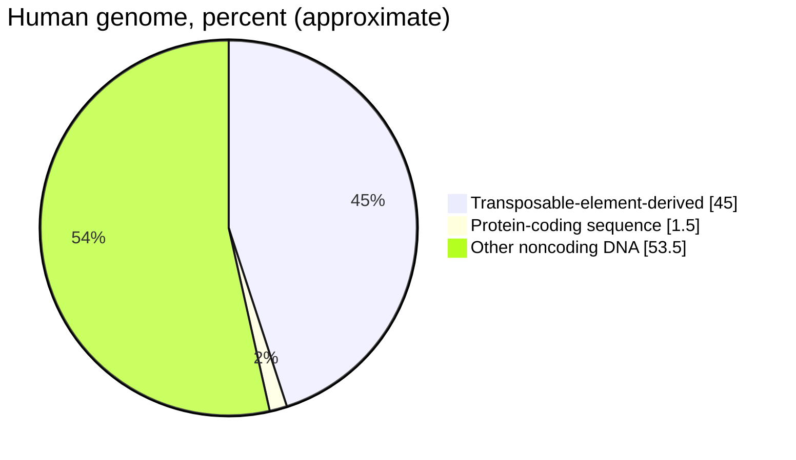
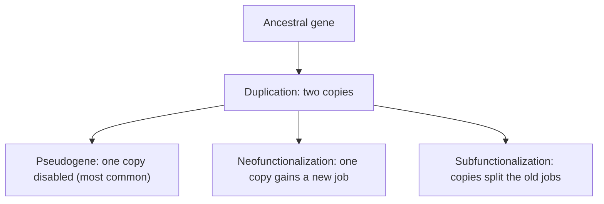

Lesson 46 ended with a puzzle: flies and mice build very different bodies with the same Hox genes, and mammals have four Hox clusters where a fly has one. This lesson steps back to look at whole genomes. Why do some onions have five times as much DNA as you? Where do new genes come from? What is the rest of the genome, the 98 percent or so that does not code for protein? And how can evolution produce new body forms when the developmental toolkit is shared across animals? The answers tie together mutation (lesson 24), chromosome changes (lesson 21) and the evidence for evolution (lesson 26).

## Genome size and the C-value paradox

The amount of DNA in one set of chromosomes (a haploid genome) is called the **C-value**. It is measured in picograms of DNA or, now that genomes are sequenced, in base pairs; 1 pg is about 978 million base pairs.

| Organism | Genome size (million bp) | Protein-coding genes (approx.) |
|---|---|---|
| *E. coli* (bacterium) | 4.6 | 4,300 |
| Baker's yeast | 12 | 6,000 |
| Fruit fly | 140 | 14,000 |
| Nematode *C. elegans* | 100 | 20,000 |
| *Arabidopsis* (small plant) | 135 | 27,000 |
| Pufferfish (*Takifugu*) | 390 | 20,000 |
| Human | 3,100 | 20,000 |
| Onion | 16,000 | not well established |
| Axolotl (salamander) | 32,000 | not well established |
| Australian lungfish | 43,000 | not well established |
| Fork fern *Tmesipteris oblanceolata* | about 160,000 | not well established |

Two patterns stand out. Gene number varies only about fivefold among these eukaryotes, while genome size varies more than ten-thousand-fold. And genome size has little to do with how complex an organism seems: a pufferfish and a human have about the same number of genes in genomes that differ eightfold, and a small fern holds about 50 times as much DNA as a human. This mismatch was called the **C-value paradox**. It stops being a paradox once you know that most DNA in large genomes is not genes; the differences come mainly from noncoding DNA, especially transposable elements, and from duplications of whole genomes. Genome size does correlate with some cell traits: large genomes go with large nuclei and cells and with slower cell division, which is one reason salamanders, with huge genomes, develop slowly. Why some lineages accumulate so much DNA is still debated.

### Example 1: Gene density in two genomes

Using the table: (a) Find the number of genes per million base pairs (Mb) for *E. coli* and for humans. (b) A typical gene's protein-coding sequence is about 950 bp in *E. coli* and about 1,600 bp in humans. Estimate the percent of each genome that codes for protein.

Step 1: *E. coli*: $4{,}300 \div 4.6 \approx 935$ genes per Mb, about one gene every 1,100 bp. Human: $20{,}000 \div 3{,}100 \approx 6.5$ genes per Mb, about one gene every 155,000 bp. Bacterial genes are packed about 145 times more densely.

Step 2: Coding DNA in *E. coli*: $4{,}300 \times 950 \approx 4.1$ million bp, or $4.1 \div 4.6 \approx 89\%$ of the genome.

Step 3: Coding DNA in humans: $20{,}000 \times 1{,}600 = 32$ million bp, or $32 \div 3{,}100 \approx 1.0\%$ of the genome. Human genes are not much longer in their coding parts; what differs is everything between and within them.

## What the rest of the genome is

Sequence that does not code for protein is called **noncoding DNA**. In humans it includes:

- introns, which make up roughly a quarter or more of the genome;
- regulatory sequences: promoters, enhancers and other switches (lesson 24);
- genes for functional RNAs: ribosomal and transfer RNAs, microRNAs and many others;
- repeated sequences at centromeres and telomeres;
- pseudogenes, broken copies of genes (below);
- and, by far the largest share, sequences descended from transposable elements.

How much of the noncoding DNA has a function is genuinely contested. In 2012 the ENCODE project reported biochemical activity (such as RNA being made, or proteins binding) across about 80 percent of the genome, and some headlines declared "junk DNA" dead. Many evolutionary biologists objected that biochemical activity is not the same as function. Comparisons across mammal genomes find that only about 10 percent of the human genome is conserved by natural selection, though some functional sequences change quickly and would be missed. Most biologists today would say the functional fraction is well under half but larger than the 1.5 percent that codes for protein.

## Transposable elements

In the 1940s Barbara McClintock, studying the spotted kernels of maize, concluded that some genetic elements could move from place to place in the chromosomes and switch genes off where they landed. The idea was widely doubted for years; she received the 1983 Nobel Prize. A **transposable element** (transposon) is a DNA sequence that can move or copy itself to new positions in the genome. There are two main classes:

- *DNA transposons* "cut and paste" themselves using an enzyme, transposase, that they encode.
- **Retrotransposons** "copy and paste": they are transcribed into RNA, and a reverse transcriptase makes a DNA copy that inserts somewhere new. Each round adds a copy, which is how they can swamp a genome.

In humans the most abundant are LINE-1 elements (about 17 percent of the genome; a complete copy is about 6,000 bp and encodes its own reverse transcriptase) and Alu elements (about 10 percent; about 300 bp, and they borrow LINE-1's machinery). Almost all copies are inactive fossils, but about a hundred LINE-1 copies can still move, and new insertions occasionally cause disease, such as a case of hemophilia A traced in 1988 to a LINE-1 that had jumped into a clotting-factor gene.

Transposable elements are not only parasites. Their copies give unequal crossing over places to misalign (one source of gene duplications), they carry sequences that have been recruited as regulatory switches, and some of their genes have been "domesticated." The enzymes that cut and join antibody genes in your immune cells descend from a transposon's transposase, and a protein needed to build the human placenta comes from an ancient retrovirus.

### Example 2: Counting repeats

Alu elements make up about 10.6% of the 3.1-billion-bp human genome, and each is about 300 bp. LINE-1 elements make up about 17%, and there are about 500,000 copies. (a) Estimate the number of Alu copies. (b) Estimate the average length of a LINE-1 copy, and compare it with the 6,000-bp full-length element.

Step 1: Alu DNA: $0.106 \times 3.1 \times 10^9 \approx 3.3 \times 10^8$ bp. Copies: $3.3 \times 10^8 \div 300 \approx 1.1 \times 10^6$, about a million copies.

Step 2: LINE-1 DNA: $0.17 \times 3.1 \times 10^9 \approx 5.3 \times 10^8$ bp. Average length: $5.3 \times 10^8 \div 500{,}000 \approx 1{,}050$ bp.

Step 3: The average copy is only about one-sixth of a complete element. Most LINE-1 copies are truncated, because reverse transcription often stops before copying the whole RNA. That is one reason so few copies can still move.

## Gene duplication and gene families

New genes mostly come from old ones. Genes are copied by unequal crossing over, by retrotransposition of an mRNA (which makes an intron-less copy), and by **whole-genome duplication**, in which every chromosome is doubled at once, as in polyploid plants (lesson 21). The evidence strongly supports two rounds of whole-genome duplication early in vertebrate history: the lancelet, a close invertebrate relative of vertebrates, has one Hox cluster, while mammals have four.

A set of genes descended by duplication from one ancestral gene is a **gene family**. Genes related by duplication within a lineage are **paralogs** (human α-globin and β-globin); genes in different species that descend from one gene in their common ancestor, split by speciation, are **orthologs** (human β-globin and mouse β-globin).

Once there are two copies, one is free to change. Susumu Ohno argued this in 1970, and the possible fates are now well described:

- A **pseudogene** is a copy disabled by mutations; with no selection to keep it, it decays. Humans have over 10,000 pseudogenes. Our family of smell-receptor genes includes roughly 400 working genes and a similar or larger number of pseudogenes, while mice have over 1,000 working ones.
- In **neofunctionalization**, one copy keeps the old function while mutations give the other a new one. Duplication of an X-linked opsin gene in the ancestors of Old World monkeys and apes, followed by small changes, produced separate red- and green-sensitive pigments and full three-color vision.
- In **subfunctionalization**, the copies divide up the original jobs, often by being expressed in different tissues or at different times.

The globin family shows all of these. An ancient duplication separated myoglobin (oxygen storage in muscle) from hemoglobin; a later one separated the α and β chains, letting hemoglobin form a four-chain molecule that loads and unloads oxygen cooperatively. Further duplications in the β cluster made embryonic, fetal and adult chains expressed at different stages. Fetal hemoglobin binds oxygen more tightly than adult hemoglobin, so it can take oxygen from the mother's blood across the placenta. The clusters also contain pseudogenes.

## Evo-devo: old genes, new forms

**Evo-devo** (evolutionary developmental biology) studies how changes in development produce evolutionary change. Its first big surprise was how widely developmental genes are shared.

*Pax6 and deep homology.* Mutations in one gene, *eyeless* in flies, *Pax6* in mice, and *PAX6* in humans, reduce or eliminate eyes (in humans, heterozygotes lack an iris). Yet insect compound eyes and vertebrate camera eyes were long thought to have evolved independently. In 1995 Walter Gehring's lab switched on the *mouse* Pax6 gene in fly tissues that normally make legs, wings or antennae, and extra eyes grew there. They were *fly* compound eyes: the mouse protein triggered the fly's own eye-building program. Structures that are not homologous can still be built under the control of homologous genes inherited from a common ancestor, a relationship called **deep homology**.

*Sticklebacks and Pitx1.* Ocean-living three-spined sticklebacks carry sharp pelvic spines that make them hard for predatory fish to swallow. After the last ice age, many populations became trapped in lakes, and in several of them the pelvis and spines shrank or disappeared, probably because spines are a liability where there are few predatory fish and many insects that grab spines. Mapping the trait led to the gene *Pitx1*, which codes for a transcription factor.

The Pitx1 protein of lake fish is unchanged. Instead, *Pitx1* is no longer expressed in the developing pelvic region, while expression in the jaw, pituitary and other tissues is normal. In 2010 researchers found that independent lake populations had separately lost a stretch of DNA containing a pelvic enhancer of *Pitx1*, a **cis-regulatory element** (a switch on the same DNA molecule as the gene it controls). Adding back a working copy of the enhancer restored pelvic structures in lake fish.

### Example 3: Why a regulatory change?

Mice with no working Pitx1 protein die around birth with defects in the hindlimbs, jaw and pituitary. (a) Explain why evolution reduced the stickleback pelvis by losing an enhancer rather than by changing the protein. (b) In a hybrid between ocean and lake fish, you measure Pitx1 mRNA from each allele in the pelvic region. If the change were in a separate regulatory protein (a different gene), what would you expect? If it is a cis-regulatory change, what would you expect?

Step 1: Pitx1 has several jobs in different tissues. A mutation that damaged the protein would affect all of them, which would likely be fatal. Deleting one tissue-specific enhancer removes only the pelvic job, so it can be favored by selection without harmful side effects. This is the general argument that changes in form often evolve through cis-regulatory changes in toolkit genes.

Step 2: A separate regulatory protein made in the hybrid's cells would act on both alleles equally. If the ocean fish supplies a working version, both alleles would be expressed.

Step 3: A cis-regulatory change travels with its own allele. In the hybrid, the ocean allele (with its enhancer) would be expressed in the pelvis but the lake allele (without it) would not. Comparing allele-specific expression in hybrids is a standard way to tell cis from trans changes.

## Common mistakes

- Assuming bigger genomes mean more complex organisms or more genes. Most size differences are noncoding DNA.
- Saying all noncoding DNA is junk, or that all of it is functional. Both overstate the evidence; the true fraction is debated.
- Mixing up paralogs (duplication within a lineage) and orthologs (separated by speciation).
- Thinking mouse Pax6 made mouse eyes in flies. It switched on the fly's own eye program.
- Thinking a lost trait means a lost gene. Lake sticklebacks still have and use *Pitx1*; they lost one switch.

## Key points

- The C-value (haploid DNA amount) varies more than 10,000-fold among eukaryotes and does not track complexity: the C-value paradox, explained mostly by noncoding DNA.
- About 1–1.5% of the human genome codes for protein; about 45% derives from transposable elements. How much is functional is debated.
- Transposable elements move by cut-and-paste (DNA transposons) or copy-and-paste via RNA (retrotransposons such as LINE-1 and Alu).
- Duplication (unequal crossing over, retrotransposition, whole-genome duplication) creates gene families; copies become pseudogenes, gain new functions, or split old ones.
- Evo-devo: shared toolkit genes such as Pax6 show deep homology; new forms often evolve through cis-regulatory changes, like the lost Pitx1 pelvic enhancer in sticklebacks.
