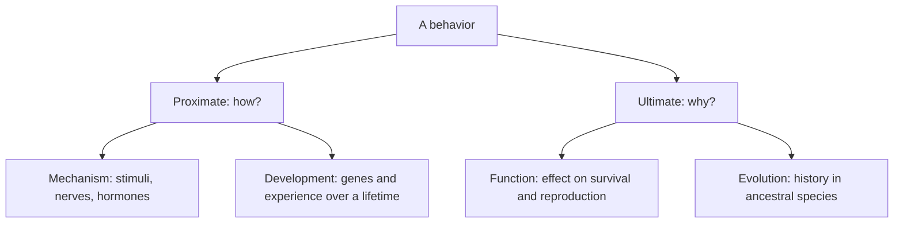

Natural selection (lesson 27) shaped bodies: beaks, wings, camouflage. It shapes what animals *do* just as much. Behavior is part of the phenotype, it is partly heritable, and it affects survival and reproduction, so it evolves. This lesson covers how biologists explain behavior, built-in versus learned behavior, communication, navigation, and how a cost-and-benefit calculation predicts what a hungry animal will eat.

## Two kinds of "why"

Ask "why does a robin sing in spring?" and you can get two correct answers that don't compete. One: lengthening days raise testosterone, which acts on song-control regions of the brain. Two: males that sing defend territories and attract mates, so singing raised their ancestors' reproductive success.

The first answer is a **proximate cause**: the immediate mechanism (hormones, nerves, genes, the triggering stimulus) and how the behavior develops in the individual. The second is an **ultimate cause**: the evolutionary reason, meaning how the behavior affects fitness and how it arose in the lineage. Ethologist Niko Tinbergen split these further into four questions that a full explanation should answer.

Keeping the levels apart avoids a common confusion. "The bird sings because of testosterone" and "the bird sings to attract a mate" are both true; neither replaces the other.

## Built-in behavior: fixed action patterns

Some behaviors appear complete the first time an animal performs them, with no practice. A **fixed action pattern** is an unlearned sequence of actions that, once started, usually runs to completion. It is triggered by a **sign stimulus**, a specific feature of the environment.

Konrad Lorenz and Niko Tinbergen described a classic case in nesting greylag geese. If an egg rolls out of the nest, the goose stretches her neck over it and rolls it back with the underside of her bill. If the experimenter removes the egg partway through, the goose finishes the tucking motion anyway, rolling an egg that isn't there. Geese will also roll in a golf ball or a doorknob: the sign stimulus is "rounded object near the nest," not "my egg."

Tinbergen's work on three-spined sticklebacks showed how specific a sign stimulus can be. In breeding season males develop red bellies and attack other males that enter their territory. Tinbergen offered them models. A realistic fish model without red was mostly ignored, while crude shapes that were red underneath were attacked. Herring gull chicks peck at a red spot on the parent's yellow bill, which makes the parent regurgitate food. In tests with models, a thin red rod with white bands drew more pecks than a realistic gull head: an exaggerated cue that beats the natural one is called a supernormal stimulus.

Why would selection favor such rigid behavior? When mistakes are rare in nature (few doorknobs roll out of goose nests) and acting fast matters, a simple, reliable trigger works well and costs little.

## Learning

Most behavior is shaped by experience as well. Biologists distinguish several kinds of learning:

| Type | What happens | Example |
|---|---|---|
| **Imprinting** | Learning during a limited window early in life that is hard to reverse | Goslings follow the first moving object they see |
| **Habituation** | Response to a repeated, harmless stimulus fades | Birds stop fleeing a scarecrow that never moves |
| **Classical conditioning** | A neutral stimulus becomes linked to one that already causes a response | Pavlov's dogs salivated at a sound that preceded food |
| **Operant conditioning** | An animal links its own action to a reward or punishment | A toad that bites a stinging bee stops trying to eat bees |
| **Spatial learning** | Remembering the layout of the surroundings | A wasp uses landmarks to find its nest |
| **Social learning** | Learning by watching others | Young chimpanzees learn to fish for termites with sticks |

Imprinting shows that instinct and learning are not opposites. Lorenz found that greylag goslings follow and bond with the first moving object they see in roughly their first day or two, normally their mother, but in his famous case Lorenz himself. The tendency to imprint is built in; *what* is imprinted on is learned. The window, called the **sensitive period**, matters: outside it, imprinting doesn't happen. Programs raising whooping cranes for release have handlers wear crane costumes so chicks don't imprint on humans.

Tinbergen's experiment on spatial learning is a model of simple design. A female digger wasp (*Philanthus*) digs a nest in sand, then flies off to hunt. While she was inside, Tinbergen placed a ring of pine cones around the entrance. After she left, he moved the ring a short distance away. Returning wasps searched in the center of the moved ring, not at the real nest entrance: they had learned the landmarks, not the spot itself. Wasps learn these landmarks on a brief orientation flight, circling over the nest before they leave.

Lorenz, Tinbergen and Karl von Frisch shared the 1973 Nobel Prize in Physiology or Medicine for founding the study of animal behavior.

## Communication

Communication is a signal from one animal that changes another's behavior.

- *Chemical.* A **pheromone** is a chemical signal between members of the same species. Ants lay trail pheromones from food to the nest; a female silk moth releases a sex attractant that males detect with their feathery antennae from a long way downwind.
- *Sound.* Vervet monkeys give different alarm calls for leopards, eagles and snakes. In playback experiments with recorded calls and no predator present, monkeys ran into trees at leopard calls, looked up or dived into bushes at eagle calls, and stood up to scan the ground at snake calls. The calls carry specific information.
- *Touch and movement.* Karl von Frisch decoded the honeybee **waggle dance**.

A forager returning from a rich flower patch dances on the vertical comb in the dark hive. She runs straight ahead while waggling her abdomen, loops back, and repeats. The direction of the waggle run, measured from straight up, gives the direction of the food measured from the sun's direction. The duration of the waggle run grows with the distance to the food.

How long the waggle lasts for a given distance differs between colonies and landscapes (bees seem to measure distance by how much the scenery flows past their eyes), so researchers calibrate it for each colony by training bees to feeders at known distances.

### Example 1: decoding a dance

A forager's waggle runs point 40° to the right of vertical and last 2.0 seconds on average. The sun is at a compass bearing of 150° (south-southeast). In this colony, 1 second of waggling corresponds to about 750 m. Where is the food?

1. Direction: "up" on the comb stands for the sun's direction, and "right of up" means clockwise from the sun. So the food is at $150° + 40° = 190°$, a little west of due south.
2. Distance: $2.0 \text{ s} \times 750 \text{ m/s} = 1500$ m.
3. Prediction: recruits should arrive at a feeder about 1.5 km away at a bearing of 190°. Experimenters test this by setting out scented feeders in a fan of directions and distances and counting arrivals; most recruits arrive near the indicated spot.

## Migration and navigation

**Migration** is regular, long-distance movement between regions, usually seasonal. Arctic terns fly between Arctic breeding grounds and Antarctic waters each year; tracking with tiny geolocators has recorded round trips averaging about 70,000 km.

Animals find their way in three increasingly demanding ways:

1. *Piloting*: following familiar landmarks (coastlines, rivers, mountains).
2. *Compass orientation*: holding a direction. The sun is a compass only if the animal knows the time, because the sun's direction changes through the day; many birds and monarchs have a time-compensated sun compass tied to their internal clock. Night migrants use stars: Stephen Emlen raised indigo buntings in a planetarium and found they learned "north" as the point the night sky rotates around. When he rotated the planetarium sky around a different star, the birds treated that star as north. European robins in cages without any view of the sky oriented using Earth's magnetic field.
3. *True navigation*: finding a goal from an unfamiliar place, which needs a "map" sense as well as a compass. Homing pigeons released far from home in places they have never been head home.

### Example 2: a clock-shift experiment

Homing pigeons are kept for several days under lights that come on and go off 6 hours earlier than the real sunrise and sunset. Their internal clock now runs 6 hours ahead. They are released at noon in the Northern Hemisphere, at a site due south of their loft, so they should fly north. Predict their direction if they use a sun compass.

1. Simple model: the sun's compass direction moves about $360° / 24 \text{ h} = 15°$ per hour, from east through south to west.
2. At real noon the sun is due south (bearing 180°), but the birds "think" it is 6 pm, when the sun should be in the west (270° in the simple model). They expect the sun $6 \times 15° = 90°$ farther clockwise than it is.
3. Facing north, west is on your left, so a bird that believes the sun is in the west flies with the sun on its left. The real sun is in the south, and keeping the south on your left means facing west.
4. Prediction: departure about 90° counterclockwise from home (west instead of north).

Experiments by Klaus Schmidt-Koenig and others found departures deflected in the predicted direction, which is strong evidence for a time-compensated sun compass. The measured deflections are often smaller than 90°, partly because the sun's compass direction doesn't move at a steady 15° per hour and partly because birds also use other cues, such as the magnetic field. On overcast days, clock-shifted pigeons often head home correctly.

## Foraging: a cost-benefit view

**Optimal foraging theory** predicts that natural selection favors feeding behavior that maximizes the net energy gained per unit time (or another currency tied to fitness), within the animal's constraints. A useful measure of a food item is its *profitability*: energy gained divided by the handling time needed to catch, open and eat it.

### Example 3: which mussels should a crab eat?

Shore crabs break open mussels with their claws. Big mussels hold more food but take much longer to crack. These illustrative averages follow the pattern Elner and Hughes found in a 1978 study of shore crabs:

| Mussel length | Energy (J) | Handling time (s) | Profitability (J/s) |
|---|---|---|---|
| 1 cm | 200 | 40 | 5.0 |
| 2 cm | 600 | 75 | 8.0 |
| 3 cm | 1,200 | 300 | 4.0 |

1. Profitability = energy ÷ handling time: $200/40 = 5.0$, $600/75 = 8.0$, $1200/300 = 4.0$ J/s.
2. Prediction: crabs should prefer middle-sized mussels, not the biggest ones. Shore crabs given a choice did eat mostly intermediate sizes.
3. The model also predicts that when the best prey is plentiful, foragers should ignore poor prey, and when it is scarce, they should widen their diet. Many animals do this.

Foraging is not only about energy. A feeding animal can be eaten. Many birds feed less efficiently but more safely in flocks or near cover, and models that include predation risk predict that tradeoff.

## Common mistakes

- Treating proximate and ultimate explanations as rivals. A hormone (proximate) and mate attraction (ultimate) explain the same song at different levels.
- Calling every unlearned behavior "instinct" and every learned one "not genetic." Imprinting is a built-in capacity to learn something specific during a set window.
- Thinking behavior evolves "for the good of the species." Selection acts on the reproductive success of individuals and their genes; the next lesson shows how this explains even helping behavior.
- Reading the waggle angle from north. It is measured from the sun's direction.
- Assuming optimal foraging means the biggest prey. Profitability is energy per unit time, and handling time can make big prey a poor choice.

## Key points

- Proximate causes explain how a behavior works and develops; ultimate causes explain why it evolved (Tinbergen's four questions: mechanism, development, function, evolution).
- A fixed action pattern is unlearned and runs to completion once a sign stimulus triggers it.
- Learning includes imprinting (sensitive period), habituation, classical and operant conditioning, spatial and social learning.
- Animals communicate with chemicals (pheromones), sounds, sights and touch; the bee waggle dance encodes direction relative to the sun and distance by duration.
- Migrants navigate by landmarks, sun, star and magnetic compasses, and some by true navigation; clock-shift experiments reveal a time-compensated sun compass.
- Optimal foraging theory predicts diets from profitability (energy ÷ handling time) and predicts that tradeoffs with predation risk change the choice.
