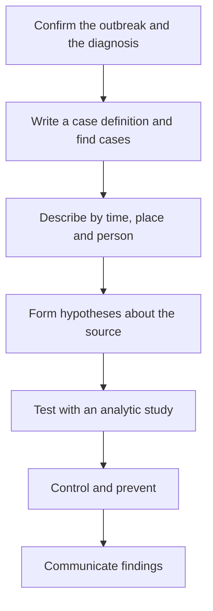

Lesson 37 followed an infection inside one body: the pathogen gets in, the immune system responds, memory cells remain. Lesson 39 modeled populations of animals growing toward carrying capacity. **Epidemiology**, the study of how disease is distributed in populations and what causes it, combines the two ideas: it treats an outbreak as a population of infections that grows, peaks and declines. This lesson builds the basic measures and models, then follows real investigations, from a London water pump in 1854 to diseases from animals and antibiotic resistance.

## Counting disease: incidence and prevalence

Two numbers describe how common a disease is.

- **Incidence** counts *new* cases in a period, as a rate: new cases divided by the population at risk, per unit time. "40 new cases per 100,000 people per year."
- **Prevalence** counts *all existing* cases at one time, as a proportion of the population. "1.2% of adults have the condition today."

Picture a bathtub. Incidence is the water flowing in from the tap; prevalence is the water in the tub; recovery and death are the drain. If the inflow and outflow have been steady for a while and the disease is fairly rare,

$$\text{prevalence} \approx \text{incidence} \times \text{average duration}$$

A short illness such as the flu can have high incidence but low prevalence, because people recover in days. A long-lasting condition such as type 2 diabetes builds up a high prevalence even at a modest incidence. A treatment that keeps people alive longer *without* curing them raises prevalence, which is good news even though the number looks worse.

### Example 1: incidence, prevalence and duration

A town of 50,000 people records 150 new cases of a chronic liver disease during 2025. On July 1, 2025, 600 residents are living with the disease. Find the incidence and prevalence per 100,000, and estimate the average duration.

1. Incidence: $\dfrac{150}{50{,}000} = 0.003$ per year, or 300 per 100,000 per year. (Strictly, the population at risk excludes the 600 who already have it: $150/49{,}400$ gives 304 per 100,000. With a rare disease the difference is small.)
2. Prevalence: $\dfrac{600}{50{,}000} = 0.012$, which is 1.2% or 1,200 per 100,000.
3. Duration: $\dfrac{0.012}{0.003 \text{ per year}} = 4$ years, if the disease is in a steady state.

## How fast does it spread? $R_0$ and $R_e$

The **basic reproduction number**, $R_0$, is the average number of people one infected person infects in a population where everyone is susceptible. It depends on the pathogen *and* on the population: roughly,

$$R_0 = (\text{contacts per day}) \times (\text{chance a contact is infected}) \times (\text{days infectious})$$

which is why handwashing, masks, ventilation and faster treatment all lower it. Typical estimates: seasonal influenza about 1.3, the original strain of SARS-CoV-2 about 2.5–3, measles about 12–18. These are ranges because $R_0$ changes with how people live and mix.

Once some people are immune, an infected person meets fewer susceptible people. The **effective reproduction number** $R_e$ (also written $R_t$) is the average number of new infections per case at a given time. In a well-mixed population,

$$R_e = R_0 \times s$$

where $s$ is the fraction still susceptible. The rule that matters: if $R_e > 1$ the number of cases grows; if $R_e < 1$ it shrinks. Every control measure is an attempt to push $R_e$ below 1.

## The SIR model

The simplest epidemic model splits a population of $N$ people into three compartments: susceptible ($S$), infectious ($I$) and removed ($R$, recovered and immune, or dead). This is the **SIR model**, first worked out by William Kermack and Anderson McKendrick in 1927.

Two rates drive it. Each day, an infectious person makes enough contact to infect $\beta$ people if all of them were susceptible; only the fraction $S/N$ are, so new infections per day are $\beta S I / N$. And a fraction $\gamma$ of infectious people recover each day, so the average infectious period is $1/\gamma$ days. Then $R_0 = \beta/\gamma$. To step the model forward one day:

$$\text{new infections} = \frac{\beta S I}{N}, \qquad \text{recoveries} = \gamma I$$

$$S \to S - \text{new}, \quad I \to I + \text{new} - \text{recoveries}, \quad R \to R + \text{recoveries}$$

### Example 2: one step of an SIR model

A town of $N = 10{,}000$ has $S = 9{,}000$, $I = 1{,}000$, $R = 0$. The pathogen has $\beta = 0.3$ per day and $\gamma = 0.1$ per day. Find $R_0$, $R_e$ now, and the compartments one day later.

1. $R_0 = 0.3 / 0.1 = 3$ (an infectious period of $1/0.1 = 10$ days). $R_e = 3 \times \tfrac{9{,}000}{10{,}000} = 2.7$, above 1, so cases will rise.
2. New infections: $\dfrac{0.3 \times 9{,}000 \times 1{,}000}{10{,}000} = 270$. Recoveries: $0.1 \times 1{,}000 = 100$.
3. Day 1: $S = 9{,}000 - 270 = 8{,}730$; $I = 1{,}000 + 270 - 100 = 1{,}170$; $R = 100$. The total is still 10,000.
4. Repeating the step: day 2 brings $\dfrac{0.3 \times 8{,}730 \times 1{,}170}{10{,}000} \approx 306$ new infections. Computers repeat such steps to draw the whole epidemic.

The curves show three things the equations predict:

- *The peak comes when $s = 1/R_0$.* At that moment $R_e = 1$; after it, each case causes fewer than one new case, and infections fall even though many people are still susceptible.
- *Overshoot.* An uncontrolled epidemic doesn't stop at the peak. Infectious people still infect others on the way down, so the final fraction ever infected (about 94% for $R_0 = 3$, about 80% for $R_0 = 2$) is well above $1 - 1/R_0$.
- *Herd immunity threshold.* Setting $R_0 s = 1$ gives the immune fraction $1 - 1/R_0$ at which an introduced infection can't grow (lesson 37 used this for vaccine coverage). Reaching it by vaccination before an epidemic avoids the overshoot.

The model assumes random mixing, permanent immunity and no change in behavior. Real models add compartments (an exposed but not yet infectious class gives the SEIR model), age groups and contact networks, but the logic of $R_e$ stays the same.

## John Snow and the Broad Street pump

In 1854 cholera killed over 500 people within about ten days in the Soho district of London. Most doctors then blamed miasma, foul air from rotting matter. The physician John Snow suspected cholera spread through water contaminated with the waste of sick people. He mapped the deaths and found them clustered around a public pump on Broad Street. The exceptions fit too: workers at a nearby brewery, who drank beer and water from the brewery's own well, were spared, and so were most residents of a workhouse with its own well. A woman who lived miles away but had Broad Street water carried to her because she liked its taste died of cholera. On Snow's evidence, the local board removed the pump's handle on September 8. (The outbreak was already declining as people fled, so the handle's removal wasn't proof by itself; the pattern of cases was.)

### Example 3: Snow's "grand experiment"

Two companies supplied water to homes on the same streets of south London. The Southwark and Vauxhall Company drew water from the Thames downstream of sewage outflows; the Lambeth Company had moved its intake upstream in 1852. Snow recorded cholera deaths in the first seven weeks of the 1854 epidemic:

| Water supplier | Houses | Cholera deaths |
|---|---|---|
| Southwark and Vauxhall | 40,046 | 1,263 |
| Lambeth | 26,107 | 98 |

1. Death rates per 10,000 houses: $\dfrac{1{,}263}{40{,}046} \times 10{,}000 \approx 315$ and $\dfrac{98}{26{,}107} \times 10{,}000 \approx 38$.
2. Ratio: $315 / 38 \approx 8.4$. Homes on the downstream supply had about eight times the death rate.
3. Why it is convincing: households on both supplies lived side by side, rich and poor alike, often without knowing which company served them, so air, wealth and neighborhood were matched. Only the water differed. This is a natural experiment.

Robert Koch identified the cholera bacterium, *Vibrio cholerae*, in 1883–84, long after Snow had shown how it spread.

## Investigating an outbreak

Modern outbreak investigations follow Snow's logic in a standard sequence.

A **case definition** sets standard criteria (symptoms, lab results, time and place) for who counts as a case, so cases are counted the same way everywhere. An **epidemic curve** is a histogram of cases by date of onset. Its shape is a clue: a single sharp peak spanning about one incubation period suggests a point source (one contaminated meal); a plateau suggests a continuing common source (a contaminated water supply); a series of growing peaks spaced about one incubation period apart suggests person-to-person (propagated) spread.

For a food-borne outbreak, investigators compare the **attack rate** (the fraction of a group who became ill) among people who ate each food with the attack rate among those who didn't. The ratio of the two is the **relative risk**.

### Example 4: finding the bad dish

After a picnic for 100 people, 46 became ill with vomiting within 12 hours. Interviews give:

| Food | Ate: ill / total | Did not eat: ill / total |
|---|---|---|
| Chicken salad | 42 / 60 | 4 / 40 |
| Bread rolls | 38 / 80 | 8 / 20 |

1. Chicken salad: attack rates $42/60 = 70\%$ and $4/40 = 10\%$. Relative risk $= 70/10 = 7$.
2. Rolls: $38/80 = 47.5\%$ and $8/20 = 40\%$. Relative risk $\approx 1.2$.
3. The chicken salad is the prime suspect: a high attack rate among eaters, a low one among non-eaters, and it accounts for 42 of the 46 cases. The 4 ill people who didn't eat it could be misremembering, unrelated illness, or cross-contamination. The next step is testing leftover food and patients.

## Zoonoses: diseases from animals

A **zoonosis** is an infectious disease that spreads between animals and people. According to the CDC, more than 6 in 10 known human infectious diseases can be spread from animals, and about three quarters of new or emerging ones come from animals. Examples include rabies, Lyme disease, West Nile virus, avian influenza and Ebola. HIV began as a related virus of chimpanzees that crossed into people in central Africa in the early twentieth century.

The animal population in which a pathogen normally lives is its **reservoir**: fruit bats for Nipah virus, white-footed mice and other small animals for the Lyme bacterium. Spillover into people happens at contact points, and often through an intermediate host or a vector such as a tick or mosquito. Clearing forests, hunting and trading wildlife, and crowding livestock all increase contact. Public health agencies therefore watch for unusual illness in wildlife and farm animals as an early warning (the "One Health" approach).

## Antibiotic stewardship

Antibiotics are a shared resource that use itself wears out. Every course of antibiotics selects for resistant bacteria in the patient's body and in the wider community (the mechanisms are in module 8's honors lesson on microbes). Across European countries, those with higher outpatient antibiotic use have higher rates of resistant bacteria. The CDC estimates more than 2.8 million antibiotic-resistant infections and over 35,000 deaths in the United States each year, and a global study estimated about 1.27 million deaths worldwide in 2019 directly caused by resistant bacterial infections.

**Antibiotic stewardship** is the coordinated effort to use antibiotics only when they help, choosing the right drug, dose and duration. In practice:

- No antibiotics for viral infections such as colds and most sore throats and bronchitis; US studies estimate about 30% of outpatient prescriptions are unnecessary.
- Narrow-spectrum drugs when the pathogen is known, and tests to identify it.
- Patients take the antibiotic exactly as prescribed and never save or share leftovers. (For many common infections, trials show shorter courses work as well as longer ones, so prescribers are moving to the shortest effective course.)
- Infection prevention and vaccination, so fewer infections need treatment at all.
- Limits in agriculture: since 2017 the US has not allowed medically important antibiotics to be used to promote growth in farm animals.

## Common mistakes

- Mixing up incidence (new cases per time) and prevalence (existing cases at a moment).
- Treating $R_0$ as a fixed property of a germ. It depends on contact patterns and changes with behavior; $R_e$ also falls as immunity rises.
- Thinking an epidemic peaks when everyone has been infected. It peaks when $s = 1/R_0$, and then overshoots.
- Comparing the number of ill people instead of attack rates. More ill people ate the rolls than were ill without them, simply because most people ate rolls.

## Key points

- Incidence = new cases per population per time; prevalence = existing cases per population; prevalence ≈ incidence × duration in a steady state.
- $R_0$ is new infections per case in a fully susceptible population; $R_e = R_0 s$; cases grow when $R_e > 1$.
- SIR model: new infections $\beta SI/N$, recoveries $\gamma I$, $R_0 = \beta/\gamma$; infections peak at $s = 1/R_0$, and the herd immunity threshold is $1 - 1/R_0$.
- John Snow linked cholera to water by mapping cases and comparing water suppliers.
- Outbreak investigations use case definitions, epidemic curves, attack rates and relative risk.
- Most emerging diseases are zoonoses; stewardship slows antibiotic resistance by cutting unnecessary use.
