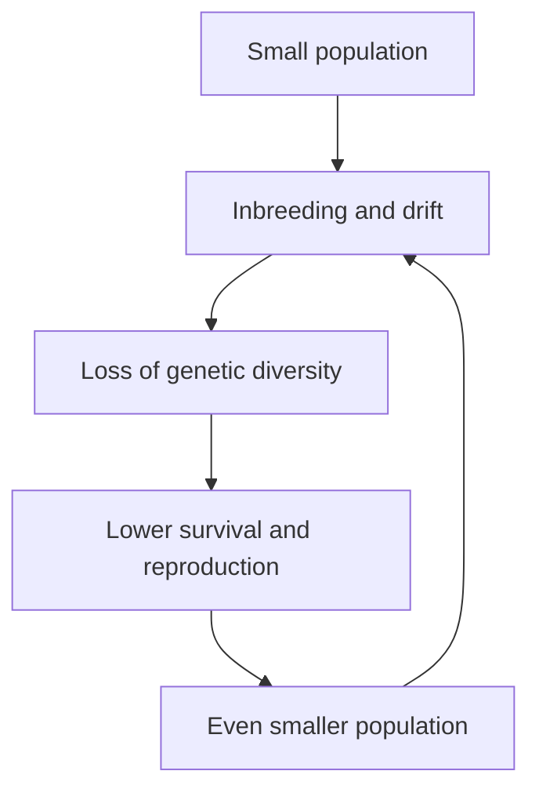

Lesson 40 listed the main threats to biodiversity: habitat loss, climate change, invasive species, pollution and overexploitation. Conservation biology is the applied science of slowing those losses. It borrows from almost every earlier lesson: population growth and mark–recapture (lesson 39), genetic drift and Hardy-Weinberg (lesson 28), and community ecology (lesson 40). This lesson takes the quantitative tools conservation biologists actually use and ends with cases where conservation worked.

## How fast are species disappearing?

Extinction is normal. Most species that ever lived are extinct, and even outside the five mass extinctions species died out at a slow, steady **background extinction rate**. To compare rates across groups, biologists count extinctions per million species-years (E/MSY): if you watched a million species for one year, how many would go extinct? Fossil and molecular studies put the background rate at roughly 0.1 E/MSY, though estimates range up to about 1.

Suppose a group of 5,000 well-studied species has 40 documented extinctions in the last 400 years. Its rate is

$$\frac{40}{5{,}000 \times 400} \times 1{,}000{,}000 = 20 \text{ E/MSY},$$

about 200 times a background rate of 0.1. Calculations like this, using real data for birds, mammals and amphibians, give modern rates around 100 E/MSY, on the order of 1,000 times background. The figures are uncertain both ways: some species declared extinct are rediscovered, but many species vanish before anyone describes them, and others are "committed" to extinction by habitat already lost (see extinction debt below).

## Island biogeography

Why do big islands have more species than small ones, and near islands more than remote ones? Robert MacArthur and E. O. Wilson answered with the theory of **island biogeography** (1963, 1967). The number of species on an island is a balance between two rates:

- *Immigration* of new species falls as the island fills up, because fewer of the mainland's species are left to arrive. It is lower for islands far from the mainland.
- *Extinction* rises as species accumulate, because more species share the space and each has a smaller population. It is higher on small islands, where populations are small.

The number of species settles at the equilibrium where the curves cross. Species keep arriving and disappearing (turnover), but the count stays roughly constant.

Daniel Simberloff and Wilson tested the theory in the late 1960s. They covered small mangrove islands in the Florida Keys with tents, fumigated them to remove every insect and spider, and recorded recolonization. Within about a year species numbers returned to near their original levels, though the species list was different, and the most distant island recovered most slowly.

The pattern behind the theory is the **species-area relationship**:

$$S = cA^z$$

where $S$ is the number of species, $A$ the area, and $c$ and $z$ constants fitted to data. For islands, $z$ is usually about 0.2–0.35. With $z \approx 0.3$, ten times the area holds about twice the species ($10^{0.3} \approx 2$).

Nature reserves surrounded by farms and cities are islands too, which is why the theory matters for conservation.

### Example 1: predicting losses from habitat loss

A forest region holds 200 bird species. Logging removes 90% of the forest. Using $z = 0.25$, how many species would eventually remain?

1. Ratio of areas: $A_{\text{new}}/A_{\text{old}} = 0.10$. The constant $c$ cancels: $\dfrac{S_{\text{new}}}{S_{\text{old}}} = \left(\dfrac{A_{\text{new}}}{A_{\text{old}}}\right)^z$.
2. $S_{\text{new}} = 200 \times 0.10^{0.25} = 200 \times 0.562 \approx 112$.
3. Losing 90% of the area loses only about 44% of the species, but that is still about 88 species.

Two cautions. The losses are not immediate: species can persist for decades in remnants too small to support them, an **extinction debt** that comes due later unless habitat is restored. And species-area predictions are approximate; they depend on how species are spread across the landscape, and some studies argue that this method overestimates losses. Treat such results as estimates with wide uncertainty.

## Fragmentation and edges

Habitat loss rarely removes one neat block. Usually it causes **habitat fragmentation**: a continuous habitat is broken into smaller, isolated patches separated by farms, roads or towns. Fragments suffer an **edge effect**: near the boundary, conditions differ from the interior. Edges get more light, wind and drying, more invasive plants, and more nest predators and parasites. In the eastern United States, songbird nests near forest edges are parasitized more often by brown-headed cowbirds, which lay eggs in other birds' nests.

The Biological Dynamics of Forest Fragments Project, started in 1979 near Manaus, Brazil, isolated Amazon forest patches of 1, 10 and 100 hectares and has studied them ever since. Edge effects reached 100 m or more into the forest; large trees died faster near edges, and small fragments lost many understory birds and other species.

### Example 2: core area

A reserve of 100 ha (1 ha = 10,000 m²) can be one square block or four separate square blocks of 25 ha each. If edge effects reach 100 m, how much interior (core) habitat does each design keep?

1. One block: $\sqrt{1{,}000{,}000 \text{ m}^2} = 1{,}000$ m on a side. The core is $(1{,}000 - 2 \times 100)^2 = 800^2 = 640{,}000$ m², or 64 ha.
2. Four blocks: each is $\sqrt{250{,}000} = 500$ m on a side, with core $(500 - 200)^2 = 300^2 = 90{,}000$ m² = 9 ha. Together: 36 ha.
3. Same total area, but the split design keeps barely more than half as much core habitat. Interior species need the single large block, or strips of habitat that connect the pieces so animals can move between them.

Corridors work: in large field experiments at the Savannah River Site in South Carolina, patches connected by corridors exchanged more pollinators, seeds and animals and kept more plant species than isolated patches.

## Small populations and genetic diversity

How small is too small? A **minimum viable population** is the smallest population with a high chance (say 95%) of persisting for a set time (say 100 years) despite chance events. Small populations face four kinds of chance: demographic accidents (by chance, all births in a year are males), environmental swings (a drought year), catastrophes (a hurricane), and genetic problems.

The genetic problems come from drift and inbreeding (lesson 28). What matters is not the head count but the **effective population size** $N_e$: the size of an ideal population that would lose genetic diversity at the same rate. Unequal sex ratios, unequal family sizes and population crashes all make $N_e$ smaller than the census count. For unequal numbers of breeding males $N_m$ and females $N_f$,

$$N_e = \frac{4N_mN_f}{N_m + N_f}$$

and heterozygosity (the proportion of heterozygous genes) falls by a fraction $\tfrac{1}{2N_e}$ each generation:

$$H_t = H_0\left(1 - \frac{1}{2N_e}\right)^t$$

Inbreeding exposes harmful recessive alleles, causing **inbreeding depression**: lower survival and fertility in offspring of relatives. Low numbers, inbreeding and lost variation then reinforce each other.

This feedback loop is the **extinction vortex**. An old rule of thumb, the "50/500 rule," held that $N_e$ of 50 avoids serious short-term inbreeding and 500 keeps enough variation to adapt; newer analyses suggest at least 100 and 1,000. Many studies put census minimum viable populations in the thousands.

### Example 3: a captive breeding program

A zoo program breeds from 10 males and 40 females. Find $N_e$ and the fraction of heterozygosity left after 20 generations. Compare with 25 males and 25 females.

1. $N_e = \dfrac{4 \times 10 \times 40}{10 + 40} = \dfrac{1{,}600}{50} = 32$, well below the 50 animals counted.
2. $H_{20}/H_0 = \left(1 - \tfrac{1}{64}\right)^{20} = 0.984^{20} \approx 0.73$. About 27% of the heterozygosity is lost.
3. With 25 of each sex, $N_e = 50$ and $\left(1 - \tfrac{1}{100}\right)^{20} \approx 0.82$, keeping 82%. Equalizing breeders helps; real programs also pair animals to keep family sizes equal.

The fix for an inbred population is often **genetic rescue**: bringing in individuals from another population. By the early 1990s only about 20–30 Florida panthers survived, with kinked tails, heart defects and poor sperm quality. Eight female pumas from Texas were released in 1995. Panthers with mixed ancestry had fewer defects and survived better, and the population has grown to an estimated 120–230. Greater prairie chickens in Illinois recovered their egg hatching rates after birds from larger populations in other states were brought in during the 1990s.

## Counting and forecasting populations

Mark–recapture (lesson 39) gives $N = MC/R$. Its assumptions are a closed population (no births, deaths or migration between samples), marks that aren't lost, and every animal equally likely to be caught. If marked animals avoid traps ("trap-shy"), recaptures $R$ are too low and $N$ is overestimated; "trap-happy" animals make it an underestimate. With small samples, ecologists use Chapman's version, $N = \dfrac{(M+1)(C+1)}{R+1} - 1$, which is less biased: for $M = 40$, $C = 50$, $R = 8$ it gives $\tfrac{41 \times 51}{9} - 1 \approx 231$ instead of 250.

**Population viability analysis** (PVA) uses data on survival, reproduction and their variation to simulate a population's future thousands of times, giving a probability of extinction within, say, 100 years under each management option. One lesson of PVA is that year-to-year variation itself is dangerous.

### Example 4: good years and bad years

A population alternates years of growth $\lambda = 1.5$ and decline $\lambda = 0.6$. The average $\lambda$ is $1.05$. Is it growing?

1. Over two years the population is multiplied by $1.5 \times 0.6 = 0.90$: it shrinks 10% every two years.
2. The long-run growth rate is the geometric mean, $\sqrt{0.90} \approx 0.95$, a 5% decline per year.
3. After ten years, $0.90^5 \approx 0.59$ of the starting population remains. Variable environments can doom a population whose average year looks fine, which is why PVA models variation, not just averages.

## Invasive species

Many introduced species never establish, and only a fraction of those that do become harmful, but the ones that spread can be devastating, often because they escaped the predators, parasites and competitors of their home range. Cane toads, introduced to Queensland in 1935 to control beetles in sugarcane, failed at that job, spread across northern Australia, and poison native predators such as quolls and monitor lizards that eat them. Nile perch introduced to Lake Victoria contributed, along with pollution, to the loss of perhaps 200 or more of its native cichlid fish species. The emerald ash borer, a beetle first found near Detroit in 2002, has killed hundreds of millions of North American ash trees.

Management, from cheapest to most expensive: prevention (inspecting cargo, banning risky imports), early detection and rapid response, eradication, and long-term control. Eradication works best on islands: helicopter baiting from 2011 to 2015 removed rats and mice from the subantarctic island of South Georgia, declared rodent-free in 2018, and its ground-nesting birds are returning. **Biological control** uses a natural enemy from the invader's home range. In 1888–89 the vedalia beetle from Australia controlled cottony cushion scale, which was destroying California's citrus; the cane toad shows why candidates must now be tested for effects on non-target species first.

## Conservation that worked

- *California condor.* By 1987 all 27 surviving condors were taken into captivity. Captive breeding and releases brought the total to about 600 by 2025, more than half flying free. Lead poisoning from bullet fragments in carcasses remains the main threat.
- *Yellowstone wolves.* Thirty-one wolves from Canada were released in 1995–96, 70 years after wolves were eliminated from the park. Elk numbers and behavior changed. How much this let willows and aspens recover (a trophic cascade) is still debated, because elk also declined for other reasons.
- *Humpback whales.* Commercial hunting of humpbacks was banned worldwide in 1966, and a moratorium on all commercial whaling followed in 1986. Many humpback populations have since recovered strongly.
- *Florida panther* and *South Georgia* (above).

## Common mistakes

- Expecting extinctions to follow habitat loss immediately. Extinction debt means losses can lag by decades.
- Applying the species-area relationship linearly. Losing 90% of the area loses fewer than 90% of species, because $S$ grows as a power of $A$.
- Counting heads instead of effective size. A population of 50 with a skewed sex ratio can behave genetically like one of 32 or fewer.
- Judging growth by the arithmetic mean of $\lambda$. Multiply the yearly factors; the geometric mean decides the long-run trend.
- Assuming a single large reserve always beats several small ones. Large blocks keep more core habitat, but several reserves can spread risk from a single catastrophe; the best design depends on the species.

## Key points

- Background extinction is about 0.1 E/MSY; current rates are estimated near 100 E/MSY.
- Island biogeography: species number is an equilibrium between immigration (lower for far islands) and extinction (higher for small islands); $S = cA^z$ with $z \approx 0.2$–$0.35$.
- Fragmentation shrinks core habitat through edge effects; corridors help connect fragments.
- $N_e = 4N_mN_f/(N_m + N_f)$; heterozygosity falls by $1/(2N_e)$ per generation; small populations can enter an extinction vortex, and genetic rescue can reverse inbreeding depression.
- Mark–recapture estimates depend on its assumptions; population viability analysis forecasts extinction risk, and variable growth lowers long-run growth.
- Prevention is the cheapest invasive-species control; island eradications and careful biological control can succeed; species such as the condor show recovery is possible.
