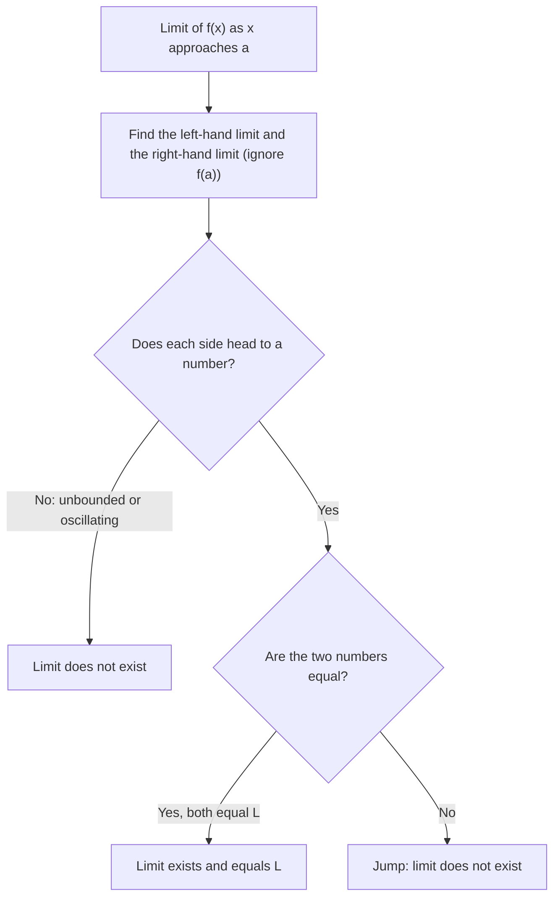

## Why calculus starts with limits

Calculus answers two old questions. How fast is something changing *at one instant*? And how much has piled up when the rate keeps changing? Both questions force you to think about a quantity you can't compute directly, only approach. A speedometer reading is an average speed over a shorter and shorter time interval; the area under a curve is a sum of thinner and thinner rectangles. The tool that makes "shorter and shorter" precise is the **limit**.

This lesson builds the idea from pictures and tables. The next lesson turns it into algebra you can do by hand.

## The idea

We write

$$\lim_{x \to a} f(x) = L$$

and say "the limit of $f(x)$ as $x$ approaches $a$ is $L$" when the outputs $f(x)$ can be made as close to $L$ as we like by taking inputs $x$ close enough to $a$ (but not equal to $a$).

Two things in that sentence matter a lot:

1. *Only nearby inputs count.* The value $f(a)$ itself, or whether $f(a)$ even exists, has no effect on the limit. A limit describes where the function is *heading*, not where it *is*.
2. *"As close as we like."* It isn't enough for $f(x)$ to get closer to $L$; it has to get *arbitrarily* close. (Lesson 4 turns this into the formal ε-δ definition.)

Here is the classic picture. The function

$$f(x) = \frac{x^2 - 1}{x - 1}$$

is undefined at $x = 1$ (the denominator is zero), but for every other $x$ it equals $x + 1$. Its graph is the line $y = x + 1$ with a hole at $(1, 2)$.

```plot
{"x": [-2, 4], "y": [-1, 5], "functions": [{"f": "(x^2 - 1)/(x - 1)", "label": "y = (x² − 1)/(x − 1)"}], "points": [{"at": [1, 2], "open": true, "label": "hole at (1, 2)"}], "caption": "The outputs head toward 2 as x approaches 1, even though f(1) is undefined"}
```

As $x$ approaches 1 from either side, the outputs approach 2. So $\lim_{x\to1} f(x) = 2$, even though $f(1)$ doesn't exist.

## Estimating a limit with a table

A table of values is a quick way to see where outputs are heading. Pick inputs closing in on $a$ from both sides.

### Example 1

Estimate $\displaystyle\lim_{x \to 0} \frac{\sin x}{x}$ ($x$ in radians).

Plugging in $x = 0$ gives $0/0$, which tells us nothing. So we tabulate:

| $x$ | $\pm 0.5$ | $\pm 0.1$ | $\pm 0.01$ | $\pm 0.001$ |
|---|---|---|---|---|
| $\dfrac{\sin x}{x}$ | 0.958851 | 0.998334 | 0.999983 | 0.9999998 |

The function is even, so both sides give the same numbers. The outputs climb toward 1, so we estimate the limit is **1**. (Lesson 4 proves it.)

Tables are evidence, not proof. They can mislead if you don't go close enough, or if the function oscillates. For instance $\sin(\pi/x)$ equals 0 at $x = 0.1, 0.01, 0.001, \dots$, but it swings between $-1$ and $1$ infinitely often near 0, so it has no limit there. A careful table uses "unfriendly" inputs too, and a graph if you can get one.

## One-sided limits

Sometimes the function heads to different places depending on which side you come from. The **one-sided limits** are written

$$\lim_{x \to a^-} f(x) \quad(\text{from the left, } x < a), \qquad \lim_{x \to a^+} f(x) \quad(\text{from the right, } x > a).$$

The two-sided limit exists exactly when both one-sided limits exist and are equal:

$$\lim_{x\to a} f(x) = L \iff \lim_{x\to a^-} f(x) = L \text{ and } \lim_{x\to a^+} f(x) = L.$$

This is the most useful test for "does the limit exist?" Look left, look right, compare.

The chart below turns that test into a routine you can run on any limit.



### Example 2

Let

$$g(x) = \begin{cases} x + 1, & x < 2 \\ 5, & x = 2 \\ 7 - x^2/2, & x > 2. \end{cases}$$

Find $\lim_{x\to2^-} g(x)$, $\lim_{x\to2^+} g(x)$, $\lim_{x\to2} g(x)$ and $g(2)$.

- From the left, $g$ follows $x + 1$, heading to $2 + 1 = 3$.
- From the right, $g$ follows $7 - x^2/2$, heading to $7 - 4/2 = 5$.
- The one-sided limits differ ($3 \ne 5$), so $\lim_{x\to 2} g(x)$ **does not exist**.
- $g(2) = 5$ by the middle line. That matches the right-hand limit, but the value doesn't rescue the two-sided limit.

```plot
{"x": [-1, 5], "y": [-2, 7], "functions": [{"f": "x + 1", "to": 2}, {"f": "7 - x^2/2", "from": 2}], "points": [{"at": [2, 3], "open": true}, {"at": [2, 5], "label": "g(2) = 5"}], "caption": "A jump at x = 2: left limit 3, right limit 5"}
```

## Reading limits from a graph

When you read a limit from a graph, put your finger on the curve and slide toward $x = a$ from each side, watching the $y$-value. Ignore any dot sitting exactly at $x = a$. Three common pictures:

| Picture at $x = a$ | Two-sided limit |
|---|---|
| Hole, curve meets from both sides at height $L$ | exists, equals $L$ |
| Jump: left side heads to $L_1$, right side to $L_2 \ne L_1$ | does not exist |
| Vertical asymptote: outputs blow up | does not exist (we may write $\infty$; see Lesson 3) |

At a jump there are three different heights to keep apart: where the curve heads from the left, where it heads from the right, and where the solid dot sits. Only the first two say anything about the limit.


### Example 3

The graph below shows $h$. Read off $\lim_{x\to -1} h(x)$, $h(-1)$, $\lim_{x\to 1^-} h(x)$ and $\lim_{x\to1^+} h(x)$.

```plot
{"x": [-3, 3], "y": [-2, 4], "functions": [{"f": "x^2", "to": 1}, {"f": "x - 1", "from": 1}], "points": [{"at": [-1, 1], "open": true}, {"at": [-1, 3], "label": "(−1, 3)"}, {"at": [1, 1], "open": true}, {"at": [1, 0]}], "caption": "y = h(x)"}
```

- Near $x = -1$ the curve is the parabola $y = x^2$ on both sides, heading to height 1. So $\lim_{x\to-1} h(x) = 1$.
- The solid dot says $h(-1) = 3$. The limit and the value disagree; that's allowed.
- Left of 1 the parabola heads to height 1, so $\lim_{x\to1^-} h(x) = 1$.
- Right of 1 the line $y = x - 1$ heads to 0, so $\lim_{x\to1^+}h(x) = 0$. The two-sided limit at 1 doesn't exist.

## When a limit fails to exist

There are three standard ways:

1. **Jump**: different one-sided limits (Example 2).
2. **Unbounded behavior**: outputs grow without bound, as with $1/x^2$ near 0.
3. **Oscillation**: outputs never settle, as with $\sin(\pi/x)$ near 0.

The third kind is the hardest to picture. Between $x = 0.1$ and $x = 1$, $\sin(\pi/x)$ makes only a few swings, but between $0.01$ and $0.1$ it makes many more, and the swings keep crowding together as $x$ shrinks. Every interval around 0, however small, contains inputs where the output is 1 and inputs where it is $-1$, so the outputs can't settle near any single number.

```plot
{"x": [-1, 1], "y": [-1.5, 1.5], "functions": [{"f": "sin(pi/x)"}], "caption": "y = sin(π/x) swings between −1 and 1 faster and faster near x = 0 (no drawing can show every swing)"}
```

## Common mistakes

- *Plugging in and stopping.* If direct substitution gives $0/0$, that is *not* the answer and not "undefined"; it means more work is needed. $0/0$ is called an indeterminate form.
- *Using the dot instead of the curve.* $f(a)$ and $\lim_{x\to a} f(x)$ are different questions. Read the limit from the curve's approach.
- *Checking only one side.* A two-sided limit needs both sides to agree.
- *Trusting a short table.* Go close (0.001 or nearer) and check both sides; watch for oscillation.
- *Calculator in degrees.* $\sin x / x \to 1$ only in radians. In degrees the table heads to $\pi/180 \approx 0.01745$.

## Key points

- $\lim_{x\to a} f(x) = L$ means $f(x)$ gets arbitrarily close to $L$ for $x$ close to (but not equal to) $a$.
- The value $f(a)$ doesn't affect the limit.
- Two-sided limit exists ⇔ both one-sided limits exist and agree.
- Tables and graphs give estimates; algebra (next lesson) gives exact values.
- Limits fail to exist through jumps, unbounded growth, or oscillation.
