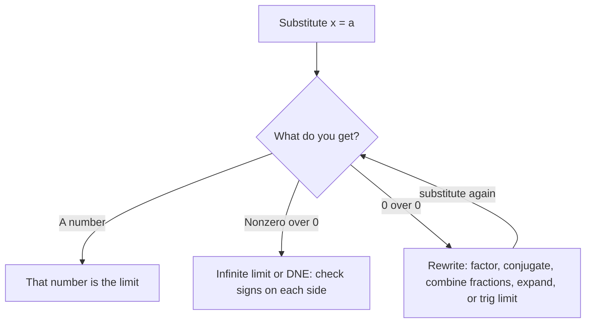

## From estimates to exact answers

Lesson 1 estimated limits from graphs and tables. That's slow and never quite certain. This lesson gives the rules that let you compute most limits exactly with algebra: the limit laws, direct substitution, and a handful of tricks for the $0/0$ case.

## The limit laws

Suppose $\lim_{x\to a} f(x) = L$ and $\lim_{x\to a} g(x) = M$ both exist, and $c$ is a constant. Then:

| Law | Statement |
|---|---|
| Sum/difference | $\lim (f \pm g) = L \pm M$ |
| Constant multiple | $\lim c f = cL$ |
| Product | $\lim fg = LM$ |
| Quotient | $\lim \dfrac{f}{g} = \dfrac{L}{M}$, provided $M \ne 0$ |
| Power | $\lim f^n = L^n$ |
| Root | $\lim \sqrt[n]{f} = \sqrt[n]{L}$ (for even $n$, need $L \ge 0$ and $f(x) \ge 0$ near $a$) |

These are what you'd expect: if $f$ is near $L$ and $g$ is near $M$, then $f + g$ is near $L + M$. (The proofs use the ε-δ definition from Lesson 4.) The fine print matters: each law needs the individual limits to *exist*, and the quotient law needs a nonzero denominator limit.

Two basic limits start everything off: $\lim_{x\to a} c = c$ and $\lim_{x\to a} x = a$. Combine them with the laws and you get:

## Direct substitution

**Direct substitution property:** if $f$ is a polynomial, or a rational function with $a$ in its domain, then

$$\lim_{x\to a} f(x) = f(a).$$

The same holds for roots, exponentials, logarithms and trig functions at points of their domains (they are all continuous there; see Lesson 5). So the first move with any limit is: *plug in*.

- If you get a number, that's the limit.
- If you get (nonzero)/0, the function blows up there; look at one-sided behavior (Lesson 3).
- If you get $0/0$, you have an **indeterminate form**: the limit could be anything, and you need to rewrite the expression first.

The rewriting tricks below all rest on one fact: **if $f(x) = g(x)$ for all $x$ near $a$ except possibly at $a$ itself, then $\lim_{x\to a} f(x) = \lim_{x\to a} g(x)$.** Limits ignore the point $x = a$, so canceling a factor that's zero only at $x = a$ is legal.

## Technique 1: factor and cancel

### Example 1

Find $\displaystyle\lim_{x\to 3}\frac{x^2 - x - 6}{x^2 - 9}$.

1. Plug in: $\dfrac{9 - 3 - 6}{9 - 9} = \dfrac00$. Indeterminate, so rewrite.
2. A zero at $x = 3$ in both top and bottom means $(x - 3)$ is a factor of both:
$$\frac{x^2 - x - 6}{x^2 - 9} = \frac{(x - 3)(x + 2)}{(x - 3)(x + 3)}.$$
3. For $x \ne 3$, cancel: the expression equals $\dfrac{x + 2}{x + 3}$.
4. Now substitute: $\dfrac{3 + 2}{3 + 3} = \mathbf{\dfrac56}$.

```plot
{"x": [-1, 7], "y": [-1, 2], "functions": [{"f": "(x^2 - x - 6)/(x^2 - 9)"}], "points": [{"at": [3, 0.8333], "open": true, "label": "(3, 5/6)"}], "caption": "The graph has a hole at x = 3 at height 5/6"}
```

## Technique 2: multiply by the conjugate

Square roots in a $0/0$ form usually call for the **conjugate**: for $\sqrt{A} - B$ it is $\sqrt{A} + B$. Multiplying uses $(\sqrt A - B)(\sqrt A + B) = A - B^2$ to clear the root.

### Example 2

Find $\displaystyle\lim_{x\to 0}\frac{\sqrt{x + 9} - 3}{x}$.

1. Plug in: $\dfrac{3 - 3}{0} = \dfrac00$.
2. Multiply top and bottom by the conjugate $\sqrt{x+9} + 3$:
$$\frac{\sqrt{x + 9} - 3}{x}\cdot\frac{\sqrt{x+9} + 3}{\sqrt{x+9} + 3} = \frac{(x + 9) - 9}{x\left(\sqrt{x+9} + 3\right)} = \frac{x}{x\left(\sqrt{x+9} + 3\right)}.$$
3. Cancel $x$ (legal since $x \ne 0$ near the limit): $\dfrac{1}{\sqrt{x + 9} + 3}$.
4. Substitute: $\dfrac{1}{3 + 3} = \mathbf{\dfrac16}$.

```plot
{"x": [-9, 6], "y": [-0.1, 0.5], "functions": [{"f": "(sqrt(x + 9) - 3)/x", "from": -9}], "points": [{"at": [0, 0.16667], "open": true, "label": "(0, 1/6)"}, {"at": [-9, 0.33333], "label": "(−9, 1/3)"}], "caption": "y = (√(x + 9) − 3)/x is defined for x ≥ −9 except x = 0, where the graph has a hole at height 1/6"}
```

Leave the denominator unexpanded in step 2; you want the factor $x$ to appear so you can cancel it.

## Technique 3: combine fractions

A complex fraction often hides the cancellation.

### Example 3

Find $\displaystyle\lim_{h\to 0}\frac{\frac{1}{2 + h} - \frac12}{h}$.

1. Plug in: $\dfrac{\frac12 - \frac12}{0} = \dfrac00$.
2. Combine the top over the common denominator $2(2 + h)$:
$$\frac{1}{2 + h} - \frac12 = \frac{2 - (2 + h)}{2(2 + h)} = \frac{-h}{2(2 + h)}.$$
3. Divide by $h$: $\dfrac{-h}{2(2 + h)\,h} = \dfrac{-1}{2(2 + h)}$.
4. Substitute $h = 0$: $\mathbf{-\dfrac14}$.

You'll meet exactly this shape again: it's the derivative of $1/x$ at $x = 2$ (Lesson 6).

## Technique 4: expand and simplify

### Example 4

Find $\displaystyle\lim_{h \to 0}\frac{(4 + h)^2 - 16}{h}$.

Expand: $(4 + h)^2 - 16 = 16 + 8h + h^2 - 16 = 8h + h^2 = h(8 + h)$. Cancel $h$: the expression is $8 + h$, which tends to **8**.

## Piecewise functions and absolute values

For a piecewise function, use the formula that applies on each side, as in Lesson 1. Absolute values are piecewise in disguise: $|x - a|$ equals $x - a$ for $x > a$ and $-(x - a)$ for $x < a$.

### Example 5

Find $\displaystyle\lim_{x\to 2}\frac{|x - 2|}{x - 2}$.

- For $x > 2$: $\dfrac{x - 2}{x - 2} = 1$, so the right-hand limit is 1.
- For $x < 2$: $\dfrac{-(x - 2)}{x - 2} = -1$, so the left-hand limit is $-1$.

They differ, so the limit **does not exist**.

```plot
{"x": [-1, 5], "y": [-2, 2], "functions": [{"f": "-1", "to": 2}, {"f": "1", "from": 2}], "points": [{"at": [2, -1], "open": true}, {"at": [2, 1], "open": true}], "caption": "y = |x − 2|/(x − 2) is −1 to the left of 2 and 1 to the right; it is undefined at x = 2"}
```

## Choosing a technique

| What you see after plugging in | Try |
|---|---|
| A number | Done |
| Nonzero over zero | Infinite limit or DNE; check signs on each side (Lesson 3) |
| $0/0$ with polynomials | Factor and cancel |
| $0/0$ with a square root | Conjugate |
| $0/0$ with fractions inside fractions | Common denominator |
| $0/0$ with $(a + h)^n$ | Expand |
| $0/0$ with $\sin$ or $\cos$ | Special trig limits (Lesson 4) |
| Absolute value or piecewise | One-sided limits |

The same routine as a loop: plug in, read what you get, and if it is $0/0$, rewrite and plug in again. Some limits need two rewrites before substitution gives a number. (The chart is for a single formula built from polynomials, roots, trig and similar functions. For a piecewise function, the value at $x = a$ may not be the limit, so use one-sided limits as in the table.)



## Common mistakes

- **Writing $0/0 = 0$ or $0/0 = 1$, or calling it "undefined" and stopping.** It's indeterminate; the answer depends on the expression.
- *Canceling terms instead of factors.* In $\dfrac{x^2 - 9}{x - 3}$ you can't cancel the $x$'s or the 3's; you must factor $x^2 - 9 = (x-3)(x+3)$ first.
- *Dropping "lim" too early.* Keep writing $\lim_{x\to a}$ on each line until you actually substitute.
- *Conjugate errors.* $(\sqrt{x+9} - 3)(\sqrt{x+9} + 3) = x + 9 - 9 = x$, not $x + 9 - 3$.
- *Applying the quotient law with a zero denominator.* The law simply doesn't apply there.

## Key points

- Limit laws let you split limits over $+,-,\times,\div$ (nonzero denominator), powers and roots.
- Polynomials and rational functions (in their domain) obey direct substitution.
- $0/0$ means rewrite: factor, conjugate, combine fractions, or expand, then substitute.
- Canceling is legal because a limit never looks at $x = a$ itself.
