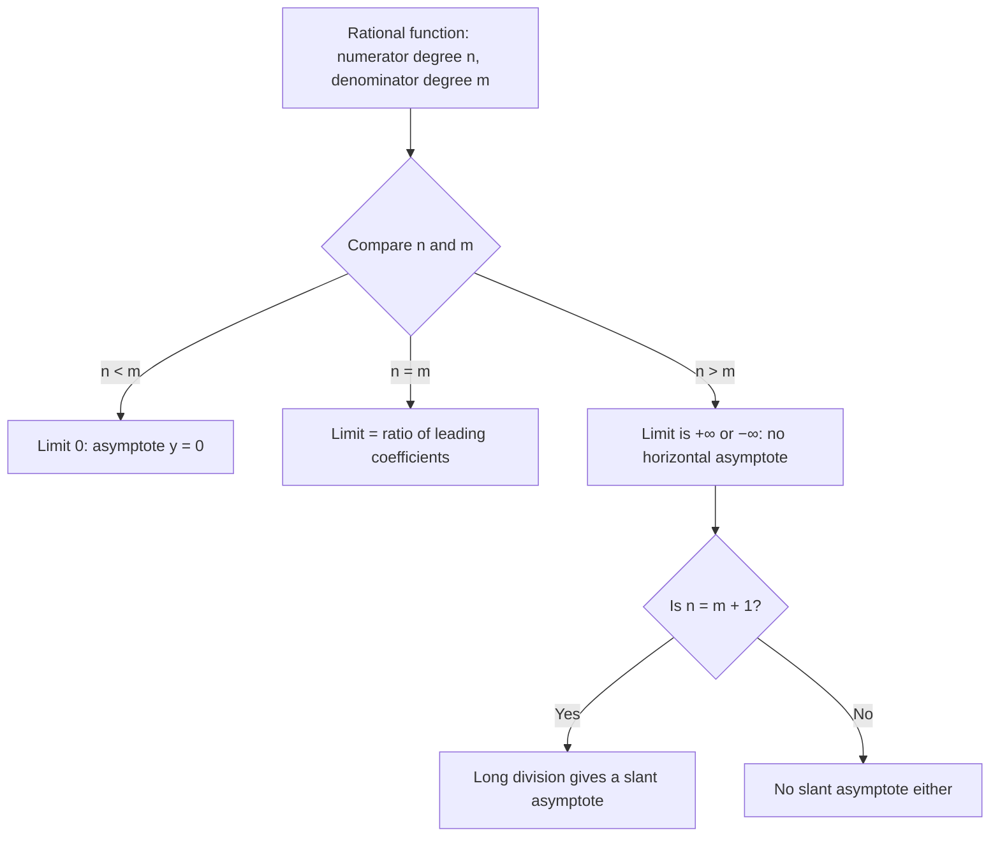

## Two different uses of ∞

So far the input approached a number and the output approached a number. Infinity enters in two separate ways, and it's worth keeping them apart:

- **Infinite limits**: the input approaches a number, but the output grows without bound. These describe **vertical asymptotes**.
- **Limits at infinity**: the input grows without bound, and we ask where the output heads. These describe **horizontal asymptotes** and long-run behavior.

Infinity is not a number. Writing $\lim_{x\to a} f(x) = \infty$ is shorthand for a particular *way* the limit fails to exist: the outputs eventually exceed every bound.

## Infinite limits

We write $\displaystyle\lim_{x\to a} f(x) = \infty$ if $f(x)$ can be made larger than any number you name by taking $x$ close enough to $a$ (but not equal). Similarly for $-\infty$ and for one-sided versions. If any one-sided limit at $a$ is $\pm\infty$, the line $x = a$ is a vertical asymptote.

The algebra signal is **(nonzero)/0** after substitution. A tiny denominator makes a huge quotient; the only question is the sign, and you settle that by checking each side.

### Example 1

Find $\displaystyle\lim_{x\to 3^-}\frac{x + 1}{x - 3}$ and $\displaystyle\lim_{x\to 3^+}\frac{x + 1}{x - 3}$.

Substituting gives $4/0$: an infinite limit. Check signs.

- For $x$ slightly less than 3 (say 2.99): numerator $\approx 4 > 0$, denominator $x - 3$ is a small negative number. Positive over tiny negative → $-\infty$.
- For $x$ slightly more than 3: denominator is small and positive → $+\infty$.

So the left limit is $-\infty$, the right limit is $+\infty$, and $x = 3$ is a vertical asymptote. The two-sided limit doesn't exist (not even as $\infty$, since the sides disagree).

```plot
{"x": [-3, 9], "y": [-10, 12], "functions": [{"f": "(x + 1)/(x - 3)"}, {"f": "1", "dashed": true}], "segments": [{"from": [3, -10], "to": [3, 12], "dashed": true}], "caption": "y = (x + 1)/(x − 3): vertical asymptote x = 3, horizontal asymptote y = 1"}
```

Compare $\dfrac{1}{(x - 3)^2}$: the squared denominator is positive on both sides, so both one-sided limits are $+\infty$ and we may write $\lim_{x\to3} \dfrac{1}{(x-3)^2} = \infty$.

**Careful with $0/0$.** A zero denominator doesn't guarantee an asymptote. $\dfrac{x^2 - 9}{x - 3}$ has a hole at 3, not an asymptote, because the factor cancels. Always cancel common factors before declaring a vertical asymptote.

The graph below shows a hole and an asymptote side by side. Since
$$y = \frac{x^2 - x - 2}{x^2 - 4} = \frac{(x - 2)(x + 1)}{(x - 2)(x + 2)},$$
the factor $x - 2$ cancels: for $x \ne 2$ the function equals $\dfrac{x + 1}{x + 2}$, so there is a hole at $x = 2$, at height $\frac{3}{4}$. The factor $x + 2$ doesn't cancel, so $x = -2$ is a vertical asymptote. (The horizontal asymptote $y = 1$ comes from the next section.)


## Limits at infinity

We write $\displaystyle\lim_{x\to\infty} f(x) = L$ if $f(x)$ gets arbitrarily close to $L$ as $x$ grows without bound. If that happens (as $x \to \infty$ or $x \to -\infty$), the line $y = L$ is a horizontal asymptote.

The building block is

$$\lim_{x\to\pm\infty}\frac{1}{x^n} = 0 \quad (n > 0).$$

Dividing 1 by a huge number gives something tiny. Everything else follows by rewriting expressions in terms of $1/x^n$.

## Rational functions: divide by the highest power

For a rational function, divide every term of the numerator and denominator by the highest power of $x$ *in the denominator*. Each extra term becomes some constant over a power of $x$ and dies.

### Example 2

Find $\displaystyle\lim_{x\to\infty}\frac{6x^2 - 5x + 1}{3x^2 + 4}$.

Divide top and bottom by $x^2$:

$$\frac{6 - \frac5x + \frac1{x^2}}{3 + \frac4{x^2}} \longrightarrow \frac{6 - 0 + 0}{3 + 0} = \mathbf 2.$$

The horizontal asymptote is $y = 2$, the ratio of the leading coefficients.

That example generalizes. With numerator degree $n$ and denominator degree $m$:

| Degrees | $\lim_{x\to\pm\infty}$ | Horizontal asymptote |
|---|---|---|
| $n < m$ | $0$ | $y = 0$ |
| $n = m$ | ratio of leading coefficients | $y =$ that ratio |
| $n > m$ | $\pm\infty$ (sign from leading terms) | none |

When $n = m + 1$, long division gives a slant (oblique) asymptote $y = cx + d$: for example $\dfrac{x^2 + 1}{x} = x + \dfrac1x$, which hugs $y = x$.

As a decision chart:



The reason the table works: for large $|x|$ a polynomial behaves like its leading term. $6x^2 - 5x + 1 \approx 6x^2$ when $x = 10^6$, because $6x^2$ is a million times bigger than $5x$.

## Square roots and $x \to -\infty$

Roots need care because $\sqrt{x^2} = |x|$, which is $-x$ when $x$ is negative.

### Example 3

Find $\displaystyle\lim_{x\to-\infty}\frac{\sqrt{4x^2 + 1}}{x - 5}$.

The top behaves like $\sqrt{4x^2} = 2|x|$. For $x < 0$, $|x| = -x$. Divide top and bottom by $x$, writing $x = -\sqrt{x^2}$ in the numerator:

$$\frac{\sqrt{4x^2+1}}{x - 5} = \frac{\sqrt{4x^2 + 1}/x}{1 - 5/x} = \frac{-\sqrt{4 + 1/x^2}}{1 - 5/x} \longrightarrow \frac{-\sqrt 4}{1} = \mathbf{-2}.$$

As $x \to +\infty$ the same function tends to $+2$. Two different horizontal asymptotes, $y = 2$ and $y = -2$.

```plot
{"x": [-40, 40], "y": [-8, 8], "functions": [{"f": "sqrt(4x^2 + 1)/(x - 5)"}, {"f": "2", "dashed": true, "label": "y = 2"}, {"f": "-2", "dashed": true, "label": "y = −2"}], "segments": [{"from": [5, -8], "to": [5, 8], "dashed": true}], "caption": "y = √(4x² + 1)/(x − 5) approaches −2 on the far left and 2 on the far right; x = 5 is a vertical asymptote"}
```

## Differences of roots: ∞ − ∞

### Example 4

Find $\displaystyle\lim_{x\to\infty}\left(\sqrt{x^2 + 6x} - x\right)$.

Both terms grow, so this is $\infty - \infty$, another indeterminate form. Multiply by the conjugate over itself:

$$\left(\sqrt{x^2 + 6x} - x\right)\frac{\sqrt{x^2 + 6x} + x}{\sqrt{x^2 + 6x} + x} = \frac{6x}{\sqrt{x^2 + 6x} + x}.$$

Divide top and bottom by $x$ (positive here, so $\sqrt{x^2} = x$): $\dfrac{6}{\sqrt{1 + 6/x} + 1} \to \dfrac{6}{2} = \mathbf 3$.

## Exponentials and logs at infinity

Some facts to know cold:

- $\lim_{x\to\infty} e^x = \infty$, $\lim_{x\to-\infty} e^x = 0$.
- $\lim_{x\to\infty}\ln x = \infty$, $\lim_{x\to 0^+} \ln x = -\infty$.
- $\lim_{x\to\infty}\arctan x = \pi/2$, $\lim_{x\to-\infty}\arctan x = -\pi/2$.
- Growth order for large $x$: $\ln x \ll x^p \ll e^x$ for any $p > 0$ (proved with L'Hôpital's rule in Lesson 16).

So $\lim_{x\to\infty} \dfrac{3e^x + x}{e^x + 2} = 3$: divide through by $e^x$.

## Common mistakes

- *Calling every zero denominator an asymptote.* Cancel common factors first; a canceled factor is a hole.
- *Forgetting sign checks.* $\dfrac{x+1}{x-3}$ goes to $-\infty$ on the left of 3, not $+\infty$.
- **$\sqrt{x^2} = x$ for negative $x$.** It's $|x| = -x$ there; Example 3's sign flips.
- **Treating ∞ − ∞ as 0** or **∞/∞ as 1.** Both are indeterminate.
- *Thinking a graph can't cross a horizontal asymptote.* It can, often; the asymptote only describes the far ends.

## Key points

- Infinite limit: input → number, output → ±∞ (vertical asymptote). Signal: nonzero/0. Check signs on each side.
- Limit at infinity: input → ±∞ (horizontal asymptote). Divide by the highest power in the denominator.
- Rational functions: compare degrees; equal degrees give the ratio of leading coefficients.
- Use $\sqrt{x^2} = |x|$ when $x \to -\infty$; use conjugates for ∞ − ∞.
