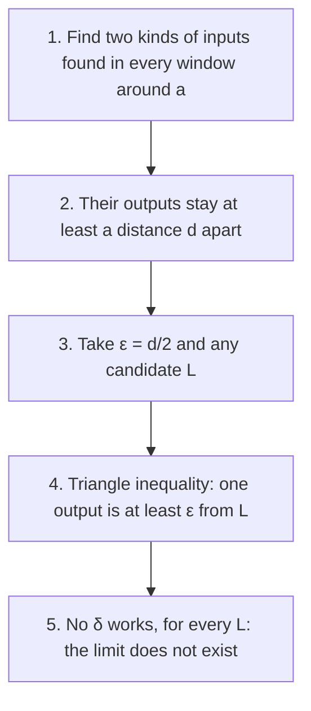

## Where this goes beyond Lesson 4

Lesson 4 made one kind of limit precise: the input approaches a number $a$ and the output approaches a number $L$. Three loose ends remain. Lesson 3 used "$= \infty$" and "as $x \to \infty$" with only an informal meaning. Lesson 2 stated the limit laws and said "the proofs use the ε-δ definition" without giving any. And so far we have only shown limits *exist*; we have never proved that a limit *fails* to exist, beyond pointing at a picture.

This honors lesson ties up all three. It is college Calculus I material, and a first taste of real analysis, the branch of mathematics that proves calculus from the ground up. The algebra is light; the new skill is handling the words "for every" and "there is" with care.

## One pattern, several definitions

Every limit definition has the same shape: *for every output tolerance there is an input threshold*. Only the two conditions change.

| Statement | Input condition | Output condition |
|---|---|---|
| $\lim_{x\to a} f(x) = L$ | $0 < \lvert x - a\rvert < \delta$ | $\lvert f(x) - L\rvert < \varepsilon$ |
| $\lim_{x\to a^+} f(x) = L$ | $a < x < a + \delta$ | $\lvert f(x) - L\rvert < \varepsilon$ |
| $\lim_{x\to a^-} f(x) = L$ | $a - \delta < x < a$ | $\lvert f(x) - L\rvert < \varepsilon$ |
| $\lim_{x\to a} f(x) = \infty$ | $0 < \lvert x - a\rvert < \delta$ | $f(x) > M$ |
| $\lim_{x\to \infty} f(x) = L$ | $x > N$ | $\lvert f(x) - L\rvert < \varepsilon$ |
| $\lim_{x\to \infty} f(x) = \infty$ | $x > N$ | $f(x) > M$ |

Read each row as: "for every $\varepsilon > 0$ (or every $M$) there is a $\delta > 0$ (or an $N$) such that the input condition guarantees the output condition." The one-sided rows simply keep half of the window $0 < |x - a| < \delta$. For $-\infty$, replace "$f(x) > M$" with "$f(x) < -M$", and for $x \to -\infty$ replace "$x > N$" with "$x < -N$".

## Infinite limits

The **M-δ definition** (a convenient name, not a universal one): $\lim_{x\to a} f(x) = \infty$ means that for every $M > 0$ there is a $\delta > 0$ such that

$$0 < |x - a| < \delta \implies f(x) > M.$$

The skeptic now names a *height* $M$, as large as they like, and you must find a window around $a$ where the graph stays above that height.

### Example 1

Prove $\displaystyle\lim_{x\to 2}\frac{1}{(x - 2)^2} = \infty$, and find $\delta$ for $M = 10{,}000$.

*Scratch work.* Work backward from what we want:
$$\frac{1}{(x-2)^2} > M \iff (x - 2)^2 < \frac1M \iff |x - 2| < \frac{1}{\sqrt M}.$$
(Taking reciprocals flips the inequality because both sides are positive.) So $\delta = 1/\sqrt M$ should work.

*Proof.* Given $M > 0$, let $\delta = 1/\sqrt{M}$. If $0 < |x - 2| < \delta$, then $0 < (x - 2)^2 < \delta^2 = \dfrac1M$, so $\dfrac{1}{(x-2)^2} > M$. $\blacksquare$

For $M = 10{,}000$, $\delta = 1/100 = 0.01$. Check: at $x = 2.0099$, $(0.0099)^2 = 0.00009801$ and $1/0.00009801 \approx 10{,}203 > 10{,}000$. Notice the "$0 <$" doing real work: at $x = 2$ itself the function isn't defined, and the definition never asks about it.

## Limits at infinity

The **ε-N definition**: $\lim_{x\to\infty} f(x) = L$ means that for every $\varepsilon > 0$ there is a number $N$ such that

$$x > N \implies |f(x) - L| < \varepsilon.$$

Instead of a window around $a$, you must find a point $N$ past which the graph stays inside the horizontal band forever.

### Example 2

Prove $\displaystyle\lim_{x\to\infty}\frac{3x + 1}{x + 2} = 3$, and find $N$ for $\varepsilon = 0.01$.

*Scratch work.* Simplify the distance to 3 over a common denominator:
$$\left|\frac{3x + 1}{x + 2} - 3\right| = \left|\frac{3x + 1 - 3x - 6}{x + 2}\right| = \frac{5}{|x + 2|}.$$
For $x > 0$, $x + 2$ is positive, so this is $\dfrac{5}{x + 2}$, and
$$\frac{5}{x + 2} < \varepsilon \iff x + 2 > \frac5\varepsilon \iff x > \frac{5}{\varepsilon} - 2.$$

*Proof.* Given $\varepsilon > 0$, let $N = \max\!\left(0, \dfrac5\varepsilon - 2\right)$. If $x > N$, then $x > 0$ and $x + 2 > \dfrac{5}{\varepsilon}$, so $\left|\dfrac{3x+1}{x+2} - 3\right| = \dfrac{5}{x+2} < \varepsilon$. $\blacksquare$

For $\varepsilon = 0.01$: $N = 500 - 2 = 498$. At $x = 499$ the distance is $5/501 \approx 0.00998$, just inside. The $\max$ with 0 handles large $\varepsilon$ (for $\varepsilon \ge 2.5$ the formula would give a negative $N$, and we promised ourselves $x > 0$ to drop the absolute value).

## Proving the sum law

**Sum law.** If $\lim_{x\to a} f(x) = L$ and $\lim_{x\to a} g(x) = K$, then $\lim_{x\to a}\,[f(x) + g(x)] = L + K$.

The proof needs one tool, the **triangle inequality**:

$$|u + v| \le |u| + |v| \quad\text{for all real } u, v.$$

It holds because if $u$ and $v$ have the same sign their sizes add exactly, and if they have opposite signs they partly cancel. (As distances: going $u$ and then $v$ along the line can't take you farther than $|u| + |v|$.)

*Proof.* Let $\varepsilon > 0$. Because $f(x) \to L$, the definition applied with the tolerance $\varepsilon/2$ gives a $\delta_1 > 0$ such that
$$0 < |x - a| < \delta_1 \implies |f(x) - L| < \tfrac{\varepsilon}{2}.$$
Likewise there is a $\delta_2 > 0$ with $0 < |x - a| < \delta_2 \implies |g(x) - K| < \tfrac\varepsilon2$. Let $\delta = \min(\delta_1, \delta_2)$. If $0 < |x - a| < \delta$, both conclusions hold at once, so
$$\big|(f(x) + g(x)) - (L + K)\big| = \big|(f(x) - L) + (g(x) - K)\big| \le |f(x) - L| + |g(x) - K| < \tfrac\varepsilon2 + \tfrac\varepsilon2 = \varepsilon. \;\blacksquare$$

Two moves carry the whole proof, and they come back in nearly every analysis proof:

1. **Split the error budget.** Two errors are coming, so ask each one for half.
2. **Take the minimum of the deltas**, so that every requirement holds in one window.

*The product law, in outline.* The key is an algebra identity that adds and subtracts $f(x)K$:
$$f(x)g(x) - LK = f(x)\,\big(g(x) - K\big) + K\,\big(f(x) - L\big).$$
The second term is small because $f(x) - L$ is. For the first, take $\delta$ small enough that $|f(x) - L| < 1$; then $|f(x)| < |L| + 1$, so $f(x)$ can't spoil the smallness of $g(x) - K$. Asking for $|g(x) - K| < \dfrac{\varepsilon}{2(|L| + 1)}$ and $|f(x) - L| < \dfrac{\varepsilon}{2(|K| + 1)}$, then taking the minimum of three deltas, finishes the proof. (The $+1$s keep us from dividing by zero when $L$ or $K$ is 0.) The quotient law is proved the same way, with extra care to keep $g(x)$ away from 0.

## Proving that a limit does not exist

To prove "$\lim_{x\to a} f(x) = L$" is *false*, you need the **negation** of the definition. Negating flips each quantifier ("for every" becomes "there is", and the other way round) and negates the final condition:

> There is some $\varepsilon > 0$ such that for every $\delta > 0$ there is an $x$ with $0 < |x - a| < \delta$ but $|f(x) - L| \ge \varepsilon$.

In game terms, the skeptic has one winning tolerance: whatever window you offer, they can find a point in it whose output is too far from $L$. To show the limit doesn't exist *at all*, you must win this game against **every** candidate $L$, not just the obvious ones.

### Example 3

The **Heaviside step function** is $H(x) = 0$ for $x < 0$ and $H(x) = 1$ for $x \ge 0$. Prove that $\lim_{x\to 0} H(x)$ does not exist.

Take $\varepsilon = \tfrac12$ and let $L$ be any number. Given any $\delta > 0$, the inputs $x_1 = -\delta/2$ and $x_2 = \delta/2$ both satisfy $0 < |x| < \delta$, and $H(x_1) = 0$, $H(x_2) = 1$. Suppose both outputs were within $\tfrac12$ of $L$. Then by the triangle inequality
$$1 = |H(x_2) - H(x_1)| = |(1 - L) + (L - 0)| \le |1 - L| + |L - 0| < \tfrac12 + \tfrac12 = 1,$$
which says $1 < 1$, impossible. So at least one of $x_1, x_2$ has output at least $\tfrac12$ away from $L$, and no $\delta$ works. Since $L$ was arbitrary, the limit does not exist. $\blacksquare$

### Example 4

Prove that $\lim_{x\to 0}\sin(1/x)$ does not exist.

For each whole number $n \ge 1$, let
$$p_n = \frac{1}{\frac{\pi}{2} + 2\pi n}, \qquad q_n = \frac{1}{\frac{3\pi}{2} + 2\pi n}.$$
Then $\sin(1/p_n) = \sin(\tfrac\pi2 + 2\pi n) = 1$ and $\sin(1/q_n) = \sin(\tfrac{3\pi}{2} + 2\pi n) = -1$. Both are positive and shrink toward 0 as $n$ grows, so every window $0 < |x| < \delta$ contains some $p_n$ and some $q_n$ (choose $n$ with $2\pi n > 1/\delta$).

The two outputs differ by 2, so take $\varepsilon = 1$. For any $L$, the triangle inequality gives $2 = |1 - (-1)| \le |1 - L| + |L - (-1)|$, so $1$ and $-1$ can't both be less than 1 away from $L$. As in Example 3, no $\delta$ works for any $L$. $\blacksquare$

## Common mistakes

- *Letting δ depend on $x$.* δ is chosen once, from ε (and $a$), before any $x$ is picked. "Take $\delta = |x - 2|/2$" is meaningless.
- *Mixing up the roles.* In the M-δ definition you are handed a height $M$ and must produce a window. A large $M$ calls for a *small* δ, as in $\delta = 1/\sqrt M$.
- *Dropping an absolute value without checking the sign.* In Example 2, $|x + 2| = x + 2$ only for $x > -2$; that's why $N$ was kept at least 0.
- *Using ε for each piece in the sum law.* You would end with $2\varepsilon$. It can be repaired, but the clean fix is to ask each piece for $\varepsilon/2$ at the start.
- *A wrong negation.* "For every ε, some δ fails" is not the negation. The negation needs *one* ε for which *every* δ fails.
- *Ruling out only one candidate.* Showing that $L = \tfrac12$ fails for the Heaviside function isn't enough; the proof must work for every $L$.

## Key points

- Every limit definition reads: for every output tolerance ($\varepsilon$ or $M$) there is an input threshold ($\delta$ or $N$) that guarantees it.
- $\lim_{x\to a} f(x) = \infty$: for every $M > 0$ there's a $\delta > 0$ with $0 < |x - a| < \delta \Rightarrow f(x) > M$.
- $\lim_{x\to\infty} f(x) = L$: for every $\varepsilon > 0$ there's an $N$ with $x > N \Rightarrow |f(x) - L| < \varepsilon$.
- The sum law follows from the triangle inequality, an $\varepsilon/2$ split, and $\delta = \min(\delta_1, \delta_2)$.
- To prove a limit doesn't exist, negate the definition: one ε defeats every δ, for every candidate $L$. Two families of inputs with outputs a fixed distance apart do the job.
