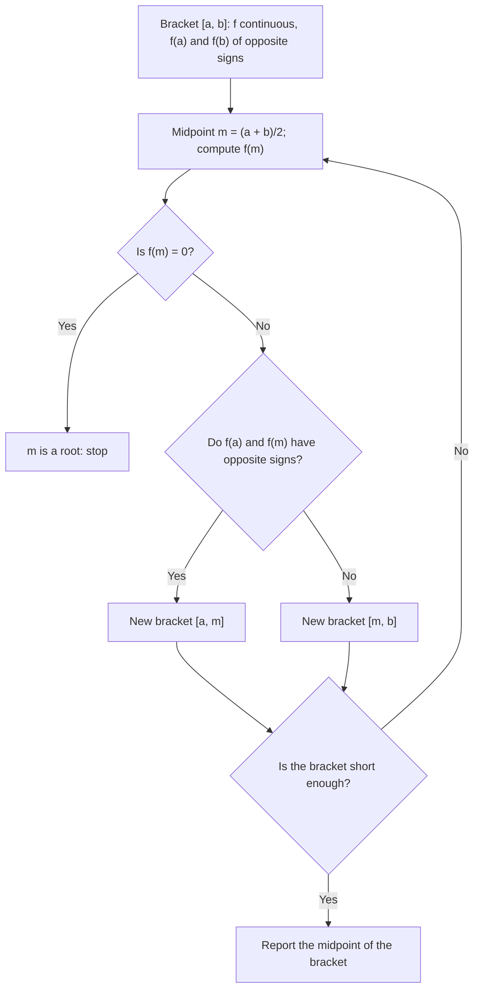

## Beyond "there is a root somewhere"

Lesson 5 used the Intermediate Value Theorem in its plainest form: opposite signs at the ends of an interval, plus continuity, force a root in between. This honors lesson pushes the theorem further in three directions. First, how *fast* bisection pins a root down, with an error you can guarantee in advance. Second, fixed points, where a function's output equals its input. Third, existence proofs that look like puzzles, where the whole trick is choosing the right function to apply the IVT to. We finish with what the IVT quietly depends on.

Recall the theorem: if $f$ is continuous on $[a, b]$ and $N$ is strictly between $f(a)$ and $f(b)$, then $f(c) = N$ for at least one $c$ in $(a, b)$.

## How fast bisection closes in

Bisection starts with a **bracket**: an interval $[a, b]$ on which a continuous $f$ changes sign, so a root is trapped inside. Each step tests the midpoint and keeps the half where the sign change is. The root never escapes, and the bracket's length halves every time.



After $n$ steps starting from $[a, b]$:

- the bracket has length $\dfrac{b - a}{2^n}$, and the root is somewhere inside it;
- the bracket's midpoint is within $\dfrac{b - a}{2^{n+1}}$ of the root (the root can be at most half a bracket away from the middle).

This is an **error bound**: a guarantee, computed before you start, that holds no matter what $f$ looks like inside the bracket. To make the bracket no longer than a tolerance $t$, you need $\dfrac{b-a}{2^n} \le t$, that is,

$$2^n \ge \frac{b - a}{t}, \qquad n \ge \log_2\!\frac{b - a}{t},$$

and $n$ is the smallest whole number that works. Since $2^{10} = 1024 \approx 10^3$, every 10 steps buy about 3 more correct decimal places, or about one digit per 3.3 steps.

![The graph of y = x³ + x − 3 crossing the x-axis at a root near 1.213. Below it, four nested brackets: step 0 is [1, 2], step 1 is [1, 1.5], step 2 is [1, 1.25], and step 3 is [1.125, 1.25]. Each is half as long as the one above, and all contain the root.](images/calc-m1-bisection.svg)

### Example 1

Take $f(x) = x^3 + x - 3$ on $[1, 2]$ from Lesson 5, where $f(1) = -1$ and $f(2) = 7$.

**(a)** Lesson 5 stopped at $[1, 1.25]$. One more step: $f(1.125) = 1.423828\ldots + 1.125 - 3 \approx -0.451 < 0$, while $f(1.25) \approx 0.203 > 0$, so the bracket becomes $[1.125, 1.25]$, of length $\tfrac18 = \tfrac{1}{2^3}$. Its midpoint $1.1875$ is guaranteed to be within $\tfrac{1}{16} = 0.0625$ of the root. (The root is about $1.2134$, so the actual error is about $0.026$, comfortably inside the guarantee.)

**(b)** How many steps guarantee a bracket of length at most $10^{-6}$? We need $2^n \ge \dfrac{1}{10^{-6}} = 10^6$. Since $2^{19} = 524{,}288$ is too small and $2^{20} = 1{,}048{,}576$ is enough, **20 steps**. (Check: $\log_2 10^6 \approx 19.93$, rounded *up*.)

Bisection is slow next to Newton's method (Lesson 15), which often doubles the number of correct digits each step. But Newton's method can wander off or fail; bisection, given continuity and a sign change, cannot.

## Fixed points

A **fixed point** of $f$ is a number $c$ with $f(c) = c$: an input the function leaves unchanged. On a graph, it's where $y = f(x)$ meets the line $y = x$.

**Fixed-point theorem** (one dimension). If $f$ is continuous on $[a, b]$ and every output $f(x)$ for $x$ in $[a, b]$ also lies in $[a, b]$, then $f$ has a fixed point in $[a, b]$.

*Proof.* Let $g(x) = f(x) - x$, which is continuous on $[a, b]$ (a difference of continuous functions). Because $f(a)$ lies in $[a, b]$, $f(a) \ge a$, so $g(a) \ge 0$. Because $f(b) \le b$, $g(b) \le 0$. If $g(a) = 0$ or $g(b) = 0$, that endpoint is a fixed point. Otherwise $g(a) > 0 > g(b)$, and the IVT gives a $c$ in $(a, b)$ with $g(c) = 0$, that is, $f(c) = c$. $\blacksquare$

The move from $f(x) = x$ to $g(x) = f(x) - x = 0$ is the key: the IVT is about hitting a *height*, so turn the problem into one. (In higher dimensions this result becomes Brouwer's fixed-point theorem, which is much harder to prove.)

### Example 2

Show that $\cos x = x$ ($x$ in radians) has exactly one solution in $[0, 1]$.

*Existence.* On $[0, 1]$, $\cos$ is continuous and decreasing, so its outputs run from $\cos 0 = 1$ down to $\cos 1 \approx 0.5403$, all inside $[0, 1]$. The fixed-point theorem gives a solution. (Directly: $g(x) = \cos x - x$ has $g(0) = 1 > 0$ and $g(1) \approx -0.4597 < 0$.)

*Uniqueness.* On $[0, 1]$, $\cos x$ decreases and $x$ increases, so $g(x) = \cos x - x$ is strictly decreasing and can cross 0 only once.

Bisection on $g$ locates the solution at about $0.739085$. Curiously, pressing the cosine key over and over on a calculator in radian mode also creeps toward $0.739085$. The IVT doesn't promise that; why it happens here is a topic called fixed-point iteration.

```plot
{"x": [0, 1.6], "y": [0, 1.6], "equal": true, "functions": [{"f": "cos(x)", "label": "y = cos x"}, {"f": "x", "dashed": true, "label": "y = x"}], "points": [{"at": [0.739085, 0.739085], "label": "fixed point ≈ (0.739, 0.739)"}], "caption": "The only solution of cos x = x lies where the curve meets the line y = x"}
```

## Existence proofs: choose the right function

In each example below the question doesn't mention a function at all. The work is to invent one whose sign change answers the question.

### Example 3

Prove that every polynomial of odd degree has at least one real root.

Let $p(x) = a_n x^n + \dots + a_0$ with $n$ odd. Dividing by $a_n$ doesn't change the roots, so assume $a_n = 1$. For large $|x|$ the leading term dominates (Lesson 3), and because $n$ is odd, $x^n$ has the sign of $x$:
$$\lim_{x\to\infty} p(x) = \infty, \qquad \lim_{x\to-\infty} p(x) = -\infty.$$
So there is some $b$ with $p(b) > 0$ and some $a < b$ with $p(a) < 0$. A polynomial is continuous on $[a, b]$, so the IVT gives a root in $(a, b)$. $\blacksquare$

Even degree gets no such guarantee: $x^2 + 1$ is positive everywhere, because both ends of its graph point up.

### Example 4

A hiker starts up a trail at 7:00 a.m. and reaches the summit at 5:00 p.m. The next morning she starts down the same trail at 7:00 a.m. and reaches the bottom at 5:00 p.m. She changes speed and stops to rest whenever she likes. Must there be a spot on the trail that she passes at the same clock time on both days?

Let $u(t)$ be her distance along the trail from the bottom at time $t$ on day 1, and $d(t)$ the same on day 2, for $7 \le t \le 17$ (hours on a 24-hour clock); let $D$ be the trail's length. Positions change continuously, so $h(t) = u(t) - d(t)$ is continuous on $[7, 17]$, with
$$h(7) = 0 - D < 0, \qquad h(17) = D - 0 > 0.$$
By the IVT, $h(c) = 0$ for some time $c$: at that moment she is at the same place on both days. **Yes**, always. Picture both days happening at once: one hiker going up, one coming down the same trail, and they must meet. The IVT doesn't say where or when.

### Example 5

A runner covers 10 km in exactly 50 minutes, varying her pace but never stopping. Must some 5 km stretch take her exactly 25 minutes?

Let $T(x)$ be the time, in minutes, when she reaches distance $x$ km, for $0 \le x \le 10$. Since she never stops or turns back, $T$ is increasing and has no jumps, so it is continuous, with $T(0) = 0$ and $T(10) = 50$. For $0 \le x \le 5$, define
$$g(x) = T(x + 5) - T(x) - 25,$$
the time for the stretch from $x$ to $x + 5$, minus 25. Then
$$g(0) = T(5) - 25, \qquad g(5) = T(10) - T(5) - 25 = 25 - T(5),$$
so $g(5) = -g(0)$. If $g(0) = 0$, the first half took exactly 25 minutes. Otherwise $g(0)$ and $g(5)$ have opposite signs, and the IVT gives $c$ with $g(c) = 0$: the stretch from $c$ to $c + 5$ took exactly 25 minutes. **Yes.** (The "never stops" condition matters: a pause at one spot would make $T$ jump there.)

A known result, the **universal chord theorem**, says how far this goes: a stretch run at exactly the average pace is guaranteed whenever its length is the whole distance divided by a whole number (5 km, $3\tfrac13$ km, 2.5 km, 2 km, …), and for any other length, such as 4 km, some pace plan avoids it. We don't prove that here.

## What the IVT depends on

Two hypotheses hide in the theorem.

*Continuity on the whole interval.* The **Dirichlet function**, $D(x) = 1$ when $x$ is rational and $D(x) = 0$ when $x$ is irrational, is continuous nowhere: every interval, however small, contains both kinds of numbers, so the outputs near any point keep jumping between 0 and 1 and never settle. It goes from 0 to 1 without ever taking the value $\tfrac12$.

*No gaps in the number line.* If we only allowed rational numbers, the IVT would be false: $x^2 - 2$ is $-1$ at $x = 1$ and $2$ at $x = 2$, but no rational number makes it 0, because $\sqrt2$ is irrational. The IVT is really a statement that the real line has no holes. Proving it from that property belongs to real analysis.

## Common mistakes

- *Mixing up the two bounds.* After $n$ steps the bracket length is $(b-a)/2^n$; the midpoint's error bound is half that, $(b-a)/2^{n+1}$.
- *Rounding the step count down.* $\log_2 10^6 \approx 19.93$ means 20 steps; 19 steps leave a bracket longer than $10^{-6}$.
- *Skipping the "maps into itself" check.* $f(x) = x + 1$ is continuous on $[0, 1]$ but has no fixed point; its outputs leave the interval.
- *Comparing speeds in the hiking problem.* Speeds are irrelevant; the difference of positions is the function that changes sign.
- *Assuming every stretch length works.* Halves, thirds, quarters and so on are guaranteed; a 4 km stretch of a 10 km run at exactly average pace is not.
- *Forgetting continuity.* Every argument above fails for a function that can jump.

## Key points

- Bisection after $n$ steps: bracket length $(b-a)/2^n$; midpoint within $(b-a)/2^{n+1}$ of a root. Steps needed for length $\le t$: the smallest $n$ with $2^n \ge (b-a)/t$.
- A fixed point solves $f(c) = c$. A continuous $f$ mapping $[a, b]$ into itself has one: apply the IVT to $g(x) = f(x) - x$.
- Every odd-degree polynomial has a real root: its two ends have opposite signs.
- For an existence puzzle, build a continuous function whose sign change *is* the answer, such as a difference of positions or of times.
- The IVT needs continuity and the completeness of the real numbers.
