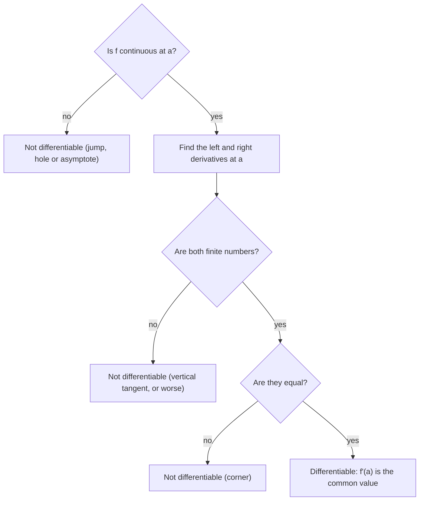

## From one slope to a slope function

Lesson 6 found the slope at one point. Doing that over and over, one point at a time, is tedious. Instead, keep the point as a variable $x$ and compute the slope at every point at once. The result is a new function.

The **derivative function** of $f$ is

$$f'(x) = \lim_{h\to0}\frac{f(x + h) - f(x)}{h}.$$

Its domain is every $x$ where the limit exists. A function is **differentiable** at $a$ if $f'(a)$ exists, and differentiable on an interval if it's differentiable at every point there.

### Notation

All of these mean the same thing:

$$f'(x), \qquad \frac{dy}{dx}, \qquad \frac{df}{dx}, \qquad \frac{d}{dx}f(x), \qquad y', \qquad D_x f.$$

The **Leibniz notation** $\frac{dy}{dx}$ reminds you that a derivative is a limit of $\frac{\Delta y}{\Delta x}$. To evaluate at a point, write $f'(3)$ or $\left.\frac{dy}{dx}\right|_{x=3}$.

### Example 1

Find $f'(x)$ for $f(x) = x^3$ from the definition.

1. Expand $(x + h)^3 = x^3 + 3x^2h + 3xh^2 + h^3$.
2. Difference quotient: $\dfrac{(x^3 + 3x^2h + 3xh^2 + h^3) - x^3}{h} = \dfrac{3x^2h + 3xh^2 + h^3}{h} = 3x^2 + 3xh + h^2$.
3. Let $h\to 0$: $f'(x) = \mathbf{3x^2}$.

Now $f'(2) = 12$, $f'(-1) = 3$, $f'(0) = 0$, all from one computation.

### Example 2

Find $f'(x)$ for $f(x) = \dfrac{1}{x}$.

$$\frac{\frac{1}{x + h} - \frac1x}{h} = \frac{x - (x + h)}{x(x + h)h} = \frac{-h}{x(x + h)h} = \frac{-1}{x(x + h)} \to -\frac{1}{x^2}.$$

So $f'(x) = -\dfrac{1}{x^2}$ for $x \ne 0$. The slope is always negative, matching the always-falling branches of the hyperbola.

## Reading $f'$ from the graph of $f$

You can sketch $f'$ without a formula by reading slopes off the graph of $f$:

| Graph of $f$ | Graph of $f'$ |
|---|---|
| rising | above the $x$-axis ($f' > 0$) |
| falling | below the axis ($f' < 0$) |
| horizontal tangent (peak, valley, flat spot) | crosses or touches 0 |
| steep | large $\lvert f'\rvert$ |
| corner or vertical tangent | $f'$ undefined there |

```plot
{"x": [-3, 3], "y": [-6, 8], "functions": [{"f": "x^3 - 3x"}, {"f": "3x^2 - 3", "dashed": true}], "points": [{"at": [-1, 2]}, {"at": [1, -2]}, {"at": [-1, 0]}, {"at": [1, 0]}], "caption": "Solid: f(x) = x³ − 3x. Dashed: f′(x) = 3x² − 3, which is zero exactly where f has horizontal tangents (x = ±1)"}
```

Notice the pattern: $f$ peaks at $x = -1$, and $f'$ crosses from positive to negative there. That observation becomes the first derivative test in Lesson 18.

## When is a function not differentiable?

$f'(a)$ fails to exist in three typical ways.

1. **Corner** (or cusp): the left and right slopes differ. Example: $|x|$ at 0 has slope $-1$ on the left and $+1$ on the right.
2. **Vertical tangent line**: the slopes blow up. Example: $\sqrt[3]{x}$ at 0, where the difference quotient $\frac{h^{1/3}}{h} = h^{-2/3} \to \infty$.
3. **Discontinuity**: a jump, hole or asymptote.

```plot
{"x": [-3, 3], "y": [-2, 3], "functions": [{"f": "abs(x)", "label": "y = |x|"}, {"f": "cbrt(x)", "dashed": true, "label": "y = ∛x"}], "caption": "A corner (|x| at 0) and a vertical tangent (∛x at 0)"}
```

One graph can show all of these at once. Below, $f'$ exists and equals 0 at the smooth peak, but fails to exist at the corner, at the jump, and at the vertical tangent.


For corners, compute the one-sided derivatives:

$$f'_-(a) = \lim_{h\to0^-}\frac{f(a+h) - f(a)}{h}, \qquad f'_+(a) = \lim_{h\to0^+}\frac{f(a+h) - f(a)}{h}.$$

$f$ is differentiable at $a$ exactly when both exist and agree.

Putting the whole check together:



## Differentiability implies continuity

*Theorem.* If $f$ is differentiable at $a$, then $f$ is continuous at $a$.

*Proof.* For $x \ne a$, write
$$f(x) - f(a) = \frac{f(x) - f(a)}{x - a}\cdot(x - a).$$
As $x \to a$ the first factor tends to $f'(a)$ and the second to 0, so $f(x) - f(a) \to f'(a)\cdot0 = 0$. That is, $\lim_{x\to a}f(x) = f(a)$.

The converse is false: $|x|$ is continuous at 0 but not differentiable. So: differentiable ⇒ continuous, but continuous ⇏ differentiable. A discontinuous function can never be differentiable there.

### Example 3

For which $a$ and $b$ is
$$f(x) = \begin{cases} x^2, & x \le 2\\ ax + b, & x > 2\end{cases}$$
differentiable at $x = 2$?

Two conditions are needed.

1. **Continuity at 2:** the pieces must meet. $2^2 = 2a + b$, so $2a + b = 4$.
2. *Matching slopes:* the left piece has slope $2x$ (the definition gives $\frac{d}{dx}x^2 = 2x$, just as in Example 1), which is $4$ at $x = 2$; the right piece has slope $a$. So $a = 4$.

Then $b = 4 - 2a = -4$. With $a = 4$, $b = -4$, the line $y = 4x - 4$ is exactly the tangent to $y = x^2$ at $x = 2$, so the graph joins smoothly.

Matching only the slopes isn't enough: without continuity, the function jumps and can't be differentiable.

## Estimating $f'$ from a table

### Example 4

| $t$ (h) | 0 | 2 | 5 | 6 |
|---|---|---|---|---|
| $W(t)$ (gal) | 120 | 150 | 186 | 193 |

Estimate $W'(4)$.

The closest data bracketing $t = 4$ are $t = 2$ and $t = 5$: $W'(4) \approx \dfrac{186 - 150}{5 - 2} = 12$ gallons per hour. That's an average rate standing in for an instantaneous one, which is the best the table allows.

## Common mistakes

- *Thinking continuity guarantees differentiability.* Corners and vertical tangents are continuous but not differentiable.
- **Reading $f$'s height instead of its slope.** Where $f$ is high, $f'$ isn't necessarily large; where $f$ is steep, it is.
- *Checking only slopes for a piecewise function.* You must check that the pieces meet (continuity) first.
- *Forgetting the domain.* $f'(x) = -1/x^2$ inherits the restriction $x \ne 0$.

## Key points

- $f'(x) = \lim_{h\to0}\frac{f(x + h) - f(x)}{h}$ is a function: the slope of $f$ at each $x$.
- $f' > 0$ means $f$ is rising, $f' < 0$ falling; horizontal tangent ⇔ $f' = 0$.
- Not differentiable at corners, cusps, vertical tangents and discontinuities.
- Differentiable ⇒ continuous; the converse fails.
- For a piecewise function to be differentiable at a seam: the pieces meet, and their slopes match.
