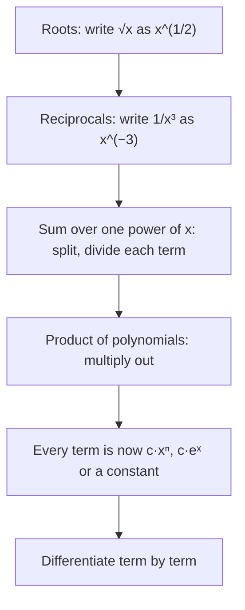

## Shortcuts from the definition

Computing every derivative from the limit definition is like adding $7 + 7 + 7 + 7$ instead of multiplying. In Lesson 7 the definition gave $\frac{d}{dx}x^3 = 3x^2$ and $\frac{d}{dx}x^{-1} = -x^{-2}$. Those fit one pattern, and once it's proved you never need the limit for powers again. This lesson collects the first set of rules: constants, powers, constant multiples, sums, and the natural exponential $e^x$.

## The constant rule

$$\frac{d}{dx}c = 0.$$

The graph of $y = c$ is a horizontal line with slope 0. (From the definition: $\frac{c - c}{h} = 0$.)

## The power rule

$$\frac{d}{dx}x^n = nx^{n-1}.$$

**Why (positive integer $n$).** Expand $(x + h)^n$ with the binomial theorem:
$$(x + h)^n = x^n + nx^{n-1}h + \binom n2 x^{n-2}h^2 + \dots + h^n.$$
Subtract $x^n$ and divide by $h$: every term but $nx^{n-1}$ still has a factor of $h$, so it vanishes as $h \to 0$.

The rule holds for *every real exponent* $n$ (negative, fractional, irrational), which we'll justify with logarithms in Lesson 13. That makes rewriting the key skill:

| Function | Rewrite | Derivative |
|---|---|---|
| $\sqrt x$ | $x^{1/2}$ | $\tfrac12 x^{-1/2} = \dfrac{1}{2\sqrt x}$ |
| $\dfrac{1}{x^3}$ | $x^{-3}$ | $-3x^{-4} = -\dfrac{3}{x^4}$ |
| $\sqrt[3]{x^2}$ | $x^{2/3}$ | $\tfrac23 x^{-1/3} = \dfrac{2}{3\sqrt[3]x}$ |
| $\dfrac{5}{\sqrt x}$ | $5x^{-1/2}$ | $-\tfrac52 x^{-3/2}$ |
| $x$ | $x^1$ | $1$ |

## Constant multiples, sums and differences

$$\frac{d}{dx}\left[c f(x)\right] = c f'(x), \qquad \frac{d}{dx}\left[f(x) \pm g(x)\right] = f'(x) \pm g'(x).$$

Both come straight from the limit laws: the difference quotient of $f + g$ is the sum of the two difference quotients. Together with the power rule, these let you differentiate any polynomial term by term.

### Example 1

Differentiate $f(x) = 4x^5 - 3x^2 + 7x - 9$.

Term by term: $4\cdot5x^4 - 3\cdot2x + 7 - 0$, so $f'(x) = \mathbf{20x^4 - 6x + 7}$.

### Example 2

Differentiate $g(x) = \dfrac{x^2 + 3\sqrt x}{x}$ for $x > 0$.

There's no quotient rule yet, and we don't need one. Divide first:
$$g(x) = \frac{x^2}{x} + \frac{3x^{1/2}}{x} = x + 3x^{-1/2}.$$
Then $g'(x) = 1 - \tfrac32 x^{-3/2} = \mathbf{1 - \dfrac{3}{2x^{3/2}}}$.

Simplifying *before* differentiating is often the fastest route. Products like $(x + 1)(x - 2)$ can be expanded first too.

Until the product, quotient and chain rules arrive in the next module, the job is always the same: get every term into the form $cx^n$ or $ce^x$, then differentiate term by term.



## The natural exponential

Which exponential function $b^x$ has slope exactly 1 where it crosses the $y$-axis? From the definition,
$$\frac{d}{dx}b^x = \lim_{h\to0}\frac{b^{x+h} - b^x}{h} = b^x\cdot\lim_{h\to0}\frac{b^h - 1}{h}.$$
So the derivative of $b^x$ is $b^x$ times a constant (its slope at 0). For $b = 2$ that constant is about $0.693$, for $b = 3$ about $1.099$. Somewhere in between is a base that makes it exactly 1; that base is $e \approx 2.71828$. So

$$\frac{d}{dx}e^x = e^x.$$

The function $e^x$ is its own derivative: at every point its slope equals its height. (Lesson 13 shows the constant for general $b$ is $\ln b$.)

```plot
{"x": [-3, 2], "y": [-1, 6], "functions": [{"f": "e^x", "label": "y = eˣ"}], "tangents": [{"f": "e^x", "at": 0}, {"f": "e^x", "at": 1}], "points": [{"at": [0, 1], "label": "slope 1"}, {"at": [1, 2.718], "label": "slope e"}], "caption": "The slope of eˣ equals its height"}
```

## Tangent lines and horizontal tangents

### Example 3

Where does $y = x^3 - 6x^2 + 9x + 1$ have horizontal tangent lines? Find the tangent line at $x = 0$.

$y' = 3x^2 - 12x + 9 = 3(x - 1)(x - 3)$. Horizontal tangents need $y' = 0$: at $x = 1$ ($y = 5$) and $x = 3$ ($y = 1$).

At $x = 0$: $y = 1$ and $y' = 9$, so the tangent line is $y = 9x + 1$.

## Higher derivatives

The derivative of $f'$ is the **second derivative**, $f''$; its derivative is $f'''$, and so on. Notation:

$$f''(x) = \frac{d^2y}{dx^2}, \qquad f'''(x) = \frac{d^3y}{dx^3}, \qquad f^{(4)}(x) = \frac{d^4y}{dx^4}.$$

If $s(t)$ is position, then $s'(t) = v(t)$ is velocity and $s''(t) = v'(t) = a(t)$ is **acceleration**, the rate of change of velocity. Geometrically, $f''$ measures how the slope changes, which shows up as **concavity** (Lesson 19).

### Example 4

A particle's position is $s(t) = t^3 - 6t^2 + 5$ meters at time $t$ seconds. Find its velocity and acceleration at $t = 1$.

- $v(t) = s'(t) = 3t^2 - 12t$, so $v(1) = 3 - 12 = -9$ m/s (moving in the negative direction).
- $a(t) = v'(t) = 6t - 12$, so $a(1) = -6$ m/s².

Velocity and acceleration have the same sign, so the particle is speeding up at $t = 1$.

Graphing all three together shows how they fit: $v$ is the slope of $s$, and $a$ is the slope of $v$. Where $v$ crosses zero (at $t = 4$) the position graph turns around, and where $a$ crosses zero (at $t = 2$) the velocity is at its lowest.

```plot
{"x": [0, 5], "y": [-30, 20], "functions": [{"f": "x^3 - 6x^2 + 5"}, {"f": "3x^2 - 12x", "dashed": true}, {"f": "6x - 12", "color": "#b03a2e"}], "points": [{"at": [4, 0]}, {"at": [2, 0]}], "xLabel": "t", "caption": "Position s(t) = t³ − 6t² + 5 (solid curve), velocity v = s′ (dashed) and acceleration a = v′ (the straight line)"}
```

### Example 5

Find $f^{(4)}(x)$ for $f(x) = x^5 + 2e^x$.

$f' = 5x^4 + 2e^x$, $f'' = 20x^3 + 2e^x$, $f''' = 60x^2 + 2e^x$, $f^{(4)} = \mathbf{120x + 2e^x}$.

For a polynomial of degree $n$, the $(n+1)$st derivative is 0.

## Common mistakes

- *Power rule on exponentials.* $\frac{d}{dx}2^x \ne x\,2^{x-1}$. The power rule is for $x^n$ (variable base, constant exponent).
- **Power rule on $e^x$.** $\frac{d}{dx} e^x = e^x$, not $xe^{x-1}$.
- *Not rewriting first.* $\frac{1}{x^2}$ must become $x^{-2}$; $\frac{d}{dx}\frac{1}{x^2} \ne \frac{1}{2x}$.
- *Negative exponent arithmetic.* $-\tfrac12 - 1 = -\tfrac32$, not $-\tfrac12$ or $\tfrac12$.
- *Differentiating a product term by term.* $\frac{d}{dx}[x^2\cdot x^3] = 5x^4$ (multiply first), not $2x\cdot3x^2$. The real product rule is next.
- *Forgetting constants vanish.* $\frac{d}{dx}(e^2) = 0$; $e^2$ is a number.

## Key points

- $\frac{d}{dx}c = 0$, $\frac{d}{dx}x^n = nx^{n-1}$ for all real $n$, $\frac{d}{dx}e^x = e^x$.
- Derivatives respect constant multiples, sums and differences.
- Rewrite roots and reciprocals as powers; simplify quotients by a monomial before differentiating.
- $f''$ is the derivative of $f'$; for motion, $s' = v$ and $s'' = v' = a$.
