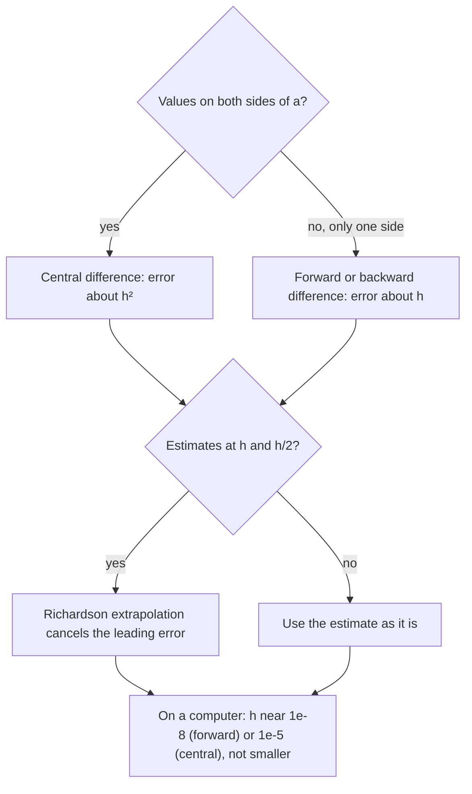

## When there is no formula

Lesson 6 estimated derivatives from tables with difference quotients and said, without proof, that the central difference "is usually more accurate." This lesson makes that precise. It matters because most derivatives computed in science and engineering are never found with the power rule: a motion sensor's software turns a list of positions into velocities, many weather and engineering simulations compute rates of change on a grid of points, and a spreadsheet turns monthly sales into growth rates, all with difference quotients. You will see how big the error is, why the central difference wins, how to combine two poor estimates into a much better one, and why making $h$ "as small as possible" backfires on a computer.

## Three difference quotients

For a step $h > 0$ there are three natural estimates of $f'(a)$:

| Name | Formula | Points used |
|---|---|---|
| **forward difference** | $D_+(h) = \dfrac{f(a + h) - f(a)}{h}$ | $a$ and $a + h$ |
| **backward difference** | $D_-(h) = \dfrac{f(a) - f(a - h)}{h}$ | $a - h$ and $a$ |
| central difference | $D_c(h) = \dfrac{f(a + h) - f(a - h)}{2h}$ | $a - h$ and $a + h$ |

The central difference is exactly the average of the other two: $D_c = \tfrac12(D_+ + D_-)$. Averaging helps because the forward and backward errors are close to equal and opposite, so they mostly cancel.

The plot shows this for $f(x) = x^2$ at $a = 1$ with $h = 1$. The forward secant (slope 3) is too steep, the backward secant (slope 1) too shallow, and the central secant (slope 2) is exactly parallel to the tangent line.

```plot
{"x": [-0.5, 2.5], "y": [-1, 5], "functions": [{"f": "x^2", "label": "y = x²"}, {"f": "1 + 3(x - 1)", "dashed": true, "label": "forward"}, {"f": "x", "dashed": true, "label": "backward"}, {"f": "2x", "color": "#b03a2e", "label": "central"}], "tangents": [{"f": "x^2", "at": 1}], "points": [{"at": [0, 0]}, {"at": [1, 1]}, {"at": [2, 4]}], "caption": "Secants for y = x² at a = 1 with h = 1: forward slope 3, backward slope 1, central slope 2, the same as the tangent"}
```

## Measuring the error exactly

For polynomials we can compute the error with algebra. Take $f(x) = x^3$, whose derivative is $3a^2$:

$$D_+(h) = \frac{(a + h)^3 - a^3}{h} = \frac{3a^2h + 3ah^2 + h^3}{h} = 3a^2 + 3ah + h^2,$$

$$D_c(h) = \frac{(a + h)^3 - (a - h)^3}{2h} = \frac{6a^2h + 2h^3}{2h} = 3a^2 + h^2.$$

The forward error, $3ah + h^2$, is dominated by a term proportional to $h$. In the central error the $h$ term has cancelled, leaving $h^2$. For a quadratic $f(x) = px^2 + qx + r$ the central difference has no error at all, as the plot above showed.

The error a difference quotient makes because $h$ is not zero is its **truncation error**. For any function with enough continuous derivatives, and small $h$,

$$D_+(h) - f'(a) \approx \frac{f''(a)}{2}\,h, \qquad D_c(h) - f'(a) \approx \frac{f'''(a)}{6}\,h^2.$$

These come from Taylor's theorem (Lesson 44); for now, check them on $x^3$. There $f''(a) = 6a$, so the forward prediction is $3ah$, the leading part of the exact error. And $f''' = 6$, so the central prediction is $h^2$, exactly the error.

The power of $h$ is the method's **order of accuracy**. The forward difference is *first order*: halve $h$ and the error roughly halves. The central difference is *second order*: halve $h$ and the error drops by about a factor of 4.

### Example 1

Estimate the derivative of $e^x$ at $0$ (the exact value is $e^0 = 1$) with both quotients, for several step sizes.

| $h$ | $D_+(h)$ | error | $D_c(h)$ | error |
|---|---|---|---|---|
| $0.1$ | $1.051709$ | $0.0517$ | $1.0016675$ | $0.00167$ |
| $0.05$ | $1.025422$ | $0.0254$ | $1.0004167$ | $0.000417$ |
| $0.025$ | $1.012605$ | $0.0126$ | $1.0001042$ | $0.000104$ |

Each time $h$ is halved, the forward error halves ($0.0517 \to 0.0254 \to 0.0126$) and the central error quarters ($0.00167 \to 0.000417 \to 0.000104$). The predictions match too: $f''(0)/2 \cdot 0.1 = 0.05$ and $f'''(0)/6 \cdot 0.01 \approx 0.00167$. With the same two function values per estimate, the central difference is about 30 times more accurate at $h = 0.1$.

## Richardson extrapolation

If you know *how* an error behaves, you can cancel it. Suppose $D(h) \approx f'(a) + Ch$ for some unknown constant $C$. Then $D(h/2) \approx f'(a) + Ch/2$, and

$$2D(h/2) - D(h) \approx 2f'(a) + Ch - f'(a) - Ch = f'(a).$$

The $C$ terms cancel without our ever knowing $C$. This trick is **Richardson extrapolation**, named for Lewis Fry Richardson, who used it in the early 1900s. For the central difference the error is about $Kh^2$, so the combination that cancels it is

$$\frac{4D_c(h/2) - D_c(h)}{3}.$$

### Example 2

Improve the estimates of the derivative of $e^x$ at $0$ from Example 1.

1. Forward differences: $D_+(0.1) = 1.051709$ and $D_+(0.05) = 1.025422$. Then $2(1.025422) - 1.051709 = 0.999135$, with error about $0.00087$, about 30 times smaller than the error of $D_+(0.05)$.
2. Central differences: $D_c(0.1) = 1.0016675$ and $D_c(0.05) = 1.0004167$. Then $\dfrac{4(1.0004167) - 1.0016675}{3} = \dfrac{2.9999993}{3} \approx 0.9999998$, with error about $2 \times 10^{-7}$.

Richardson extrapolation costs no new function values, just arithmetic on estimates you already have. The same idea powers Romberg integration and many adaptive methods in scientific software.

## Why smaller $h$ eventually makes things worse

Truncation error says: shrink $h$. On paper that always works. On a computer it doesn't, because computers store numbers with about 16 significant digits (standard double precision). Each computed value of $f$ carries a tiny **round-off error**, about $10^{-16}$ times its size.

Usually that is harmless. But in $f(a + h) - f(a)$ we subtract two nearly equal numbers when $h$ is small. If both agree in their first 12 digits, the difference has only about 4 trustworthy digits left. This loss of digits is **subtractive cancellation** (also called catastrophic cancellation). Then we divide by the tiny $h$, which magnifies what is left of the error. Roughly, the round-off part of the forward difference's error is about $2\varepsilon|f(a)|/h$, where $\varepsilon \approx 10^{-16}$: it *grows* as $h$ shrinks.

### Example 3

Forward differences for the derivative of $e^x$ at $x = 1$ (exact value $e$), computed in standard double precision:

| $h$ | $10^{-1}$ | $10^{-4}$ | $10^{-8}$ | $10^{-12}$ | $10^{-16}$ |
|---|---|---|---|---|---|
| error | $0.14$ | $1.4\times10^{-4}$ | $6.6\times10^{-9}$ | $4.3\times10^{-4}$ | $2.7$ |

The error falls until about $h = 10^{-8}$, then rises again. At $h = 10^{-16}$ the computer rounds $1 + 10^{-16}$ to exactly 1, so the numerator is 0 and the "derivative" is 0, an error of all of $e \approx 2.7$.

The graph shows every power of 10 for both quotients, on log scales.

![A log-log graph of error against step size h, from 10 to the minus 16 up to 1. The forward-difference curve, solid with circles, falls in a straight line from the right as h shrinks, reaches its lowest error, about 10 to the minus 8, near h = 10 to the minus 8, then climbs raggedly toward the left. The central-difference curve, dashed with squares, falls more steeply, reaches about 10 to the minus 10 near h = 10 to the minus 5 to 10 to the minus 7, and also climbs on the left. The right side is labeled truncation dominates and the left side round-off dominates.](images/calc-m2-step-error.svg)

### Choosing $h$

The total error of the forward difference is roughly

$$E(h) \approx \underbrace{\frac{|f''(a)|}{2}h}_{\text{truncation}} + \underbrace{\frac{2\varepsilon|f(a)|}{h}}_{\text{round-off}}.$$

A sum $Ah + \dfrac{B}{h}$ (with $A, B > 0$) is smallest when the two terms are equal, $Ah = B/h$, so at $h = \sqrt{B/A}$. (One proof: $Ah + \frac Bh - 2\sqrt{AB} = \left(\sqrt{Ah} - \sqrt{B/h}\right)^2 \ge 0$.) For $e^x$ at 1, $A = e/2$ and $B = 2\varepsilon e$, giving $h = 2\sqrt{\varepsilon} \approx 2 \times 10^{-8}$, just where the graph bottoms out. The same reasoning for the central difference gives a best step near $\varepsilon^{1/3} \approx 10^{-5}$. These are rules of thumb for functions whose values and derivatives are of moderate size, not laws: scale matters.

### Example 4

A motion sensor records a cart's position every $0.01$ s, and each reading may be off by up to $0.002$ m. The cart's acceleration is about $3$ m/s². Which spacing $h$ gives the most reliable forward-difference velocity?

Measurement error plays the role of round-off. If each reading is off by up to $\delta = 0.002$ m, the numerator can be off by up to $2\delta$, so the velocity can be off by up to $2\delta/h$. Truncation adds about $\frac{|s''|}{2}h = 1.5h$.

- Using neighboring readings, $h = 0.01$ s: up to $\frac{0.004}{0.01} + 1.5(0.01) = 0.4 + 0.015 = 0.415$ m/s.
- Using every tenth reading, $h = 0.1$ s: up to $\frac{0.004}{0.1} + 1.5(0.1) = 0.04 + 0.15 = 0.19$ m/s.
- Balancing $1.5h = 0.004/h$: $h = \sqrt{0.004/1.5} \approx 0.052$ s, so every fifth reading ($h = 0.05$ s) is about best, with worst-case error about $0.08 + 0.075 = 0.155$ m/s.

Differentiating data magnifies its noise. That is why real instruments smooth data before differentiating it, or fit a curve and differentiate the curve.

## Choosing a method



## Common mistakes

- *Thinking smaller $h$ is always better.* On paper, yes; in floating-point arithmetic or with measured data, error eventually grows like $1/h$.
- *Dividing the central difference by $h$ instead of $2h$.* The two points are $2h$ apart. Forgetting the 2 doubles the estimate.
- *Using a central difference at the end of a table.* At the first or last data point there is no value on the other side; use a one-sided quotient.
- *Getting the Richardson weights backward.* For first-order errors it's $2D(h/2) - D(h)$, with the *smaller* step getting the larger weight; for central differences it's $\frac{4D_c(h/2) - D_c(h)}{3}$.
- *Reporting more digits than the method supports.* An estimate with error near $10^{-3}$ should not be quoted to eight decimal places.

## Key points

- Forward and backward differences have truncation error about $\frac{f''(a)}{2}h$: first order.
- The central difference has error about $\frac{f'''(a)}{6}h^2$: second order, and exact for quadratics.
- Richardson extrapolation combines estimates at $h$ and $h/2$ to cancel the leading error: $2D(h/2) - D(h)$ for first-order methods, $\frac{4D_c(h/2) - D_c(h)}{3}$ for central differences.
- Round-off and measurement error grow like $1/h$, so the total error is smallest at a balanced $h$, roughly $10^{-8}$ (forward) or $10^{-5}$ (central) in double precision for well-scaled functions.
