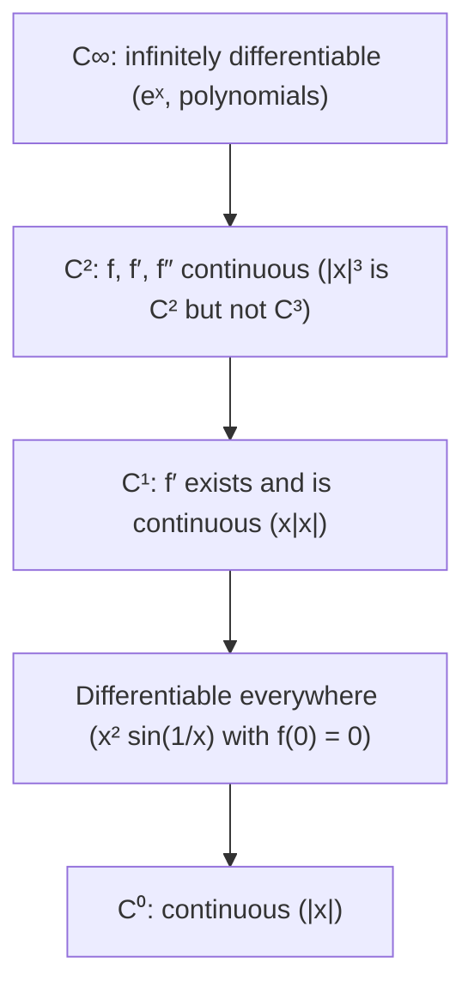

## Beyond "no corners"

Lesson 7 sorted functions into two bins: differentiable at a point, or not (corner, cusp, vertical tangent, discontinuity). To join two pieces smoothly, you matched their values and their slopes. That is enough for a graph to look smooth, but not always enough for a ride to *feel* smooth: a train entering a curve, a car's path on a highway ramp, or a robot arm's motion can be differentiable everywhere and still give a jolt. This lesson grades smoothness more finely, looks at derivatives that exist but behave badly, and ends with a function that is continuous everywhere and differentiable nowhere.

## One-sided derivatives and the piece-by-piece shortcut

The **one-sided derivatives** of Lesson 7 are

$$f'_-(a) = \lim_{h\to0^-}\frac{f(a + h) - f(a)}{h}, \qquad f'_+(a) = \lim_{h\to0^+}\frac{f(a + h) - f(a)}{h}.$$

For a piecewise function it is tempting to skip the limits and just compare the derivatives of the two formulas at the seam. That shortcut is backed by a theorem (a consequence of the Mean Value Theorem, Lesson 17): *if $f$ is continuous at $a$, differentiable just to the left of $a$, and $f'(x) \to L$ as $x \to a^-$, then $f'_-(a) = L$* (and likewise on the right).

Note the hypothesis: *continuity at $a$*. Without it the shortcut lies. Take

$$f(x) = \begin{cases} x^2, & x \le 1\\ x^2 + 1, & x > 1.\end{cases}$$

Both formulas have slope 2 at $x = 1$, yet $f$ jumps there. The true right-hand derivative is

$$f'_+(1) = \lim_{h\to0^+}\frac{(1 + h)^2 + 1 - 1}{h} = \lim_{h\to0^+}\left(\frac1h + 2 + h\right) = \infty,$$

because $f(1) = 1$ comes from the *left* formula. Check continuity first, always.

## A derivative that exists but is not continuous

The theorem also has a gap in the other direction: $f'(a)$ can exist even when $\lim_{x\to a}f'(x)$ does not.

### Example 1

Let $f(x) = x^2\sin(1/x)$ for $x \ne 0$ and $f(0) = 0$. Find $f'(0)$, and decide whether $f'$ is continuous at 0.

1. Use the definition (the shortcut can't help: the formula isn't defined at 0):
$$f'(0) = \lim_{h\to0}\frac{h^2\sin(1/h) - 0}{h} = \lim_{h\to0} h\sin(1/h).$$
2. Squeeze (Lesson 4): $-|h| \le h\sin(1/h) \le |h|$, and both bounds go to 0. So $f'(0) = \mathbf{0}$.
3. For $x \ne 0$, the product and chain rules of Lessons 9 and 11 give $f'(x) = 2x\sin(1/x) - \cos(1/x)$. As $x \to 0$, the first term goes to 0, but $\cos(1/x)$ keeps swinging between $-1$ and $1$ infinitely often.
4. So $\lim_{x\to0}f'(x)$ does not exist, while $f'(0) = 0$. The function is differentiable everywhere, but $f'$ is *not continuous* at 0.

```plot
{"x": [-0.4, 0.4], "y": [-0.17, 0.17], "functions": [{"f": "x^2*sin(1/x)", "label": "f"}, {"f": "x^2", "dashed": true}, {"f": "-x^2", "dashed": true}], "caption": "f(x) = x² sin(1/x) wiggles infinitely often near 0 but is trapped between y = x² and y = −x², so it flattens out: f′(0) = 0"}
```

Can a derivative have *any* kind of discontinuity? No. **Darboux's theorem** (Gaston Darboux, 1875) says that if $f$ is differentiable on $[a, b]$, then $f'$ takes every value between $f'(a)$ and $f'(b)$, just as the Intermediate Value Theorem says for continuous functions, even when $f'$ is not continuous. So a derivative can never have a jump. For example, a function equal to $-1$ for $x < 0$ and $1$ for $x \ge 0$ is not the derivative of anything on an interval containing 0. A derivative's discontinuities must be wild, oscillating ones like $\cos(1/x)$ above. (The proof uses the Extreme Value Theorem and is part of a first real analysis course.)

## Grading smoothness

Mathematicians sort functions on an interval into **smoothness classes**:

| Class | Meaning |
|---|---|
| $C^0$ | continuous |
| $C^1$ | **continuously differentiable**: $f'$ exists and is continuous |
| $C^2$ | $f'$ and $f''$ exist and are continuous |
| $C^k$ | the first $k$ derivatives exist and are continuous |
| $C^\infty$ | **infinitely differentiable**: derivatives of every order exist |

Each class sits inside the one before it, and "differentiable everywhere" sits strictly between $C^1$ and $C^0$ (Example 1 is differentiable but not $C^1$).



### Example 2

How smooth is $f(x) = x\lvert x\rvert$ at 0?

1. Pieces: $f(x) = x^2$ for $x \ge 0$ and $f(x) = -x^2$ for $x < 0$. It is continuous, with $f(0) = 0$.
2. First derivative at 0, from the definition: $f'(0) = \lim_{h\to0}\dfrac{h\lvert h\rvert}{h} = \lim_{h\to0}\lvert h\rvert = 0$.
3. Elsewhere, $f'(x) = 2x$ for $x > 0$ and $-2x$ for $x < 0$. Together with $f'(0) = 0$, that is $f'(x) = 2\lvert x\rvert$ for every $x$, which is continuous. So $f$ is $C^1$.
4. Second derivative at 0: $\dfrac{f'(h) - f'(0)}{h} = \dfrac{2\lvert h\rvert}{h}$, which is $2$ for $h > 0$ and $-2$ for $h < 0$. No limit, so $f''(0)$ does not exist: $f'$ has a corner.

So $x\lvert x\rvert$ is $C^1$ but not $C^2$. The same reasoning shows $\lvert x\rvert^3$ is $C^2$ but not $C^3$: its derivatives are $3x\lvert x\rvert$, then $6\lvert x\rvert$, which has a corner.

```plot
{"x": [-2, 2], "y": [-4, 4], "functions": [{"f": "x*abs(x)"}, {"f": "2abs(x)", "dashed": true}], "caption": "f(x) = x|x| (solid) looks perfectly smooth; its derivative 2|x| (dashed) has a corner at 0, so f″(0) does not exist"}
```

## Why the second derivative matters: transition curves

Picture a train running at constant speed $v$ along a track. Ignoring any tilt of the track, its sideways acceleration is $v^2\kappa$, where $\kappa$ is the track's *curvature*: $0$ on a straight, $1/R$ on a circular arc of radius $R$. For a track drawn as $y = f(x)$, the curvature is $\dfrac{|f''(x)|}{(1 + f'(x)^2)^{3/2}}$, which is close to $|f''(x)|$ where the slope is small. (That formula is derived in multivariable calculus; here it is enough that curvature is mostly about $f''$.)

Join a straight track directly to a circular arc, tangent to it, and the join is $C^1$: no corner. But the curvature jumps from $0$ to $1/R$, so the sideways acceleration jumps from $0$ to $v^2/R$ in an instant, which passengers feel as a lurch. Railways and highways therefore insert a **transition curve** between them, along which the curvature grows steadily from 0 to $1/R$. Common choices are the clothoid (or Euler spiral), whose curvature grows in direct proportion to distance along it, and the simpler cubic parabola $y = cx^3$. In calculus terms, the transition makes the path $C^2$ instead of just $C^1$.


### Example 3

Find $a$, $c$ and $d$ so that

$$f(x) = \begin{cases} 0, & x \le 0\\ ax^3, & 0 < x \le 1\\ 3x^2 + cx + d, & x > 1\end{cases}$$

is $C^2$: $f$, $f'$ and $f''$ all continuous.

1. At $x = 0$: $ax^3$ and its first two derivatives, $3ax^2$ and $6ax$, are all 0 at $x = 0$, matching the zero piece for every $a$. Nothing to solve.
2. At $x = 1$, start with the second derivatives, since they involve only one unknown: $6a(1) = 2 \cdot 3$, so $a = 1$. (The second derivative of $3x^2$ is $6$, not $3$.)
3. Slopes at $x = 1$: $3a(1)^2 = 2\cdot3(1) + c$, so $3 = 6 + c$ and $c = -3$.
4. Values at $x = 1$: $a = 3 + c + d$, so $1 = 3 - 3 + d$ and $d = 1$.

So the last piece is $3x^2 - 3x + 1$. Along the way, $f''$ is $0$, then rises linearly ($6x$), then holds at $6$: the same pattern as the curvature graph above. (In this toy example the slopes are not small, so $f''$ only roughly tracks curvature; real track design works with curvature directly. The matching idea is the same.) The function is not $C^3$: $f'''$ jumps from 6 to 0 at $x = 1$.

The same matching drives the **cubic spline**: a chain of cubic pieces through a list of data points, joined so that the values, first derivatives and second derivatives all agree at each joint. Splines are $C^2$, smooth enough that the eye sees no seams, and they are standard in computer-aided design, animation and data interpolation.

## Continuous everywhere, differentiable nowhere

Many 19th-century mathematicians assumed a continuous function must be differentiable except at a few isolated points; André-Marie Ampère even published an attempted proof in 1806. In 1872 Karl Weierstrass presented a counterexample to the Berlin Academy:

$$W(x) = \sum_{n=0}^{\infty} a^n\cos(b^n\pi x),$$

with $0 < a < 1$, $b$ an odd integer and $ab > 1 + \tfrac{3\pi}{2}$ (G. H. Hardy showed in 1916 that $ab \ge 1$ is enough). Each term is a smooth wave, and the series converges to a continuous function, but the higher terms add ever faster wiggles that, though smaller, are steep: zoom in anywhere and new corners keep appearing, so the graph never straightens into a tangent line. (Bernard Bolzano had found a similar example around 1830, but it was not published until the 20th century.) Charles Hermite called such functions a "lamentable plague." Today they are everyday tools: the path of a particle in Brownian motion, used to model diffusion and stock prices, is continuous but, with probability 1, differentiable nowhere.

## Common mistakes

- *Comparing the pieces' slopes without checking continuity.* Equal slopes at a seam mean nothing if the pieces don't meet.
- *Assuming $\lim_{x\to a}f'(x)$ must exist when $f'(a)$ does.* $x^2\sin(1/x)$ shows it need not; use the definition at the point itself.
- *Treating "differentiable" and "$C^1$" as the same.* $C^1$ also requires $f'$ to be continuous.
- *Matching $f''$ with the wrong number.* $(Ax^2 + Bx + C)'' = 2A$, not $A$.
- *Thinking a tangent (C¹) join is free of jolts.* Value and slope can match while curvature, and hence sideways acceleration, still jumps.

## Key points

- The one-sided derivatives at a seam are guaranteed to equal the limits of the pieces' derivatives when $f$ is continuous there (and those limits exist); if $f$ jumps, the shortcut can give the wrong answer.
- A derivative can exist everywhere and still be discontinuous ($x^2\sin(1/x)$), but by Darboux's theorem it can never jump.
- Smoothness classes: $C^\infty \subset \dots \subset C^2 \subset C^1 \subset$ differentiable $\subset C^0$; $\lvert x\rvert$, $x\lvert x\rvert$ and $\lvert x\rvert^3$ climb the ladder one rung at a time.
- A $C^2$ join matches value, slope and second derivative; transition curves on roads and railways and cubic splines are built this way.
- Weierstrass's function is continuous everywhere and differentiable nowhere.
