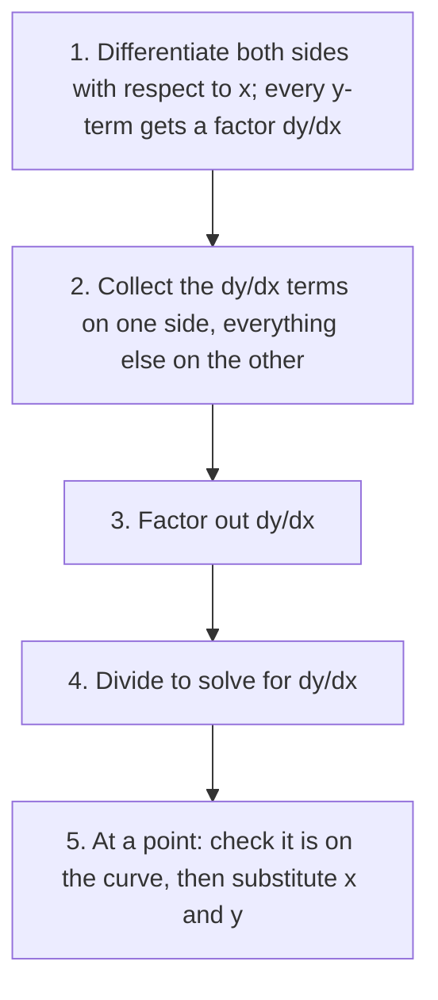

## Curves that aren't functions

Every derivative so far started from an explicit formula $y = f(x)$. But many curves are described by an equation relating $x$ and $y$, like the circle $x^2 + y^2 = 25$ or the folium $x^3 + y^3 = 6xy$. Some can't be solved for $y$ at all, and even when they can (the circle splits into $y = \pm\sqrt{25 - x^2}$), it's clumsy. Yet these curves clearly have tangent lines. **Implicit differentiation** finds their slopes without solving for $y$. It's the chain rule applied with a twist.

## The method

Treat $y$ as an unknown function of $x$, $y = y(x)$, and differentiate both sides of the equation with respect to $x$. Whenever you differentiate an expression involving $y$, the chain rule attaches a factor of $\frac{dy}{dx}$:

$$\frac{d}{dx}\left(y^2\right) = 2y\frac{dy}{dx}, \qquad \frac{d}{dx}\sin y = \cos y\,\frac{dy}{dx}, \qquad \frac{d}{dx}(xy) = 1\cdot y + x\frac{dy}{dx}.$$

Then solve the resulting equation for $\frac{dy}{dx}$. Steps:

1. Differentiate both sides with respect to $x$.
2. Move every term containing $\frac{dy}{dx}$ to one side, everything else to the other.
3. Factor out $\frac{dy}{dx}$ and divide.

When you need the slope at a particular point, finish by substituting its coordinates, as in the chart.



### Example 1

Find $\frac{dy}{dx}$ for the circle $x^2 + y^2 = 25$, and the tangent line at $(3, -4)$.

Differentiate: $2x + 2y\dfrac{dy}{dx} = 0$. Solve: $\dfrac{dy}{dx} = -\dfrac{x}{y}$.

At $(3, -4)$: slope $= -\dfrac{3}{-4} = \dfrac34$. Tangent: $y + 4 = \frac34(x - 3)$.

```plot
{"x": [-7, 8], "y": [-7, 7], "equal": true, "curves": [{"x": "5cos(t)", "y": "5sin(t)", "t": [0, "2pi"]}], "functions": [{"f": "0.75(x - 3) - 4", "dashed": true}], "points": [{"at": [3, -4], "label": "(3, −4)"}], "caption": "Tangent to x² + y² = 25 at (3, −4), slope 3/4"}
```

Check: the radius to $(3, -4)$ has slope $-\frac43$, and a tangent to a circle is perpendicular to the radius: $\frac34\cdot\left(-\frac43\right) = -1$. ✓

The formula $-x/y$ works on both halves of the circle at once; it needs both coordinates because $x$ alone doesn't tell you which half you're on.

### Example 2

Find $\frac{dy}{dx}$ for $x^3 + y^3 = 6xy$, and the slope at $(3, 3)$.

Differentiate (product rule on the right):
$$3x^2 + 3y^2\frac{dy}{dx} = 6y + 6x\frac{dy}{dx}.$$
Collect: $3y^2\dfrac{dy}{dx} - 6x\dfrac{dy}{dx} = 6y - 3x^2$. Factor and divide (and cancel the 3):
$$\frac{dy}{dx} = \frac{2y - x^2}{y^2 - 2x}.$$
At $(3, 3)$: $\dfrac{6 - 9}{9 - 6} = \mathbf{-1}$.

Horizontal tangents occur where the numerator is 0 (and the denominator isn't); vertical tangents where the denominator is 0 (and the numerator isn't).

```plot
{"x": [-5, 5], "y": [-5, 5], "equal": true, "curves": [{"x": "6t/(1 + t^3)", "y": "6t^2/(1 + t^3)", "t": [-0.85, 25]}, {"x": "6t/(1 + t^3)", "y": "6t^2/(1 + t^3)", "t": [-25, -1.2]}], "functions": [{"f": "6 - x", "dashed": true}], "points": [{"at": [3, 3], "label": "(3, 3)"}], "caption": "The folium x³ + y³ = 6xy and its tangent at (3, 3), slope −1"}
```

## Second derivatives implicitly

Differentiate $\frac{dy}{dx}$ again (it will contain $y$, so more $\frac{dy}{dx}$'s appear), then substitute the expression you already have for $\frac{dy}{dx}$.

### Example 3

For $x^2 + y^2 = 25$, find $\frac{d^2y}{dx^2}$.

From $y' = -\frac xy$, quotient rule:
$$y'' = -\frac{1\cdot y - x\,y'}{y^2} = -\frac{y - x\left(-\frac xy\right)}{y^2} = -\frac{y^2 + x^2}{y^3} = -\frac{25}{y^3}.$$
The original equation turned $x^2 + y^2$ into 25. On the top half ($y > 0$), $y'' < 0$: concave down, as expected.

## Derivatives of inverse trig functions

Implicit differentiation gives the derivatives of inverse functions. Recall $y = \arcsin x$ means $\sin y = x$ with $-\frac\pi2 \le y \le \frac\pi2$.

Differentiate $\sin y = x$ implicitly: $\cos y\,\dfrac{dy}{dx} = 1$, so $\dfrac{dy}{dx} = \dfrac{1}{\cos y}$.

Express $\cos y$ in terms of $x$. Since $\cos^2 y = 1 - \sin^2 y = 1 - x^2$, and $\cos y \ge 0$ on $[-\frac\pi2, \frac\pi2]$, $\cos y = \sqrt{1 - x^2}$. So

$$\frac{d}{dx}\arcsin x = \frac{1}{\sqrt{1 - x^2}}, \quad -1 < x < 1.$$

```shape
{"polygons": [{"points": [[0, 0], [3, 0], [3, 4]]}], "rightAngles": [[[3, 0], [0, 0], [3, 4]]], "segments": [{"from": [0, 0], "to": [3, 0], "label": "√(1 − x²)"}, {"from": [3, 0], "to": [3, 4], "label": "x"}, {"from": [0, 0], "to": [3, 4], "label": "1"}], "labels": [{"at": [0.6, 0.25], "text": "y"}], "caption": "If sin y = x, the adjacent side is √(1 − x²), so cos y = √(1 − x²)"}
```

The same approach for $\tan y = x$: $\sec^2 y\,y' = 1$, and $\sec^2 y = 1 + \tan^2 y = 1 + x^2$. All six:

| $f(x)$ | $f'(x)$ |
|---|---|
| $\arcsin x$ | $\dfrac{1}{\sqrt{1 - x^2}}$ |
| $\arccos x$ | $-\dfrac{1}{\sqrt{1 - x^2}}$ |
| $\arctan x$ | $\dfrac{1}{1 + x^2}$ |
| $\operatorname{arccot} x$ | $-\dfrac{1}{1 + x^2}$ |
| $\operatorname{arcsec} x$ | $\dfrac{1}{\lvert x\rvert\sqrt{x^2 - 1}}$ |
| $\operatorname{arccsc} x$ | $-\dfrac{1}{\lvert x\rvert\sqrt{x^2 - 1}}$ |

The co- versions are negatives because, for example, $\arccos x = \frac\pi2 - \arcsin x$.

A note on $\operatorname{arcsec}$: the $\lvert x\rvert$ in its derivative goes with the usual range $[0, \frac\pi2) \cup (\frac\pi2, \pi]$ (the one this course uses, since $\operatorname{arcsec} x = \arccos\frac1x$). A few textbooks pick the range $[0, \frac\pi2) \cup [\pi, \frac{3\pi}{2})$ instead, which makes the derivative $\frac{1}{x\sqrt{x^2 - 1}}$ with no absolute value. Check which convention your book uses.

Notice that the derivatives are algebraic, with no trig left in them. That's why $\arctan$ and $\arcsin$ show up as antiderivatives of ordinary-looking functions in integration (Lesson 24).

### Example 4

Differentiate $y = \arctan(3x)$ and $y = \arcsin(\sqrt x)$.

Chain rule with each:
- $\dfrac{d}{dx}\arctan(3x) = \dfrac{1}{1 + (3x)^2}\cdot3 = \dfrac{3}{1 + 9x^2}$.
- $\dfrac{d}{dx}\arcsin(\sqrt x) = \dfrac{1}{\sqrt{1 - x}}\cdot\dfrac{1}{2\sqrt x} = \dfrac{1}{2\sqrt{x(1 - x)}}$.

### Example 5

Differentiate $y = x\arctan x$. Product rule: $y' = \arctan x + \dfrac{x}{1 + x^2}$.

### Example 6

Find the tangent line to $x^2 + xy + y^2 = 7$ at the point $(1, 2)$.

First confirm the point is on the curve: $1 + 2 + 4 = 7$. ✓ Differentiate (product rule on $xy$):
$$2x + y + x\frac{dy}{dx} + 2y\frac{dy}{dx} = 0 \quad\Longrightarrow\quad \frac{dy}{dx} = -\frac{2x + y}{x + 2y}.$$
At $(1, 2)$: $\frac{dy}{dx} = -\frac{4}{5}$. The tangent line is $y - 2 = -\frac45(x - 1)$, or $y = -\frac45x + \frac{14}{5}$.

The curve is a tilted ellipse; solving it for $y$ would need the quadratic formula, which implicit differentiation avoided entirely.

## Common mistakes

- **Forgetting $\frac{dy}{dx}$ on $y$-terms.** $\frac{d}{dx}y^3 = 3y^2y'$, not $3y^2$.
- **Treating $xy$ as one variable.** It's a product: $\frac{d}{dx}(xy) = y + xy'$.
- *Differentiating constants to something nonzero.* $\frac{d}{dx}25 = 0$.
- **$\arcsin x = \frac{1}{\sin x}$.** No: $\arcsin$ is the inverse function, $\csc$ is the reciprocal.
- **Sign of $\frac{d}{dx}\arccos x$.** It's negative.

## Key points

- Implicit differentiation: differentiate both sides in $x$, attach $\frac{dy}{dx}$ to every $y$-derivative, solve for $\frac{dy}{dx}$.
- Slopes from implicit derivatives usually depend on both $x$ and $y$.
- $(\arcsin x)' = \frac{1}{\sqrt{1 - x^2}}$, $(\arctan x)' = \frac{1}{1 + x^2}$, $(\operatorname{arcsec} x)' = \frac{1}{|x|\sqrt{x^2 - 1}}$; co-versions are negatives.
