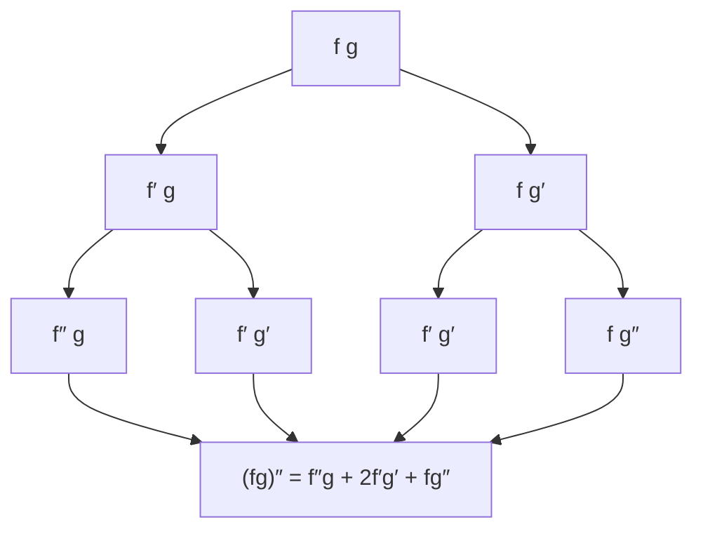

## Beyond the second derivative

Lesson 8 introduced the second derivative, and Lesson 10 noticed that the derivatives of $\sin x$ repeat every four steps. This lesson takes those ideas as far as they go. How would you find the tenth derivative of $x^2e^{3x}$? Applying the product rule ten times in a row works, but the expression doubles in length at every step. There is a much better way.

Higher derivatives are not just a puzzle. Taylor series (Lesson 44) build a polynomial out of *all* the derivatives of a function at one point, so a formula for the $n$th derivative is exactly what you need there. And in physics, the third derivative of position (called *jerk*) matters in designing smooth rides in elevators and trains.

Notation: the **nth derivative** of $f$ is written $f^{(n)}$ or $\dfrac{d^ny}{dx^n}$, with the parentheses keeping it apart from a power. By convention $f^{(0)} = f$.

## Patterns for the basic functions

For many functions you can spot the pattern after two or three derivatives, then prove it.

| $f(x)$ | $f^{(n)}(x)$ |
|---|---|
| $x^m$ | $m(m - 1)(m - 2)\cdots(m - n + 1)\,x^{m - n}$ |
| $e^{ax}$ | $a^ne^{ax}$ |
| $\sin(ax + b)$ | $a^n\sin\left(ax + b + \frac{n\pi}{2}\right)$ |
| $\cos(ax + b)$ | $a^n\cos\left(ax + b + \frac{n\pi}{2}\right)$ |
| $\dfrac{1}{x - c}$ | $\dfrac{(-1)^n\,n!}{(x - c)^{n + 1}}$ |
| $\ln x$ | $\dfrac{(-1)^{n - 1}(n - 1)!}{x^n}$, for $n \ge 1$ |

The product $m(m - 1)\cdots(m - n + 1)$ of $n$ factors, each one less than the last, is called a **falling factorial**. When $m$ is a whole number and $n > m$, one of its factors is 0: a polynomial of degree $m$ has every derivative past the $m$th equal to zero. When $n = m$ the falling factorial is $m!$, so $\frac{d^m}{dx^m}x^m = m!$.

*Why the sine pattern holds.* Since $\cos\theta = \sin\left(\theta + \frac\pi2\right)$, differentiating $\sin(ax + b)$ gives $a\cos(ax + b) = a\sin\left(ax + b + \frac\pi2\right)$. Each derivative multiplies by $a$ and shifts the angle by a quarter turn, which is the four-step cycle of Lesson 10 in a single formula.

*Why the reciprocal pattern holds.* Write $\frac{1}{x - c} = (x - c)^{-1}$. The power rule brings down $-1$, then $-2$, then $-3$, and so on; after $n$ steps the coefficient is $(-1)(-2)\cdots(-n) = (-1)^nn!$ and the power is $-(n + 1)$.

Arguments like these are proofs by **mathematical induction**: show the formula is right for $n = 1$, then show that if it is right for some $n$, differentiating once more gives the formula for $n + 1$. For the reciprocal, differentiating $(-1)^nn!(x - c)^{-(n + 1)}$ gives $(-1)^nn!\cdot(-(n + 1))(x - c)^{-(n + 2)} = (-1)^{n + 1}(n + 1)!\,(x - c)^{-(n + 2)}$, the formula with $n + 1$ in place of $n$.

### Example 1

Find $\dfrac{d^{100}}{dx^{100}}\sin(2x)$ and the fifth derivative of $\ln x$.

- The sine pattern with $a = 2$, $b = 0$, $n = 100$: $2^{100}\sin(2x + 50\pi)$. Adding $50\pi$ (25 full turns) changes nothing, so the answer is $\mathbf{2^{100}\sin(2x)}$.
- The log pattern with $n = 5$: $\dfrac{(-1)^4\,4!}{x^5} = \mathbf{\dfrac{24}{x^5}}$. Check the start of the chain: $\frac1x$, $-\frac1{x^2}$, $\frac2{x^3}$, $-\frac6{x^4}$, $\frac{24}{x^5}$.

### Example 2

Find a formula for the $n$th derivative of $f(x) = \dfrac{1}{x^2 - 1}$, and evaluate $f^{(n)}(0)$.

No row of the table fits directly, but the function splits into two reciprocals (add the fractions back to check):
$$\frac{1}{x^2 - 1} = \frac12\left(\frac{1}{x - 1} - \frac{1}{x + 1}\right).$$
Differentiation is linear, so apply the reciprocal pattern to each piece:
$$f^{(n)}(x) = \frac{(-1)^n\,n!}{2}\left(\frac{1}{(x - 1)^{n + 1}} - \frac{1}{(x + 1)^{n + 1}}\right).$$
At $x = 0$ the bracket is $(-1)^{n + 1} - 1$, which is $-2$ when $n$ is even and $0$ when $n$ is odd. So $f^{(n)}(0) = -n!$ for even $n$ and $0$ for odd $n$. (Odd derivatives vanish at 0 because $f$ is an even function.) This splitting trick, partial fractions, is studied properly in Lesson 33.

## Leibniz's rule for products

Differentiate a product a few times and watch the coefficients:
$$\begin{aligned}
(fg)' &= f'g + fg'\\
(fg)'' &= f''g + 2f'g' + fg''\\
(fg)''' &= f'''g + 3f''g' + 3f'g'' + fg'''
\end{aligned}$$
The coefficients 1, 2, 1 and 1, 3, 3, 1 are rows of Pascal's triangle, the same numbers as in $(a + b)^2$ and $(a + b)^3$. The pattern continues forever. This is the **Leibniz rule** (also called the general Leibniz rule):
$$(fg)^{(n)} = \sum_{k = 0}^{n}\binom nk f^{(n - k)}\,g^{(k)},$$
where $\binom nk = \dfrac{n!}{k!\,(n - k)!}$ is the binomial coefficient. In every term the two orders of differentiation add up to $n$. It is named after Gottfried Wilhelm Leibniz (1646–1716), who also gave us the $\frac{dy}{dx}$ notation.

*Why the binomial coefficients appear.* Each time you differentiate a term like $f^{(i)}g^{(j)}$, the product rule splits it into two terms: one with an extra derivative on $f$, one with an extra derivative on $g$. That is the same bookkeeping as multiplying by $(a + b)$, where choosing $a$ means "differentiate $f$" and choosing $b$ means "differentiate $g$." After $n$ steps, the term $f^{(n - k)}g^{(k)}$ is reached once for every way to choose which $k$ of the $n$ steps went to $g$, and there are $\binom nk$ such ways. The tree below shows this for $n = 2$: the term $f'g'$ is reached by two paths, which is where the 2 comes from.

A formal proof is by induction, using Pascal's rule $\binom nk + \binom n{k - 1} = \binom{n + 1}k$ to combine the two terms that land on the same $f^{(n + 1 - k)}g^{(k)}$.

The rule pays off when one factor is a polynomial, because then only a few terms survive.

### Example 3

Find the tenth derivative of $y = x^2e^{3x}$.

Let the polynomial be $g = x^2$, so $g' = 2x$, $g'' = 2$, and $g^{(k)} = 0$ for $k \ge 3$. Only $k = 0, 1, 2$ survive. For $f = e^{3x}$, $f^{(m)} = 3^me^{3x}$.
$$y^{(10)} = \binom{10}0 3^{10}e^{3x}\cdot x^2 + \binom{10}1 3^9e^{3x}\cdot 2x + \binom{10}2 3^8e^{3x}\cdot 2.$$
With $\binom{10}1 = 10$ and $\binom{10}2 = 45$:
$$y^{(10)} = e^{3x}\left(3^{10}x^2 + 20\cdot3^9x + 90\cdot3^8\right) = \mathbf{3^9e^{3x}(3x^2 + 20x + 30)}.$$
(Factor $3^8$ out first: $3^8(9x^2 + 60x + 90) = 3^9(3x^2 + 20x + 30)$.) Three terms instead of a page of product rules.

### Example 4

Find the 20th derivative of $y = x^3\sin x$ at $x = 0$.

Take $g = x^3$. At $x = 0$, $g$, $g'$ and $g''$ are all 0, and $g^{(k)} = 0$ for $k \ge 4$. Only the $k = 3$ term survives, with $g'''(0) = 6$:
$$y^{(20)}(0) = \binom{20}3\,\sin^{(17)}(0)\cdot 6.$$
Since $17 = 4\cdot4 + 1$, the 17th derivative of $\sin$ is $\cos$, and $\cos 0 = 1$. With $\binom{20}3 = 1140$, the answer is $1140\cdot6 = \mathbf{6840}$.

A check you will be able to do after Lesson 44: $x^3\sin x = x^4 - \frac{x^6}{6} + \cdots + \frac{x^{20}}{17!} - \cdots$, and the coefficient of $x^{20}$ must be $\frac{y^{(20)}(0)}{20!}$. Indeed $\frac{20!}{17!} = 20\cdot19\cdot18 = 6840$.

## Higher derivatives of composites

There is no equally tidy rule for $f(g(x))$. Differentiating the chain rule $f'(g(x))\,g'(x)$ once more needs the chain rule again on the first factor and the product rule for the pair:
$$\frac{d^2}{dx^2}f(g(x)) = f''(g(x))\,\big[g'(x)\big]^2 + f'(g(x))\,g''(x).$$
For example, $\frac{d^2}{dx^2}e^{x^2} = e^{x^2}(2x)^2 + e^{x^2}\cdot2 = e^{x^2}(4x^2 + 2)$. Third and higher derivatives grow quickly more complicated; the general formula is known as Faà di Bruno's formula, after the Italian mathematician who published it in the 1850s. In practice, for a specific function you simply differentiate step by step and simplify as you go.

## Common mistakes

- *Dropping the binomial coefficients.* $(fg)'' = f''g + f'g' + fg''$ is wrong; the middle term is $2f'g'$.
- *Mismatched orders.* In each Leibniz term the derivative orders on $f$ and $g$ add to $n$: $f^{(n - k)}g^{(k)}$, never $f^{(k)}g^{(k)}$.
- *Forgetting the factor $a^n$* in $\frac{d^n}{dx^n}e^{ax}$ or $\frac{d^n}{dx^n}\sin(ax)$.
- *Off by one in the log pattern.* The $n$th derivative of $\ln x$ has $(n - 1)!$, not $n!$, because the first derivative $\frac1x$ already used up one step.
- *Squaring the wrong thing.* The second derivative of $f(g(x))$ is not $f''(g(x))\,g''(x)$; it is $f''(g(x))\,[g'(x)]^2 + f'(g(x))\,g''(x)$.
- *Reading $f^{(3)}$ as a cube.* The parentheses mean "third derivative"; $f^3$ means $f\cdot f\cdot f$.

## Key points

- Know the $n$th-derivative patterns: $x^m$ (falling factorial), $e^{ax}$ ($a^ne^{ax}$), $\sin(ax + b)$ (multiply by $a$, shift by $\frac\pi2$ each time), $\frac1{x - c}$ ($(-1)^nn!/(x - c)^{n + 1}$), $\ln x$.
- Prove a pattern by induction: check $n = 1$, then show one more derivative turns the $n$ formula into the $n + 1$ formula.
- Leibniz rule: $(fg)^{(n)} = \sum_{k=0}^n\binom nk f^{(n - k)}g^{(k)}$, with the same coefficients as $(a + b)^n$.
- When one factor is a polynomial of degree $m$, at most $m + 1$ terms survive; at $x = 0$ often only one does.
- Splitting a rational function into simple fractions turns its $n$th derivative into a sum of reciprocal patterns.
