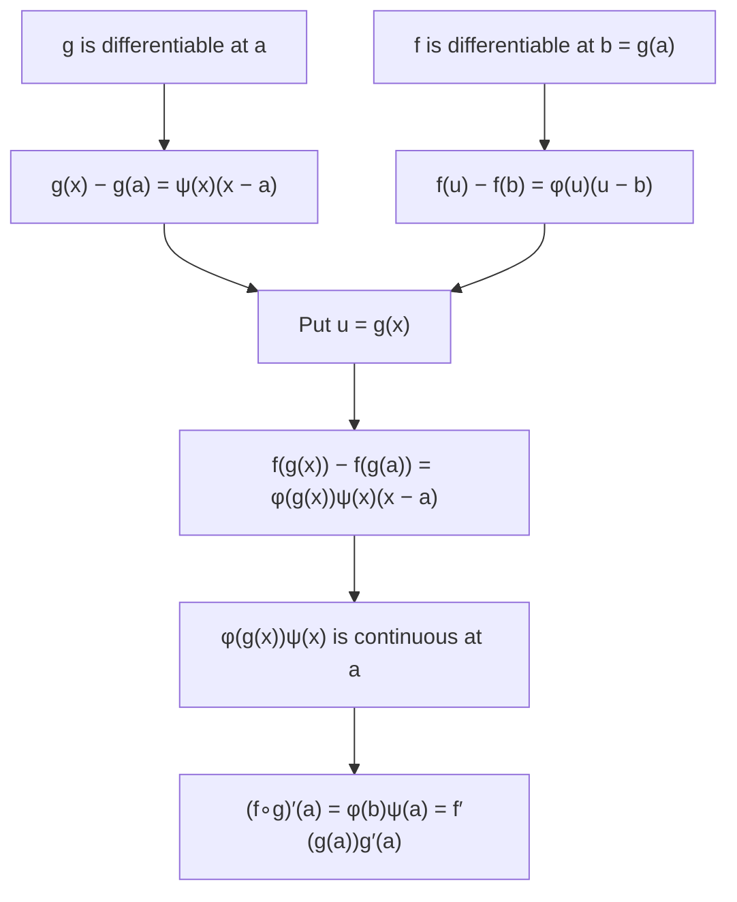

## Closing two gaps

Lesson 11 justified the chain rule with a sketch and admitted that "a fully rigorous proof handles the case $\Delta u = 0$ separately." Lesson 13 found $(f^{-1})'$ by differentiating $f(g(x)) = x$, which quietly assumes that $f^{-1}$ *has* a derivative before computing it. Both shortcuts give the right formulas, but a careful reader should ask whether the formulas are always true and when they fail. This lesson closes both gaps with one idea, then uses it to give a clean account of real exponents and of the number $e$ as a limit.

## What goes wrong with the sketch

The sketch wrote
$$\frac{f(g(x + h)) - f(g(x))}{h} = \frac{f(u + \Delta u) - f(u)}{\Delta u}\cdot\frac{\Delta u}{h},\qquad \Delta u = g(x + h) - g(x).$$
That is only allowed when $\Delta u \ne 0$. For many functions $\Delta u$ is nonzero for every small $h \ne 0$, and the sketch is fine. But consider
$$g(x) = \begin{cases} x^2\sin\dfrac1x, & x \ne 0\\ 0, & x = 0.\end{cases}$$
It is differentiable at 0 with $g'(0) = 0$, because $\left|\frac{g(h) - g(0)}{h}\right| = \left|h\sin\frac1h\right| \le |h| \to 0$. Yet $g(h) = 0$ at every $h = \frac{1}{k\pi}$, $k = 1, 2, 3, \ldots$, so $\Delta u = 0$ for infinitely many $h$ arbitrarily close to 0. A limit as $h \to 0$ must work for *all* small $h$, so the factored form is not even defined along the way. We need an argument that never divides by $\Delta u$.

## Differentiability without division

Here is an equivalent way to say "$f$ is differentiable at $a$."

*$f$ is differentiable at $a$ exactly when there is a function $\varphi$, continuous at $a$, with*
$$f(x) - f(a) = \varphi(x)\,(x - a)\quad\text{for all } x \text{ near } a.$$
*In that case $f'(a) = \varphi(a)$.*

Call $\varphi$ the **slope function** of $f$ at $a$. For $x \ne a$ it is forced to be the slope of the secant line from $(a, f(a))$ to $(x, f(x))$. The only freedom is its value at $a$ itself, and continuity says that value must be the limit of the secant slopes, which is the derivative. This formulation is usually credited to Constantin Carathéodory (1873–1950), a Greek mathematician who worked mostly in Germany.

*Proof.* If $f'(a)$ exists, define $\varphi(x) = \frac{f(x) - f(a)}{x - a}$ for $x \ne a$ and $\varphi(a) = f'(a)$. The equation holds (at $x = a$ both sides are 0), and $\varphi(x) \to f'(a) = \varphi(a)$ is exactly the definition of the derivative, so $\varphi$ is continuous at $a$. Conversely, if such a $\varphi$ exists, then for $x \ne a$ the difference quotient equals $\varphi(x)$, which tends to $\varphi(a)$; so $f'(a)$ exists and equals $\varphi(a)$. $\blacksquare$

```plot
{"x": [-2, 3.5], "y": [-1, 8], "functions": [{"f": "x^2", "label": "y = x²"}], "segments": [{"from": [1, 1], "to": [2.5, 6.25], "dashed": true}, {"from": [-1, 1], "to": [1, 1], "dashed": true}], "tangents": [{"f": "x^2", "at": 1}], "points": [{"at": [1, 1], "label": "(1, 1)"}, {"at": [2.5, 6.25]}, {"at": [-1, 1]}], "caption": "For f(x) = x² at a = 1, φ(x) = x + 1 is the slope of the dashed secant to (x, x²): 3.5 at x = 2.5, 0 at x = −1, and the tangent slope 2 at x = 1"}
```

### Example 1

Find the slope function of $f(x) = x^3$ at $a = 2$, and show that $f(x) = |x|$ has none at $a = 0$.

- Factor the difference of cubes: $x^3 - 8 = (x^2 + 2x + 4)(x - 2)$. So $\varphi(x) = x^2 + 2x + 4$, a polynomial, continuous everywhere. Hence $f'(2) = \varphi(2) = \mathbf{12}$, matching $3x^2$ at 2.
- For $|x|$ we would need $|x| = \varphi(x)\cdot x$, so $\varphi(x) = 1$ for $x > 0$ and $-1$ for $x < 0$. No choice of $\varphi(0)$ makes that continuous at 0, so $|x|$ is *not* differentiable at 0, as Lesson 7 showed by other means.

## The chain rule, proved

**Theorem.** If $g$ is differentiable at $a$ and $f$ is differentiable at $b = g(a)$, then $f \circ g$ is differentiable at $a$ and $(f\circ g)'(a) = f'(g(a))\,g'(a)$.

*Proof.* Take slope functions: $g(x) - g(a) = \psi(x)(x - a)$ with $\psi$ continuous at $a$, $\psi(a) = g'(a)$; and $f(u) - f(b) = \varphi(u)(u - b)$ with $\varphi$ continuous at $b$, $\varphi(b) = f'(b)$. The second equation holds for every $u$ near $b$, so put $u = g(x)$ (allowed because $g$ is continuous at $a$, so $g(x)$ is near $b$ when $x$ is near $a$), then use the first:
$$f(g(x)) - f(g(a)) = \varphi(g(x))\,\big(g(x) - g(a)\big) = \varphi(g(x))\,\psi(x)\,(x - a).$$
The factor $\varphi(g(x))\,\psi(x)$ is continuous at $a$: $\varphi\circ g$ is a continuous function of a continuous function, and products of continuous functions are continuous. So it is a slope function for $f\circ g$ at $a$, and the derivative is its value at $a$: $\varphi(b)\,\psi(a) = f'(g(a))\,g'(a)$. $\blacksquare$

When $g(x) = g(a)$, both sides of the key equation are simply 0; nothing is divided, so the troublesome case causes no trouble.



### Example 2

Prove the product rule the same way.

With $f(x) - f(a) = \varphi(x)(x - a)$ and $g(x) - g(a) = \psi(x)(x - a)$, add and subtract $f(x)g(a)$:
$$f(x)g(x) - f(a)g(a) = f(x)\big(g(x) - g(a)\big) + g(a)\big(f(x) - f(a)\big) = \big[f(x)\psi(x) + g(a)\varphi(x)\big](x - a).$$
The bracket is continuous at $a$ ($f$ is continuous there because it is differentiable), so it is a slope function, and its value at $a$ is $f(a)g'(a) + g(a)f'(a)$. $\blacksquare$ Compare the rectangle picture in Lesson 9: the bracket's two terms are the two strips, and the corner piece has been absorbed into $f(x)\psi(x)$.

## Derivatives of inverse functions, with the fine print

**Theorem.** Let $f$ be continuous and strictly increasing (or strictly decreasing) on an open interval containing $a$, differentiable at $a$ with $f'(a) \ne 0$, and let $b = f(a)$. Then $f^{-1}$ is differentiable at $b$ and
$$(f^{-1})'(b) = \frac{1}{f'(a)}.$$

*Proof.* We use one fact proved in analysis courses: the inverse of a continuous, strictly monotonic function on an interval is continuous. Write $f(x) - f(a) = \varphi(x)(x - a)$ and put $x = f^{-1}(y)$:
$$y - b = \varphi\big(f^{-1}(y)\big)\,\big(f^{-1}(y) - a\big).$$
The factor $\varphi(f^{-1}(y))$ is never 0 near $b$: at $y = b$ it equals $f'(a) \ne 0$, and for $y \ne b$ the left side is nonzero. So we may divide by it:
$$f^{-1}(y) - f^{-1}(b) = \frac{1}{\varphi(f^{-1}(y))}\,(y - b).$$
Since $f^{-1}$ is continuous at $b$ and $\varphi$ is continuous at $a$ with $\varphi(a) \ne 0$, the factor $\frac{1}{\varphi(f^{-1}(y))}$ is continuous at $b$. It is a slope function for $f^{-1}$ at $b$, with value $\frac{1}{f'(a)}$. $\blacksquare$

*Why $f'(a) \ne 0$ is needed.* Take $f(x) = x^3$, which is strictly increasing with $f'(0) = 0$. Its inverse $\sqrt[3]{x}$ has a vertical tangent at 0 and no derivative there. Reflecting a horizontal tangent across $y = x$ gives a vertical one, and "$\frac10$" is no slope at all.

```plot
{"x": [-2, 2], "y": [-2, 2], "equal": true, "functions": [{"f": "x^3", "label": "y = x³"}, {"f": "cbrt(x)", "label": "y = ∛x"}, {"f": "x", "dashed": true}], "points": [{"at": [0, 0]}], "caption": "x³ has a horizontal tangent at 0, so its inverse ∛x has a vertical tangent there and is not differentiable at 0"}
```

### Example 3

Let $f(x) = x + e^x$. Explain why $f^{-1}$ is differentiable everywhere, and find $(f^{-1})'(1)$ and $(f^{-1})'(1 + e)$.

$f'(x) = 1 + e^x > 0$ for every $x$, so $f$ is strictly increasing and its derivative is never 0; the theorem applies at every point. (There is no formula for $f^{-1}$ using the functions of this course, so the theorem is the only way in.)

- $f(0) = 0 + 1 = 1$, so $a = 0$ and $(f^{-1})'(1) = \dfrac{1}{f'(0)} = \dfrac{1}{1 + 1} = \mathbf{\dfrac12}$.
- $f(1) = 1 + e$, so $(f^{-1})'(1 + e) = \dfrac{1}{f'(1)} = \mathbf{\dfrac{1}{1 + e}} \approx 0.269$.

## Real exponents and the number $e$

*The power rule for any real exponent.* For $x > 0$ and any real $r$, $x^r$ is defined as $e^{r\ln x}$. The chain rule (now fully proved) gives
$$\frac{d}{dx}x^r = e^{r\ln x}\cdot\frac rx = x^r\cdot\frac rx = rx^{r - 1}.$$
Lesson 13 reached this by logarithmic differentiation, which assumed $x^r$ was differentiable; this route proves it.

*$e$ as a limit.* The derivative of $\ln x$ at $x = 1$ is $\frac11 = 1$, so by the definition of the derivative
$$\lim_{h\to0}\frac{\ln(1 + h) - \ln 1}{h} = \lim_{h\to0}\ln\big((1 + h)^{1/h}\big) = 1.$$
Because $e^x$ is continuous, exponentiating gives $\lim_{h\to0}(1 + h)^{1/h} = e^1 = e$. Taking $h = \frac1n$:
$$\lim_{n\to\infty}\left(1 + \frac1n\right)^n = e.$$

| $n$ | 1 | 10 | 100 | 1000 | 1 000 000 |
|---|---|---|---|---|---|
| $\left(1 + \frac1n\right)^n$ | 2 | 2.5937… | 2.7048… | 2.7169… | 2.71828… |

The convergence is slow but sure; $e = 2.718281828\ldots$ Jacob Bernoulli met this limit in the 1680s while studying compound interest: a year's interest at 100% compounded $n$ times a year multiplies your money by $\left(1 + \frac1n\right)^n$, which approaches $e$ but never exceeds it. The same argument with $h = \frac rn$ shows $\left(1 + \frac rn\right)^n \to e^r$, the formula for continuous compounding.

### Example 4

Find $\displaystyle\lim_{n\to\infty}\left(1 + \frac3n\right)^{2n}$.

Take logs: $2n\ln\left(1 + \frac3n\right) = 6\cdot\dfrac{\ln\left(1 + \frac3n\right)}{\frac3n}$. As $n\to\infty$, $h = \frac3n \to 0$, so the fraction tends to 1 and the log tends to 6. The limit is $\mathbf{e^6} \approx 403.43$.

Note the form: the base tends to 1 and the exponent to $\infty$, so "$1^\infty$" is an indeterminate form, not automatically 1. L'Hôpital's rule (Lesson 16) handles such limits the same way, by taking logs first.

## Common mistakes

- *Dividing by $\Delta u$.* The short proof of the chain rule fails when $g(x + h) = g(x)$ for small $h$; use slope functions instead.
- *Assuming $f^{-1}$ is differentiable.* Differentiating $f(f^{-1}(x)) = x$ finds the derivative only if it exists. The theorem needs $f'(a) \ne 0$.
- *Evaluating at the wrong point.* $(f^{-1})'(b) = \frac{1}{f'(a)}$ with $f(a) = b$, not $\frac{1}{f'(b)}$.
- *Asking for too much continuity.* The slope function only has to be continuous at the single point $a$, not everywhere.
- *Treating $1^\infty$ as 1.* $\left(1 + \frac1n\right)^n \to e$, not 1.

## Key points

- $f$ is differentiable at $a$ exactly when $f(x) - f(a) = \varphi(x)(x - a)$ with $\varphi$ continuous at $a$; then $f'(a) = \varphi(a)$.
- With slope functions the chain rule, product rule and inverse rule are proved without ever dividing by a quantity that might be 0.
- Inverse rule: if $f$ is continuous and strictly monotonic on an interval and $f'(a) \ne 0$, then $(f^{-1})'(f(a)) = \frac{1}{f'(a)}$. If $f'(a) = 0$, the inverse has a vertical tangent.
- $x^r = e^{r\ln x}$ gives $(x^r)' = rx^{r - 1}$ for every real $r$ (with $x > 0$).
- $(\ln)'(1) = 1$ gives $\left(1 + \frac1n\right)^n \to e$ and $\left(1 + \frac rn\right)^n \to e^r$.
