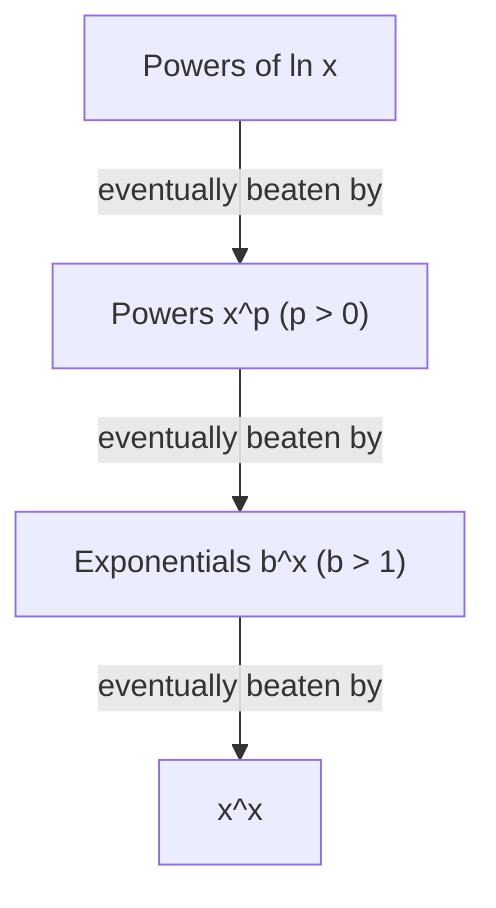

## What Lesson 16 left unproved

Lesson 16 justified L'Hôpital's rule with tangent lines: if $f(a) = g(a) = 0$, then near $a$ we have $f(x) \approx f'(a)(x - a)$ and $g(x) \approx g'(a)(x - a)$, so $\frac{f}{g} \approx \frac{f'(a)}{g'(a)}$. That argument is a good picture, but it quietly assumes a lot: that $f'(a)$ and $g'(a)$ exist, that $g'(a) \ne 0$, and that $a$ is a number. Yet the rule is used when the derivatives at $a$ are $0/0$ again (Example 1 of Lesson 16 applied it twice), and when $x \to \infty$.

This lesson proves the rule properly, using a two-function version of the Mean Value Theorem due to Augustin-Louis Cauchy, then uses the rule to sort functions by how fast they grow.

## Rolle's theorem, briefly

Lesson 17 studies this in detail; here we only need the statement. **Rolle's theorem**: if $h$ is continuous on $[a, b]$, differentiable on $(a, b)$, and $h(a) = h(b)$, then $h'(c) = 0$ for at least one $c$ strictly between $a$ and $b$. The picture: a smooth graph that starts and ends at the same height must have a flat spot (a top or a bottom) somewhere in between.

## Cauchy's mean value theorem

**Cauchy's mean value theorem**. Suppose $f$ and $g$ are continuous on $[a, b]$, differentiable on $(a, b)$, and $g'(x) \ne 0$ on $(a, b)$. Then there is a $c$ in $(a, b)$ with
$$\frac{f(b) - f(a)}{g(b) - g(a)} = \frac{f'(c)}{g'(c)}.$$

(The denominator on the left isn't zero: if $g(b) = g(a)$, Rolle's theorem would give a point where $g' = 0$.)

*Proof.* Build a function that takes equal values at the two ends:
$$h(x) = [f(b) - f(a)]\,g(x) - [g(b) - g(a)]\,f(x).$$
Multiplying out, $h(a) = f(b)g(a) - g(b)f(a)$ and $h(b) = f(b)g(a) - g(b)f(a)$ as well, so $h(a) = h(b)$. By Rolle's theorem there is a $c$ in $(a, b)$ with $h'(c) = 0$:
$$[f(b) - f(a)]\,g'(c) = [g(b) - g(a)]\,f'(c).$$
Dividing by $g'(c)\,[g(b) - g(a)]$, both nonzero, gives the theorem.

*What it means.* Think of $t \mapsto (g(t), f(t))$ as a point moving in the plane. By the chain rule its path has slope $\frac{dy}{dx} = \frac{f'(t)}{g'(t)}$. The left side is the slope of the chord from the start of the path to the end. So the theorem says: somewhere, the path runs parallel to its chord. With $g(x) = x$ it is exactly the ordinary Mean Value Theorem.

```plot
{"x": [0, 9], "y": [0, 5], "curves": [{"x": "t^3", "y": "t^2", "t": [1, 2]}], "segments": [{"from": [1, 1], "to": [8, 4], "dashed": true}, {"from": [1.264, 1.349], "to": [6.264, 3.491]}], "points": [{"at": [1, 1]}, {"at": [8, 4]}, {"at": [3.764, 2.420]}], "labels": [{"at": [1.4, 0.55], "text": "t = 1"}, {"at": [7.6, 4.45], "text": "t = 2"}, {"at": [2.6, 3.0], "text": "t = c = 14/9"}], "caption": "The path (t³, t²) for 1 ≤ t ≤ 2: the tangent at t = 14/9 is parallel to the dashed chord, slope 3/7"}
```

### Example 1

Find the $c$ promised by Cauchy's theorem for $f(x) = x^2$, $g(x) = x^3$ on $[1, 2]$.

- Left side: $\dfrac{f(2) - f(1)}{g(2) - g(1)} = \dfrac{4 - 1}{8 - 1} = \dfrac37$.
- Right side: $\dfrac{f'(c)}{g'(c)} = \dfrac{2c}{3c^2} = \dfrac{2}{3c}$.
- Solve $\dfrac{2}{3c} = \dfrac37$: $c = \dfrac{14}{9} \approx 1.556$, which is inside $(1, 2)$ as promised.

*Why not use the ordinary MVT twice?* It gives $f(2) - f(1) = f'(c_1)\cdot 1$ and $g(2) - g(1) = g'(c_2)\cdot 1$, so the ratio is $\frac{f'(c_1)}{g'(c_2)}$ with two *different* points: here $c_1 = \frac32$ and $c_2 = \sqrt{7/3} \approx 1.528$. Cauchy's theorem gets one point that works for both, and that is exactly what the proof of L'Hôpital's rule needs.

## Proving L'Hôpital's rule (the $\frac00$ case)

Suppose $f(x) \to 0$ and $g(x) \to 0$ as $x \to a^+$, both are differentiable on some interval $(a, a + \delta)$ with $g' \ne 0$ there, and $\dfrac{f'(x)}{g'(x)} \to L$ as $x \to a^+$.

1. *Fill in the hole.* Define (or redefine) $f(a) = g(a) = 0$. Now both are continuous on $[a, x]$ for any $x$ in $(a, a + \delta)$, whatever their original values at $a$.
2. *Apply Cauchy on $[a, x]$.* There is a $c_x$ with $a < c_x < x$ and
$$\frac{f(x)}{g(x)} = \frac{f(x) - f(a)}{g(x) - g(a)} = \frac{f'(c_x)}{g'(c_x)}.$$
3. *Squeeze.* As $x \to a^+$, the point $c_x$ is trapped between $a$ and $x$, so $c_x \to a^+$ too. Since $\frac{f'}{g'} \to L$ as its input approaches $a$ from the right, $\frac{f'(c_x)}{g'(c_x)} \to L$. Therefore $\frac{f(x)}{g(x)} \to L$.

The left-hand limit works the same way on $[x, a]$, and the two together give the two-sided limit. Notice what the proof never used: the values $f'(a)$ and $g'(a)$. That is why the rule can be applied again when $\frac{f'}{g'}$ is itself $\frac00$.

*Limits at infinity.* If $x \to \infty$, substitute $x = \frac1t$ and let $t \to 0^+$. With $F(t) = f(1/t)$ and $G(t) = g(1/t)$, the chain rule gives
$$\frac{F'(t)}{G'(t)} = \frac{f'(1/t)\cdot(-1/t^2)}{g'(1/t)\cdot(-1/t^2)} = \frac{f'(1/t)}{g'(1/t)},$$
so the $x \to \infty$ case follows from the $t \to 0^+$ case.

*The $\frac{\infty}{\infty}$ case* is also true and is also proved with Cauchy's theorem, applied on $[x, y]$ with $y$ held fixed while $x$ approaches $a$. The bookkeeping is longer, so we state it without proof.

### Example 2 (why the hypothesis $g' \ne 0$ is there)

This classic example goes back to Otto Stolz in 1879. Let
$$f(x) = x + \sin x\cos x, \qquad g(x) = e^{\sin x}\,(x + \sin x\cos x), \qquad x \to \infty.$$
Both grow without bound, an $\frac\infty\infty$ form. Differentiating (using $\cos^2 x - \sin^2 x + 1 = 2\cos^2 x$):
$$f'(x) = 2\cos^2 x, \qquad g'(x) = e^{\sin x}\cos x\,(x + \sin x\cos x + 2\cos x).$$
If you cancel the common factor $\cos x$, you get $\dfrac{f'}{g'} = \dfrac{2\cos x}{e^{\sin x}(x + \sin x\cos x + 2\cos x)}$, which tends to 0 (bounded top, growing bottom). But the actual quotient is
$$\frac{f(x)}{g(x)} = e^{-\sin x},$$
which keeps swinging between $e^{-1}$ and $e$ and has no limit at all. What went wrong? $g'(x) = 0$ whenever $\cos x = 0$, at points as far out as you like, so the hypothesis "$g' \ne 0$ near the limit point" fails, and the cancellation hid the zeros. The hypotheses are not decoration.

## Orders of growth

L'Hôpital's rule is the main tool for comparing how fast functions grow. For functions that are positive as $x \to \infty$:

- $f$ grows more slowly than $g$, written $f = o(g)$ (**little-o notation**, read "$f$ is little-o of $g$"), if $\dfrac{f(x)}{g(x)} \to 0$.
- $f$ and $g$ are **asymptotically equivalent**, written $f \sim g$, if $\dfrac{f(x)}{g(x)} \to 1$.

The basic ladder, for any powers $p, q > 0$ and any base $b > 1$:
$$(\ln x)^q = o(x^p), \qquad x^p = o(b^x), \qquad b^x = o(x^x).$$

*Why.* Put $x = e^u$: then $\frac{(\ln x)^q}{x^p} = \frac{u^q}{e^{pu}}$, and applying L'Hôpital's rule enough times (once for each unit of $q$, rounding up) leaves a constant or a negative power of $u$ over $e^{pu}$, which tends to 0. The same repeated differentiation shows $\frac{x^p}{b^x} \to 0$. And $\frac{b^x}{x^x} = \left(\frac bx\right)^x \to 0$ because the base drops below $\frac12$ once $x > 2b$.



"Eventually" can mean *very* eventually.

```plot
{"x": [0, 10000], "y": [0, 110], "functions": [{"f": "ln(x)^2", "label": "(ln x)²"}, {"f": "sqrt(x)", "dashed": true, "label": "√x"}], "points": [{"at": [5504, 74.19]}], "labels": [{"at": [5504, 62], "text": "x ≈ 5504"}], "caption": "(ln x)² stays above √x from about x = 4.2 until about x = 5504; after that √x leads forever"}
```

### Example 3 (ranking, and how far away "eventually" is)

Rank $x^{10}$, $(\ln x)^5$, $1.001^x$ and $x^{0.01}$ from slowest to fastest growth as $x \to \infty$.

- By the ladder: $(\ln x)^5 = o(x^{0.01})$, then $x^{0.01} = o(x^{10})$ (compare powers: the ratio is $x^{-9.99} \to 0$), then $x^{10} = o(1.001^x)$.
- Order: $(\ln x)^5,\ x^{0.01},\ x^{10},\ 1.001^x$.

Now, when does $x^{0.01}$ actually pass $(\ln x)^5$? With $u = \ln x$ the equation $x^{0.01} = (\ln x)^5$ becomes $e^{0.01u} = u^5$, or $0.01u = 5\ln u$. Solving numerically gives $u \approx 4168$, so $x \approx e^{4168} \approx 10^{1810}$. For every $x$ from about $2.7$ up to that astronomically large number, $(\ln x)^5$ is bigger. Asymptotic statements describe the long run only; for real inputs you may still have to compute.

### Example 4 (asymptotic equivalence)

Show that $\ln(x^2 + 1) \sim 2\ln x$ as $x \to \infty$.

The ratio $\dfrac{\ln(x^2 + 1)}{2\ln x}$ is $\frac\infty\infty$. L'Hôpital: $\dfrac{2x/(x^2 + 1)}{2/x} = \dfrac{x^2}{x^2 + 1} \to 1$. So the two are asymptotically equivalent: adding 1 inside the logarithm makes no difference to its growth.

A caution: $f \sim g$ says the *ratio* tends to 1, not that the *difference* tends to 0. For example $x^2 + x \sim x^2$, yet $(x^2 + x) - x^2 = x \to \infty$.

## Common mistakes

- *Using the ordinary MVT on top and bottom separately.* That gives two different points $c_1$ and $c_2$, and the proof falls apart. Cauchy's theorem provides one shared $c$.
- *Thinking the rule needs $f'(a)$ and $g'(a)$.* The proof only uses derivatives near $a$, never at $a$.
- *Ignoring $g' \ne 0$.* Stolz's example shows the rule can give a wrong answer when $g'$ keeps vanishing.
- *Reading $\sim$ as "difference tends to 0".* It is a statement about the ratio.
- *Treating "eventually" as "for all practical $x$".* $x^{0.01}$ beats $(\ln x)^5$ only beyond about $10^{1810}$.

## Key points

- Cauchy's mean value theorem: $\dfrac{f(b) - f(a)}{g(b) - g(a)} = \dfrac{f'(c)}{g'(c)}$ for some $c$ in $(a, b)$, if $g' \ne 0$ there. Proof: Rolle's theorem applied to $[f(b) - f(a)]g - [g(b) - g(a)]f$.
- L'Hôpital's rule ($\frac00$ case) follows by applying Cauchy's theorem on $[a, x]$ and letting $x \to a$; $x \to \infty$ follows by substituting $x = 1/t$.
- The hypotheses matter: Stolz's example has $\frac{f'}{g'} \to 0$ while $\frac fg$ has no limit, because $g'$ keeps hitting 0.
- $f = o(g)$ means $\frac fg \to 0$; $f \sim g$ means $\frac fg \to 1$.
- Growth ladder: $(\ln x)^q \ll x^p \ll b^x \ll x^x$ ($p, q > 0$, $b > 1$), but crossovers can be far away.
