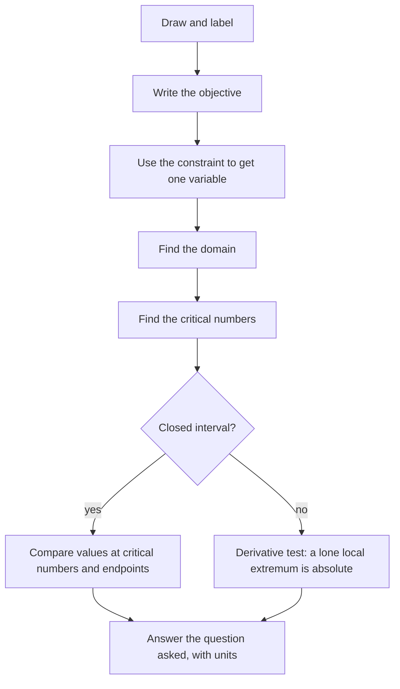

## Calculus for the best possible choice

What dimensions make a can that holds a liter with the least metal? Where should a pipeline cross a river to cost the least? What price maximizes revenue? These are **optimization** problems: find the input that makes some quantity as large or as small as possible. Lessons 17 and 18 gave the tools (critical numbers, the closed interval method, the first derivative test). This lesson is about setting the problems up, which is usually the hard part.

## A procedure

1. *Understand and draw.* Label the quantities with variables.
2. *Name the objective*: the quantity to maximize or minimize. Write a formula for it.
3. *Use the constraint* (the fixed condition) to rewrite the objective in terms of *one* variable.
4. *Find the domain* of that variable from the physical situation.
5. *Optimize*: find critical numbers; use the closed interval method (if the domain is closed) or the first/second derivative test (if it isn't).
6. *Answer the question asked*, with units. Sometimes that's the input, sometimes the optimal value, sometimes both.

The same steps as a flowchart, with the branch that decides how to finish:



### Example 1 (the open box)

A box with no lid is made from a 12-in by 12-in sheet of cardboard by cutting equal squares from the corners and folding up the sides. What size squares give the largest volume?

```shape
{"polygons": [{"points": [[0, 0], [12, 0], [12, 12], [0, 12]]}, {"points": [[0, 0], [2, 0], [2, 2], [0, 2]], "fill": true}, {"points": [[10, 0], [12, 0], [12, 2], [10, 2]], "fill": true}, {"points": [[0, 10], [2, 10], [2, 12], [0, 12]], "fill": true}, {"points": [[10, 10], [12, 10], [12, 12], [10, 12]], "fill": true}], "segments": [{"from": [2, 2], "to": [10, 2], "dashed": true, "label": "12 − 2x"}, {"from": [2, 2], "to": [2, 10], "dashed": true}, {"from": [10, 2], "to": [10, 10], "dashed": true}, {"from": [2, 10], "to": [10, 10], "dashed": true}], "labels": [{"at": [1, 1], "text": "x"}], "caption": "Cut x × x squares from each corner and fold along the dashed lines"}
```

- Let $x$ = side of each cut square. The base is $(12 - 2x)$ by $(12 - 2x)$ and the height is $x$.
- Objective: $V(x) = x(12 - 2x)^2$.
- Domain: $0 \le x \le 6$ (can't cut more than half the side).
- $V'(x) = (12 - 2x)^2 + x\cdot2(12 - 2x)(-2) = (12 - 2x)(12 - 2x - 4x) = (12 - 2x)(12 - 6x)$.
- Critical numbers in the domain: $x = 2$ and $x = 6$.
- Closed interval method: $V(0) = 0$, $V(2) = 2\cdot8^2 = 128$, $V(6) = 0$.

Cut **2-inch squares**; the box holds 128 in³.

### Example 2 (fencing along a river)

A farmer has 600 m of fence for a rectangular field along a straight river; no fence is needed on the river side. What dimensions maximize the area?

```shape
{"polygons": [{"points": [[0, 0], [6, 0], [6, 3], [0, 3]], "fill": true}], "segments": [{"from": [-1, 3], "to": [7, 3], "dashed": true}, {"from": [0, 3], "to": [0, 0], "label": "x"}, {"from": [0, 0], "to": [6, 0], "label": "y"}, {"from": [6, 0], "to": [6, 3], "label": "x"}], "labels": [{"at": [3, 3.6], "text": "river (no fence)"}, {"at": [3, 1.5], "text": "area A = xy"}], "caption": "Fence on three sides: 2x + y = 600"}
```

- Let $x$ = each side perpendicular to the river, $y$ = the side parallel to it.
- Objective: $A = xy$. Constraint: $2x + y = 600$, so $y = 600 - 2x$.
- $A(x) = x(600 - 2x) = 600x - 2x^2$, domain $0 \le x \le 300$.
- $A'(x) = 600 - 4x = 0$ at $x = 150$. $A(150) = 150\cdot300 = 45{,}000$; endpoints give 0.

The field is **150 m by 300 m** (the side along the river is twice as long), area 45,000 m².

### Example 3 (the cheapest can (open domain))

A cylindrical can must hold $1000$ cm³. Find the radius and height that minimize the surface area (top, bottom and side).

- Objective: $S = 2\pi r^2 + 2\pi rh$. Constraint: $\pi r^2h = 1000$, so $h = \dfrac{1000}{\pi r^2}$.
- $S(r) = 2\pi r^2 + \dfrac{2000}{r}$, domain $r > 0$ (open: there are no endpoints to check).
- $S'(r) = 4\pi r - \dfrac{2000}{r^2} = 0 \Rightarrow r^3 = \dfrac{500}{\pi} \Rightarrow r = \sqrt[3]{500/\pi} \approx 5.42$ cm.
- Justify it's a minimum: $S''(r) = 4\pi + \dfrac{4000}{r^3} > 0$ for all $r > 0$, so by the second derivative test this is a local min. Since it's the only critical number and $S$ is concave up everywhere on the domain, it's the absolute min.
- $h = \dfrac{1000}{\pi r^2} \approx 10.84$ cm.

Notice $h = 2r$: the cheapest can is as tall as it is wide. (Check: $h = \frac{1000}{\pi r^2} = \frac{1000\,r}{\pi r^3} = \frac{1000\,r}{500} = 2r$.)

On an open domain, a single critical number that's a local min (by either derivative test) is the absolute min. That's sometimes called the **first derivative test for absolute extrema**.

### Example 4 (closest point on a curve)

Find the point on the parabola $y = x^2$ closest to $(0, 3)$.

- Distance from $(x, x^2)$ to $(0, 3)$: $D = \sqrt{x^2 + (x^2 - 3)^2}$.
- Trick: minimize $D^2$ instead (same minimizer, no square root). $F(x) = x^2 + (x^2 - 3)^2 = x^4 - 5x^2 + 9$.
- $F'(x) = 4x^3 - 10x = 2x(2x^2 - 5) = 0$ at $x = 0, \pm\sqrt{5/2}$.
- $F(0) = 9$; $F(\pm\sqrt{5/2}) = \frac{25}{4} - \frac{25}{2} + 9 = \frac{11}{4}$.

The closest points are $\left(\pm\sqrt{5/2}, \tfrac52\right)$, at distance $\frac{\sqrt{11}}{2} \approx 1.66$. (The vertex $(0, 0)$, at distance 3, is a local max of the distance.)

```plot
{"x": [-3, 3], "y": [-0.5, 5], "equal": true, "functions": [{"f": "x^2"}], "points": [{"at": [0, 3], "label": "(0, 3)"}, {"at": [1.5811, 2.5]}, {"at": [-1.5811, 2.5]}], "segments": [{"from": [0, 3], "to": [1.5811, 2.5], "dashed": true}, {"from": [0, 3], "to": [-1.5811, 2.5], "dashed": true}], "caption": "The two closest points on y = x² to (0, 3)"}
```

### Example 5 (business)

A company sells $q$ units at price $p = 80 - 0.02q$ dollars each. Its cost is $C(q) = 20q + 5000$. Find the production level that maximizes profit.

Revenue $R = pq = 80q - 0.02q^2$; profit $P = R - C = 60q - 0.02q^2 - 5000$. $P'(q) = 60 - 0.04q = 0$ at $q = 1500$, and $P'' = -0.04 < 0$ confirms a max. Profit is maximized at 1500 units (price 50 dollars, profit 40,000 dollars). Note this is where *marginal revenue equals marginal cost*: $R'(q) = 80 - 0.04q = 20 = C'(q)$.

## Common mistakes

- *Optimizing a function of two variables.* Use the constraint to eliminate one first.
- *Ignoring the domain.* Endpoints can be the answer; impossible values (negative lengths) can't.
- *Not justifying max vs min.* Use the closed interval method, a derivative test, or a clear argument.
- *Answering the wrong question.* "What dimensions?" wants $r$ and $h$, not $S$.
- *Forgetting units.*

## Key points

- Objective (what to optimize) + constraint (what's fixed) → a function of one variable on a domain.
- Closed domain: compare critical numbers and endpoints. Open domain: use a derivative test; a lone local extremum is absolute.
- Minimizing distance? Minimize distance squared.
- Profit is maximized where marginal revenue equals marginal cost.
