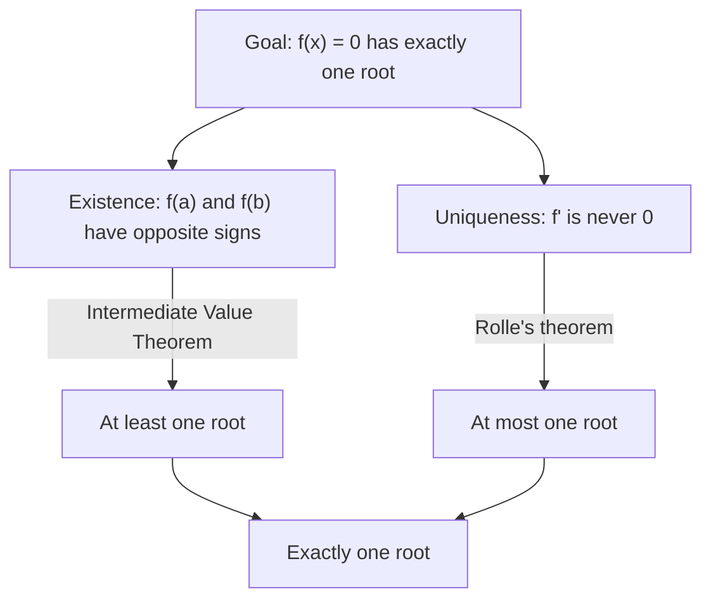

## From one equation to many inequalities

Lesson 17 proved the Mean Value Theorem and drew a few consequences from it: a zero derivative means a constant function, a positive derivative means an increasing function. Those were the first hints of what the theorem is really for. The MVT almost never tells you *where* the special point $c$ is. What it does is turn facts about $f'$, which are often easy to get, into facts about $f$, which are often hard to get directly.

This honors lesson uses that idea three ways: to prove inequalities such as $e^x \ge 1 + x$ and $|\sin a - \sin b| \le |a - b|$, to estimate values with guaranteed error bounds, and to count how many solutions an equation has without solving it. These are the arguments mathematicians use every day, and they lead straight to the Taylor polynomials of Lesson 44.

## The MVT as an inequality machine

Suppose $f$ is continuous on $[a, b]$, differentiable on $(a, b)$, and its derivative is trapped between two numbers: $m \le f'(x) \le M$ for every $x$ in $(a, b)$. The MVT says $f(b) - f(a) = f'(c)(b - a)$ for some $c$ in $(a, b)$. We don't know $c$, but we know $m \le f'(c) \le M$, and $b - a > 0$, so

$$m(b - a) \le f(b) - f(a) \le M(b - a).$$

In words: *if you know how fast something can change, you know how far it can get.* A car whose speed stays between 50 and 70 mph for 2 hours travels between 100 and 140 miles. The bound uses only the extreme slopes, never the exact one.

A common special case: if $|f'(x)| \le M$ on an interval, then for any two points in it,

$$|f(x_2) - f(x_1)| \le M|x_2 - x_1|.$$

### Example 1

Show that $|\sin a - \sin b| \le |a - b|$ for all real $a$ and $b$.

Let $f(x) = \sin x$. Then $f'(x) = \cos x$, and $|\cos x| \le 1$ everywhere, so $M = 1$ works on any interval. If $a = b$ there is nothing to prove; otherwise apply the bound on the interval between them: $|\sin a - \sin b| \le 1\cdot|a - b|$.

Taking $b = 0$ gives a useful corollary: $|\sin a| \le |a|$ for every $a$. The sine of an angle (in radians) is never bigger in size than the angle itself.

### Example 2

Estimate $\sqrt{101}$, with a guaranteed error bound, without a calculator.

Let $f(x) = \sqrt x$ on $[100, 101]$. The MVT gives

$$\sqrt{101} - \sqrt{100} = \frac{1}{2\sqrt c}\,(101 - 100) = \frac{1}{2\sqrt c}$$

for some $c$ in $(100, 101)$. Since $\sqrt c > \sqrt{100} = 10$, the right side is less than $\frac{1}{20}$, so $\sqrt{101} < 10.05$. For a lower bound, $\sqrt c < \sqrt{101} < 10.05$, so $\frac{1}{2\sqrt c} > \frac{1}{20.1}$, and

$$10 + \tfrac{1}{20.1} < \sqrt{101} < 10.05, \qquad\text{that is,}\qquad 10.04975 < \sqrt{101} < 10.05.$$

The true value is $10.04988\ldots$, inside the bracket. Linearization at 100 (Lesson 15) gives the same estimate, $10.05$; the MVT adds how wrong it can be (by less than $0.00025$) and in which direction (too high).

## The racetrack principle

Two runners start a race at the same spot, and runner G is always at least as fast as runner F. Then G is never behind. Turned into calculus, this is the **racetrack principle** (a name some textbooks use):

> If $f$ and $g$ are continuous on $[a, b]$ and differentiable on $(a, b)$, $f(a) = g(a)$, and $f'(x) \le g'(x)$ on $(a, b)$, then $f(x) \le g(x)$ for every $x$ in $[a, b]$.

*Proof.* Let $h = g - f$. Then $h(a) = 0$ and $h' = g' - f' \ge 0$. For any $x$ in $(a, b]$, the MVT gives $h(x) - h(a) = h'(c)(x - a) \ge 0$, so $h(x) \ge 0$, which says $g(x) \ge f(x)$.

Two details matter. First, the starting values must agree (or at least $f(a) \le g(a)$). Second, the principle runs *forward* from the starting point. Going backward (for $x < a$), the inequality flips: $h(a) - h(x) = h'(c)(a - x) \ge 0$ gives $h(x) \le 0$, so the faster runner is *behind* at earlier times, as it must be to have caught up by time $a$.

### Example 3

Prove that $e^x \ge 1 + x$ for every real $x$, with equality only at $x = 0$.

Let $f(x) = 1 + x$ and $g(x) = e^x$. Both equal 1 at $x = 0$.

- For $x > 0$: $f'(t) = 1 \le e^t = g'(t)$ on $(0, x)$, so running forward from 0, $g(x) \ge f(x)$.
- For $x < 0$: now $g'(t) = e^t < 1 = f'(t)$ on $(x, 0)$. The roles swap: $f$ is the faster runner, so running backward from 0 it is behind: $f(x) \le g(x)$ again.

Either way $e^x \ge 1 + x$. (Because the derivative inequalities are strict away from 0, so is the conclusion.) Geometrically, $y = 1 + x$ is the tangent line to $y = e^x$ at $(0, 1)$, and the graph never dips below it.

A bonus: for $x > -1$ both sides are positive, and $\ln$ is increasing, so taking logs gives $x \ge \ln(1 + x)$. For example, $\ln 1.1 \le 0.1$ (true value $0.0953$).

### Example 4 (stacking the principle)

Show that $\cos x \ge 1 - \dfrac{x^2}{2}$ for all $x$.

Step 1: $\sin x \le x$ for $x \ge 0$. Both are 0 at $x = 0$, and $(\sin x)' = \cos x \le 1 = (x)'$.

Step 2: compare $g(x) = \cos x$ and $f(x) = 1 - \frac{x^2}{2}$. Both equal 1 at 0. Their derivatives are $g'(x) = -\sin x$ and $f'(x) = -x$. By Step 1, $-\sin x \ge -x$ for $x \ge 0$, so $g' \ge f'$, and the racetrack principle gives $\cos x \ge 1 - \frac{x^2}{2}$ for $x \ge 0$. Both sides are even functions, so the inequality also holds for $x < 0$.

So $\cos 0.2 \ge 1 - 0.02 = 0.98$; the true value is $0.98007$. One more round (compare $\sin x$ with $x - \frac{x^3}{6}$) gives $\sin x \ge x - \frac{x^3}{6}$ for $x \ge 0$. The polynomials appearing here, $1 - \frac{x^2}{2}$ and $x - \frac{x^3}{6}$, are exactly the Taylor polynomials of Lesson 44; this is one way to see why those approximations work.

```plot
{"x": [-3.5, 3.5], "y": [-2.2, 1.6], "functions": [{"f": "cos(x)"}, {"f": "1 - x^2/2", "dashed": true}], "points": [{"at": [0, 1]}], "caption": "Solid: y = cos x. Dashed: y = 1 − x²/2. The cosine stays on or above the parabola, touching it only at x = 0"}
```

## Counting roots with Rolle's theorem

Rolle's theorem says that between two zeros of a differentiable function there is a zero of its derivative. Read backward, it *limits* how many zeros a function can have:

- If $f'$ is never 0 on an interval, $f$ has *at most one* zero there.
- More generally, if $f'$ has $k$ zeros on an interval, $f$ has at most $k + 1$ zeros there (each gap between consecutive zeros of $f$ needs its own zero of $f'$).

Rolle's theorem never proves that a root *exists*. That job belongs to the Intermediate Value Theorem (Lesson 5). An "exactly one root" proof therefore has two halves:



### Example 5

Show that $x^3 + 4x - 7 = 0$ has exactly one real solution.

*Existence.* $f(x) = x^3 + 4x - 7$ is a polynomial, so it is continuous. $f(1) = -2 < 0$ and $f(2) = 9 > 0$, so by the IVT there is a root in $(1, 2)$.

*Uniqueness.* $f'(x) = 3x^2 + 4 \ge 4 > 0$ for every $x$. If there were two roots $r_1 < r_2$, Rolle's theorem would give a $c$ between them with $f'(c) = 0$, which is impossible. So there is exactly one real root (it is about $1.255$, and Newton's method from Lesson 15 finds it quickly).

### Example 6

How many real solutions does $x^4 - 4x + 1 = 0$ have?

$f'(x) = 4x^3 - 4 = 4(x - 1)(x^2 + x + 1)$. The quadratic factor has discriminant $1 - 4 < 0$, so $f'$ has exactly one zero, $x = 1$. Hence $f$ has *at most two* real roots.

Now look for sign changes: $f(0) = 1 > 0$, $f(1) = -2 < 0$, $f(2) = 9 > 0$. The IVT gives a root in $(0, 1)$ and another in $(1, 2)$. So there are *exactly two* real roots (about $0.251$ and $1.493$).

The same reasoning handles any cubic $x^3 - 3k^2x + q$ with $k > 0$: its critical numbers are $\pm k$, so it has at most three roots, and it has three exactly when the local max $f(-k)$ is positive and the local min $f(k)$ is negative. If both have the same sign, the graph crosses the axis only once.

### A subtle case: a derivative that touches zero

What about $x = \cos x$? Let $f(x) = x - \cos x$, so $f'(x) = 1 + \sin x \ge 0$. Here $f'$ *does* equal 0, at $x = -\frac{\pi}{2} + 2\pi n$, so Rolle's argument alone fails. But those zeros are isolated points. On any interval $[x_1, x_2]$, $f' \ge 0$ makes $f$ nondecreasing; if $f(x_1) = f(x_2)$, $f$ would be constant on the whole interval, forcing $f' = 0$ on an entire interval, which doesn't happen. So $f$ is strictly increasing and has at most one root. Since $f(0) = -1 < 0$ and $f(\frac{\pi}{2}) = \frac{\pi}{2} > 0$, it has exactly one (about $0.739$). The same argument shows $x^3$ is strictly increasing even though its derivative is 0 at the origin.

## One more consequence: why $e^x$ is the only one

Lesson 17 showed that two functions with the same derivative differ by a constant. A variation proves something striking: *the only function with $f' = f$ and $f(0) = 1$ is $e^x$.* Let $q(x) = f(x)e^{-x}$. By the product rule, $q'(x) = f'(x)e^{-x} - f(x)e^{-x} = 0$, so $q$ is constant, and $q(0) = 1$. Hence $f(x) = e^x$. This uniqueness argument is the seed of the existence-and-uniqueness theory of differential equations (Lessons 37–39).

## Common mistakes

- *Trying to find $c$.* In an inequality proof you only need bounds on $f'$, not the value of $c$.
- *Flipping the interval carelessly.* $m(b - a) \le f(b) - f(a)$ needs $b > a$. Going backward (as for $x < 0$ in Example 3) reverses the comparison.
- *Forgetting the starting values* in the racetrack principle. $f' \le g'$ alone says nothing: $g = x$ and $f = 5$ have $f' = 0 \le 1 = g'$, yet $f > g$ for $x < 5$.
- *Using Rolle's theorem to prove existence.* Rolle bounds the number of roots from above; the IVT (or an explicit root) shows there is at least one.
- *Forgetting the hypotheses.* The bound $|f(b) - f(a)| \le M|b - a|$ needs $f$ differentiable on the whole interval. A step function that jumps from 0 to 1 at $x = 0$ has $f' = 0$ wherever $f'$ exists, yet $f(1) - f(-1) = 1$.

## Key points

- If $m \le f' \le M$ on $(a, b)$, then $m(b - a) \le f(b) - f(a) \le M(b - a)$; in particular $|f'| \le M$ gives $|f(x_2) - f(x_1)| \le M|x_2 - x_1|$.
- Racetrack principle: equal start and $f' \le g'$ give $f \le g$ going forward (and $f \ge g$ going backward).
- Classic results: $|\sin x| \le |x|$, $e^x \ge 1 + x$, $\ln(1 + x) \le x$, $\cos x \ge 1 - \frac{x^2}{2}$.
- If $f'$ has $k$ zeros on an interval, $f$ has at most $k + 1$; combine with the IVT to get an exact count.
- "Exactly one root" = IVT (existence) + Rolle or monotonicity (uniqueness).
