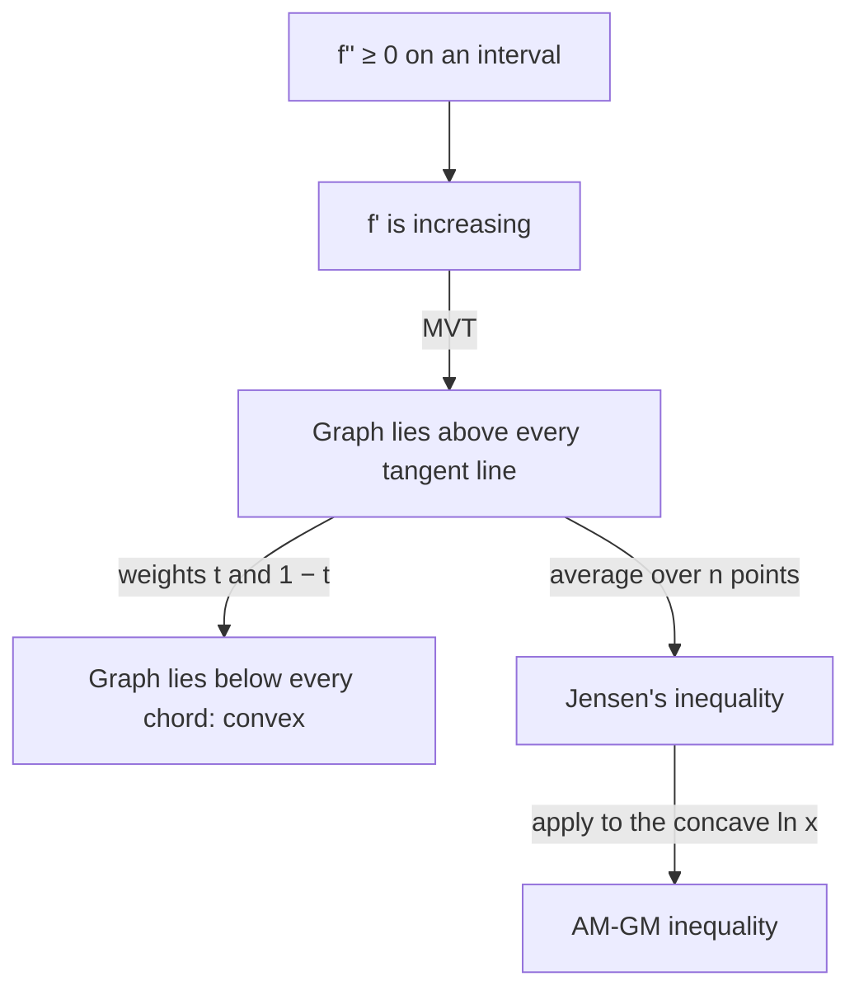

## Concave up, seen three ways

Lesson 19 defined *concave up* by the slopes: $f'$ is increasing, which is guaranteed when $f'' > 0$. It also mentioned, almost in passing, that a concave-up graph lies above its tangent lines. This honors lesson takes that remark seriously. Concave-up functions have three equivalent pictures (rising slopes, tangent lines below, chords above), and each one is a tool. Together they prove some of the most useful inequalities in mathematics, including the one between the arithmetic and geometric means, and they explain why the cheapest-can problem in Lesson 20 had exactly one answer.

A note on words. In most college and research mathematics, a concave-up function is called a **convex function** and a concave-down function a **concave function**. Some books say "concave upward" instead, and a few older ones use the words differently, so always check a source's definition. This lesson uses *convex* = concave up and *concave* = concave down.

## The definition: chords lie above the graph

A function $f$ is **convex** on an interval $I$ if for any two points $x$ and $y$ in $I$ and any weight $t$ between 0 and 1,

$$f\big(tx + (1 - t)y\big) \le t f(x) + (1 - t) f(y).$$

As $t$ runs from 0 to 1, the point $tx + (1 - t)y$ runs from $y$ to $x$, and the right side runs along the straight segment joining $(y, f(y))$ to $(x, f(x))$, the chord. So the definition says: *every chord lies on or above the graph between its endpoints.* The function is **strictly convex** if the inequality is strict whenever $x \ne y$ and $0 < t < 1$. A function is concave when the inequality is reversed, that is, when $-f$ is convex.

This definition needs no derivatives at all, which is why mathematicians prefer it: $|x|$ is convex, corner and all. For differentiable functions, though, calculus gives an easy test.


## The tangent line inequality

*Theorem.* If $f$ is differentiable on an open interval $I$ and $f'$ is increasing there (for instance, if $f'' \ge 0$ on $I$), then for every $a$ and $x$ in $I$,

$$f(x) \ge f(a) + f'(a)(x - a).$$

This is the **tangent line inequality**: the graph lies on or above each of its tangent lines.

*Proof.* If $x = a$ there's nothing to show. Otherwise the MVT gives $f(x) - f(a) = f'(c)(x - a)$ for some $c$ between $a$ and $x$.
- If $x > a$, then $c > a$, so $f'(c) \ge f'(a)$; multiplying by the positive number $x - a$ gives $f'(c)(x - a) \ge f'(a)(x - a)$.
- If $x < a$, then $c < a$, so $f'(c) \le f'(a)$; multiplying by the *negative* number $x - a$ flips it, giving again $f'(c)(x - a) \ge f'(a)(x - a)$.

Either way $f(x) - f(a) \ge f'(a)(x - a)$.

*Tangents imply chords.* Now take $x$, $y$, $t$ and set $z = tx + (1 - t)y$. Write the tangent line inequality at $z$ twice:

$$f(x) \ge f(z) + f'(z)(x - z), \qquad f(y) \ge f(z) + f'(z)(y - z).$$

Multiply the first by $t$, the second by $1 - t$, and add. The $f'(z)$ terms combine to $f'(z)\big(tx + (1 - t)y - z\big) = f'(z)\cdot 0 = 0$, leaving $t f(x) + (1 - t)f(y) \ge f(z)$, the definition of convexity. So *$f'' \ge 0$ on an interval implies $f$ is convex there*, and $f'' > 0$ implies strictly convex.

### Example 1

Use a tangent line to prove $x + \dfrac1x \ge 2$ for every $x > 0$.

$f(x) = \frac1x$ has $f''(x) = \frac{2}{x^3} > 0$ on $(0, \infty)$, so it is convex there. Its tangent line at $a = 1$ is $y = f(1) + f'(1)(x - 1) = 1 - (x - 1) = 2 - x$. The tangent line inequality says $\frac1x \ge 2 - x$, which rearranges to $x + \frac1x \ge 2$. Equality holds only at the point of tangency, $x = 1$.

## Convexity makes optimization easy

Suppose $f$ is convex and differentiable on an interval, and $f'(c) = 0$ at some point. The tangent line at $c$ is horizontal, $y = f(c)$, and the tangent line inequality says $f(x) \ge f(c)$ for *every* $x$ in the interval. So:

> For a convex function, any critical point with $f'(c) = 0$ is an absolute minimum. No other test is needed.

That is exactly what happened with the can in Lesson 20: $S''(r) > 0$ for all $r > 0$, so $S$ is convex and its single critical point is the absolute minimum. It also explains why a convex function can't have two separate local minima with a hump between them. (For a concave function, a critical point is an absolute maximum.)

## Jensen's inequality

The tangent trick works with any number of points. Let $f$ be convex and differentiable, take points $x_1, \dots, x_n$ in the interval, and let $m = \frac{x_1 + \cdots + x_n}{n}$ be their mean. The tangent line inequality at $m$ gives, for each $i$,

$$f(x_i) \ge f(m) + f'(m)(x_i - m).$$

Add the $n$ inequalities and divide by $n$. The $f'(m)$ terms add to $f'(m)\cdot\frac1n\sum(x_i - m) = 0$, because the deviations from a mean add to zero. What's left is **Jensen's inequality**:

$$f\!\left(\frac{x_1 + \cdots + x_n}{n}\right) \le \frac{f(x_1) + \cdots + f(x_n)}{n}.$$

*The function of the average is at most the average of the function.* The same proof with weights $w_i \ge 0$ adding to 1 gives the weighted version $f\big(\sum w_i x_i\big) \le \sum w_i f(x_i)$; the chord definition above is the case $n = 2$. For a strictly convex $f$, equality holds only when all the $x_i$ are equal. For a concave $f$ the inequality reverses. (The Danish mathematician Johan Jensen published it in 1906; the inequality holds for convex functions that are not differentiable too, with a slightly different proof.)

### Example 2

Apply Jensen's inequality to $f(x) = x^2$ and the numbers 2, 4, 9.

$f'' = 2 > 0$, so $f$ is strictly convex. The mean is $m = \frac{15}{3} = 5$ and $f(m) = 25$. The average of the squares is $\frac{4 + 16 + 81}{3} = \frac{101}{3} \approx 33.67$. Indeed $25 \le 33.67$.

The gap, $\frac{101}{3} - 25 = \frac{26}{3}$, is the (population) variance of the data: mean of the squares minus square of the mean. Jensen's inequality for $x^2$ is the statement that a variance can never be negative, and it is zero only when all the numbers are equal.

## The AM–GM inequality

For positive numbers $a_1, \dots, a_n$, the **arithmetic mean** is $\frac{a_1 + \cdots + a_n}{n}$ and the **geometric mean** is $\sqrt[n]{a_1 a_2\cdots a_n}$. The **AM–GM inequality** says

$$\sqrt[n]{a_1 a_2\cdots a_n} \le \frac{a_1 + \cdots + a_n}{n},$$

with equality only when all the numbers are equal.

*Proof.* $\ln x$ has second derivative $-\frac{1}{x^2} < 0$, so it is strictly concave on $(0, \infty)$, and Jensen's inequality reverses:

$$\ln\!\left(\frac{a_1 + \cdots + a_n}{n}\right) \ge \frac{\ln a_1 + \cdots + \ln a_n}{n} = \ln\sqrt[n]{a_1\cdots a_n}.$$

Since $\ln$ is increasing, the arithmetic mean is at least the geometric mean. For example, for 2, 8 and 4: AM $= \frac{14}{3} \approx 4.67$ and GM $= \sqrt[3]{64} = 4$.

```plot
{"x": [-0.3, 7], "y": [-1, 2.3], "functions": [{"f": "ln(x)", "from": 0.25, "label": "y = ln x"}], "segments": [{"from": [1, 0], "to": [6, 1.7918], "dashed": true}], "points": [{"at": [1, 0]}, {"at": [6, 1.7918]}, {"at": [3.5, 1.2528], "label": "ln(average)"}, {"at": [3.5, 0.8959], "label": "average of ln"}], "caption": "ln x is concave: the chord from x = 1 to x = 6 lies below the graph, so ln of the average beats the average of the logs"}
```

The whole chain of ideas, from the second derivative to AM–GM:



## Optimizing without derivatives

AM–GM solves many optimization problems in one line. The trick is to split the objective into terms whose *product* is constant; then the sum is smallest when the terms are equal.

### Example 3

Minimize $x + \dfrac{9}{x}$ for $x > 0$.

The product of the two terms is $x\cdot\frac9x = 9$, a constant. By AM–GM with $n = 2$, $\frac{x + 9/x}{2} \ge \sqrt9 = 3$, so $x + \frac9x \ge 6$. Equality needs the terms equal: $x = \frac9x$, so $x = 3$. The minimum is **6** at $x = 3$. (Check with calculus: $1 - \frac{9}{x^2} = 0$ at $x = 3$.)

### Example 4 (Lesson 20's can, again)

Minimize $S(r) = 2\pi r^2 + \dfrac{2000}{r}$ for $r > 0$.

The two terms don't have a constant product ($2\pi r^2\cdot\frac{2000}{r} = 4000\pi r$). Split the second term in half instead:

$$S = 2\pi r^2 + \frac{1000}{r} + \frac{1000}{r}, \qquad\text{product} = 2\pi r^2\cdot\frac{1000}{r}\cdot\frac{1000}{r} = 2\pi\cdot 10^6.$$

AM–GM with $n = 3$: $S \ge 3\sqrt[3]{2\pi\cdot10^6} = 300\sqrt[3]{2\pi} \approx 553.6$ cm², with equality when $2\pi r^2 = \frac{1000}{r}$, that is $r^3 = \frac{500}{\pi}$, $r \approx 5.42$ cm. This is the same answer Lesson 20 found with derivatives, now with no derivative test needed.

## Common mistakes

- *Reversing Jensen.* For convex $f$, $f(\text{average}) \le \text{average of } f$. For concave $f$ (like $\ln x$ or $\sqrt x$) it's the other way.
- *Using AM–GM with negative numbers.* It needs nonnegative terms: $-1$ and $-4$ have AM $-2.5$ but "GM" $2$.
- *Ignoring the equality condition.* The bound $x + \frac9x \ge 6$ is a minimum only because equality is actually reached (at $x = 3$). If the terms can never be equal on the allowed domain, the bound is not attained.
- *Splitting so the product isn't constant*, as with $2\pi r^2 + \frac{2000}{r}$ before the split in Example 4.
- *Checking convexity at one point.* The tangent line inequality needs $f'' \ge 0$ on the whole interval, not just at $a$.

## Key points

- Convex (= concave up): every chord lies on or above the graph. $f'' \ge 0$ on an interval guarantees it.
- Tangent line inequality: a convex $f$ satisfies $f(x) \ge f(a) + f'(a)(x - a)$; proved with the MVT.
- For a convex function, a point with $f'(c) = 0$ is an absolute minimum.
- Jensen: $f\left(\frac{x_1 + \cdots + x_n}{n}\right) \le \frac{f(x_1) + \cdots + f(x_n)}{n}$ for convex $f$; reversed for concave.
- AM–GM: $\sqrt[n]{a_1\cdots a_n} \le \frac{a_1 + \cdots + a_n}{n}$ for positive numbers, with equality only when all are equal; it optimizes sums whose terms have a constant product.
