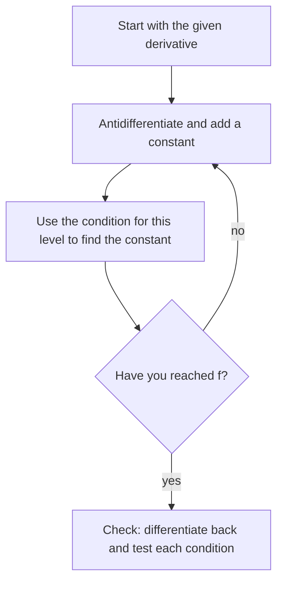

## Running differentiation backward

So far we've gone from a function to its rate of change. Often the information comes the other way. A physicist knows a rocket's acceleration and wants its position; a biologist knows how fast a population grows and wants its size. Recovering a function from its derivative is **antidifferentiation**, and it opens the second half of calculus.

## Antiderivatives

A function $F$ is an **antiderivative** of $f$ on an interval if $F'(x) = f(x)$ for every $x$ in the interval.

For example, $F(x) = x^3$ is an antiderivative of $f(x) = 3x^2$. But so are $x^3 + 5$, $x^3 - \pi$, and $x^3 + C$ for any constant $C$, since constants differentiate to 0.

Are there any others? No. Lesson 17 showed (from the MVT) that two functions with the same derivative on an interval differ by a constant. So:

**If $F$ is one antiderivative of $f$ on an interval, every antiderivative has the form $F(x) + C$.**

The family $F(x) + C$ is written with the **indefinite integral** sign:

$$\int f(x)\,dx = F(x) + C.$$

Here $f(x)$ is the integrand, $dx$ says $x$ is the variable, and $C$ is the **constant of integration**. Geometrically, the antiderivatives of $f$ are vertical shifts of one another: they all have the same slope at each $x$.

```plot
{"x": [-2.5, 2.5], "y": [-5, 7], "functions": [{"f": "x^3 - 2"}, {"f": "x^3"}, {"f": "x^3 + 2"}, {"f": "x^3 + 4"}], "labels": [{"at": [1.75, -2], "text": "C = −2"}, {"at": [-1.1, 1.3], "text": "C = 2"}, {"at": [-1.1, 3.3], "text": "C = 4"}, {"at": [-0.8, 0.6], "text": "C = 0"}], "caption": "Antiderivatives of 3x²: y = x³ + C for C = −2, 0, 2, 4, all vertical shifts of one curve"}
```

## Basic antiderivative formulas

Each line is a derivative rule read backward. Check any of them by differentiating the right side.

| $\int f(x)\,dx$ | Result |
|---|---|
| $\int x^n\,dx$ ($n \ne -1$) | $\dfrac{x^{n+1}}{n + 1} + C$ |
| $\int \dfrac1x\,dx$ | $\ln\lvert x\rvert + C$ |
| $\int e^x\,dx$ | $e^x + C$ |
| $\int b^x\,dx$ | $\dfrac{b^x}{\ln b} + C$ |
| $\int \cos x\,dx$ | $\sin x + C$ |
| $\int \sin x\,dx$ | $-\cos x + C$ |
| $\int \sec^2 x\,dx$ | $\tan x + C$ |
| $\int \sec x\tan x\,dx$ | $\sec x + C$ |
| $\int \csc^2 x\,dx$ | $-\cot x + C$ |
| $\int \csc x\cot x\,dx$ | $-\csc x + C$ |
| $\int \dfrac{1}{1 + x^2}\,dx$ | $\arctan x + C$ |
| $\int \dfrac{1}{\sqrt{1 - x^2}}\,dx$ | $\arcsin x + C$ |

The **power rule for integrals** says: raise the exponent by one, divide by the new exponent. It fails only for $n = -1$ (division by zero), and that gap is filled by $\ln|x|$.

Two linearity rules carry over from derivatives:

$$\int cf(x)\,dx = c\int f(x)\,dx, \qquad \int\left[f(x) \pm g(x)\right]dx = \int f(x)\,dx \pm \int g(x)\,dx.$$

There is *no* product rule or quotient rule for antiderivatives. To integrate a product or quotient, first rewrite it as a sum (or use the techniques of Module 8).

### Example 1

Find $\displaystyle\int\left(6x^2 - \frac{4}{x^3} + 5\sqrt x\right)dx$.

Rewrite as powers: $6x^2 - 4x^{-3} + 5x^{1/2}$. Integrate term by term:

$$6\cdot\frac{x^3}{3} - 4\cdot\frac{x^{-2}}{-2} + 5\cdot\frac{x^{3/2}}{3/2} + C = \mathbf{2x^3 + \frac{2}{x^2} + \frac{10}{3}x^{3/2} + C}.$$

Check: differentiating gives $6x^2 - 4x^{-3} + 5x^{1/2}$. ✓

### Example 2

Find $\displaystyle\int\frac{x^2 + 3x - 1}{x}\,dx$ and $\displaystyle\int(3\cos x - 2e^x)\,dx$.

- Divide first: $\frac{x^2 + 3x - 1}{x} = x + 3 - \frac1x$, so the integral is $\frac{x^2}{2} + 3x - \ln|x| + C$.
- Term by term: $3\sin x - 2e^x + C$.

One $+C$ at the end covers all terms.

## Initial value problems

A **differential equation** is an equation involving a derivative, like $\frac{dy}{dx} = 3x^2$. Its general solution is a family, $y = x^3 + C$. An **initial condition** such as $y(1) = 4$ picks out one member. The pair is an **initial value problem (IVP)**.

### Example 3

Solve $f'(x) = 4x - 3$, $f(2) = 5$.

General antiderivative: $f(x) = 2x^2 - 3x + C$. Apply the condition: $f(2) = 8 - 6 + C = 5$, so $C = 3$. Answer: $f(x) = 2x^2 - 3x + 3$.

### Example 4 (two conditions)

Find $f$ if $f''(x) = 12x^2 + 6$, $f'(0) = 1$, $f(0) = -2$.

- Antidifferentiate once: $f'(x) = 4x^3 + 6x + C_1$. Since $f'(0) = 1$, $C_1 = 1$.
- Again: $f(x) = x^4 + 3x^2 + x + C_2$. Since $f(0) = -2$, $C_2 = -2$.

$f(x) = x^4 + 3x^2 + x - 2$. A second-order problem needs two conditions, one per constant.

The procedure is the same every time, however many antiderivatives it takes:



## Motion from acceleration

Since $s' = v$ and $v' = a$, antidifferentiating acceleration gives velocity, and antidifferentiating velocity gives position.

The picture shows the two directions for the ball in Example 5. Going down the chain is differentiation; going up is antidifferentiation, and each step up needs its own initial value.


### Example 5

A ball is thrown upward at 48 ft/s from a 64-ft cliff. With $a(t) = -32$ ft/s², when does it hit the ground below?

- $v(t) = -32t + C_1$; $v(0) = 48$, so $v(t) = -32t + 48$.
- $s(t) = -16t^2 + 48t + C_2$; $s(0) = 64$, so $s(t) = -16t^2 + 48t + 64$.
- Ground: $s(t) = 0 \Rightarrow -16(t^2 - 3t - 4) = 0 \Rightarrow (t - 4)(t + 1) = 0$, so $t = 4$ s.

It hits the ground after 4 seconds, moving at $v(4) = -80$ ft/s.

## Common mistakes

- **Forgetting $+C$** on indefinite integrals.
- *Power rule backward wrong.* $\int x^3\,dx = \frac{x^4}{4}$, not $3x^2$ or $\frac{x^4}{3}$.
- **Using the power rule on $x^{-1}$.** $\int\frac1x\,dx = \ln|x| + C$.
- *Integrating products factor by factor.* $\int x\cdot x^2\,dx \ne \frac{x^2}{2}\cdot\frac{x^3}{3}$; multiply first: $\int x^3\,dx = \frac{x^4}{4} + C$.
- **Sign of $\int\sin x\,dx$.** It's $-\cos x + C$.
- *Applying initial conditions before integrating everything,* or mixing up which condition belongs to $f$ and which to $f'$.

## Key points

- $F$ is an antiderivative of $f$ if $F' = f$; all antiderivatives are $F + C$.
- $\int x^n\,dx = \frac{x^{n+1}}{n+1} + C$ ($n \ne -1$); $\int\frac1x\,dx = \ln|x| + C$.
- Antiderivatives are linear, but there's no product or quotient rule: rewrite first.
- Initial conditions determine $C$; each antidifferentiation needs one condition.
- Check every antiderivative by differentiating.
