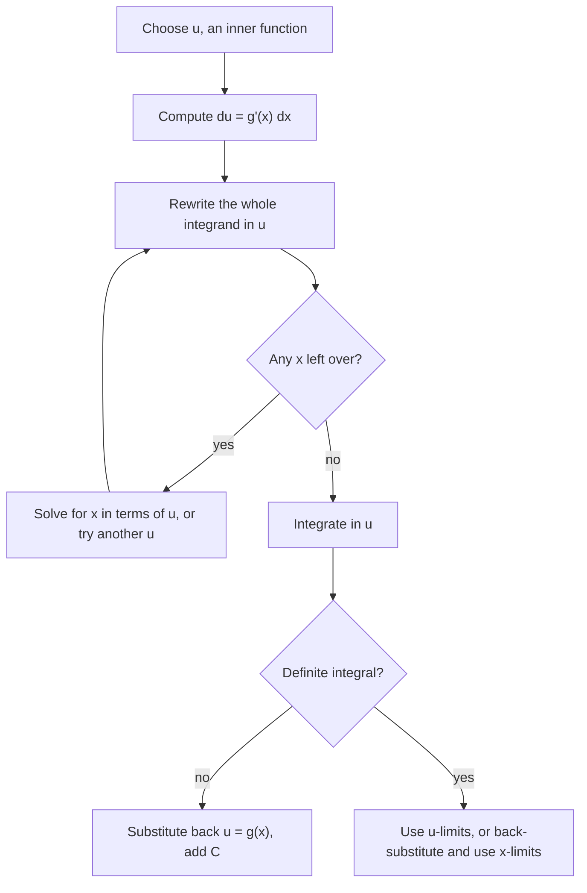

## Undoing the chain rule

The basic antiderivative table handles $\int\cos x\,dx$ but not $\int 2x\cos(x^2)\,dx$. Yet we know where that integrand comes from: the chain rule says $\frac{d}{dx}\sin(x^2) = \cos(x^2)\cdot2x$. So $\int2x\cos(x^2)\,dx = \sin(x^2) + C$. **Substitution** (u-substitution) is the systematic way to recognize and reverse the chain rule.

## The method

The chain rule gives $\frac{d}{dx}F(g(x)) = F'(g(x))g'(x)$. Reading it backward:

$$\int f(g(x))\,g'(x)\,dx = \int f(u)\,du, \quad\text{where } u = g(x).$$

The bookkeeping uses the differential: if $u = g(x)$, then $du = g'(x)\,dx$. Steps:

1. Choose $u$, usually the "inside" of a composite, whose derivative appears (up to a constant) as a factor elsewhere.
2. Compute $du = g'(x)\,dx$.
3. Rewrite the *entire* integrand in terms of $u$ and $du$. No $x$ may remain.
4. Integrate in $u$.
5. Substitute back $u = g(x)$.

The same steps as a chart, including the two places where people most often get stuck:



### Example 1

Find $\displaystyle\int 2x\cos(x^2)\,dx$.

Let $u = x^2$, so $du = 2x\,dx$. The integral becomes $\int\cos u\,du = \sin u + C = \mathbf{\sin(x^2) + C}$.

### Example 2 (adjusting a constant)

Find $\displaystyle\int x^2(x^3 + 5)^6\,dx$.

Let $u = x^3 + 5$, so $du = 3x^2\,dx$, i.e. $x^2\,dx = \frac13\,du$:
$$\int(x^3 + 5)^6\,x^2\,dx = \frac13\int u^6\,du = \frac13\cdot\frac{u^7}{7} + C = \mathbf{\frac{(x^3 + 5)^7}{21} + C}.$$

Constants can be adjusted freely, but a missing *variable* factor can't. $\int(x^3 + 5)^6\,dx$ (no $x^2$) does not yield to this substitution.

### Example 3

Find $\displaystyle\int\frac{e^{\sqrt x}}{\sqrt x}\,dx$.

Let $u = \sqrt x$, $du = \frac{1}{2\sqrt x}dx$, so $\frac{dx}{\sqrt x} = 2\,du$:
$$\int e^u\cdot2\,du = 2e^u + C = \mathbf{2e^{\sqrt x} + C}.$$

## Common patterns

| Integrand shape | Choose | Result |
|---|---|---|
| $f(ax + b)$ | $u = ax + b$ | $\frac1a F(ax + b) + C$ |
| $\dfrac{g'(x)}{g(x)}$ | $u = g(x)$ | $\ln\lvert g(x)\rvert + C$ |
| $g(x)^n g'(x)$ | $u = g(x)$ | $\dfrac{g(x)^{n+1}}{n + 1} + C$ |
| $e^{g(x)}g'(x)$ | $u = g(x)$ | $e^{g(x)} + C$ |
| $\dfrac{1}{a^2 + x^2}$ | $u = x/a$ | $\frac1a\arctan\frac xa + C$ |
| $\dfrac{1}{\sqrt{a^2 - x^2}}$ | $u = x/a$ | $\arcsin\frac xa + C$ |

### Example 4 ($\tan x$)

Find $\displaystyle\int\tan x\,dx$.

Write $\tan x = \frac{\sin x}{\cos x}$. Let $u = \cos x$, $du = -\sin x\,dx$:
$$\int\frac{\sin x}{\cos x}dx = -\int\frac{du}{u} = -\ln|u| + C = -\ln|\cos x| + C = \ln|\sec x| + C.$$

### Example 5 (arctan form)

Find $\displaystyle\int\frac{dx}{9 + x^2}$.

Factor out 9: $\frac{1}{9}\int\frac{dx}{1 + (x/3)^2}$. Let $u = x/3$, $dx = 3\,du$: $\frac19\cdot3\int\frac{du}{1 + u^2} = \frac13\arctan\frac x3 + C$.

*Completing the square.* A quadratic denominator with no real roots and an $x$ term, like $x^2 + 4x + 13$, can be pushed into the arctan pattern by completing the square: $x^2 + 4x + 13 = (x + 2)^2 + 9$. With $u = x + 2$ ($du = dx$),
$$\int\frac{dx}{x^2 + 4x + 13} = \int\frac{du}{u^2 + 9} = \frac13\arctan\frac{x + 2}{3} + C.$$
The same move turns $\sqrt{a^2 - (x - h)^2}$ shapes into the arcsin pattern.

## Substitution in definite integrals

Two equally valid ways:

- *Change the limits* to $u$-values: if $u = g(x)$, then $\displaystyle\int_a^b f(g(x))g'(x)\,dx = \int_{g(a)}^{g(b)}f(u)\,du$. Never substitute back.
- Or find the antiderivative in $x$ first (substituting back), then use the original limits.

The first is usually faster. The one thing you must not do is mix: $u$-integrand with $x$-limits.

### Example 6

Evaluate $\displaystyle\int_0^2\frac{x}{\sqrt{x^2 + 5}}\,dx$.

Let $u = x^2 + 5$, $du = 2x\,dx$. Limits: $x = 0 \Rightarrow u = 5$; $x = 2 \Rightarrow u = 9$.
$$\frac12\int_5^9 u^{-1/2}\,du = \frac12\Big[2u^{1/2}\Big]_5^9 = \sqrt9 - \sqrt5 = \mathbf{3 - \sqrt5} \approx 0.764.$$

Changing the limits really does describe a different region with the same area. The two graphs below have different shapes and widths, but both shaded areas equal $3 - \sqrt5 \approx 0.764$.

```plot
{"x": [-0.3, 2.5], "y": [-0.1, 0.9], "functions": [{"f": "x/sqrt(x^2 + 5)", "label": "y = x/√(x² + 5)"}], "shade": [{"f": "x/sqrt(x^2 + 5)", "from": 0, "to": 2}], "caption": "Before: the region under x/√(x² + 5) from x = 0 to x = 2"}
```

```plot
{"x": [4, 10], "y": [-0.05, 0.35], "functions": [{"f": "0.5/sqrt(x)", "label": "y = 1/(2√u)"}], "shade": [{"f": "0.5/sqrt(x)", "from": 5, "to": 9}], "xLabel": "u", "caption": "After: the region under 1/(2√u) from u = 5 to u = 9, wider and lower but with the same area"}
```

### Example 7

Evaluate $\displaystyle\int_1^e\frac{(\ln x)^2}{x}\,dx$.

$u = \ln x$, $du = \frac{dx}{x}$; limits $u = 0$ to $u = 1$: $\int_0^1u^2\,du = \frac13$.

## Symmetry shortcuts

On a symmetric interval $[-a, a]$:

- If $f$ is **even** ($f(-x) = f(x)$), $\int_{-a}^a f\,dx = 2\int_0^a f\,dx$.
- If $f$ is **odd** ($f(-x) = -f(x)$), $\int_{-a}^a f\,dx = 0$: the areas cancel.

So $\int_{-2}^2 x^3\cos x\,dx = 0$ with no computation, since $x^3\cos x$ is odd.

```plot
{"x": [-2.3, 2.3], "y": [-3.6, 3.6], "functions": [{"f": "x^3*cos(x)", "label": "y = x³ cos x"}], "shade": [{"f": "x^3*cos(x)", "from": -2, "to": 2}], "caption": "An odd function: each piece of area on the right has a mirror-image piece of opposite sign on the left, so the net area on [−2, 2] is 0"}
```

### Example 8 (solving for $x$)

Find $\displaystyle\int x\sqrt{x + 1}\,dx$.

Let $u = x + 1$, so $du = dx$. The leftover $x$ isn't a constant multiple of $du$, but the substitution itself says $x = u - 1$:
$$\int(u - 1)u^{1/2}\,du = \int\left(u^{3/2} - u^{1/2}\right)du = \frac25u^{5/2} - \frac23u^{3/2} + C = \mathbf{\frac25(x + 1)^{5/2} - \frac23(x + 1)^{3/2} + C}.$$

When a stray $x$ remains after substituting, try expressing it in terms of $u$ before giving up.

### Example 9 (spotting a disguised pattern)

Find $\displaystyle\int\frac{e^x}{1 + e^{2x}}\,dx$.

Since $e^{2x} = (e^x)^2$, let $u = e^x$, $du = e^x\,dx$: $\displaystyle\int\frac{du}{1 + u^2} = \arctan u + C = \arctan(e^x) + C$.

### Example 10

Evaluate $\displaystyle\int_0^{\pi/2}\cos x\,e^{\sin x}\,dx$.

Let $u = \sin x$, $du = \cos x\,dx$. New limits: $x = 0 \Rightarrow u = 0$; $x = \frac\pi2 \Rightarrow u = 1$. The integral becomes $\int_0^1e^u\,du = e - 1 \approx 1.718$.

Because the limits were converted to $u$-values, there was no need to rewrite the answer in terms of $x$ at all. If you prefer to back-substitute instead, the antiderivative is $e^{\sin x}$, and $e^{\sin(\pi/2)} - e^{\sin 0} = e - 1$ gives the same result.

## Common mistakes

- **Leaving some $x$ in the integrand** after substituting.
- **Forgetting to convert $dx$.** $\int\cos(3x)\,dx \ne \sin(3x) + C$; it's $\frac13\sin(3x) + C$.
- *Mixing limits.* With $u$-limits, don't substitute back; with $x$-limits, do.
- **Choosing $u$ whose derivative isn't present.** If $du$ doesn't match something in the integrand (up to a constant), try another $u$.
- *Dropping the absolute value* in $\ln|u|$.

## Key points

- $\int f(g(x))g'(x)\,dx = \int f(u)\,du$ with $u = g(x)$, $du = g'(x)dx$.
- Choose $u$ as an inner function whose derivative appears as a factor; constants can be fixed, variables can't.
- Definite integrals: change the limits to $u$-values (or back-substitute and use $x$-limits).
- Even functions double; odd functions vanish on $[-a, a]$.
