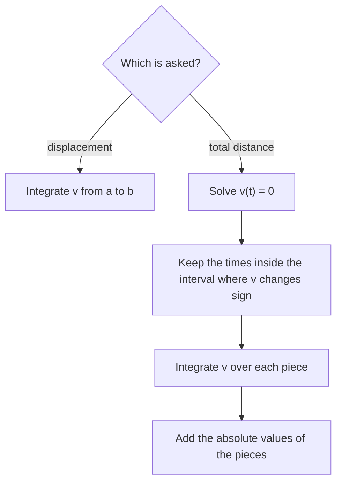

## Putting derivatives and integrals to work together

Motion along a straight line is the classic setting where both halves of calculus meet. Derivatives turn position into velocity and acceleration (Lesson 8); integrals turn them back (Lesson 21), and the net change theorem (Lesson 23) says what a definite integral of a rate means. This lesson pulls those threads together and adds one more idea: the average value of a function.

## Position, velocity, acceleration

A particle moves along a line with position $s(t)$. Then

$$v(t) = s'(t), \qquad a(t) = v'(t) = s''(t).$$

Signs carry the meaning:

- $v > 0$: moving in the positive direction (right or up); $v < 0$: moving in the negative direction.
- The particle **changes direction** where $v$ changes sign (not merely where $v = 0$).
- **Speed** is $|v(t)|$. The particle is **speeding up** when $v$ and $a$ have the same sign, and **slowing down** when they have opposite signs.

### Example 1

$s(t) = t^3 - 6t^2 + 9t$ (meters, $t \ge 0$ in seconds). When does the particle change direction? When is it speeding up?

- $v(t) = 3t^2 - 12t + 9 = 3(t - 1)(t - 3)$; $a(t) = 6t - 12 = 6(t - 2)$.
- $v > 0$ on $[0, 1)$, $v < 0$ on $(1, 3)$, $v > 0$ on $(3, \infty)$. It changes direction at $t = 1$ and $t = 3$.
- Compare signs:

| Interval | $v$ | $a$ | Behavior |
|---|---|---|---|
| $(0, 1)$ | $+$ | $-$ | slowing down |
| $(1, 2)$ | $-$ | $-$ | speeding up |
| $(2, 3)$ | $-$ | $+$ | slowing down |
| $(3, \infty)$ | $+$ | $+$ | speeding up |

A motion diagram makes the turns visible. The particle's path is drawn in three passes (in reality it all happens on one line), with its position at each whole second: $s(0) = 0$, $s(1) = 4$, $s(2) = 2$, $s(3) = 0$, $s(4) = 4$.


## Displacement versus distance

From a velocity function, the net change theorem gives

$$\text{displacement} = s(b) - s(a) = \int_a^b v(t)\,dt.$$

Displacement is net: motion backward cancels motion forward. The **total distance traveled** counts every meter:

$$\text{distance} = \int_a^b |v(t)|\,dt.$$

To compute it, split the interval where $v$ changes sign and add the absolute values of the pieces.



### Example 2

For $v(t) = t^2 - 4t + 3 = (t - 1)(t - 3)$ m/s on $[0, 4]$, find the displacement and the total distance.

An antiderivative: $S(t) = \frac{t^3}{3} - 2t^2 + 3t$. Values: $S(0) = 0$, $S(1) = \frac43$, $S(3) = 0$, $S(4) = \frac43$.

- Displacement: $S(4) - S(0) = \frac43$ m.
- Distance: $|S(1) - S(0)| + |S(3) - S(1)| + |S(4) - S(3)| = \frac43 + \frac43 + \frac43 = \mathbf 4$ m.

```plot
{"x": [-0.3, 4.3], "y": [-1.5, 3.5], "functions": [{"f": "x^2 - 4x + 3", "label": "v(t)"}], "shade": [{"f": "x^2 - 4x + 3", "from": 0, "to": 4}], "xLabel": "t", "yLabel": "v", "caption": "Areas: 4/3 above, 4/3 below, 4/3 above. Displacement 4/3; distance 4"}
```

### Example 3 (position from velocity)

A particle has $v(t) = 6 - 2t$ and $s(0) = 5$. Where is it at $t = 4$?

$s(4) = s(0) + \int_0^4(6 - 2t)\,dt = 5 + \Big[6t - t^2\Big]_0^4 = 5 + 8 = 13$.

The pattern "final = initial + integral of the rate" is the most common AP free-response move.

## Net change in other settings

| Rate | Integral over $[a, b]$ gives |
|---|---|
| Flow rate $r(t)$ (gal/min) | net gallons added |
| Population growth rate $P'(t)$ | net change in population |
| Marginal cost $C'(q)$ | change in cost from $q = a$ to $q = b$ |
| Rate in minus rate out | net change in the amount |

### Example 4

Water enters a tank at $E(t) = 20 + 4t$ L/min and leaves at $L(t) = 30$ L/min. The tank holds 200 L at $t = 0$. How much is in it at $t = 10$?

$200 + \int_0^{10}(E - L)\,dt = 200 + \int_0^{10}(4t - 10)\,dt = 200 + \Big[2t^2 - 10t\Big]_0^{10} = 200 + 100 = 300$ L.

## Average value of a function

The average of $n$ numbers is their sum divided by $n$. For a continuous function on $[a, b]$, sample $n$ equally spaced values: their average is
$$\frac{1}{n}\sum f(x_i) = \frac{1}{b - a}\sum f(x_i)\,\Delta x,$$
since $\frac1n = \frac{\Delta x}{b - a}$. As $n\to\infty$, the sum becomes an integral. The **average value** of $f$ on $[a, b]$ is

$$f_{\text{avg}} = \frac{1}{b - a}\int_a^b f(x)\,dx.$$

Geometrically: the rectangle of height $f_{\text{avg}}$ on $[a, b]$ has the same area as the region under $f$.

```plot
{"x": [-0.2, 3.2], "y": [-0.5, 9.5], "functions": [{"f": "x^2", "label": "y = x²"}, {"f": "3", "from": 0, "to": 3, "dashed": true, "label": "average = 3"}], "shade": [{"f": "x^2", "from": 0, "to": 3}], "points": [{"at": [1.7321, 3], "label": "c = √3"}], "caption": "The average of x² on [0, 3] is 3, attained at c = √3"}
```

### Example 5

Find the average value of $f(x) = x^2$ on $[0, 3]$, and a $c$ where $f(c)$ equals it.

$f_{\text{avg}} = \frac{1}{3}\int_0^3x^2\,dx = \frac13\cdot9 = \mathbf 3$. Solve $c^2 = 3$: $c = \sqrt3 \approx 1.73$, which is in $[0, 3]$.

**Mean Value Theorem for integrals.** If $f$ is continuous on $[a, b]$, there is a $c$ in $[a, b]$ with $f(c) = f_{\text{avg}}$. (It's the ordinary MVT applied to the accumulation function $\int_a^x f$.)

### Example 6

A city's temperature $t$ hours after midnight is $T(t) = 60 - 10\cos\left(\frac{\pi t}{12}\right)$ °F. What is the average temperature over the first 12 hours?

$$\frac{1}{12}\int_0^{12}\left(60 - 10\cos\frac{\pi t}{12}\right)dt = \frac{1}{12}\left[60t - \frac{120}{\pi}\sin\frac{\pi t}{12}\right]_0^{12} = \frac{1}{12}(720 - 0) = 60\text{ °F}.$$

*Average value vs average rate of change.* The average *value* of $f$ is $\frac{1}{b - a}\int_a^b f$. The average *rate of change* of $f$ is $\frac{f(b) - f(a)}{b - a}$, which equals the average value of $f'$. Read questions carefully.

## Common mistakes

- **Using $\int v\,dt$ for total distance.** That's displacement; distance needs $|v|$.
- **"Changes direction where $v = 0$."** Only if $v$ changes sign there.
- *Speeding up = positive acceleration.* No: speeding up means $v$ and $a$ have the same sign.
- *Forgetting the initial value* in "final = initial + accumulated change."
- **Average value without dividing by $b - a$.**

## Key points

- $v = s'$, $a = v'$. Speeding up iff $v$ and $a$ have the same sign.
- Displacement $= \int_a^b v\,dt$; distance $= \int_a^b |v|\,dt$ (split where $v$ changes sign).
- Final amount = initial amount + $\int$ (rate).
- $f_{\text{avg}} = \frac{1}{b - a}\int_a^b f(x)\,dx$, attained at some $c$ (MVT for integrals).
