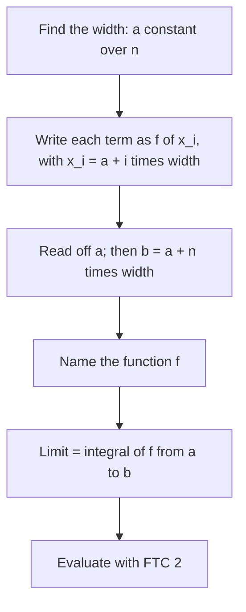

## Two directions

Lesson 22 defined $\int_a^b f(x)\,dx$ as a limit of Riemann sums, and Lesson 23 gave a fast way to evaluate it. The bridge between sums and integrals runs both ways, and this lesson crosses it in each direction:

- **Sum to integral.** A limit of a complicated sum may be a Riemann sum in disguise. Recognize it, and FTC 2 evaluates it in one line.
- **Integral to sum.** A sum with many terms, like $1 + \frac12 + \frac13 + \cdots + \frac{1}{1000}$, has no simple closed form, but integrals trap it between two easy numbers.

Along the way we'll prove the summation formulas Lesson 22 used without proof, and measure exactly how far a left or right sum can be from the integral.

## Reading a limit of sums as an integral

A right Riemann sum on $[a, b]$ with $n$ equal pieces has the form

$$\sum_{i=1}^{n} f\left(a + i\,\frac{b - a}{n}\right)\frac{b - a}{n} \;\longrightarrow\; \int_a^b f(x)\,dx.$$

To decode a given limit, look for three things: the width $\Delta x$ (usually a constant over $n$), the sample point $x_i$ (something $+\,i\,\Delta x$), and the function $f$ applied to $x_i$.



### Example 1

Evaluate $\displaystyle\lim_{n\to\infty}\sum_{i=1}^{n}\frac{3}{n}\left(2 + \frac{3i}{n}\right)^2$.

- Width: $\Delta x = \frac3n$, so $b - a = 3$.
- Sample point: $x_i = 2 + \frac{3i}{n} = 2 + i\,\Delta x$, so $a = 2$ and $b = 5$.
- Function: $f(x) = x^2$.

$$\lim_{n\to\infty}\sum_{i=1}^n\frac3n\left(2 + \frac{3i}{n}\right)^2 = \int_2^5 x^2\,dx = \frac{125 - 8}{3} = \mathbf{39}.$$

The reading is not unique. Taking $x_i = \frac{3i}{n}$ instead gives $\int_0^3 (2 + x)^2\,dx$, which is also 39: the same region, slid 2 units left. Any correct reading gives the same number.

### Example 2 (a disguised sum)

Evaluate $\displaystyle\lim_{n\to\infty}\sum_{i=1}^{n}\frac{n}{n^2 + i^2}$.

No $\Delta x$ is visible yet. Divide the top and bottom by $n^2$:

$$\frac{n}{n^2 + i^2} = \frac1n\cdot\frac{1}{1 + (i/n)^2}.$$

Now $\Delta x = \frac1n$, $x_i = \frac in$ on $[0, 1]$, and $f(x) = \frac{1}{1 + x^2}$:

$$\lim_{n\to\infty}\sum_{i=1}^n\frac{n}{n^2 + i^2} = \int_0^1\frac{dx}{1 + x^2} = \arctan 1 - \arctan 0 = \mathbf{\frac\pi4}.$$

A sum of fractions with nothing visibly circular in it converges to $\frac\pi4 \approx 0.785$. With $n = 1000$ the sum is about 0.7851, already close.

## Where the summation formulas come from

Lesson 22 used $\sum i = \frac{n(n+1)}{2}$ and $\sum i^2 = \frac{n(n+1)(2n+1)}{6}$. Both follow from one trick: a sum of differences collapses, because the inside terms cancel in pairs.

$$\sum_{i=1}^{n}\big[g(i + 1) - g(i)\big] = g(n + 1) - g(1).$$

### Example 3 (proving the sum of squares)

Take $g(i) = i^3$. Expanding, $(i + 1)^3 - i^3 = 3i^2 + 3i + 1$. Sum both sides from $i = 1$ to $n$. The left side collapses to $(n + 1)^3 - 1$. Write $S = \sum i^2$ and use the formula for $\sum i$:

$$(n + 1)^3 - 1 = 3S + 3\cdot\frac{n(n + 1)}{2} + n.$$

Solve for $S$. Multiply by 2: $2(n + 1)^3 - 2 - 3n(n + 1) - 2n = 6S$. The left side is $2n^3 + 3n^2 + n = n(n + 1)(2n + 1)$. So

$$\sum_{i=1}^n i^2 = \frac{n(n + 1)(2n + 1)}{6}.$$

The same trick with $g(i) = i^2$ proves $\sum i = \frac{n(n+1)}{2}$, and with $g(i) = i^4$ it gives $\sum i^3 = \left[\frac{n(n + 1)}{2}\right]^2$. (Notice the parallel with FTC 2: summing differences of $g$ gives an end-value minus a start-value, just as integrating $F'$ gives $F(b) - F(a)$.)

With the cube formula, the definition gives $\int_0^b x^3\,dx$ directly. Right endpoints, $\Delta x = \frac bn$, $x_i = \frac{bi}{n}$:

$$\sum_{i=1}^n\left(\frac{bi}{n}\right)^3\frac bn = \frac{b^4}{n^4}\cdot\frac{n^2(n + 1)^2}{4} \;\longrightarrow\; \frac{b^4}{4},$$

matching FTC 2. Before calculus, areas like these were found one curve at a time by summing tricks like this; Archimedes found the area of a parabolic segment in the third century BCE with a related argument.

## How far off are left and right sums?

For a function that is increasing on $[a, b]$, every right rectangle overshoots and every left one undershoots, so $L_n \le \int_a^b f \le R_n$. How far apart are $L_n$ and $R_n$? Their difference is a stack of thin strips, one per subinterval, of heights $f(x_i) - f(x_{i-1})$ and common width $\Delta x$. Slide them sideways into one column and the heights telescope:

$$R_n - L_n = \big[f(b) - f(a)\big]\Delta x = \frac{\big[f(b) - f(a)\big](b - a)}{n}.$$


The same holds, with $|f(b) - f(a)|$, for a decreasing function. Since the integral lies between $L_n$ and $R_n$, each one is within $\frac{|f(b) - f(a)|(b - a)}{n}$ of it, and their average (the trapezoidal sum) is within half that.

### Example 4

How many subintervals guarantee that a left or right sum for $\ln 2 = \int_1^2\frac{dt}{t}$ is within 0.001?

$\frac1t$ is decreasing, $|f(2) - f(1)| = \frac12$, and $b - a = 1$, so the error is at most $\frac{1}{2n}$. We need $\frac{1}{2n} \le 0.001$, so $n \ge 500$. The trapezoidal sum is guaranteed within $\frac{1}{4n}$, so $n = 250$ is enough for it. (Lesson 34 gives sharper error bounds that use concavity.)

## Trapping a sum between integrals

Now reverse the direction. Suppose $f$ is positive and decreasing for $x \ge 1$, and you want $\sum_{i=1}^n f(i)$. Draw a box of height $f(i)$ over $[i, i + 1]$. Because $f$ is decreasing, each box sits on or above the curve there, so the boxes contain the area under $f$ from 1 to $n + 1$. Shifting the boxes one unit left puts them under the curve instead. Together:

$$\int_1^{n+1} f(x)\,dx \;\le\; \sum_{i=1}^n f(i) \;\le\; f(1) + \int_1^{n} f(x)\,dx.$$

```plot
{"x": [-0.2, 6.6], "y": [-0.1, 1.15], "bars": [{"x": 1.5, "height": 1, "width": 1}, {"x": 2.5, "height": 0.5, "width": 1}, {"x": 3.5, "height": 0.3333, "width": 1}, {"x": 4.5, "height": 0.25, "width": 1}, {"x": 5.5, "height": 0.2, "width": 1}], "functions": [{"f": "1/x", "from": 0.85, "to": 6.6, "label": "y = 1/x"}], "caption": "Boxes of height 1, 1/2, …, 1/5 on [1, 6] lie above y = 1/x, so 1 + 1/2 + … + 1/5 is more than the area under the curve from 1 to 6, which is ln 6"}
```

For an increasing $f$ the inequalities flip direction, and the matching statement is $\int_0^n f \le \sum_{i=1}^n f(i) \le \int_1^{n+1} f$.

### Example 5 (harmonic numbers)

The $n$th **harmonic number** is $H_n = 1 + \frac12 + \frac13 + \cdots + \frac1n$. Bound $H_{1000}$.

With $f(x) = \frac1x$, $\int_1^{m}\frac{dx}{x} = \ln m$, so

$$\ln(1001) \le H_{1000} \le 1 + \ln 1000, \qquad\text{that is,}\qquad 6.909 \le H_{1000} \le 7.908.$$

The true value is about 7.4855. The bounds show something important: $H_n$ grows without bound, but only like $\ln n$. Adding a thousand terms gets you past 7; reaching 100 would take more than $e^{99}$ terms. In fact $H_n - \ln n$ decreases toward a limit, the **Euler–Mascheroni constant** $\gamma \approx 0.5772$, studied by Leonhard Euler in the 1730s. So $H_n \approx \ln n + 0.5772$ for large $n$; for $n = 1000$ this gives 7.4850. (Whether $\gamma$ is rational is still an open question.)

### Example 6 (an increasing function)

Estimate $S = \sqrt1 + \sqrt2 + \cdots + \sqrt{100}$.

$\sqrt x$ is increasing, so $\int_0^{100}\sqrt x\,dx \le S \le \int_1^{101}\sqrt x\,dx$:

$$\frac23(100)^{3/2} = 666.67 \;\le\; S \;\le\; \frac23\left(101^{3/2} - 1\right) \approx 676.02.$$

The actual sum is about 671.46, near the middle. This idea of comparing a sum with an integral returns in Lesson 41 as the integral test for infinite series.

## Common mistakes

- *Reading $\Delta x$ as $\frac1n$ by habit.* In $\sum\frac3n\left(2 + \frac{3i}{n}\right)^2$, $\Delta x = \frac3n$ and the interval has length 3.
- *Getting the interval wrong.* If $x_i = 2 + \frac{3i}{n}$, the interval is $[2, 5]$, not $[0, 3]$ (unless you also change $f$).
- *Using the error formula $|f(b) - f(a)|\Delta x$ for a function that isn't monotone.* It relies on every strip having the same sign; split the interval at turning points first.
- *Flipping the trap.* For a decreasing $f$, the sum from 1 to $n$ is *bigger* than $\int_1^{n+1}f$; draw the boxes to check.
- *Forgetting the first term* in the upper bound $f(1) + \int_1^n f$.

## Key points

- $\lim\sum f(a + i\Delta x)\Delta x = \int_a^b f(x)\,dx$ with $\Delta x = \frac{b - a}{n}$; find the width, the sample point and $f$.
- Sums of differences telescope: $\sum_{i=1}^n[g(i + 1) - g(i)] = g(n + 1) - g(1)$. This proves the formulas for $\sum i$, $\sum i^2$, $\sum i^3$.
- For monotone $f$: $|R_n - L_n| = |f(b) - f(a)|\Delta x$, and the integral lies between $L_n$ and $R_n$.
- For decreasing positive $f$: $\int_1^{n+1}f \le \sum_{i=1}^n f(i) \le f(1) + \int_1^n f$.
- $\ln(n + 1) \le H_n \le 1 + \ln n$, and $H_n - \ln n \to \gamma \approx 0.5772$.
