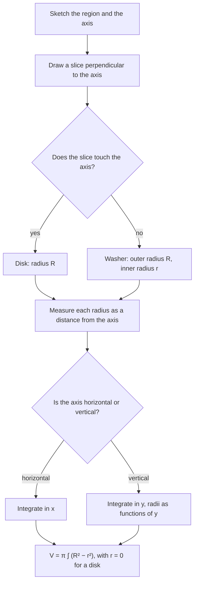

## Volume by slicing

A loaf of bread is a pile of thin slices. If you know the area of each slice, you know the volume: add up (area × thickness). That's the whole idea of this lesson. If a solid lies between $x = a$ and $x = b$, and its cross section perpendicular to the $x$-axis at position $x$ has area $A(x)$, then a slice of thickness $\Delta x$ has volume about $A(x)\Delta x$, and

$$V = \int_a^b A(x)\,dx.$$

All the volume formulas below are this one with a particular shape of cross section.

## Known cross sections

Some solids are described directly by their cross sections: "a solid whose base is the region R and whose cross sections perpendicular to the $x$-axis are squares." Then the side of each square is the width of the base at $x$, and you square it.

| Cross section on base width $s$ | Area $A$ |
|---|---|
| square (side $s$) | $s^2$ |
| semicircle (diameter $s$) | $\frac{\pi}{8}s^2$ |
| equilateral triangle (side $s$) | $\frac{\sqrt3}{4}s^2$ |
| isosceles right triangle (leg $s$) | $\frac12s^2$ |
| rectangle of height $h$ | $sh$ |

### Example 1

The base of a solid is the region between $y = \sqrt x$ and the $x$-axis on $[0, 4]$. Cross sections perpendicular to the $x$-axis are squares. Find the volume.

At position $x$ the base runs from $y = 0$ to $y = \sqrt x$, so $s = \sqrt x$ and $A(x) = (\sqrt x)^2 = x$.
$$V = \int_0^4 x\,dx = \mathbf 8.$$

If the cross sections were semicircles instead: $A = \frac\pi8 x$, so $V = \frac\pi8\cdot8 = \pi$.

## Solids of revolution: disks

Rotate the region under $y = f(x) \ge 0$ on $[a, b]$ about the $x$-axis. Each cross section perpendicular to the axis is a circular **disk** of radius $R = f(x)$, area $\pi[f(x)]^2$. This is the **disk method**:

$$V = \pi\int_a^b[R(x)]^2\,dx.$$

```plot
{"x": [-0.5, 4.5], "y": [-2.5, 2.5], "equal": true, "functions": [{"f": "sqrt(x)", "label": "y = √x"}, {"f": "-sqrt(x)", "dashed": true}], "curves": [{"x": "2.5 + 0.25cos(t)", "y": "1.5811sin(t)", "t": [0, "2pi"]}], "segments": [{"from": [2.5, 0], "to": [2.5, 1.5811], "label": "R = √x"}], "caption": "Rotating y = √x about the x-axis: each slice is a disk of radius √x"}
```

### Example 2

Rotate the region under $y = \sqrt x$, $0 \le x \le 4$, about the $x$-axis. Find the volume.

$R(x) = \sqrt x$, so
$$V = \pi\int_0^4(\sqrt x)^2\,dx = \pi\int_0^4x\,dx = \mathbf{8\pi}.$$

### Example 3 (a classic check)

Derive the volume of a sphere of radius $r$.

Rotate the semicircle $y = \sqrt{r^2 - x^2}$, $-r \le x \le r$, about the $x$-axis:
$$V = \pi\int_{-r}^{r}(r^2 - x^2)\,dx = \pi\left[r^2x - \frac{x^3}{3}\right]_{-r}^{r} = \pi\left(\frac{2r^3}{3} + \frac{2r^3}{3}\right) = \frac43\pi r^3.$$

## Washers

If the region doesn't touch the axis of rotation, each cross section is a **washer** (a disk with a hole). With outer radius $R(x)$ and inner radius $r(x)$, the area is $\pi R^2 - \pi r^2$. This is the **washer method**:

$$V = \pi\int_a^b\left([R(x)]^2 - [r(x)]^2\right)dx.$$

Note it's $R^2 - r^2$, not $(R - r)^2$.


In the picture, both radii start on the axis of rotation: $R$ reaches the far boundary of the region and $r$ the near one. The slice's volume is its face area $\pi R^2 - \pi r^2$ times its thickness $\Delta x$.

### Example 4

The region between $y = x$ and $y = x^2$ (for $0 \le x \le 1$) is rotated about the $x$-axis. Find the volume.

On $[0, 1]$, $x \ge x^2$, so the line is farther from the axis: $R = x$, $r = x^2$.
$$V = \pi\int_0^1(x^2 - x^4)\,dx = \pi\left(\frac13 - \frac15\right) = \mathbf{\frac{2\pi}{15}}.$$

## Other axes

Radii are distances from the axis of rotation. For a horizontal axis $y = k$:

- a curve $y = f(x)$ lies at distance $\lvert f(x) - k\rvert$ from it.

For rotation about a vertical axis with the disk/washer method, slice perpendicular to that axis (horizontal slices) and integrate in $y$, writing radii as functions of $y$.

### Example 5

Rotate the region between $y = x$ and $y = x^2$ about the line $y = 2$.

Now both curves lie below the axis $y = 2$. The farther curve is the lower one, $y = x^2$: $R = 2 - x^2$. The nearer is $y = x$: $r = 2 - x$.
$$V = \pi\int_0^1\left[(2 - x^2)^2 - (2 - x)^2\right]dx = \pi\int_0^1\left(x^4 - 5x^2 + 4x\right)dx = \pi\left(\tfrac15 - \tfrac53 + 2\right) = \mathbf{\frac{8\pi}{15}}.$$

### Example 6 (vertical axis)

Rotate the region bounded by $y = x^2$, $y = 4$ and $x = 0$ (first quadrant) about the $y$-axis.

Slice horizontally: at height $y$, the region runs from $x = 0$ to $x = \sqrt y$, so the disks have radius $\sqrt y$:
$$V = \pi\int_0^4(\sqrt y)^2\,dy = \pi\int_0^4y\,dy = \mathbf{8\pi}.$$

## Choosing the setup

1. Sketch the region and the axis.
2. Draw a slice *perpendicular* to the axis. Disk if the slice touches the axis, washer if not.
3. Measure $R$ (and $r$) from the axis to the far (and near) boundary.
4. Integrate in the variable along the axis: $dx$ for a horizontal axis, $dy$ for a vertical one.

If slicing perpendicular to the axis is awkward (radii hard to express), use shells instead (next lesson).

The same steps as a flowchart:



## Common mistakes

- **$(R - r)^2$ instead of $R^2 - r^2$.**
- **Forgetting $\pi$** (or including it for squares and triangles, where it doesn't belong).
- **Measuring radii from the $x$-axis when rotating about another line.** Radius is distance to the axis of rotation.
- *Wrong variable.* Rotating about a vertical axis with disks/washers means $dy$.
- **Swapping $R$ and $r$.** $R$ is the boundary farther from the axis.

## Key points

- $V = \int_a^b A(x)\,dx$ for any solid with cross-sectional area $A(x)$.
- Disk: $V = \pi\int R^2$; washer: $V = \pi\int(R^2 - r^2)$.
- Radii are distances to the axis of rotation; integrate along the axis.
- Square, semicircle, triangle cross sections: area from the base width $s$.
