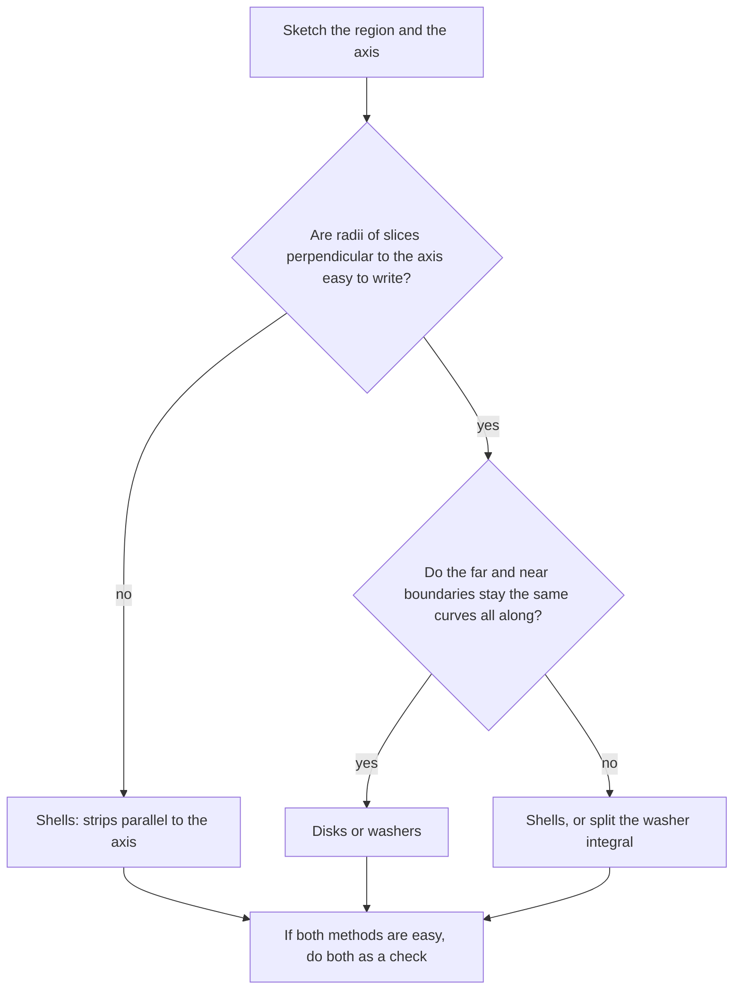

## When washers get awkward

Rotate the region under $y = 2x^2 - x^3$ (for $0 \le x \le 2$) about the $y$-axis. Washers would need horizontal slices, so you'd have to solve $y = 2x^2 - x^3$ for $x$ in terms of $y$: a cubic, and the region has two different $x$-boundaries at each height. Hopeless. The **shell method** slices the other way and avoids the problem.

## The idea

Take a thin vertical strip of the region at position $x$, with height $h(x)$ and width $\Delta x$. Rotate it about the $y$-axis. It sweeps out a thin cylindrical **shell**, like a tin can with no top or bottom.

Cut the shell down one side and unroll it: it's nearly a flat rectangular slab with

- length = circumference $= 2\pi x$ (the strip is at distance $x$ from the axis),
- height $= h(x)$,
- thickness $= \Delta x$.

So its volume is about $2\pi x\,h(x)\,\Delta x$. Adding shells and taking the limit:

$$V = 2\pi\int_a^b(\text{radius})(\text{height})\,dx = 2\pi\int_a^b x\,h(x)\,dx \quad(\text{about the } y\text{-axis}).$$

```plot
{"x": [-3, 3], "y": [-0.5, 2], "functions": [{"f": "2x^2 - x^3", "from": 0, "to": 2}, {"f": "2x^2 + x^3", "from": -2, "to": 0, "dashed": true}], "segments": [{"from": [1.2, 0], "to": [1.2, 1.152]}, {"from": [-1.2, 0], "to": [-1.2, 1.152], "dashed": true}, {"from": [0, 0.05], "to": [1.2, 0.05], "label": "radius x"}], "labels": [{"at": [2.1, 1.5], "text": "y = 2x² − x³"}], "caption": "A strip at distance x from the y-axis sweeps out a shell of radius x and height h(x)"}
```

Here is the cut-and-unroll step as a picture. The shell's wall becomes a thin slab whose length is the circumference $2\pi x$:


### Example 1

Find the volume when the region under $y = 2x^2 - x^3$, $0 \le x \le 2$, is rotated about the $y$-axis.

Radius $x$, height $2x^2 - x^3$:
$$V = 2\pi\int_0^2x(2x^2 - x^3)\,dx = 2\pi\int_0^2(2x^3 - x^4)\,dx = 2\pi\left[\frac{x^4}{2} - \frac{x^5}{5}\right]_0^2 = 2\pi\left(8 - \frac{32}{5}\right) = \mathbf{\frac{16\pi}{5}}.$$

### Example 2 (compare with washers)

Rotate the region bounded by $y = x^2$, $y = 4$ and $x = 0$ (first quadrant) about the $y$-axis. (This is Example 6 of Lesson 27, where washers gave $8\pi$.)

Shells: a vertical strip at $x$ runs from $y = x^2$ up to $y = 4$, so its height is $4 - x^2$; $x$ goes from 0 to 2.
$$V = 2\pi\int_0^2x(4 - x^2)\,dx = 2\pi\left[2x^2 - \frac{x^4}{4}\right]_0^2 = 2\pi(8 - 4) = 8\pi. \checkmark$$

## Other axes

The radius is the distance from the strip to the axis; the height is the length of the strip.

| Axis | Strips | Radius | Integrate in |
|---|---|---|---|
| $y$-axis | vertical | $x$ | $x$ |
| $x = k$ (vertical) | vertical | $\lvert x - k\rvert$ | $x$ |
| $x$-axis | horizontal | $y$ | $y$ |
| $y = k$ (horizontal) | horizontal | $\lvert y - k\rvert$ | $y$ |

Shells run *parallel* to the axis of rotation. (Disks and washers are perpendicular.)

### Example 3

Rotate the region between $y = x$ and $y = x^2$ ($0 \le x \le 1$) about the line $x = 2$.

Vertical strips at $x$: height $x - x^2$; distance to the line $x = 2$ is $2 - x$ (the region is to its left).
$$V = 2\pi\int_0^1(2 - x)(x - x^2)\,dx = 2\pi\int_0^1\left(x^3 - 3x^2 + 2x\right)dx = 2\pi\left(\tfrac14 - 1 + 1\right) = \mathbf{\frac{\pi}{2}}.$$

### Example 4 (horizontal axis with shells)

Rotate the region between $x = y^2$ and $x = 4$ (for $0 \le y \le 2$) about the $x$-axis.

Horizontal strips at height $y$ run from $x = y^2$ to $x = 4$, length $4 - y^2$, at distance $y$ from the $x$-axis:
$$V = 2\pi\int_0^2y(4 - y^2)\,dy = 2\pi\left[2y^2 - \frac{y^4}{4}\right]_0^2 = 8\pi.$$

(Check with disks: rotating the region under $y = \sqrt x$ on $[0, 4]$ about the $x$-axis gave $8\pi$ in Lesson 27. Same solid.)

## Disks/washers or shells?

| Ask | If yes |
|---|---|
| Are the radii easy as functions of the variable along the axis? | washers |
| Would washers need solving for $x$ in terms of $y$ (or vice versa) awkwardly? | shells |
| Does the region's boundary change partway along the axis direction? | try the other method |

Or as a decision chart:



Both always give the same answer when set up correctly, so a second method is a good check.

### Example 5 (both methods)

Rotate the first-quadrant region under $y = 4 - x^2$ about the $y$-axis. Find the volume with shells, then check with disks.

*Shells.* Vertical strips at $x$ ($0 \le x \le 2$) have radius $x$ and height $4 - x^2$:
$$V = 2\pi\int_0^2x(4 - x^2)\,dx = 2\pi\left[2x^2 - \frac{x^4}{4}\right]_0^2 = 2\pi(8 - 4) = 8\pi.$$

*Disks.* Horizontal slices at height $y$ ($0 \le y \le 4$) are disks of radius $x = \sqrt{4 - y}$:
$$V = \pi\int_0^4(4 - y)\,dy = \pi\left[4y - \frac{y^2}{2}\right]_0^4 = \pi(16 - 8) = 8\pi. \checkmark$$

Here both methods are easy. When they are, doing both is the best way to catch a setup error.

### Example 6 (shells about the $x$-axis)

Rotate the region between $y = x$ and $y = x^2$ ($0 \le x \le 1$) about the $x$-axis, using shells.

Horizontal strips at height $y$ run from the line ($x = y$) to the parabola ($x = \sqrt y$), so the height (length) is $\sqrt y - y$, and the radius is $y$:
$$V = 2\pi\int_0^1y\left(\sqrt y - y\right)dy = 2\pi\left(\frac25 - \frac13\right) = \frac{2\pi}{15},$$
the same answer the washer method gave in Lesson 27, Example 4.

## Common mistakes

- **Forgetting the $2\pi$** or the radius factor.
- **Using $x$ as the radius for an axis that isn't the $y$-axis.** Measure distance to the actual axis.
- *Slicing the wrong way.* Shells are parallel to the axis.
- *Height = top function only.* Height is top minus bottom (or right minus left).
- *Limits in the wrong variable.* Vertical strips need $x$-limits.

## Key points

- Shell volume: $2\pi(\text{radius})(\text{height})(\text{thickness})$.
- About a vertical axis: $V = 2\pi\int_a^b r(x)h(x)\,dx$ with vertical strips.
- About a horizontal axis: $V = 2\pi\int_c^d r(y)h(y)\,dy$ with horizontal strips.
- Choose the method that avoids solving for the inverse function.
