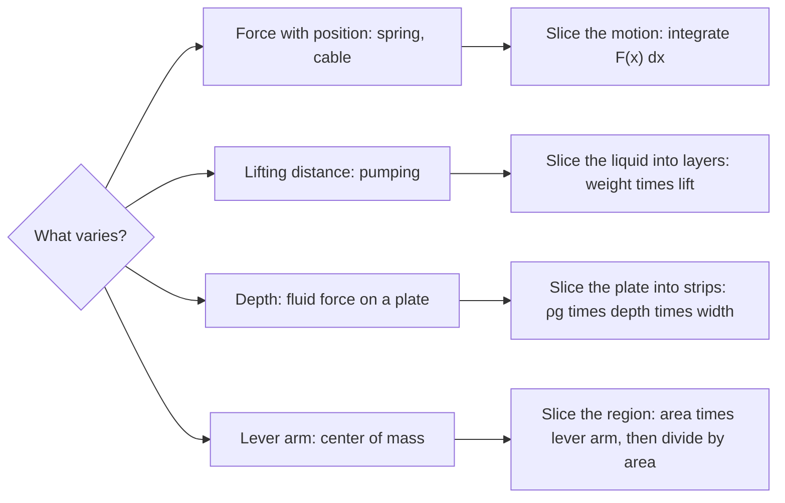

## Physics by slicing

Many physical formulas are products: work = force × distance, pressure = weight density × depth, moment = mass × lever arm. They work when the factors are constant. When a factor varies, slice until it's nearly constant on each piece, multiply, and integrate. This lesson applies that recipe to three college Calculus II topics.

In each case the first decision is which way to slice, and that depends on what varies:



Units: in SI, force is in newtons (N), distance in meters, work in joules (J = N·m). In US units, force in pounds (lb), distance in feet, work in foot-pounds (ft·lb). Mass needs $g = 9.8$ m/s² to become weight; pounds are already a weight.

## Work done by a variable force

If a constant force $F$ moves an object a distance $d$ in the direction of the force, the **work** is $W = Fd$. If the force $F(x)$ varies with position, each short move $\Delta x$ does work about $F(x)\Delta x$, so

$$W = \int_a^b F(x)\,dx.$$

### Springs

**Hooke's law**: the force needed to hold a spring stretched $x$ units beyond its natural length is $F(x) = kx$, where $k$ is the **spring constant**. Always measure $x$ from the natural length.

### Example 1

A force of 30 N holds a spring stretched 0.2 m beyond its natural length. How much work does it take to stretch it from 0.2 m to 0.5 m beyond natural length?

Find $k$: $30 = k(0.2)$, so $k = 150$ N/m. Then
$$W = \int_{0.2}^{0.5}150x\,dx = 75\left[x^2\right]_{0.2}^{0.5} = 75(0.25 - 0.04) = \mathbf{15.75}\text{ J}.$$

### Pumping liquid

To pump liquid out of a tank, slice the *liquid* into thin horizontal layers. Each layer must be lifted a different distance, which is why we slice.

For a layer at height $y$ with thickness $\Delta y$:
- volume $= A(y)\,\Delta y$, where $A(y)$ is the layer's cross-sectional area;
- weight (force) $= \rho g\,A(y)\,\Delta y$, with $\rho g$ the weight density ($9800$ N/m³ for water, or $62.4$ lb/ft³);
- distance lifted = from height $y$ to the outlet.

$$W = \int\rho g\,A(y)\,(\text{distance})\,dy.$$

### Example 2

A cylindrical tank of radius 2 m and height 5 m is full of water. How much work is needed to pump all the water over the top?

Put $y = 0$ at the bottom. A layer at height $y$ has area $\pi(2)^2 = 4\pi$ and must be lifted $5 - y$ meters.
$$W = \int_0^5 9800\cdot4\pi\,(5 - y)\,dy = 39200\pi\left[5y - \frac{y^2}{2}\right]_0^5 = 39200\pi(12.5) = 490{,}000\pi \approx \mathbf{1.54\times10^6}\text{ J}.$$

```shape
{"polygons": [{"points": [[-2, 0], [2, 0], [2, 5], [-2, 5]]}, {"points": [[-2, 2], [2, 2], [2, 2.3], [-2, 2.3]], "fill": true}], "segments": [{"from": [2.6, 2.15], "to": [2.6, 5], "arrow": true, "label": "lift 5 − y"}, {"from": [-2, -0.4], "to": [2, -0.4], "label": "radius 2"}], "labels": [{"at": [-3, 2.15], "text": "y"}], "caption": "A layer at height y is lifted 5 − y meters to the top"}
```

### Example 3 (lifting a cable)

A 20-m cable weighing 4 N/m hangs from the top of a building. How much work to pull it all up?

Slice the cable: a piece at distance $x$ below the top, of length $\Delta x$, weighs $4\Delta x$ and is lifted $x$ meters. $W = \int_0^{20}4x\,dx = 2(400) = \mathbf{800}$ J.

## Fluid force

**Pressure** at depth $d$ in a fluid is $P = \rho g d$ (weight density times depth), the same in every direction. On a horizontal plate, force = pressure × area. On a vertical plate the depth varies, so slice horizontally: a strip at depth $d(y)$ with width $w(y)$ and thickness $\Delta y$ feels force $\rho g\,d(y)\,w(y)\,\Delta y$.

$$F = \int\rho g\,(\text{depth})(\text{width})\,dy.$$


For a plate whose width changes with depth, like the trapezoid in the picture, write the width $w$ as a function of the depth before integrating.

### Example 4

A vertical rectangular gate in a dam is 4 m wide and 3 m tall, with its top edge 2 m below the water surface. Find the force on it.

Let $h$ be depth below the surface; the gate spans $2 \le h \le 5$ with constant width 4.
$$F = \int_2^5 9800\,h\cdot4\,dh = 39200\left[\frac{h^2}{2}\right]_2^5 = 39200\cdot\frac{21}{2} = \mathbf{411{,}600}\text{ N}.$$

(That's the same as the pressure at the gate's center, depth 3.5 m, times its area of 12 m², which is no coincidence for a rectangle.)

## Center of mass

A seesaw balances when the **moments** (mass × signed distance from the pivot) on each side cancel. For point masses $m_i$ at positions $x_i$, the balance point, or **center of mass**, is

$$\bar x = \frac{\sum m_ix_i}{\sum m_i}.$$

For a flat plate of uniform density (a lamina) occupying the region under $y = f(x)$ on $[a, b]$, slice into vertical strips. A strip at $x$ has area $f(x)\Delta x$ and its own center at $(x, \frac12f(x))$. Density cancels, and the center of mass is the **centroid**:

$$\bar x = \frac{1}{A}\int_a^b x\,f(x)\,dx, \qquad \bar y = \frac{1}{A}\int_a^b\frac12[f(x)]^2\,dx, \qquad A = \int_a^b f(x)\,dx.$$

### Example 5

Find the centroid of the region under $y = \sqrt x$ on $[0, 4]$.

- $A = \int_0^4x^{1/2}\,dx = \frac23(8) = \frac{16}{3}$.
- $\int_0^4x\cdot x^{1/2}\,dx = \frac25(4)^{5/2} = \frac{64}{5}$, so $\bar x = \frac{64/5}{16/3} = \frac{12}{5}$.
- $\int_0^4\frac12x\,dx = 4$, so $\bar y = \frac{4}{16/3} = \frac34$.

Centroid: $\left(\frac{12}{5}, \frac34\right) = (2.4, 0.75)$. It sits right of center because the region is taller on the right.

```plot
{"x": [-0.5, 4.5], "y": [-0.5, 2.5], "equal": true, "functions": [{"f": "sqrt(x)"}], "shade": [{"f": "sqrt(x)", "from": 0, "to": 4}], "points": [{"at": [2.4, 0.75], "label": "centroid (2.4, 0.75)"}], "caption": "The balance point of the region under √x"}
```

*Symmetry shortcut:* if a region is symmetric about a line, its centroid lies on that line.

**Theorem of Pappus:** rotating a region of area $A$ about an axis it doesn't cross produces volume $V = A\cdot2\pi\bar r$, where $\bar r$ is the distance from the centroid to the axis. Check with Example 5 rotated about the $x$-axis: $\frac{16}{3}\cdot2\pi\cdot\frac34 = 8\pi$, matching Lesson 27.

## Common mistakes

- **Measuring the spring's $x$ from the wrong point.** It's the stretch beyond natural length.
- *Using mass instead of weight.* Multiply kilograms by 9.8 to get newtons.
- *Wrong lifting distance.* It's from the layer to the outlet, not from the bottom.
- *Depth measured from the bottom* in fluid force. Pressure depends on depth below the surface.
- **Forgetting to divide by $A$** for the centroid.

## Key points

- Work: $W = \int F(x)\,dx$; springs: $F = kx$ (from natural length).
- Pumping: $W = \int\rho g\,A(y)\,(\text{lift distance})\,dy$.
- Fluid force on a vertical plate: $F = \int\rho g\,(\text{depth})(\text{width})\,dy$.
- Centroid: $\bar x = \frac1A\int xf\,dx$, $\bar y = \frac1A\int\frac12f^2\,dx$.
