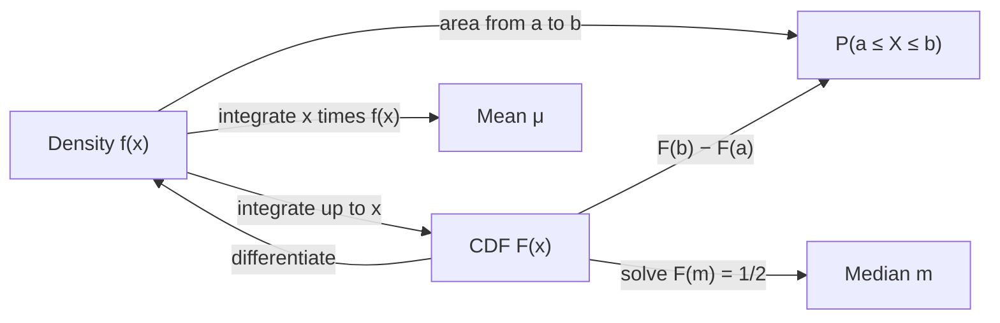

## Area as probability

This module has turned areas into volumes, lengths, work and balance points. One more application is everywhere in science and statistics: area under a curve as probability. How long will a light bulb last? How far from the target will a dart land? How many minutes until the next bus? Questions like these have answers that can be any number in an interval, and the tool for them is a function whose *area* gives probabilities. The ideas line up closely with Lesson 26 (areas) and Lesson 30 (centroids): the average of a random quantity turns out to be a balance point.

## Continuous random variables and densities

A **continuous random variable** $X$ is a random quantity that can take any value in an interval, such as a waiting time or a measured length. Its behavior is described by a **probability density function** (PDF) $f$, which gives probabilities as areas:

$$P(a \le X \le b) = \int_a^b f(x)\,dx.$$

A function $f$ can be a density exactly when

1. $f(x) \ge 0$ for all $x$ (probabilities can't be negative), and
2. $\int_{-\infty}^{\infty}f(x)\,dx = 1$ (the total probability is 1).

Usually $f$ is zero outside some interval, and the second condition only involves that interval. Two consequences surprise people:

- *A single value has probability 0.* $P(X = c) = \int_c^c f(x)\,dx = 0$. So $P(X \le c)$ and $P(X < c)$ are equal for a continuous random variable.
- *A density is not a probability.* $f(c)$ can be larger than 1. Only areas are probabilities. For example, $f(x) = 2$ on $[0, \frac12]$ (and 0 elsewhere) is a valid density: it's never negative and its total area is $2\cdot\frac12 = 1$.

### Example 1

For which $k$ is $f(x) = kx(2 - x)$ on $[0, 2]$ (and 0 elsewhere) a density? Then find $P\left(X \le \frac12\right)$.

1. On $[0, 2]$, $x(2 - x) \ge 0$, so any $k > 0$ keeps $f$ nonnegative.
2. Total area: $\int_0^2(2x - x^2)\,dx = 4 - \frac83 = \frac43$. Setting $k\cdot\frac43 = 1$ gives $k = \frac34$.
3. $P\left(X \le \frac12\right) = \frac34\int_0^{1/2}(2x - x^2)\,dx = \frac34\left(\frac14 - \frac1{24}\right) = \frac34\cdot\frac{5}{24} = \frac{5}{32} \approx 0.156.$

```plot
{"x": [-0.3, 2.3], "y": [-0.1, 1], "functions": [{"f": "0.75x(2 - x)", "from": 0, "to": 2, "label": "f(x) = (3/4)x(2 − x)"}], "shade": [{"f": "0.75x(2 - x)", "from": 0, "to": 0.5}], "caption": "The shaded area, 5/32, is P(X ≤ 1/2); the whole area under the curve is 1"}
```

## The cumulative distribution function

The **cumulative distribution function** (CDF) of $X$ is the accumulated probability up to $x$:

$$F(x) = P(X \le x) = \int_{-\infty}^{x}f(t)\,dt.$$

This is an accumulation function, so the Fundamental Theorem (Lesson 23) gives $F'(x) = f(x)$ wherever $f$ is continuous. Since $f \ge 0$, $F$ never decreases; it rises from 0 (far left) to 1 (far right). With $F$ in hand, every probability is a subtraction: $P(a \le X \le b) = F(b) - F(a)$.



## Mean, median and spread

The **expected value** or mean of $X$ is

$$\mu = E(X) = \int_{-\infty}^{\infty}x\,f(x)\,dx.$$

Compare Lesson 30's centroid, $\bar x = \frac1A\int x\,f(x)\,dx$. The region under a density has area $A = 1$, so **the mean is the $x$-coordinate of the centroid of the region under the density**: if you cut the region out of cardboard, it would balance on a knife edge at $x = \mu$. This is why a long tail on one side drags the mean toward it.

The **median** $m$ splits the probability in half: $F(m) = \frac12$, so half the area lies on each side of $x = m$. The mean balances the region; the median halves its area. They agree for a symmetric density and usually differ otherwise.

The **variance** measures spread around the mean, $\sigma^2 = \int(x - \mu)^2f(x)\,dx$, and the standard deviation is $\sigma = \sqrt{\sigma^2}$. Expanding the square gives the shortcut $\sigma^2 = \int x^2f(x)\,dx - \mu^2$.

### Example 2

$X$ has density $f(x) = \frac38x^2$ on $[0, 2]$ (0 elsewhere). Find its CDF, mean, median and standard deviation.

1. Check: $\int_0^2\frac38x^2\,dx = \frac38\cdot\frac83 = 1$. Good.
2. CDF: for $0 \le x \le 2$, $F(x) = \int_0^x\frac38t^2\,dt = \frac{x^3}{8}$ (with $F = 0$ for $x < 0$ and $F = 1$ for $x > 2$).
3. Mean: $\mu = \int_0^2x\cdot\frac38x^2\,dx = \frac38\cdot\frac{16}{4} = \frac32$.
4. Median: $\frac{m^3}{8} = \frac12$, so $m^3 = 4$ and $m = \sqrt[3]{4} \approx 1.587$.
5. Spread: $\int_0^2x^2\cdot\frac38x^2\,dx = \frac38\cdot\frac{32}{5} = \frac{12}{5}$, so $\sigma^2 = \frac{12}{5} - \frac94 = \frac{3}{20}$ and $\sigma \approx 0.387$.

The density is piled up on the right with a thin tail to the left, and the tail pulls the mean ($1.5$) below the median ($1.587$).

## The exponential distribution

Waiting times for random events (the next radioactive decay, the next customer, the next call) are often modeled by the **exponential distribution** with rate $\lambda > 0$:

$$f(x) = \lambda e^{-\lambda x}\ \text{ for } x \ge 0, \qquad f(x) = 0 \text{ for } x < 0.$$

It's a model: real waiting times fit it well when events happen independently at a steady average rate, and less well otherwise.

The interval is now infinite. $\int_0^{\infty}$ means the limit of $\int_0^b$ as $b \to \infty$ (an improper integral, covered fully in Lesson 35). Here:

- *Total area:* $\int_0^b\lambda e^{-\lambda x}\,dx = 1 - e^{-\lambda b} \to 1$. So $f$ is a density.
- *CDF:* $F(x) = 1 - e^{-\lambda x}$ for $x \ge 0$, so $P(X > x) = e^{-\lambda x}$.
- *Mean:* an antiderivative of $\lambda x e^{-\lambda x}$ is $-\left(x + \frac1\lambda\right)e^{-\lambda x}$ (check by differentiating with the product rule; Lesson 31 shows how to find it). So $\int_0^b\lambda xe^{-\lambda x}\,dx = \frac1\lambda - \left(b + \frac1\lambda\right)e^{-\lambda b}$. As $b \to \infty$, $be^{-\lambda b} \to 0$ (L'Hôpital, Lesson 16), so $\mu = \frac1\lambda$.
- *Median:* $1 - e^{-\lambda m} = \frac12$ gives $m = \frac{\ln 2}{\lambda} \approx 0.693\mu$.

The median is smaller than the mean: most waits are short, but the occasional long wait in the right tail pulls the mean up.

### Example 3

Calls arrive at a help desk so that the time until the next call is exponential with mean 4 minutes. Find the probability of waiting more than 6 minutes, the probability of waiting at most 2 minutes, and the median wait.

The mean is $\frac1\lambda = 4$, so $\lambda = \frac14$ per minute.

- $P(X > 6) = e^{-6/4} = e^{-1.5} \approx 0.223$.
- $P(X \le 2) = 1 - e^{-2/4} = 1 - e^{-0.5} \approx 0.393$.
- Median: $m = 4\ln2 \approx 2.77$ minutes. Half of all waits are under 2.77 minutes, even though the mean is 4.

```plot
{"x": [-0.5, 14], "y": [-0.02, 0.3], "functions": [{"f": "0.25exp(-0.25x)", "from": 0, "to": 14, "label": "f(x) = 0.25e^(−0.25x)"}], "shade": [{"f": "0.25exp(-0.25x)", "from": 6, "to": 14}], "points": [{"at": [2.77, 0], "label": "median 2.77"}, {"at": [4, 0], "label": "mean 4"}], "caption": "Exponential waiting time with mean 4 minutes; the shaded tail is P(X > 6) ≈ 0.223"}
```

## Two more densities to know

- The **uniform distribution** on $[a, b]$ has constant density $f(x) = \frac{1}{b - a}$ there. Every subinterval of the same length is equally likely, and the mean is the midpoint $\frac{a + b}{2}$ (the centroid of a rectangle).
- The normal ("bell curve") density with mean $\mu$ and standard deviation $\sigma$ is $f(x) = \frac{1}{\sigma\sqrt{2\pi}}e^{-(x - \mu)^2/(2\sigma^2)}$. It has no antiderivative built from elementary functions, so its probabilities come from numerical integration (Lesson 34), tables or software. Showing that its total area is exactly 1 takes a trick from multivariable calculus.

## Common mistakes

- **Treating $f(c)$ as $P(X = c)$.** For a continuous variable, $P(X = c) = 0$ and $f(c)$ may exceed 1.
- **Forgetting to normalize.** Find the constant that makes the total area 1 before computing any probability.
- *Integrating over the wrong interval.* Outside its stated interval the density is 0; split integrals there.
- *Confusing mean and median.* The mean is $\int xf\,dx$; the median solves $F(m) = \frac12$. They differ for skewed densities.
- *Exponential with $\lambda$ and the mean mixed up.* The mean is $\frac1\lambda$; a mean of 4 minutes is a rate of $\frac14$ per minute.
- *Forgetting the 0 part of the CDF.* $F(x) = 0$ to the left of the density's interval and 1 to the right.

## Key points

- A density has $f \ge 0$ and total area 1; $P(a \le X \le b) = \int_a^bf(x)\,dx$.
- CDF: $F(x) = \int_{-\infty}^xf(t)\,dt$, $F' = f$, $P(a \le X \le b) = F(b) - F(a)$.
- Mean $\mu = \int xf(x)\,dx$, the balance point; median: $F(m) = \frac12$; variance $\int x^2f\,dx - \mu^2$.
- Exponential: $f = \lambda e^{-\lambda x}$, $P(X > x) = e^{-\lambda x}$, mean $\frac1\lambda$, median $\frac{\ln2}{\lambda}$.
- Uniform on $[a, b]$: $f = \frac1{b - a}$, mean $\frac{a + b}2$.
