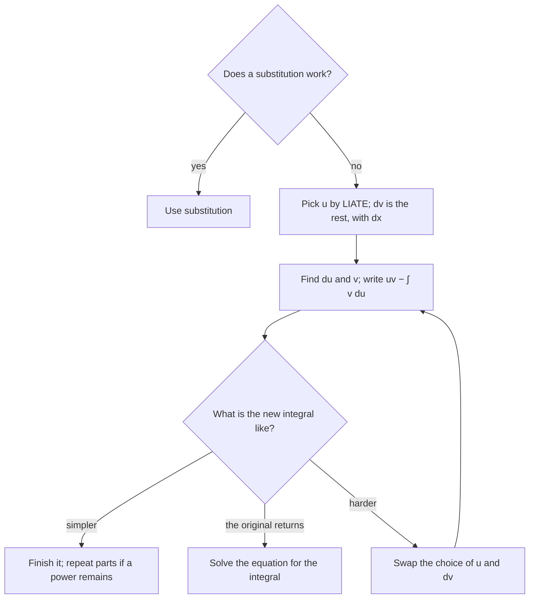

## Undoing the product rule

Module 8 is about techniques: ways to rewrite integrals that the basic table and substitution can't handle. Substitution reverses the chain rule; integration by parts reverses the product rule. It's the tool for integrals like $\int xe^x\,dx$, $\int x\sin x\,dx$, $\int\ln x\,dx$ and $\int e^x\cos x\,dx$: products of functions of different types.

## The formula

The product rule says $\frac{d}{dx}[u(x)v(x)] = u'v + uv'$. Integrate both sides:

$$uv = \int u'v\,dx + \int uv'\,dx \quad\Longrightarrow\quad \int uv'\,dx = uv - \int vu'\,dx.$$

With differentials $du = u'\,dx$ and $dv = v'\,dx$, this is the **integration by parts** formula:

$$\int u\,dv = uv - \int v\,du.$$

You split the integrand into two pieces: $u$ (which you'll differentiate) and $dv$ (which you'll integrate). The method pays off when $\int v\,du$ is simpler than the original.

The formula also has a picture. Plot the curve traced by the point $(u, v)$ as $x$ runs from $a$ to $b$, from $(u_1, v_1)$ to $(u_2, v_2)$. When both $u$ and $v$ increase along the way, as here, the big rectangle $u_2v_2$ is made of three pieces: the small rectangle $u_1v_1$, the region under the curve (area $\int v\,du$), and the region to its left (area $\int u\,dv$). So $\int u\,dv = u_2v_2 - u_1v_1 - \int v\,du$, which is the definite version of the formula.

## Choosing $u$: LIATE

A reliable rule of thumb: choose $u$ to be whichever factor comes first in this list.

| L | I | A | T | E |
|---|---|---|---|---|
| Logarithms | Inverse trig | Algebraic (powers, polynomials) | Trig | Exponentials |

Functions early in the list get simpler (or at least no worse) when differentiated, while those late in the list are easy to integrate. $dv$ is everything else, including $dx$.

The whole decision, including what to do after the first round, fits in one chart:

### Example 1

Find $\displaystyle\int xe^x\,dx$.

$x$ is algebraic, $e^x$ exponential, so $u = x$, $dv = e^x\,dx$. Then $du = dx$, $v = e^x$.
$$\int xe^x\,dx = xe^x - \int e^x\,dx = \mathbf{xe^x - e^x + C}.$$

Check: $\frac{d}{dx}(xe^x - e^x) = e^x + xe^x - e^x = xe^x$. ✓

What if you chose the other way? With $u = e^x$, $dv = x\,dx$: $\int xe^x\,dx = \frac{x^2}{2}e^x - \int\frac{x^2}{2}e^x\,dx$. The new integral is *worse* (higher power). That's the signal you chose badly.

### Example 2

Find $\displaystyle\int\ln x\,dx$.

There's only one factor, so let $u = \ln x$, $dv = dx$. Then $du = \frac1x\,dx$, $v = x$:
$$\int\ln x\,dx = x\ln x - \int x\cdot\frac1x\,dx = \mathbf{x\ln x - x + C}.$$

The same trick (with $dv = dx$) integrates $\arctan x$ and $\arcsin x$.

## Repeated integration by parts

### Example 3

Find $\displaystyle\int x^2\sin x\,dx$.

First round: $u = x^2$, $dv = \sin x\,dx$; $du = 2x\,dx$, $v = -\cos x$:
$$\int x^2\sin x\,dx = -x^2\cos x + \int2x\cos x\,dx.$$
Second round on $\int2x\cos x\,dx$: $u = 2x$, $dv = \cos x\,dx$; $du = 2\,dx$, $v = \sin x$:
$$\int2x\cos x\,dx = 2x\sin x - \int2\sin x\,dx = 2x\sin x + 2\cos x.$$
Altogether: $\mathbf{-x^2\cos x + 2x\sin x + 2\cos x + C}$.

Each round lowers the power of $x$ by one, so $x^n$ times sine, cosine or $e^{ax}$ takes $n$ rounds.

### The tabular shortcut

For "polynomial × (something easy to integrate repeatedly)," organize the rounds in a table. Differentiate the polynomial down to 0 in one column; integrate the other factor repeatedly in the next; multiply diagonally with alternating signs $+, -, +, \dots$

| Sign | $u$ and derivatives | $dv$ and integrals |
|---|---|---|
| $+$ | $x^2$ | $\sin x$ |
| $-$ | $2x$ | $-\cos x$ |
| $+$ | $2$ | $-\sin x$ |
| | $0$ | $\cos x$ |

Diagonals: $+x^2(-\cos x) - 2x(-\sin x) + 2(\cos x)$, matching Example 3.

## When the integral comes back

### Example 4

Find $\displaystyle\int e^x\cos x\,dx$.

Call it $I$. Parts with $u = \cos x$, $dv = e^x\,dx$:
$$I = e^x\cos x + \int e^x\sin x\,dx.$$
Parts again with $u = \sin x$, $dv = e^x\,dx$ (keep the same type of choice!):
$$\int e^x\sin x\,dx = e^x\sin x - \int e^x\cos x\,dx = e^x\sin x - I.$$
So $I = e^x\cos x + e^x\sin x - I$. Solve the equation for $I$:
$$2I = e^x(\cos x + \sin x) \quad\Longrightarrow\quad I = \mathbf{\tfrac12e^x(\sin x + \cos x) + C}.$$

If you switch choices on the second round (letting $u = e^x$), you undo the first round and get the useless identity $I = I$.

## Definite integrals by parts

$$\int_a^b u\,dv = \Big[uv\Big]_a^b - \int_a^b v\,du.$$

### Example 5

Evaluate $\displaystyle\int_0^1 xe^{2x}\,dx$.

$u = x$, $dv = e^{2x}dx$; $du = dx$, $v = \frac12e^{2x}$.
$$\left[\tfrac12xe^{2x}\right]_0^1 - \int_0^1\tfrac12e^{2x}\,dx = \tfrac12e^2 - \left[\tfrac14e^{2x}\right]_0^1 = \tfrac12e^2 - \tfrac14e^2 + \tfrac14 = \mathbf{\frac{e^2 + 1}{4}} \approx 2.097.$$

### Example 6 (substitution, then parts)

Find $\displaystyle\int\sin\sqrt x\,dx$.

Let $w = \sqrt x$, so $x = w^2$ and $dx = 2w\,dw$: the integral becomes $\int2w\sin w\,dw$. Parts with $u = 2w$, $dv = \sin w\,dw$: $-2w\cos w + 2\sin w + C = -2\sqrt x\cos\sqrt x + 2\sin\sqrt x + C$. Techniques combine freely.

## Common mistakes

- **Choosing $u$ and $dv$ backward,** which makes the new integral harder. Use LIATE.
- *Sign errors*, especially with $v = -\cos x$. Write $u$, $du$, $v$, $dv$ out explicitly.
- **Forgetting that $dv$ includes $dx$** and must be something you can integrate.
- *Switching choices* in a cyclic problem like Example 4.
- **Evaluating only $uv$ at the limits** in a definite integral and forgetting the remaining integral (or vice versa).

## Key points

- $\int u\,dv = uv - \int v\,du$: the product rule in reverse.
- LIATE: pick $u$ as the first of Log, Inverse trig, Algebraic, Trig, Exponential.
- Powers times sine/cosine/exponential: repeat (or use the tabular method).
- Cyclic integrals ($e^x\sin x$, $e^x\cos x$): parts twice, then solve for the integral.
- $\int\ln x\,dx = x\ln x - x + C$.
