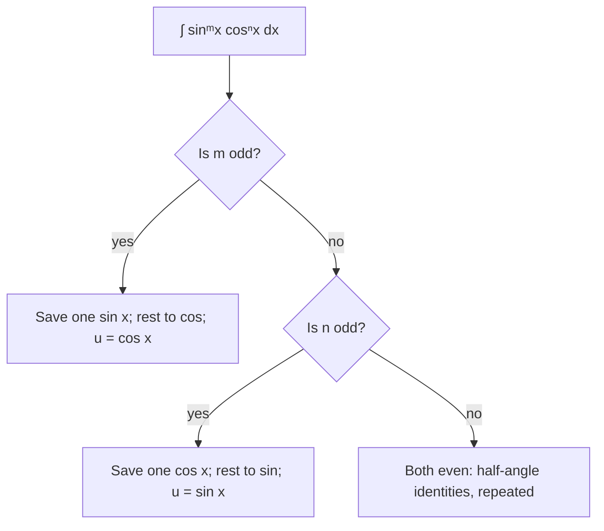

## Two uses of trig identities

This lesson has two halves that work as a pair. First, integrals of powers of trig functions, like $\int\sin^3x\cos^2x\,dx$, which yield to identities plus substitution. Second, trigonometric substitution, which turns algebraic integrals containing $\sqrt{a^2 - x^2}$, $\sqrt{a^2 + x^2}$ or $\sqrt{x^2 - a^2}$ into trig integrals of the first kind. Both are college Calculus II topics.

The identities you need:

$$\sin^2x + \cos^2x = 1, \qquad 1 + \tan^2x = \sec^2x,$$
$$\sin^2x = \frac{1 - \cos2x}{2}, \qquad \cos^2x = \frac{1 + \cos2x}{2}.$$

The last two are the **half-angle identities** (power-reduction formulas).

## Powers of sine and cosine: $\int\sin^mx\cos^nx\,dx$

The idea: save one factor to be part of $du$, and convert everything else with $\sin^2 + \cos^2 = 1$.

| Case | Strategy | Substitution |
|---|---|---|
| power of $\sin$ odd | save one $\sin x$, convert the rest to $\cos$ | $u = \cos x$ |
| power of $\cos$ odd | save one $\cos x$, convert the rest to $\sin$ | $u = \sin x$ |
| both even | half-angle identities to lower the powers | |

The same decision as a chart (when both powers are odd, either branch works):



### Example 1

Find $\displaystyle\int\sin^3x\cos^2x\,dx$.

The sine power is odd. Save one $\sin x$ and write $\sin^2x = 1 - \cos^2x$:
$$\int(1 - \cos^2x)\cos^2x\,\sin x\,dx.$$
Let $u = \cos x$, $du = -\sin x\,dx$:
$$-\int(1 - u^2)u^2\,du = -\frac{u^3}{3} + \frac{u^5}{5} + C = \mathbf{-\frac{\cos^3x}{3} + \frac{\cos^5x}{5} + C}.$$

### Example 2

Find $\displaystyle\int\cos^2x\,dx$ and $\displaystyle\int_0^\pi\sin^2x\,dx$.

Both powers even, so use half-angle identities:
$$\int\cos^2x\,dx = \int\frac{1 + \cos2x}{2}\,dx = \frac x2 + \frac{\sin2x}{4} + C.$$
$$\int_0^\pi\sin^2x\,dx = \int_0^\pi\frac{1 - \cos2x}{2}\,dx = \left[\frac x2 - \frac{\sin2x}{4}\right]_0^\pi = \frac\pi2.$$
A useful fact: over a full period, $\sin^2$ and $\cos^2$ each average $\frac12$.

## Powers of tangent and secant

Use $\frac{d}{dx}\tan x = \sec^2x$ and $\frac{d}{dx}\sec x = \sec x\tan x$, with $\tan^2 = \sec^2 - 1$:

- **even power of $\sec$**: save $\sec^2x$, convert the rest to $\tan$, let $u = \tan x$;
- **odd power of $\tan$** (with some $\sec$): save $\sec x\tan x$, convert the rest to $\sec$, let $u = \sec x$.

### Example 3

Find $\displaystyle\int\tan^2x\sec^4x\,dx$.

Save $\sec^2x$; write $\sec^2x = 1 + \tan^2x$:
$$\int\tan^2x(1 + \tan^2x)\sec^2x\,dx = \int(u^2 + u^4)\,du = \frac{\tan^3x}{3} + \frac{\tan^5x}{5} + C.$$

Two results worth knowing (the second via $\sec x\cdot\frac{\sec x + \tan x}{\sec x + \tan x}$): $\int\tan x\,dx = \ln|\sec x| + C$ and $\int\sec x\,dx = \ln|\sec x + \tan x| + C$.

## Trigonometric substitution

An expression like $\sqrt{a^2 - x^2}$ is the side of a right triangle with hypotenuse $a$. Substituting $x = a\sin\theta$ turns it into $\sqrt{a^2 - a^2\sin^2\theta} = a\cos\theta$, and the root disappears.

| Expression | Substitute | Identity used | Becomes |
|---|---|---|---|
| $\sqrt{a^2 - x^2}$ | $x = a\sin\theta$ | $1 - \sin^2 = \cos^2$ | $a\cos\theta$ |
| $\sqrt{a^2 + x^2}$ | $x = a\tan\theta$ | $1 + \tan^2 = \sec^2$ | $a\sec\theta$ |
| $\sqrt{x^2 - a^2}$ | $x = a\sec\theta$ | $\sec^2 - 1 = \tan^2$ | $a\tan\theta$ |

After integrating in $\theta$, convert back to $x$ with a reference triangle.

Each substitution comes with its own reference triangle. Label it from the substitution itself: $\sin\theta = \frac xa$ puts $x$ opposite and $a$ on the hypotenuse; $\tan\theta = \frac xa$ puts $x$ opposite and $a$ adjacent; $\sec\theta = \frac xa$ puts $x$ on the hypotenuse and $a$ adjacent. The Pythagorean theorem gives the third side, and it is always the root you started with.


### Example 4

Find $\displaystyle\int\frac{dx}{x^2\sqrt{9 - x^2}}$.

$\sqrt{9 - x^2}$: let $x = 3\sin\theta$, $dx = 3\cos\theta\,d\theta$, $\sqrt{9 - x^2} = 3\cos\theta$.
$$\int\frac{3\cos\theta\,d\theta}{9\sin^2\theta\cdot3\cos\theta} = \frac19\int\csc^2\theta\,d\theta = -\frac19\cot\theta + C.$$

Back to $x$: $\sin\theta = \frac x3$, so draw a right triangle with opposite side $x$, hypotenuse 3, adjacent side $\sqrt{9 - x^2}$. Then $\cot\theta = \frac{\sqrt{9 - x^2}}{x}$:
$$\int\frac{dx}{x^2\sqrt{9 - x^2}} = \mathbf{-\frac{\sqrt{9 - x^2}}{9x} + C}.$$

```shape
{"polygons": [{"points": [[0, 0], [2.2361, 0], [2.2361, 2]]}], "rightAngles": [[[2.2361, 0], [0, 0], [2.2361, 2]]], "segments": [{"from": [0, 0], "to": [2.2361, 2], "label": "3"}, {"from": [2.2361, 0], "to": [2.2361, 2], "label": "x"}, {"from": [0, 0], "to": [2.2361, 0], "label": "√(9 − x²)"}], "labels": [{"at": [0.55, 0.15], "text": "θ"}], "caption": "Reference triangle for x = 3 sin θ"}
```

### Example 5 (a definite integral: area of a circle)

Show that $\displaystyle\int_{-r}^{r}\sqrt{r^2 - x^2}\,dx = \frac{\pi r^2}{2}$.

Let $x = r\sin\theta$; when $x = \pm r$, $\theta = \pm\frac\pi2$. The integral becomes
$$\int_{-\pi/2}^{\pi/2}r\cos\theta\cdot r\cos\theta\,d\theta = r^2\int_{-\pi/2}^{\pi/2}\cos^2\theta\,d\theta = r^2\cdot\frac\pi2.$$
With definite integrals, change the limits to $\theta$ and you never need the triangle.

### Example 6

Find $\displaystyle\int\frac{dx}{\sqrt{x^2 + 4}}$.

$x = 2\tan\theta$, $dx = 2\sec^2\theta\,d\theta$, $\sqrt{x^2 + 4} = 2\sec\theta$:
$$\int\frac{2\sec^2\theta}{2\sec\theta}\,d\theta = \int\sec\theta\,d\theta = \ln|\sec\theta + \tan\theta| + C.$$
From the triangle ($\tan\theta = \frac x2$, hypotenuse $\sqrt{x^2 + 4}$): $\ln\left|\frac{\sqrt{x^2 + 4} + x}{2}\right| + C$, which is $\ln\left(x + \sqrt{x^2 + 4}\right) + C'$ after absorbing $-\ln2$ into the constant. (Lesson 36 shows that $\ln\frac{x + \sqrt{x^2 + 4}}{2}$ is the inverse hyperbolic sine $\sinh^{-1}\frac x2$, a shortcut for integrals of this shape.)

*Check before substituting.* If the integrand has an $x$ that matches the derivative of the inside, ordinary substitution is faster: $\int\frac{x\,dx}{\sqrt{9 - x^2}} = -\sqrt{9 - x^2} + C$ with $u = 9 - x^2$.

### Example 7

Find $\displaystyle\int\sin^2x\cos^2x\,dx$.

Both powers are even. Use $\sin x\cos x = \frac12\sin2x$ first, then a half-angle identity:
$$\int\frac14\sin^22x\,dx = \frac14\int\frac{1 - \cos4x}{2}\,dx = \frac{x}{8} - \frac{\sin4x}{32} + C.$$

### Example 8

Find $\displaystyle\int\tan^3x\sec x\,dx$.

The tangent power is odd: save $\sec x\tan x$ and write $\tan^2x = \sec^2x - 1$. With $u = \sec x$, $du = \sec x\tan x\,dx$:
$$\int(\sec^2x - 1)\sec x\tan x\,dx = \int(u^2 - 1)\,du = \frac{\sec^3x}{3} - \sec x + C.$$

## Common mistakes

- *Odd/even confusion.* Save a factor from the *odd* power.
- **Forgetting $dx$** when substituting: $x = 3\sin\theta$ means $dx = 3\cos\theta\,d\theta$.
- **Leaving the answer in $\theta$** for an indefinite integral.
- **Using trig substitution when $u$-substitution works.**
- *Half-angle errors:* $\sin^2x = \frac{1 - \cos2x}{2}$ (minus), $\cos^2x = \frac{1 + \cos 2x}{2}$ (plus).

## Key points

- $\sin^m\cos^n$: odd power → save one factor and substitute; both even → half-angle identities.
- $\tan^m\sec^n$: even $\sec$ power → $u = \tan x$; odd $\tan$ power → $u = \sec x$.
- $\sqrt{a^2 - x^2}$: $x = a\sin\theta$; $\sqrt{a^2 + x^2}$: $x = a\tan\theta$; $\sqrt{x^2 - a^2}$: $x = a\sec\theta$.
- Convert back with a reference triangle, or change limits for definite integrals.
