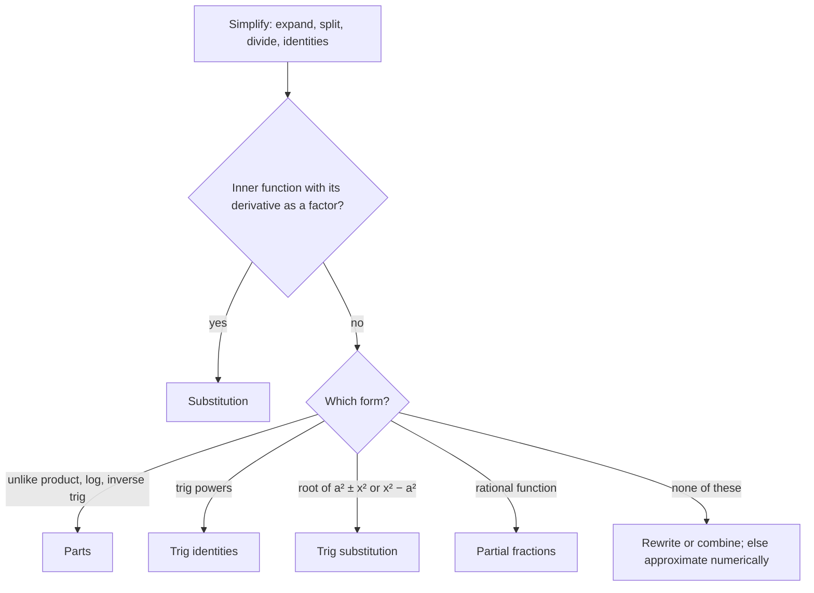

## When to use which technique

You now have four main techniques: substitution, parts, trig methods and partial fractions. Real integrals don't come labeled. This lesson gives a strategy for choosing, notes the role of tables and software, and then handles the integrals that no technique can do, by approximating them numerically.

## A strategy

1. *Simplify first.* Expand products, split fractions, divide polynomials, use identities. $\int\frac{x + 1}{\sqrt x}dx$ is just $\int(x^{1/2} + x^{-1/2})dx$.
2. *Look for a substitution:* an inner function whose derivative appears as a factor.
3. *Classify by form:*
   - product of unlike types (polynomial × exp/trig, anything × log or inverse trig) → **parts**;
   - powers of trig functions → *trig identities*;
   - $\sqrt{a^2 \pm x^2}$ or $\sqrt{x^2 - a^2}$ without a matching $x$ outside → **trig substitution**;
   - rational function → **partial fractions** (after long division).
4. *Try again.* Combine methods (substitute, then parts), multiply by a clever form of 1, or rewrite. Many integrals need two steps.

As a chart:



### Example 1

Classify each:

| Integral | Method |
|---|---|
| $\int x\sqrt{x^2 + 4}\,dx$ | substitution $u = x^2 + 4$ |
| $\int\sqrt{x^2 + 4}\,dx$ | trig substitution $x = 2\tan\theta$ |
| $\int\frac{x + 4}{x^2 + 4x}\,dx$ | looks like partial fractions, but simplify first |
| $\int x^3e^{x^2}\,dx$ | substitution $w = x^2$, then parts |
| $\int\sin^4x\,dx$ | half-angle identities twice |

That third row is a reminder: $\frac{x + 4}{x(x + 4)} = \frac1x$ (for $x \ne -4$), so the integral is $\ln|x| + C$. Always simplify before reaching for heavy machinery.

## Tables and computer algebra

Integral tables list hundreds of forms, and computer algebra systems find antiderivatives symbolically. To use a table you still need the skills of this module: rewriting an integral (often with a substitution) to match a listed form. The reference sheet for this course has the most common entries.

## Some integrals have no elementary antiderivative

$\int e^{-x^2}\,dx$, $\int\frac{\sin x}{x}\,dx$, $\int\sqrt{1 + x^3}\,dx$ and $\int\sqrt{1 + \cos^2x}\,dx$ have antiderivatives (FTC 1 guarantees it), but none can be written with the usual functions. That's a theorem, not a failure of cleverness. For definite integrals of these (and for integrals of data from a table), we approximate.

## Numerical integration

Divide $[a, b]$ into $n$ subintervals of width $\Delta x = \frac{b - a}{n}$, with points $x_0 = a, x_1, \dots, x_n = b$.

**Midpoint rule** (Lesson 22): rectangles with height at each midpoint $\bar x_i$:
$$M_n = \Delta x\left[f(\bar x_1) + f(\bar x_2) + \dots + f(\bar x_n)\right].$$

**Trapezoidal rule**: replace the curve on each subinterval by the straight segment joining its endpoints. The trapezoid on $[x_{i-1}, x_i]$ has area $\frac{\Delta x}{2}[f(x_{i-1}) + f(x_i)]$. Adding, interior points are counted twice:

$$T_n = \frac{\Delta x}{2}\left[f(x_0) + 2f(x_1) + 2f(x_2) + \dots + 2f(x_{n-1}) + f(x_n)\right].$$

$T_n$ is also the average of the left and right Riemann sums.

```plot
{"x": [-0.2, 2.2], "y": [-0.2, 1.2], "functions": [{"f": "e^(-x^2)"}], "polygons": [{"points": [[0, 0], [0, 1], [0.5, 0.7788], [0.5, 0]]}, {"points": [[0.5, 0], [0.5, 0.7788], [1, 0.3679], [1, 0]]}, {"points": [[1, 0], [1, 0.3679], [1.5, 0.1054], [1.5, 0]]}, {"points": [[1.5, 0], [1.5, 0.1054], [2, 0.0183], [2, 0]]}], "caption": "Trapezoidal rule T₄ for e^(−x²) on [0, 2]"}
```

**Simpson's rule** ($n$ even): replace the curve on each *pair* of subintervals by the parabola through three points. The weights come out as $1, 4, 2, 4, 2, \dots, 4, 1$:

$$S_n = \frac{\Delta x}{3}\left[f(x_0) + 4f(x_1) + 2f(x_2) + 4f(x_3) + \dots + 2f(x_{n-2}) + 4f(x_{n-1}) + f(x_n)\right].$$

Simpson's rule is exact for polynomials up to degree 3, and usually far more accurate than the others for the same $n$. It's also a weighted average: $S_{2n} = \frac{2M_n + T_n}{3}$.

### Example 2

Approximate $\displaystyle\int_0^2 e^{-x^2}\,dx$ with $n = 4$ using the trapezoidal rule and Simpson's rule.

$\Delta x = 0.5$. Values: $f(0) = 1$, $f(0.5) = 0.778801$, $f(1) = 0.367879$, $f(1.5) = 0.105399$, $f(2) = 0.018316$.

- $T_4 = \frac{0.5}{2}\left[1 + 2(0.778801) + 2(0.367879) + 2(0.105399) + 0.018316\right] = 0.25(3.522474) = \mathbf{0.880619}$.
- $S_4 = \frac{0.5}{3}\left[1 + 4(0.778801) + 2(0.367879) + 4(0.105399) + 0.018316\right] = \frac{0.5}{3}(5.290874) = \mathbf{0.881812}$.

The true value is $0.882081$. Simpson's error is about 0.0003; the trapezoid's about 0.0015.

## Over or under? Concavity decides

- If $f$ is **concave up**, chords lie above the curve, so $T_n$ *overestimates* and $M_n$ underestimates.
- If $f$ is **concave down**, $T_n$ underestimates and $M_n$ overestimates.

For a concave-up function, $M_n < \int_a^b f < T_n$, which brackets the true value.

The picture shows why, on a single subinterval of $f(x) = \frac12x^2 + 1$ over $[0, 2]$ (true area $\frac{10}{3} \approx 3.33$). The chord of the trapezoid lies above the concave-up curve, so $T_1 = 4$ is too big. The midpoint rectangle's top is a horizontal line through $(1, 1.5)$; tilting it to the tangent line there doesn't change its area, and the tangent lies below the curve, so $M_1 = 3$ is too small.

```plot
{"x": [-0.3, 2.5], "y": [0, 3.5], "functions": [{"f": "0.5x^2 + 1", "from": 0, "to": 2, "label": "y = ½x² + 1"}], "polygons": [{"points": [[0, 0], [0, 1], [2, 3], [2, 0]]}, {"points": [[0, 0], [0, 1.5], [2, 1.5], [2, 0]]}], "tangents": [{"f": "0.5x^2 + 1", "at": 1}], "points": [{"at": [1, 1.5]}], "labels": [{"at": [1.3, 1.25], "text": "midpoint"}], "caption": "Concave up: the trapezoid (top edge from (0, 1) to (2, 3)) has area 4, above the true 10/3; the midpoint rectangle (height 1.5) has area 3, below it"}
```

## Error bounds

If $|f''(x)| \le K$ on $[a, b]$:
$$|E_T| \le \frac{K(b - a)^3}{12n^2}, \qquad |E_M| \le \frac{K(b - a)^3}{24n^2}.$$
If $|f^{(4)}(x)| \le K$ on $[a, b]$:
$$|E_S| \le \frac{K(b - a)^5}{180n^4}.$$

Doubling $n$ cuts the trapezoid/midpoint error by about 4 and Simpson's error by about 16.

### Example 3

How large must $n$ be for the trapezoidal rule to approximate $\int_1^2\frac1x\,dx$ within $0.0001$?

$f'' = \frac{2}{x^3} \le 2$ on $[1, 2]$, so $K = 2$. Need $\frac{2(1)^3}{12n^2} \le 0.0001$, i.e. $n^2 \ge \frac{2}{0.0012} \approx 1666.7$, so $n \ge 40.8$. Take $n = 41$.

## Common mistakes

- **Using Simpson's rule with odd $n$.** It pairs subintervals, so $n$ must be even.
- *Wrong weights.* Trapezoid: $1, 2, 2, \dots, 2, 1$ times $\frac{\Delta x}{2}$. Simpson: $1, 4, 2, 4, \dots, 4, 1$ times $\frac{\Delta x}{3}$.
- *Counting points instead of subintervals.* $n = 4$ subintervals means 5 points.
- *Reaching for a technique before simplifying.*
- *Unequal subintervals from a table.* If the data spacing varies, add individual trapezoids instead of using the formula.

## Key points

- Strategy: simplify, try substitution, classify by form, combine.
- Trapezoid: $\frac{\Delta x}{2}[f_0 + 2f_1 + \dots + 2f_{n-1} + f_n]$; Simpson: $\frac{\Delta x}{3}[f_0 + 4f_1 + 2f_2 + \dots + 4f_{n-1} + f_n]$.
- Concave up: trapezoid over, midpoint under.
- Errors shrink like $\frac{1}{n^2}$ (trapezoid, midpoint) and $\frac{1}{n^4}$ (Simpson).
