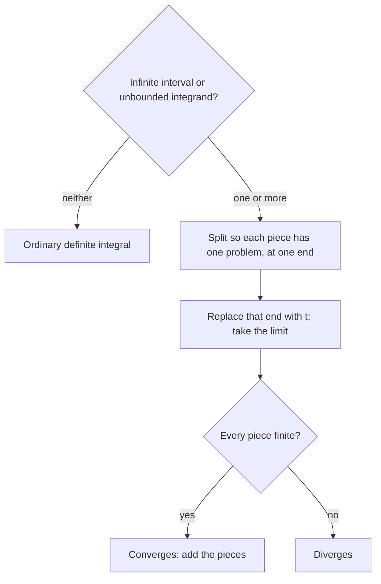

## Infinite regions with finite area

Can a region that stretches out forever have finite area? The definite integral as defined so far needs a finite interval and a bounded function. **Improper integrals** relax both conditions, using limits. They appear in probability (the normal distribution's total area is 1), in physics (escape velocity, the energy to move a charge "to infinity"), and as a test for infinite series (Lesson 41). This is BC and Calculus II material.

## Type 1: infinite intervals

Define

$$\int_a^\infty f(x)\,dx = \lim_{t\to\infty}\int_a^t f(x)\,dx, \qquad \int_{-\infty}^b f(x)\,dx = \lim_{t\to-\infty}\int_t^b f(x)\,dx.$$

If the limit exists (as a finite number), the integral **converges**; otherwise it **diverges**. For an integral over $(-\infty, \infty)$, split at any point $c$; it converges only if both halves converge:
$$\int_{-\infty}^\infty f\,dx = \int_{-\infty}^c f\,dx + \int_c^\infty f\,dx.$$

### Example 1

Evaluate $\displaystyle\int_1^\infty\frac{1}{x^2}\,dx$ and $\displaystyle\int_1^\infty\frac1x\,dx$.

- $\displaystyle\int_1^t\frac{dx}{x^2} = \left[-\frac1x\right]_1^t = 1 - \frac1t \to 1$. **Converges to 1.**
- $\displaystyle\int_1^t\frac{dx}{x} = \ln t \to \infty$. **Diverges.**

```plot
{"x": [0, 8], "y": [-0.1, 1.5], "functions": [{"f": "1/x", "from": 0.6, "dashed": true, "label": "1/x"}, {"f": "1/x^2", "from": 0.8, "label": "1/x²"}], "shade": [{"f": "1/x^2", "from": 1, "to": 8}], "caption": "The tail of 1/x² has area 1; the tail of 1/x has infinite area"}
```

The two curves look alike, but $\frac{1}{x^2}$ falls off fast enough for the area to add up to something finite, and $\frac1x$ doesn't.

## The p-integrals

That example generalizes, and the result is used constantly:

$$\int_1^\infty\frac{dx}{x^p} \quad\begin{cases}\text{converges to } \dfrac{1}{p - 1} & \text{if } p > 1,\\[4pt] \text{diverges} & \text{if } p \le 1.\end{cases}$$

(For $p \ne 1$, $\int_1^t x^{-p}dx = \frac{t^{1-p} - 1}{1 - p}$, and $t^{1-p}\to 0$ exactly when $p > 1$.)

### Example 2

Evaluate $\displaystyle\int_0^\infty e^{-3x}\,dx$ and $\displaystyle\int_{-\infty}^\infty\frac{dx}{1 + x^2}$.

- $\displaystyle\lim_{t\to\infty}\left[-\tfrac13e^{-3x}\right]_0^t = \lim\left(\tfrac13 - \tfrac13e^{-3t}\right) = \mathbf{\tfrac13}$.
- Split at 0: $\displaystyle\int_0^\infty\frac{dx}{1 + x^2} = \lim_{t\to\infty}\arctan t = \frac\pi2$, and the left half is also $\frac\pi2$ by symmetry. Total: $\mathbf{\pi}$.

## Type 2: discontinuous integrands

If $f$ blows up at an endpoint, define the integral as a one-sided limit. If $f$ is continuous on $(a, b]$ but unbounded near $a$:

$$\int_a^b f(x)\,dx = \lim_{t\to a^+}\int_t^b f(x)\,dx.$$

Similarly at $b$ (use $t\to b^-$). If the bad point $c$ is *inside* $[a, b]$, split there; both pieces must converge.

Both types follow the same plan:



### Example 3

Evaluate $\displaystyle\int_0^1\frac{dx}{\sqrt x}$.

$\frac{1}{\sqrt x}$ blows up at 0. $\displaystyle\lim_{t\to0^+}\Big[2\sqrt x\Big]_t^1 = \lim(2 - 2\sqrt t) = \mathbf 2$. Converges, even though the region is infinitely tall.

```plot
{"x": [-0.1, 1.5], "y": [0, 6], "functions": [{"f": "1/sqrt(x)", "from": 0.02, "to": 1.5, "label": "y = 1/√x"}], "shade": [{"f": "1/sqrt(x)", "from": 0.028, "to": 1}], "caption": "The region under y = 1/√x from 0 to 1 is infinitely tall near x = 0 but has area 2"}
```

The p-integrals on $[0, 1]$ behave the opposite way: $\displaystyle\int_0^1\frac{dx}{x^p}$ converges (to $\frac{1}{1 - p}$) if $p < 1$ and diverges if $p \ge 1$.

### Example 4 (a hidden discontinuity)

Evaluate $\displaystyle\int_{-1}^{2}\frac{dx}{x^2}$.

The integrand blows up at $x = 0$, inside the interval. Split: $\int_{-1}^0\frac{dx}{x^2} + \int_0^2\frac{dx}{x^2}$. The second piece is $\lim_{t\to0^+}\left[-\frac1x\right]_t^2 = \lim\left(-\frac12 + \frac1t\right) = \infty$. So the integral **diverges**.

Applying FTC 2 blindly gives $\left[-\frac1x\right]_{-1}^2 = -\frac12 - 1 = -\frac32$, a negative answer for a positive integrand: a sure sign something went wrong. Always scan the interval for discontinuities.

## Comparison test for improper integrals

Often you only need to know *whether* an integral converges. Compare with a known one.

**Comparison test.** Suppose $0 \le f(x) \le g(x)$ for $x \ge a$.
- If $\int_a^\infty g\,dx$ converges, so does $\int_a^\infty f\,dx$ (smaller than something finite).
- If $\int_a^\infty f\,dx$ diverges, so does $\int_a^\infty g\,dx$ (bigger than something infinite).

### Example 5

Does $\displaystyle\int_1^\infty\frac{dx}{x^3 + 5}$ converge? Does $\displaystyle\int_2^\infty\frac{dx}{\ln x}$?

- $\frac{1}{x^3 + 5} < \frac{1}{x^3}$, and $\int_1^\infty\frac{dx}{x^3}$ converges ($p = 3$). So it **converges**.
- For $x \ge 2$, $\ln x < x$, so $\frac{1}{\ln x} > \frac1x$, and $\int_2^\infty\frac{dx}{x}$ diverges. So it **diverges**.

The comparison has to point the right way: being smaller than a divergent integral proves nothing.

### Example 6

Does $\displaystyle\int_0^\infty e^{-x^2}\,dx$ converge?

For $x \ge 1$, $x^2 \ge x$, so $e^{-x^2} \le e^{-x}$, and $\int_1^\infty e^{-x}dx = e^{-1}$ converges. The piece on $[0, 1]$ is an ordinary integral. So it converges. (Its value turns out to be $\frac{\sqrt\pi}{2}$, which takes a multivariable trick to prove.)

### Example 7 (two more)

Evaluate $\displaystyle\int_e^\infty\frac{dx}{x(\ln x)^2}$ and $\displaystyle\int_0^1\ln x\,dx$.

- Substitute $u = \ln x$: $\displaystyle\lim_{t\to\infty}\left[-\frac{1}{\ln x}\right]_e^t = \lim_{t\to\infty}\left(-\frac{1}{\ln t} + 1\right) = \mathbf 1$. Converges.
- $\ln x \to -\infty$ as $x \to 0^+$, so this is Type 2. With $\int\ln x\,dx = x\ln x - x$: $\displaystyle\lim_{t\to0^+}\Big[x\ln x - x\Big]_t^1 = (0 - 1) - \lim_{t\to0^+}(t\ln t - t) = -1 - 0 = \mathbf{-1}$, using $t\ln t \to 0$ (Lesson 16).

The second answer is negative because $\ln x < 0$ on $(0, 1)$: the region lies below the axis, and its (finite) area is 1.

### Example 8 (comparison for Type 2)

Does $\displaystyle\int_0^1\frac{dx}{x^2 + \sqrt x}$ converge?

The integrand blows up at 0. For $0 < x \le 1$, $x^2 + \sqrt x \ge \sqrt x$, so $\dfrac{1}{x^2 + \sqrt x} \le \dfrac{1}{\sqrt x}$, and $\int_0^1\frac{dx}{\sqrt x} = 2$ converges ($p = \frac12 < 1$). By comparison, the integral **converges** (to some value below 2).

## Common mistakes

- **Treating $\infty$ as a number.** Write the limit; don't "plug in infinity."
- *Missing an interior discontinuity* (Example 4).
- **Splitting $\int_{-\infty}^\infty$ as one symmetric limit.** $\lim_{t\to\infty}\int_{-t}^t x\,dx = 0$, yet $\int_{-\infty}^\infty x\,dx$ diverges, because each half diverges.
- *Mixing up the p-integral conditions.* On $[1, \infty)$ you need $p > 1$; on $(0, 1]$ you need $p < 1$.
- *Comparison in the wrong direction.*

## Key points

- Infinite interval or unbounded integrand: replace with a limit of ordinary integrals.
- Converges if the limit is finite; diverges otherwise. Split at interior bad points and at a finite point for $(-\infty, \infty)$.
- $\int_1^\infty x^{-p}dx$ converges iff $p > 1$; $\int_0^1x^{-p}dx$ converges iff $p < 1$.
- Comparison: below a convergent integral converges; above a divergent one diverges.
