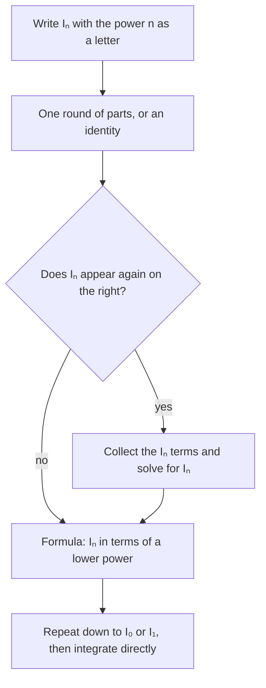

In Lesson 31, $\int x^2\sin x\,dx$ took two rounds of integration by parts, and $\int x^n e^x\,dx$ takes $n$ rounds. In Lesson 32, $\int\sin^4x\,dx$ needed the half-angle identity twice, and $\int\sin^{10}x\,dx$ would need it again and again. Doing the same step over and over is a sign that one step should be done *once, in general*. This lesson does that. The result is a **reduction formula**: an equation that expresses an integral with a power $n$ in terms of the same integral with a smaller power. Along the way, the formulas pay off with something unexpected: an infinite product for $\pi$ found by John Wallis in the 1650s.

## The idea: one round of parts, with $n$ left as a letter

Let $I_n = \int x^ne^x\,dx$ for $n = 0, 1, 2, \dots$ Integrate by parts once, exactly as in Lesson 31, but keep $n$ general: $u = x^n$, $dv = e^x\,dx$, so $du = nx^{n-1}\,dx$ and $v = e^x$. Then

$$I_n = x^ne^x - n\int x^{n-1}e^x\,dx = x^ne^x - nI_{n-1}.$$

The integral on the right is the same kind as the one on the left, one power lower. Applying the formula repeatedly walks the power down to $I_0 = \int e^x\,dx = e^x + C$, which needs no technique at all.

### Example 1

Find $\displaystyle\int x^3e^x\,dx$ with the reduction formula.

Start at the bottom and climb (constants of integration left off until the end):

- $I_0 = e^x$
- $I_1 = xe^x - 1\cdot I_0 = xe^x - e^x$
- $I_2 = x^2e^x - 2I_1 = x^2e^x - 2xe^x + 2e^x$
- $I_3 = x^3e^x - 3I_2 = x^3e^x - 3x^2e^x + 6xe^x - 6e^x$

So $\displaystyle\int x^3e^x\,dx = \mathbf{e^x(x^3 - 3x^2 + 6x - 6) + C}$. The coefficients $1, -3, 6, -6$ are $\frac{3!}{3!}, \frac{3!}{2!}, \frac{3!}{1!}, \frac{3!}{0!}$ with alternating signs, the same numbers the tabular method of Lesson 31 produces. Check by differentiating: the product rule gives $e^x(x^3 - 3x^2 + 6x - 6) + e^x(3x^2 - 6x + 6) = x^3e^x$. ✓

## Powers of sine: the integral comes back

Now let $I_n = \int\sin^nx\,dx$ with $n \ge 2$. Split off one factor: $u = \sin^{n-1}x$ and $dv = \sin x\,dx$. Then $du = (n - 1)\sin^{n-2}x\cos x\,dx$ and $v = -\cos x$, so

$$I_n = -\sin^{n-1}x\cos x + (n - 1)\int\sin^{n-2}x\cos^2x\,dx.$$

Replace $\cos^2x$ by $1 - \sin^2x$. The new integral splits into $I_{n-2} - I_n$, so the original integral reappears, just as $\int e^x\cos x\,dx$ did in Lesson 31:

$$I_n = -\sin^{n-1}x\cos x + (n - 1)I_{n-2} - (n - 1)I_n.$$

Move the $I_n$ terms together: $nI_n = -\sin^{n-1}x\cos x + (n - 1)I_{n-2}$. So

$$\int\sin^nx\,dx = -\frac{1}{n}\sin^{n-1}x\cos x + \frac{n - 1}{n}\int\sin^{n-2}x\,dx.$$

Each use lowers the power by 2, ending at $\int\sin^0x\,dx = x$ (if $n$ is even) or $\int\sin x\,dx = -\cos x$ (if $n$ is odd). Cosine has a twin formula, $\int\cos^nx\,dx = \frac1n\cos^{n-1}x\sin x + \frac{n - 1}{n}\int\cos^{n-2}x\,dx$, derived the same way.



## The Wallis integrals

On the interval $[0, \frac\pi2]$ the boundary term $\sin^{n-1}x\cos x$ is 0 at both ends ($\cos\frac\pi2 = 0$ and $\sin 0 = 0$). So the **Wallis integrals**

$$W_n = \int_0^{\pi/2}\sin^nx\,dx$$

obey the clean rule $W_n = \dfrac{n - 1}{n}W_{n-2}$, starting from $W_0 = \frac\pi2$ and $W_1 = 1$. Unwinding it:

$$W_{2k} = \frac{1\cdot3\cdot5\cdots(2k - 1)}{2\cdot4\cdot6\cdots(2k)}\cdot\frac\pi2, \qquad W_{2k+1} = \frac{2\cdot4\cdot6\cdots(2k)}{3\cdot5\cdot7\cdots(2k + 1)}.$$

Even powers bring a factor of $\pi$; odd powers give a rational number. The substitution $x \to \frac\pi2 - x$ swaps sine and cosine, so $\int_0^{\pi/2}\cos^nx\,dx = W_n$ too.

### Example 2

Evaluate $\displaystyle\int_0^{\pi/2}\sin^5x\,dx$ and $\displaystyle\int_0^{\pi/2}\cos^6x\,dx$.

- $W_5 = \frac45W_3 = \frac45\cdot\frac23W_1 = \frac45\cdot\frac23\cdot1 = \mathbf{\frac{8}{15}}$.
- $W_6 = \frac56\cdot\frac34\cdot\frac12\cdot\frac\pi2 = \frac{15}{48}\cdot\frac\pi2 = \mathbf{\frac{5\pi}{32}} \approx 0.4909$.

Compare the work with Lesson 32's methods: $\cos^6x$ would need the half-angle identity three times and a $\cos^32x$ term along the way. The reduction formula does it in one line.

```plot
{"x": [0, 1.7], "y": [0, 1.15], "functions": [{"f": "sin(x)", "from": 0, "to": 1.5708}, {"f": "sin(x)^2", "from": 0, "to": 1.5708}, {"f": "sin(x)^4", "from": 0, "to": 1.5708}, {"f": "sin(x)^8", "from": 0, "to": 1.5708}], "caption": "sinⁿx on [0, π/2] for n = 1, 2, 4, 8 (top curve to bottom curve): each higher power lies below the one before, so the areas Wₙ shrink as n grows"}
```

## Tangent: a formula without parts

Not every reduction formula needs parts. For $T_n = \int\tan^nx\,dx$, write $\tan^nx = \tan^{n-2}x(\sec^2x - 1)$. The first piece is a substitution with $u = \tan x$, $du = \sec^2x\,dx$:

$$\int\tan^nx\,dx = \frac{\tan^{n-1}x}{n - 1} - \int\tan^{n-2}x\,dx \qquad (n \ge 2).$$

### Example 3

Evaluate $\displaystyle\int_0^{\pi/4}\tan^4x\,dx$.

On $[0, \frac\pi4]$ the term $\frac{\tan^{n-1}x}{n - 1}$ is $\frac{1}{n - 1}$ at the top and 0 at the bottom, so the definite integrals obey $T_n = \frac{1}{n - 1} - T_{n-2}$, with $T_0 = \frac\pi4$.

- $T_2 = 1 - \frac\pi4$
- $T_4 = \frac13 - T_2 = \frac13 - 1 + \frac\pi4 = \mathbf{\frac\pi4 - \frac23} \approx 0.1187$

The answer is positive (as it must be, since $\tan^4x \ge 0$) and small, since $\tan^4x$ stays below 1 on the interval.

## The Wallis product for $\pi$

Here is the payoff. On $[0, \frac\pi2]$, $0 \le \sin x \le 1$, so raising to a higher power can only make the values smaller: $\sin^{2k+1}x \le \sin^{2k}x \le \sin^{2k-1}x$. Integrating keeps the inequalities:

$$W_{2k+1} \le W_{2k} \le W_{2k-1}.$$

Divide through by $W_{2k+1}$ and use the reduction rule $W_{2k+1} = \frac{2k}{2k + 1}W_{2k-1}$ on the right:

$$1 \le \frac{W_{2k}}{W_{2k+1}} \le \frac{W_{2k-1}}{W_{2k+1}} = \frac{2k + 1}{2k}.$$

The right side tends to 1, so by the squeeze theorem $\frac{W_{2k}}{W_{2k+1}} \to 1$. Now substitute the formulas for $W_{2k}$ and $W_{2k+1}$ and solve for $\frac\pi2$:

$$\frac{W_{2k}}{W_{2k+1}} = \frac\pi2\cdot\frac{1\cdot3\cdot3\cdot5\cdot5\cdots(2k - 1)(2k - 1)(2k + 1)}{2\cdot2\cdot4\cdot4\cdots(2k)(2k)} \to 1,$$

which says

$$\frac\pi2 = \lim_{k\to\infty}\frac21\cdot\frac23\cdot\frac43\cdot\frac45\cdot\frac65\cdot\frac67\cdots\frac{2k}{2k - 1}\cdot\frac{2k}{2k + 1}.$$

This is the **Wallis product**. Wallis published it in *Arithmetica Infinitorum* (1656). He reached it by a bold process of guessing and interpolating between patterns, without the integration by parts used here; the squeeze argument above is the standard modern proof.

### Example 4

How good are the partial products? Grouping the factors in pairs, $P_k = \prod_{j=1}^{k}\frac{(2j)^2}{(2j - 1)(2j + 1)} = \prod_{j=1}^{k}\frac{4j^2}{4j^2 - 1}$.

- $P_1 = \frac43 \approx 1.3333$, so $2P_1 \approx 2.667$.
- $P_2 = \frac43\cdot\frac{16}{15} = \frac{64}{45} \approx 1.4222$, so $2P_2 \approx 2.844$.
- $P_{10} \approx 1.5339$, so $2P_{10} \approx 3.068$.
- $P_{100} \approx 1.5669$, so $2P_{100} \approx 3.134$.

Every factor is bigger than 1, so the partial products increase toward $\frac\pi2 \approx 1.5708$, but slowly: after 100 pairs, $\frac\pi2 - P_{100} \approx 0.0039$, roughly $\frac{\pi}{8k}$ with $k = 100$. The product is a beautiful fact about $\pi$, not a practical way to compute it.

## A warning about running a recurrence forward

Reduction formulas for definite integrals are recurrences, and recurrences can magnify rounding errors. Take $J_n = \int_0^1x^ne^x\,dx$. The rule from the first section, with limits, gives $J_n = e - nJ_{n-1}$ and $J_0 = e - 1$. Every $J_n$ is positive and they decrease toward 0 (for $n \ge 1$, $\frac{1}{n + 1} < J_n < \frac{e}{n + 1}$). But each step multiplies whatever error $J_{n-1}$ carries by $n$, so a tiny rounding error in $J_0$ grows by about $n!$ by step $n$. In standard double-precision arithmetic (about 16 digits), running the recurrence forward gives $J_{15} \approx 0.16050$ when the true value is $0.16043$, and $J_{20} \approx -129$, a negative value for an integral of a positive function. The true $J_{20}$ is about $0.1238$.

The fix is to run the recurrence backward, $J_{n-1} = \frac{e - J_n}{n}$, which *divides* the error by $n$ at each step. Starting even from a rough guess for $J_{30}$ gives accurate values by the time you reach $J_{20}$. The exact formula is fine; the order of computation matters.

## Common mistakes

- *Forgetting the integral that comes back.* In the sine derivation, $\int\sin^{n-2}x\cos^2x\,dx$ is $I_{n-2} - I_n$, not just $I_{n-2}$. Dropping the $-I_n$ gives a wrong factor, $n - 1$ in place of $\frac{n - 1}{n}$.
- *Wrong starting values.* $W_0 = \frac\pi2$ (the integral of 1 over an interval of length $\frac\pi2$), not 0 or 1; $W_1 = 1$.
- *Mixing up the even and odd Wallis formulas.* Even powers end at $W_0$ and carry $\frac\pi2$; odd powers end at $W_1$ and are rational.
- *Using the Wallis shortcut on the wrong interval.* $W_n = \frac{n - 1}{n}W_{n-2}$ holds on $[0, \frac\pi2]$ because the boundary term vanishes there. On other intervals, evaluate $-\frac1n\sin^{n-1}x\cos x$ at the limits.
- *Trusting a forward recurrence blindly* when each step multiplies by a growing number.

## Key points

- A reduction formula writes $I_n$ in terms of $I_{n-1}$ or $I_{n-2}$; derive it with one general round of parts (or an identity) and, if $I_n$ comes back, solve for it.
- $\int x^ne^x\,dx = x^ne^x - n\int x^{n-1}e^x\,dx$; $\int\sin^nx\,dx = -\frac1n\sin^{n-1}x\cos x + \frac{n - 1}{n}\int\sin^{n-2}x\,dx$; $\int\tan^nx\,dx = \frac{\tan^{n-1}x}{n - 1} - \int\tan^{n-2}x\,dx$.
- Wallis integrals: $W_n = \frac{n - 1}{n}W_{n-2}$, $W_0 = \frac\pi2$, $W_1 = 1$; the same values hold for cosine.
- Squeezing $W_{2k+1} \le W_{2k} \le W_{2k-1}$ gives the Wallis product $\frac\pi2 = \frac21\cdot\frac23\cdot\frac43\cdot\frac45\cdots$, which converges slowly.
- Run a recurrence in the direction that shrinks errors.
