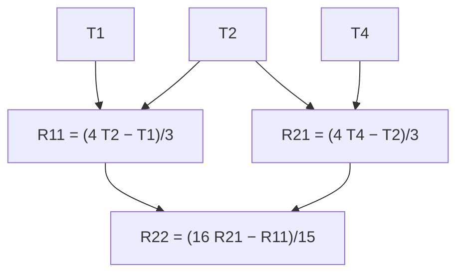

Lesson 34 ended with a pattern: doubling $n$ cuts the trapezoidal rule's error by about 4. That was presented as a fact about error *bounds*. This lesson takes it seriously as a fact about the error *itself*. If you know that the error of an approximation behaves like a constant times $h^2$, you can compute the approximation with two step sizes and combine them so that the $h^2$ errors cancel. That idea is **Richardson extrapolation**. Applied over and over to the trapezoidal rule, it becomes **Romberg integration**, which can reach many correct digits from a modest number of function values. It is also the honest way to see where Simpson's rule comes from.

## How the trapezoidal error really behaves

Write $h = \Delta x = \frac{b - a}{n}$ for the step size, $T(h)$ for the trapezoidal approximation, and $I$ for the exact integral. For a function with enough continuous derivatives, the **Euler–Maclaurin formula** gives the error as a series in even powers of $h$:

$$T(h) = I + \frac{h^2}{12}\big[f'(b) - f'(a)\big] - \frac{h^4}{720}\big[f'''(b) - f'''(a)\big] + \cdots$$

We state it without proof (the derivation belongs to a numerical analysis course), and the "$\cdots$" needs care: the series is an *asymptotic* one, accurate when $h$ is small, not a series to sum to infinity. Two things matter here. Only even powers appear, and the leading error is $c\,h^2$ with a constant $c$ that doesn't depend on $h$.

### Example 1

Test the formula on $\displaystyle\int_1^2\frac{dx}{x} = \ln 2 \approx 0.693147$.

Here $f'(x) = -\frac{1}{x^2}$, so $f'(2) - f'(1) = -\frac14 + 1 = \frac34$, and the leading error is $\frac{h^2}{12}\cdot\frac34 = \frac{h^2}{16}$.

| $n$ | $h$ | $T_n$ | actual error $T_n - \ln 2$ | predicted $\frac{h^2}{16}$ |
|---|---|---|---|---|
| 1 | 1 | 0.750000 | 0.056853 | 0.062500 |
| 2 | 0.5 | 0.708333 | 0.015186 | 0.015625 |
| 4 | 0.25 | 0.697024 | 0.003877 | 0.003906 |
| 8 | 0.125 | 0.694122 | 0.000975 | 0.000977 |

The prediction gets better as $h$ shrinks, and each halving of $h$ cuts the error by a factor close to 4. The errors are positive, as Lesson 34 predicts for a concave-up function.

## Richardson extrapolation: cancel the leading error

Suppose $T(h) \approx I + ch^2$ and $T(\frac h2) \approx I + c\frac{h^2}{4}$. Multiply the second by 4 and subtract the first: the $c$ terms cancel, leaving $4T(\frac h2) - T(h) \approx 3I$. So

$$I \approx \frac{4T(h/2) - T(h)}{3} = T(h/2) + \frac{T(h/2) - T(h)}{3}.$$

The second form shows what is happening: the change from $T(h)$ to $T(\frac h2)$ tells you how big the remaining error is, and you add a third of that change as a correction. The same reasoning works for any method whose error is $\approx ch^p$: halving $h$ multiplies the error by $\frac{1}{2^p}$, and

$$I \approx \frac{2^p A(h/2) - A(h)}{2^p - 1}.$$

### Example 2

Use $T_2 = 0.708333$ and $T_4 = 0.697024$ from Example 1.

$$\frac{4(0.697024) - 0.708333}{3} = \frac{2.079763}{3} \approx \mathbf{0.693254}.$$

The error drops from $0.0039$ (for $T_4$) to about $0.0001$, using no new function values.

**This is Simpson's rule.** With $n$ subintervals of width $2h$ and $2n$ of width $h$,

$$T_n = h\big[f_0 + 2f_2 + 2f_4 + \cdots + f_{2n}\big], \qquad T_{2n} = \frac h2\big[f_0 + 2f_1 + 2f_2 + \cdots + 2f_{2n-1} + f_{2n}\big],$$

so $4T_{2n} - T_n = h\big[f_0 + 4f_1 + 2f_2 + 4f_3 + \cdots + 4f_{2n-1} + f_{2n}\big]$. Dividing by 3 gives exactly $S_{2n}$, with its weights $1, 4, 2, 4, \dots, 4, 1$. Simpson's rule is Richardson extrapolation of the trapezoidal rule, which explains why its error falls like $h^4$: the $h^2$ term has been cancelled, and the next term in the Euler–Maclaurin series is $h^4$.

## Romberg integration: keep going

Simpson values have error $\approx c'h^4$. Apply Richardson again with $p = 4$: combine two Simpson values as $\frac{16S(h/2) - S(h)}{15}$, cancelling the $h^4$ term. Then $p = 6$ with factor 64, and so on. Organized as a triangle, this is Romberg's method:

- Column 0: $R_{k,0} = T_{2^k}$, the trapezoidal rule with $1, 2, 4, 8, \dots$ subintervals. Each new row reuses the old points and only adds the new midpoints.
- Column $j$: $R_{k,j} = R_{k,j-1} + \dfrac{R_{k,j-1} - R_{k-1,j-1}}{4^j - 1}$.

### Example 3

Build the Romberg table for $\displaystyle\int_0^1e^x\,dx = e - 1 \approx 1.7182818$ from $T_1, T_2, T_4, T_8$.

The trapezoid values: $T_1 = \frac12(1 + e) \approx 1.8591409$; $T_2 \approx 1.7539311$; $T_4 \approx 1.7272219$; $T_8 \approx 1.7205186$. Then (each entry computed from unrounded values and shown to seven decimals, so redoing a step from the rounded entries can change the last digit by 1):

| $k$ | $R_{k,0}$ (trapezoid) | $R_{k,1}$ (Simpson) | $R_{k,2}$ | $R_{k,3}$ |
|---|---|---|---|---|
| 0 | 1.8591409 | | | |
| 1 | 1.7539311 | 1.7188612 | | |
| 2 | 1.7272219 | 1.7183188 | 1.7182827 | |
| 3 | 1.7205186 | 1.7182842 | 1.7182818 | 1.7182818 |

For instance $R_{1,1} = 1.7539311 + \frac{1.7539311 - 1.8591409}{3} = 1.7188612$ and $R_{2,2} = 1.7183188 + \frac{1.7183188 - 1.7188612}{15} \approx 1.7182827$.

The best trapezoid value, $T_8$, is off by about $0.0022$. The corner of the table, built from the same nine function values, is off by less than $10^{-9}$. Each column to the right is far more accurate than the one before it.

## Extrapolation beyond integrals

Nothing in the Richardson step was about integrals. The central difference $D(h) = \frac{f(x + h) - f(x - h)}{2h}$ approximates $f'(x)$ with error $\approx ch^2$ (a Taylor series argument, Lesson 44, shows this).

### Example 4

Estimate the derivative of $e^x$ at $x = 0$ (exactly 1) from $D(0.2)$ and $D(0.1)$.

$D(0.2) = \frac{e^{0.2} - e^{-0.2}}{0.4} \approx 1.006680$ and $D(0.1) \approx 1.001668$. Extrapolate:

$$\frac{4(1.001668) - 1.006680}{3} \approx \mathbf{0.999997}.$$

The error falls from about $0.0017$ to about $0.000003$.

Lewis Fry Richardson used the idea in a 1911 paper on solving equations numerically and later called it "the deferred approach to the limit". Werner Romberg organized the repeated version for integrals in 1955. It still sits inside many numerical methods.

## When it doesn't help

Extrapolation is only as good as the error model behind it.

- **Rough integrands.** For $\int_0^1\sqrt x\,dx = \frac23$, $f'$ is unbounded at 0, so the Euler–Maclaurin series doesn't apply. The trapezoid errors shrink by a factor of less than 3 per halving instead of 4 (they behave like $h^{3/2}$, and $2^{3/2} \approx 2.8$), and the Romberg columns improve only slightly: with $T_1$ through $T_{16}$ the corner value is still off by about $0.001$. Splitting off the bad point, or a substitution such as $x = u^2$ that makes the integrand smooth, works better.
- **Step sizes that are too large.** The model is about small $h$. With very few subintervals, the higher-order terms can be as big as the leading one, and an extrapolated value can even come out worse.
- **A pleasant surprise.** For a smooth periodic function integrated over a whole period, every bracket $f^{(k)}(b) - f^{(k)}(a)$ in the series is 0. The plain trapezoidal rule is then already extremely accurate: for $\int_0^{2\pi}e^{\sin x}\,dx$, $T_8$ is off by about $10^{-6}$ and $T_{16}$ agrees with the true value to about 15 digits. Extrapolation has nothing left to cancel.

## Common mistakes

- *The wrong factor.* Trapezoid and midpoint errors go like $h^2$, so use $4$ and $3$; Simpson errors go like $h^4$, so use $16$ and $15$. In general $2^p$ and $2^p - 1$.
- *Subtracting in the wrong order.* The fine value gets the big weight: $\frac{4T_{2n} - T_n}{3}$, not $\frac{4T_n - T_{2n}}{3}$.
- *Halving $n$ instead of $h$.* Halving the step size means doubling the number of subintervals.
- *Treating the Euler–Maclaurin series as exact.* It is an asymptotic description of the error for small $h$ and smooth $f$, not a formula that always converges.
- *Extrapolating a rough integrand* and trusting all the digits.

## Key points

- For smooth $f$, $T(h) = I + c_2h^2 + c_4h^4 + \cdots$ (Euler–Maclaurin), with $c_2 = \frac{1}{12}[f'(b) - f'(a)]$.
- Richardson: if $A(h) \approx I + ch^p$, then $\frac{2^pA(h/2) - A(h)}{2^p - 1}$ cancels the $h^p$ term.
- $\frac{4T_{2n} - T_n}{3} = S_{2n}$: Simpson's rule is one Richardson step on the trapezoidal rule.
- Romberg: $R_{k,j} = R_{k,j-1} + \frac{R_{k,j-1} - R_{k-1,j-1}}{4^j - 1}$, starting from $T_1, T_2, T_4, \dots$
- It needs smoothness and small enough $h$; for smooth periodic functions over a full period, the trapezoidal rule alone is already excellent.
